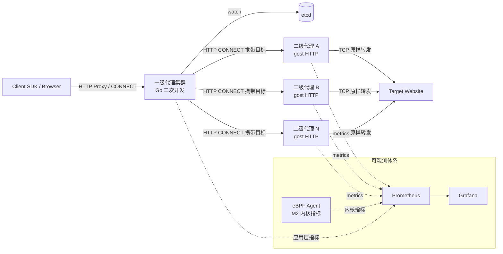
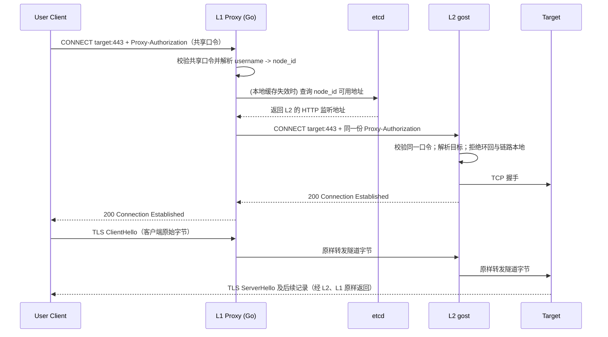
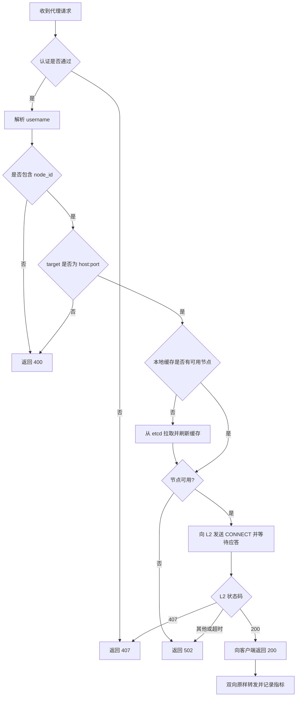
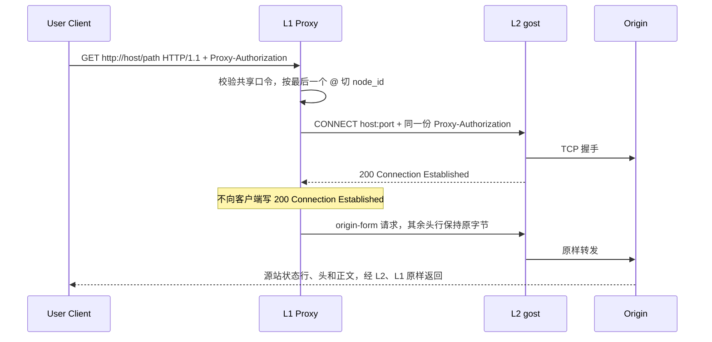

# OpenSpec 设计文档：多级高性能隧道代理（Pro 模式）

- **文档版本**：v0.6（HTTP 流程与链路安全）
- **日期**：2026-10-22
- **状态**：Draft / 可进入 PoC
- **目标**：参考商业隧道代理 Pro 模式，设计“一级代理 + 二级代理”多级转发系统，支持通过 `username` 指定二级节点、TLS 指纹透传、应用层与 eBPF 监控、etcd 自动服务发现。
- **v0.6 变更**：补上明文 HTTP（非 CONNECT）和 L1→L2 链路。明文 HTTP 由 L1 鉴权、按最后一个 `@` 切出 `node_id`，再向 gost 发一次 `CONNECT`，把 absolute-form 改成 origin-form 并删掉逐跳头，其余头行按原字节转发。不把 absolute-form 交给 gost 的 HTTP 转发：gost v3.3.1 会重排头、改大小写并注入 `User-Agent`。L1→L2 走内网，不加密、不做 mTLS；两端都不终结客户端 TLS。共享口令在内网明文传输写进 §12，作为已接受项，前提是内网隔离且 L2 只监听内网地址。§1.2、§2.1 与 §3 的 gost 示例与此对齐。§7、§8 未改。
- **v0.3 变更**：M1 PoC 的可观测改为 L1 应用层 Prometheus 指标。L1 用 `prometheus/client_golang` 暴露 `proxy_conn_active`、`proxy_connect_latency_ms`、`proxy_upstream_fail_total`，以及本地拒绝计数 `proxy_client_reject_total`。eBPF 只采集内核指标，移到 M2。两类来源和告警在 §7 分开。与 v0.2.1 的半关闭和 10s 应答等待合在同一份数据面上打点。`node_id` 失败关闭：只有 `Resolve` 返回 `ErrNoHealthyAddr` 时保留原来的 ID，其余解析错误记 `unknown`。
- **v0.2.1 变更**：修正 §10 的隧道拆除和 L2 应答等待。某一方向 `io.Copy` 返回错误（对端 RST 或写失败）时立刻完全关闭两端。干净 EOF 只 `CloseWrite`。反方向是空闲读超时而不是一次性截止：默认 30s（`halfCloseIdleTimeout`，可改），每次成功读到字节都重新计时，客户端先 FIN 和上游先 FIN 用同一套。整条隧道另有空闲兜底，默认 5 分钟（`tunnelIdleTimeout`，可改），任一方向有数据就重新计时；gost 的 `idleTimeout` 默认是 0，不靠它收尸。等待 L2 `200` 的默认上限是 10s，因为 gost 先拨通源站再应答。可观测性改版另记为 v0.3，本版不改 §7。
- **v0.2 变更**：补上 v0.1 的链路缺口。L1 用第二次 HTTP `CONNECT` 把目标 `host:port` 交给 L2；L2 定为 gost v3 的 HTTP 正向代理，不再使用 HAProxy / Envoy 的纯 TCP 模式。对比与理由见附录 A。
- **已确认**：v1 的 L2 就是 gost v3，3proxy 与锁死配置的 Envoy 只作为同接口替换项。出口拒绝范围只有环回和链路本地，不含 RFC1918。L1→L2 使用客户端登录 L1 的那一份共享口令，不轮换。

---

## 1. 背景与目标

### 1.1 背景
当前需要构建一个可替代商业 Pro 隧道代理能力的内部系统，满足以下核心诉求：

1. 支持 HTTP/HTTPS 隧道代理（重点 CONNECT）。
2. 初版通过认证用户名参数指定二级代理节点 ID。
3. 一级代理将流量转发到指定二级代理，再由二级代理访问目标站点。目标 `host:port` 由 L1 在第二次 `CONNECT` 中显式交给 L2。
4. 对目标网站的 TLS 指纹信息透传（不在一级/二级进行 TLS 中间人解密，也不重新生成 ClientHello）。
5. 可观测分两层：M1 由 L1 暴露应用层 Prometheus 指标（建连时延、活跃隧道、上游失败、本地拒绝）；M2 用 eBPF 采集内核网络与系统指标。
6. 二级节点采用开源高性能代理方案；一级节点基于开源方案二次开发。
7. 通过 etcd 实现二级节点自动注册、发现、健康感知。

### 1.2 非目标（初版）

- 不做 HTTPS MITM 解密与内容审计。
- 不做复杂计费系统（仅预留指标）。
- 不做跨地域智能调度（初版可基于静态策略 + etcd 健康状态）。
- etcd 注册进程的实现形态不在本文件决定。

本文件已经决定明文 HTTP（非 CONNECT）的处理方式：方案 B，见 §5.3–§5.6。L1↔L2 走内网明文，不加密、不做 mTLS，见 §6 和 §12 第 6 条。

---

## 2. 需求分解

### 2.1 功能需求

- 认证：支持 `BasicAuth`/`Proxy-Authorization`。全系统一份共享口令，不轮换。客户端用它登录 L1；L1 校验后把同一组用户名和密码写进发往 L2 的 `Proxy-Authorization`。用户名仍是 `user@node_id`，供 L1 选路。v1 接受由此带来的暴露面：任一 L2 都能看到这把钥匙，泄露后它对 L1 和全部 L2 继续有效，也不能按调用方吊销。
- 路由：从 `username` 解析二级节点 ID（如：`user@node-az01-003`），再从本地路由表得到该节点的 L2 监听地址。
- 转发：L1 向选中的 L2 发送 HTTP `CONNECT host:port`，L2 返回 `200` 后，双向原样转发隧道字节。
- 协议：支持 HTTP 请求代理 + HTTPS CONNECT 隧道。明文 HTTP（非 CONNECT）的处理方式已在本文件决定，采用方案 B：L1 鉴权并按最后一个 `@` 切出 `node_id` 后向 L2 发 `CONNECT`，把 absolute-form 改成 origin-form，其余头行按原字节转发，见 §5.3–§5.6。L1↔L2 走内网明文，不加密、不做 mTLS，见 §6 和 §12 第 6 条。
- 透传：TLS 握手报文、ALPN、SNI、JA3/JA4 特征在链路上不被篡改。`200` 之后只有 TCP 字节转发，没有 TLS 终结或重新握手。

### 2.2 非功能需求

- 高性能：单节点万级并发连接能力（视机器规格）。
- 高可用：一级无状态可水平扩展；二级可动态扩容缩容。
- 可观测：QPS、时延、成功率、连接生命周期、错误码分布。
- 可运维：etcd 自动发现，心跳 + TTL 下线。

---

## 3. 开源方案预研与对比

> 说明：以下为工程实践视角的预研建议，用于“一级二次开发 + 二级直接落地”的选型输入。完整对比表、TLS 结论与配置红线在附录 A。

### 3.1 候选组件

L1 与 L2 的职责不同，不能拿同一类软件硬套。

1. **一级（自研 Go）**
   - 要做终端用户认证，以及 `username -> node_id -> L2 地址` 的强制定向。
   - 要做的协议动作很小：向已选定的 L2 发一次 HTTP `CONNECT`，读到 `200` 后双向拷贝。
   - 这一跳的稳定接口是 HTTP `CONNECT`。L2 进程可以替换，L1 不用改。

2. **二级候选（动态正向代理，而不是固定后端的 L4 负载均衡）**
   - **gost v3**（v1 已确认）：HTTP handler 默认就是 `CONNECT` 之后双向转发。
   - **3proxy**：同一 CONNECT 接口下，C + Linux `splice`，连接密度更高。
   - **Envoy dynamic forward proxy**：能终止 `CONNECT` 并原始 TCP 转发，指标与热重启最好；安全配置与官方 HTTP 示例相反，容易配成重新发起 TLS。
   - **不采用 HAProxy / Nginx stream 的纯 TCP 模式**：它们只会把连接转到预先配置的后端，不能按 `CONNECT` 里的目标动态拨号；v0.1 那种裸 TCP 透传里也没有目标地址，L2 无法知道该连哪台源站。

### 3.2 推荐组合（初版）

- **一级代理（需二开）**：Go 自研网关（借鉴/嵌入高性能开源网络库能力，例如 `gnet`/`fasthttp`/标准库 netpoll 方案）。
- **L1→L2 目标传递**：第二次 HTTP `CONNECT`（代理链）。请求目标使用客户端原始 authority（`host:port`），DNS 在 L2 做。
- **二级代理（开箱即用）**：gost v3，`handler: http` + `listener: tcp`。关闭 sniffing、MITM 与压缩。这是 v1 的确定选择。
- **认证**：一份共享口令。L2 的 `auth.username` 写成客户端访问本节点时使用的用户名（含 `@node_id`），`auth.password` 与客户端登录 L1 的密码相同。L1 转发这同一组凭据。L2 只校验它，不从用户名里做选路。v1 每个 L2 节点只对应一个客户端用户名；若以后同一节点要接受多个用户名，需要把 `auth` 换成 gost 的多用户认证配置。
- **出口拒绝**：L2 在解析之后、拨号之前拒绝环回与链路本地。RFC1918 及其他私网地址本版放行，此范围以后可以再收紧。见附录 A.5。
- **服务发现**：etcd。注册地址是该实例的 HTTP `CONNECT` 监听地址。
- **监控**：M1 由 L1 暴露应用层 Prometheus 指标；M2 用 eBPF 采集内核指标。两者都进 Prometheus + Grafana。见 §7。
- **同接口替换项**（不改变 L1 的 CONNECT）：要更高连接密度用 3proxy；要 Envoy 级指标或 L1↔L2 的 HTTP/2 多路复用时，用锁死配置的 Envoy DFP。二者都不是 v1 的 L2。红线见附录 A.5，替换条件见附录 A.6。

gost 的配置形态：

```yaml
services:
  - name: l2
    addr: "10.x.x.x:8080"
    bypass: egress-deny
    handler:
      type: http
      auth:
        username: appuser@node-az01-003
        password: <shared-secret>
      metadata:
        sniffing: false
    listener:
      type: tcp
bypasses:
  - name: egress-deny
    matchers:
      - 127.0.0.0/8
      - 169.254.0.0/16
      - ::1/128
      - fe80::/10
```

`addr` 里的 `10.x.x.x` 是内网地址占位，部署时换成该 L2 的内网地址。只绑定内网，不用 `:8080` 这种全接口监听，也不把 `0.0.0.0` 暴露在公网接口上。`listener` 保持 `tcp`。L1↔L2 走内网明文，不加密、不做 mTLS，见 §6 和 §12 第 6 条。`http+tls` / `https` 监听会终结这一跳的外层 TLS，不是客户端到源站的 TLS，本版不用。`mitm.certFile` / `mitm.keyFile` 不应出现。上面的 `bypass` 是黑名单，只比请求里的主机字符串；域名解析进这些网段时不会命中。拨号前还要对解析结果做一次同样的网段判断，见附录 A.5。

### 3.3 选择理由

- 一级要实现“用户名 -> 二级节点 ID -> 强定向转发”，逻辑定制性高，自研（基于 Go）效率最高。选路在拨号之前完成，L2 不解析 `node_id`。
- v0.1 把 L2 做成纯 TCP 透传时，链路上没有任何字段携带源站 `host:port`，二级无法拨号。HAProxy 也没有“按 CONNECT 目标动态拨号”的正向代理模式。
- 第二次 `CONNECT` 用一次往返把目标、端口和同一份共享口令放进同一条标准请求；L2 连上源站后再回 `200`。SOCKS5 能表达同样的目标，但握手往返更多，而且 Envoy 不能作为现成的 SOCKS 服务端接入。PROXY protocol 传递的是本跳的源/目的地址，不是正向代理的拨号目标。
- TLS 指纹要保持，靠的是 `200` 之后原样转发客户端已经写出的 TLS 记录，而不是“随便找一个 L4 代理”。gost 的默认数据面就是这条隧道；Envoy 必须额外写对 `connect_config`，并且不能配置上游 TLS。
- 单节点万级连接落在 gost 可运行的范围内。默认临时端口约 2.8 万（`32768–60999`），一条 L1 源地址到一个 L2 地址的 HTTP/1.1 隧道数量与此同一量级，覆盖本版“万级”目标。

---

## 4. 总体架构设计

## 4.1 架构图



### 4.2 关键模块

- **AuthParser**：解析客户端 `Proxy-Authorization`，用全系统共享口令完成认证，并保留用户名与密码供转发。
- **RouteResolver**：解析 `username` 中 node_id 并在本地路由表匹配。
- **EtcdWatcher**：维护 `node_id -> upstream_addr[]` 的本地缓存。`upstream_addr` 是 gost 的 HTTP 监听地址。
- **TunnelForwarder**：向选定 L2 写 `CONNECT host:port`，`Proxy-Authorization` 使用客户端刚刚提交的同一组用户名和密码。确认 `200` 后与客户端双向原样转发。不在这条路径上 `tls.Dial`。
- **Metrics/Trace**：M1 在 L1 进程内暴露应用层 Prometheus 指标。M2 的 eBPF 内核指标另行采集，不在转发路径上计算。见 §7。

---

## 5. 关键流程设计

### 5.1 请求时序图（HTTPS CONNECT）



L1 必须先收到 L2 的 `200`（L2 已经与目标完成 TCP 握手），再向客户端回 `200`。在此之前客户端不应发出 ClientHello。客户端口令为空或不匹配时，L1 直接回 `407`，不拨 L2，计入 `proxy_client_reject_total{reason="auth"}`。目标不是 `host:port`（缺少端口）回 `400`，`reason="bad_target"`；用户名里没有 `node_id` 回 `400`，`reason="no_node"`。用户名或口令含 CR/LF 也是本地 `400`，`reason="bad_credential"`。这些本地 400/407 都不拨 L2。L2 返回 `407` 时，L1 把 `407` 和 `Proxy-Authenticate` 交给客户端，不改写成 `502`，计入 `proxy_upstream_fail_total{reason="l2_auth"}`。L2 的其他非 2xx、应答超时或拨号失败才转为 `502`，按 §7.1 的 `reason` 计入 `proxy_upstream_fail_total`。等待状态行时的读超时是 `reason="l2_response"`。这些失败路径上都不会开始传输隧道字节。建连时延和活跃隧道的打点见 §7.1。L1→L2 这一跳按 §6 走内网，不加密。明文 HTTP 不向客户端回 `200 Connection Established`，见 §5.3。

### 5.2 流程图（路由决策）



图中的 `X`、`Y`、`Z`、`H`、`J`、`K` 与 §7.1 对应。`X`（本地 407）和 `Y`（本地 400）计入 `proxy_client_reject_total`，不拨 L2。进入 `Z` 的 `502` 计入 `proxy_upstream_fail_total`，`reason` 按路径分开。`J -- 407` 不进入 `Z`，单独记 `reason="l2_auth"`。`proxy_connect_latency_ms` 在 `J` 为 200 时观察，区间从 `H` 拨号到读到 L2 的 `200`。`proxy_conn_active` 在 `K` 向客户端写出 `200` 之后随隧道增减；客户端断开后，这个 gauge 最长还会多停半关闭空闲（默认 30s）或隧道空闲（默认 5 分钟）。标签、桶，以及和 §10 每一处回写的对应，见 §7.1。这张图描述 CONNECT：L2 返回 200 之后向客户端写 `200`，再双向拷贝。明文 HTTP 在认证、选路和向 L2 发 CONNECT 之前与图相同；L2 返回 200 之后改为 §5.3，把源站响应原样交回，不写 L1 自己的 `200`。

---

### 5.3 明文 HTTP（非 CONNECT）

客户端把普通 HTTP 写成 absolute-form，例如 `GET http://host/path HTTP/1.1`。L1 先用与 CONNECT 相同的共享口令做鉴权，再按用户名最后一个 `@` 切出 `node_id`，向选中的 L2 发第二次 `CONNECT host:port`。L2 返回 `200` 之后，L1 把改写过的请求字节写进隧道。gost 在这条隧道里只转发字节，不再解析 HTTP。

另一条路是 L1 自己当 HTTP 代理，把 absolute-form 交给 gost，由 gost 向源站重新发请求。不采用。比较和实测见 §5.4。推荐 CONNECT 之后写字节，是为了保住业务层要的 HTTP/1.1 头顺序和大小写。



L1 在收到 L2 的 `200` 之前，不向源站写这份请求。成功时也不向客户端写 `200 Connection Established`：客户端等的是源站自己的状态行。本地失败和 L2 这条 CONNECT 的失败，仍用 §5.1 的 400 / 407 / 502，见 §5.6。

`Expect: 100-continue` 时，上面「写入请求」分成两段：先写头部，把源站的 `100` 原样交回，再写正文。`101 Switching Protocols` 之后，两侧改成和 CONNECT 一样的双向字节拷贝。

### 5.4 两种转发方式

方案 A：L1 把客户端的 absolute-form 请求转给 gost 的 HTTP handler，由 `http.Transport` 访问源站。

方案 B：L1 先对 L2 `CONNECT host:port`。隧道起来之后只写入改写过的原始字节。gost 不解析隧道里的 HTTP。

| | 方案 A：absolute-form 交给 gost | 方案 B：CONNECT 之后写字节 |
| --- | --- | --- |
| 头顺序和大小写 | gost v3.3.1 走 `net/http` 的 Transport。头名收成规范形式，写出时按名字排序。`x-custom` 变成 `X-Custom`，并和另一条 `X-Custom` 合成同一个名字 | L1 只重写请求行，并按行删掉逐跳头。留下的头行是客户端原来的字节 |
| Host | 客户端写的 Host 换成 absolute-URI 的 host:port。`hOsT: KeepMe.Example` 到不了源站 | 拨号目标取 absolute-URI 的 authority。Host 头原样保留，即使它和 URI 不一致 |
| 多出来的头 | 没有 User-Agent 时补 `User-Agent: Go-http-client/1.1`。`keepalive` 默认关闭，于是补 `Connection: close`。Content-Length 为 0 的 GET 会丢掉这一行 | 不补 User-Agent、Via、X-Forwarded-For、Forwarded、X-Real-IP |
| 逐跳头 | gost 会删 Proxy-Authorization 和 Proxy-Connection，但整份请求被重新序列化 | 控制面的 Proxy-Authorization 只放在 L1→L2 的 CONNECT 上。隧道里的那一份删掉，源站看不到 |
| 100-continue 和 Upgrade | Transport 自己处理 Expect；101 能做，请求和响应都经过重新序列化 | 先写头，把源站的 100 或最终响应原样交回，收到 100 才写正文。101 之后是字节隧道 |
| 超时 | 响应头默认最多等 15s（`readTimeout`），和本文的 10s、5 分钟不是同一套 | L2 的 CONNECT 用拨号 3s 和 `l2ResponseTimeout` 10s。隧道建立后用 `tunnelIdleTimeout` 5 分钟、`halfCloseIdleTimeout` 30s |
| 失败语义 | 和 CONNECT 的 400 / 407 / 502 混在 gost 自己的状态里 | CONNECT 控制面的失败与 §5.1 相同。成功之后源站状态码原样返回 |

gost v3.3.1 上方案 A 的一次实测：客户端发送 `hOsT: KeepMe.Example`、`X-Zz-Trace`、`x-custom`，没有 User-Agent。源站收到：

```
GET /PaTh?q=1 HTTP/1.1
Host: 127.0.0.1:port
User-Agent: Go-http-client/1.1
X-Custom: MiXeD
X-Zz-Trace: one
Connection: close
```

路径和 query 还在，也没有 Via 或 X-Forwarded-For。头的顺序、大小写和 Host 都变了，还多了 User-Agent。这不满足业务层对 HTTP/1.1 指纹的要求。

采用方案 B。L2 仍然是 gost 的 HTTP 正向代理。明文 HTTP 复用它已经在用的 CONNECT 字节隧道，不走它的 HTTP 重新序列化。

### 5.5 改写、逐跳头、复用和正文

请求行从 `METHOD SP absolute-URI SP HTTP/1.1` 改成 `METHOD SP origin-form SP HTTP/1.1`。方法、路径和 query 的字节保留，百分号不解码。没有路径时 origin-form 是 `/`。fragment 和 userinfo 丢掉，既不进入 CONNECT 目标，也不进入 origin-form。scheme 只接受 `http`（大小写不敏感）。`https://` 的明文请求回 400，应当改走 CONNECT。origin-form、`*` 以及没有 host 的请求也是 400。缺端口时 CONNECT 目标用 80。IPv6 保留方括号，例如 `[::1]:80`。

拨号用的 host:port 来自 absolute-URI，不来自 Host 头。Host 头有就原样保留，没有也不补。两者不一致时不改 Host。

按整行删除的逐跳头（名字大小写不敏感）：

- `Proxy-Authorization`、`Proxy-Connection`、`Keep-Alive`、`TE`、`Trailer`、`Proxy-Authenticate`
- `Connection` 里点名的头。`close`、`keep-alive`、`upgrade`、`transfer-encoding` 这四个是指令，不按头名删除

`Transfer-Encoding` 保留。正文按客户端的 chunked 帧原样拷贝，不解码再编码。同时带有 `Transfer-Encoding: chunked` 和 `Content-Length` 时删掉 `Content-Length`，避免请求走私。

`Connection` 是唯一可能改值的头：去掉那些指向已删除头的 token。token 集合没有变化时，这一行连空格都保持原样；变成空的就整行删除。Upgrade 时保留 `Upgrade` 和 `Connection`。

`Proxy-Connection` 只决定 L1 和客户端之间还要不要保持这条连接。它不转给源站，也不翻译成 `Connection`。

不添加 `Via`、`X-Forwarded-For`、`Forwarded`、`X-Real-IP`、`User-Agent`。客户端自己带了 `X-Forwarded-For` 就原样留下，不追加第二份。

同一条客户端连接上的请求串行处理。上一个响应写完才读下一个，不把管道请求并发打到源站。bufio 里已经读进来的下一个请求留到当前响应结束。

Keep-alive：

- 客户端一侧：HTTP/1.1 默认保持，除非 `Connection: close` 或 `Proxy-Connection: close`。HTTP/1.0 默认关闭，除非其中一个写了 `keep-alive`。
- 源站一侧：HTTP/1.1 默认保持，除非 `Connection: close`，或者响应既没有 Content-Length 也没有 chunked（只能读到对端关闭）。HTTP/1.0 只有 `Connection: keep-alive` 才保持。
- 一条客户端连接至多留一条 L2 隧道。下一条请求的 `node_id` 和 `host:port` 都相同，而且两边都还要保持，就把下一条请求写进同一条隧道，源站看到连接复用。主机或 node 变了，或者任一边要求关闭，就关掉隧道，下一条再发 CONNECT。
- 每条请求都重新校验口令并切 `node_id`。同一条连接上可以换 node。

正文按 `Content-Length` 或 chunked 原样转发。两个都没有，则正文为空，不把连接读到关闭。chunk 的 size 行、扩展和 trailer 原样拷贝；trailer 里不做逐跳头删除。HEAD 的响应不读正文。1xx、204、304 没有正文。

`Expect: 100-continue` 而且确实有正文时，L1 先只把头部写入隧道，不自己回 100。源站的 1xx（含 100）原样交给客户端。看到 100 之后才写正文，然后再读最终响应。源站直接给了最终响应（例如 417）就不写正文，并关掉这条客户端连接，避免还没消费的正文被当成下一个请求。已经向客户端写出过源站的任何字节（包括 100）之后，后续失败只关连接，不再补 502。

Upgrade（含 WebSocket）要同时满足：有非空的 `Upgrade`，并且 `Connection` 含 `upgrade`。这两个头都保留，`Proxy-Authorization` 仍然删除。响应是 101 时，之后双向拷贝原始字节，半关闭和空闲计时与 CONNECT 相同。101 结束这条客户端连接，不再当 HTTP 复用。不是 101 就按普通响应处理。

### 5.6 状态码、失败语义和超时

鉴权和选路的顺序与 CONNECT 相同，都在拨 L2 之前完成：

| 条件 | 客户端 | 是否拨 L2 | reason |
| --- | --- | --- | --- |
| 用户名或口令含 CR/LF | 400 | 否 | `bad_credential` |
| 口令为空、无法解析，或与共享口令不一致 | 407，带 `Proxy-Authenticate` | 否 | `auth` |
| 用户名切不出 `node_id` | 400 | 否 | `no_node` |
| 不是 `http` absolute-form，主机或端口非法，头部超过 64KiB，或头部语法不成立 | 400 | 否 | `bad_target` |
| 解析不到 L2 | 502 | 否 | `no_upstream`。只有 `ErrNoHealthyAddr` 保留原来的 `node_id` |
| 拨号失败 | 502 | 已尝试 | `dial` |
| 写出 CONNECT 失败；或隧道建立后、客户端还没收到源站字节时，请求字节写失败 | 502 | 是 | `l2_write` |
| 设置或清除读截止时间失败 | 502 | 是 | `l2_deadline` |
| 读不到 L2 的 CONNECT 状态行；或隧道建立后、客户端还没收到源站字节时，读不到源站状态行 | 502 | 是 | `l2_response` |
| L2 返回 407 | 407，原样带上 `Proxy-Authenticate` | 是 | `l2_auth` |
| L2 的其他非 200 | 502 | 是 | `l2_status` |

这些 reason 复用 §7.1 已有的标签，参考代码调用同一组 `l1metrics` 函数。L2 的 CONNECT 返回 200 时 `ObserveConnect`，隧道还活着就保持 `EnterTunnel`。明文 HTTP 没有「向客户端写 200」这一步，和 §7.1 里 gauge 帮助文本并不完全一致。§7 仍写着明文 HTTP 的计数不在本文件决定，本节不改 §7。

失败响应带 `Content-Length: 0` 和 `Connection: close`，随后关掉客户端连接。CONNECT 路径的失败响应格式不变。

超时不新造数字：

- 拨 L2：3s（`dialUpstream`）。
- 等 L2 的 CONNECT 状态行：`l2ResponseTimeout`，默认 10s。读完就清掉。
- 等下一条请求、等源站字节、拷贝正文：`tunnelIdleTimeout`，默认 5 分钟。读到字节就重新计时。客户端一直不发请求，到点关连接，不回 400。
- 101 或半关闭之后，反方向空闲：`halfCloseIdleTimeout`，默认 30s。每次读到字节重新计时。

等 L2 的 200 时，不再像 CONNECT 那样另开一个读端把客户端字节泵进 pipe。明文请求的正文还要按帧切开，多一个读端会把正文读丢。客户端要是在这 10 秒里断开，要等到这次读或写失败才发现。上限仍是拨号 3 秒加上 `l2ResponseTimeout`。

请求头超过 64KiB，或者头没有读完且不是空闲超时，回 400，`bad_target`。


## 6. TLS 指纹透传设计

### 6.1 原则

- 不启用 MITM，不在 L1 或 L2 上对客户端握手调用 TLS 栈。
- 客户端 `CONNECT` 与 L1→L2 的 `CONNECT` 都只是隧道建立前的 HTTP 控制面。两条 `200` 都写出之后，负载是客户端已经生成的 TLS 记录。
- L1 与 L2 对这段负载只做字节转发，不重写、不重分段重组后再编码、不插入 PROXY 协议头。
- L2 到目标是 L2 自己发起的 TCP 连接。目标看到的 TCP/IP 指纹属于 L2；目标看到的 TLS ClientHello 属于客户端。JA3/JA4 只覆盖后者。

v0.6 决定：L1 与 L2 之间走内网，不加密，也不做 mTLS。这一跳上的 CONNECT 和 `Proxy-Authorization` 是明文，Basic 只是 base64。前提和已接受的风险见 §12。

客户端到源站的 TLS 由业务层（客户端）生成，必须作为标准代理隧道里的原始字节，经 L1、L2 到达源站。L1 和 L2 都不终结这段 TLS，不做 MITM，也不为了看 ClientHello 去调用 TLS 栈。CONNECT 建立之后只转发原始字节：ClientHello 的字段、顺序、扩展和 ALPN 不改，TLS 记录层的分片也不改。

两种分片不是一回事：

- **TLS 记录分片**在字节流里面。一个 ClientHello 拆成多条 TLS record，或者一条 record 在记录层被拆开，都是载荷的一部分。字节拷贝保留这些边界。JA3/JA4 以外、会看记录边界的指纹因此也不变。
- **TCP 分段**不进 JA3/JA4。这两个指纹都是把 ClientHello 按 TLS 重组之后再哈希：JA3 看 legacy version、密码套件、扩展、曲线和点格式的线上顺序；JA4 另看 ALPN 和有没有 SNI，并把密码套件、扩展按自己的规则排序。它们不看 TCP 段长、TTL、窗口、选项或包间隔。L1 的 `io.Copy` 用 32KiB 缓冲，但 `Read` 一返回就 `Write`，不会为了填满缓冲而等，也不会把 TLS 重新编码。它不会把客户端原来的 TCP 段长原样送到下一跳：写到 L1→L2 的套接字上是一次新的发送。L2 再读再写。源站看到的段由 L2 出口内核决定（MSS、TSO/GSO）；L2 接收侧的 GRO 还可能先把 L1 送来的段拼起来。所以 TCP 分段会变，JA3/JA4 不变。源站看到的 TCP/IP 指纹属于 L2 的内核，不属于客户端。
- **时序**。转发路径不插入人为等待，不重排 TLS 记录，也不为了抹平间隔而囤数据。Go 的 TCP 连接默认 `TCP_NODELAY`，应用层不再用 Nagle 把小段合并。多一跳的传播延迟仍然存在。包与包之间的间隔不是透传保证，也不进入 JA3/JA4。

明文 HTTP 没有客户端 TLS。它要保住的是 HTTP/1.1 头的顺序和大小写，做法是 §5.3 的方案 B，不是在 L1 或 L2 上终结 TLS。

### 6.2 风险点与规避

- 风险：代理对源站重新发起 TLS（会换成该代理自己的 ClientHello，JA3/JA4 都变）。
  - 规避：L2 只做 `CONNECT` 终止 + 原始 TCP 转发。gost 不配置 `mitm.*`；不把 Envoy 集群配成 `transport_socket: tls`；3proxy 不启用 `ssl_mitm` / `ssl_cli`。L1 也不对目标 `tls.Dial`，不用 `http.Transport` 在隧道里继续握手。
- 风险：L2 把还没剥掉的 PROXY 协议头、HTTP 头或压缩后的字节写给源站。源站会直接握手失败，而不只是指纹变化。
  - 规避：不使用 PROXY protocol 传递目标；`200` 之后的第一个字节就是客户端写出的第一个字节。
- 风险：为了“看一眼 SNI”而解析并重新序列化 ClientHello（扩展顺序、GREASE、padding 都会变，JA3 必变）。
  - 规避：目标已经在 `CONNECT` 的 authority 里，L2 不需要读 ClientHello。`sniffing` 保持关闭。`sniffing: true` 会窥视隧道开头，HTTP 会被送进重新序列化的处理；再配上 mitm 证书就会终结 TLS。`sniffing.websocket` 同样不开。
- 风险：recorder 或重写插件碰到隧道字节。录制要把正文拷出去，重写会改头或改体。
  - 规避：不配置 `recorders`，不挂 rewriter。`compression` 保持关闭，避免 Transport 加上 `Accept-Encoding` 或解开压缩。
- 风险：把 L1→L2 做成 TLS 监听，结果终结的是这一跳，或者被人理解成要解密客户端握手。
  - 规避：gost 的 `listener.type` 保持 `tcp`，不用 `tls`、`mtls`、`http2`、`http3`。本版明确不加密这一跳，见 §12。
- 风险：透明代理或 NAT 设备插入行为导致特征变化。
  - 规避：在源站侧做 §6.3 的比对，而不是只在 L1 出口抓包。

CONNECT 的 `200` 里 gost 会带 `Proxy-Agent`。这行写给 L1，不写进源站连接，不改变 ClientHello。不要为了去掉它去打开 sniffing。

### 6.3 验证方法

可以自动化，不依赖公网：

1. 准备一份固定的 ClientHello 字节。同一个客户端打两次不能直接比整段载荷，随机数每次不同。固定字节才能比整段。
2. 源站侧用会抓原始 ClientHello 的服务，也就是 `tls.peet.ws` 的自建等价物：接受 TCP，按 TLS record 头读出完整握手记录。不要用会自己再握手的反向代理当采集点。
3. 直连：把这份 ClientHello 写给源站。
4. 经 L1→L2：同一份字节走 CONNECT。L1 只在 `200` 之后拷贝。写入可以故意拆成小块并拉开几毫秒间隔，用来确认 TCP 分段重组不改变载荷。
5. 两边用同一套实现计算 JA3 和 JA4。与 tls.peet.ws / FoxIO 一样忽略 GREASE（`id & 0x0f0f == 0x0a0a`）。JA3 是 ClientHello 的 legacy version、密码套件、扩展、支持的组和点格式按线上顺序拼出来的 MD5。JA4 取 `supported_versions` 里最高的非 GREASE 版本；密码套件和扩展（去掉 SNI 与 ALPN 之后）按十六进制排序再取 SHA-256 的前 12 个十六进制字符；签名算法保持原序。直连和经 L1→L2 的 JA3 必须相同，JA4 必须相同。固定字节时，整段 ClientHello 也必须相同。
6. 反例：打开 `mitm.*` 或 `sniffing: true` 之后再比，指纹必须对不上。发布配置时跑第 5 步。

夹具（不进仓库）按第 3 到第 5 步，用 gost v3.3.1 跑过：同一份 ClientHello 拆成小块、间隔几毫秒写进 L1→L2，源站收到的字节与直连一致，JA3 与 JA4 一致。不同客户端（Chrome、curl、Go TLS）的回归仍建议在发布前再跑一轮，比对的是各自的 ClientHello，不是要求这三者彼此相同。`tcpdump` 可以辅助看记录边界，结论以源站侧的字节和 JA3/JA4 为准。


## 7. 可观测性

指标有两个来源，都进 Prometheus，采集位置不同。

- **应用层（M1）**：L1 进程用 `prometheus/client_golang` 暴露 `proxy_conn_active`、`proxy_connect_latency_ms`、`proxy_upstream_fail_total` 和 `proxy_client_reject_total`。这些指标在 L1 的请求路径上更新。前三项是 §7.3 的 SLI。
- **内核（M2）**：eBPF Agent 采集 `kernel_tcp_retrans_total`、RTT、run queue latency 等内核网络与系统指标。

### 7.1 应用层指标（M1）

L1 注册下面四项，并在独立的管理监听地址上提供 `/metrics`。管理端口与代理端口分开，不接受 `CONNECT`，也不检查 `Proxy-Authorization`。每个 L1 副本暴露自己的值，集群总量由 Prometheus 聚合。默认 registry 同时导出 client_golang 自带的 Go 运行时和进程指标。本节的 SLI 是 `proxy_conn_active`、`proxy_connect_latency_ms`、`proxy_upstream_fail_total`。`proxy_client_reject_total` 只计拨号 L2 之前的本地拒绝，不进 §7.3 的失败率。

L2 不负责这些指标。gost 自带的 metrics/observer 不在 M1 范围内。本版只覆盖 CONNECT 隧道；明文 HTTP 的计数不在本文件决定。

标签取值有上界：

- `node_id`：本地路由表中已有的二级节点 ID，包含在表里但当前没有健康地址的节点。用户名里写出、但路由表从未收录的 ID 不进入标签，固定为 `unknown`。§10 只在 `Resolve` 返回 `ErrNoHealthyAddr` 时保留原来的 ID。`ErrUnknownNode`、其他任何错误，以及成功但地址为空，都记 `unknown`，避免把用户名里的任意 ID 写进标签。这些失败的 `reason` 都是 `no_upstream`。
- `reason`（`proxy_upstream_fail_total`）：`no_upstream`、`dial`、`l2_write`、`l2_deadline`、`l2_response`、`l2_status`、`l2_auth`。常量导出，§10 在另一个包里按 `l1metrics.ReasonDial` 这种名字使用。
- `reason`（`proxy_client_reject_total`）：`auth`、`no_node`、`bad_target`、`bad_credential`。这个计数没有 `node_id`，避免把未收录的 ID 或用户名写进标签。

不使用目标主机、URL、用户名、源地址或错误原文做标签。

| 指标 | 类型 | 标签 | 含义 |
| --- | --- | --- | --- |
| `proxy_conn_active` | Gauge | `node_id` | 已经向客户端写出 `200`、`handleConnect` 尚未返回的隧道数。客户端断开后 gauge 仍可能多计这条隧道：半关闭后反方向空闲最长再等 `halfCloseIdleTimeout`（默认 30s）；两边都没有字节时由 `tunnelIdleTimeout`（默认 5 分钟）收尸 |
| `proxy_connect_latency_ms` | Histogram | `node_id` | L2 返回 `200` 时，从开始拨号 L2 到读完该状态的毫秒数。抓取文本里的桶列为 `proxy_connect_latency_ms_bucket`，同族还有 `_sum` 与 `_count` |
| `proxy_upstream_fail_total` | Counter | `node_id`, `reason` | 没有建成隧道的上游结果。除 `l2_auth` 外，客户端收到的都是 `502`。`l2_auth` 是 L2 返回的 `407`，客户端看到的仍是 `407` |
| `proxy_client_reject_total` | Counter | `reason` | L1 在拨 L2 之前返回的本地 `400` / `407` |

`proxy_connect_latency_ms` 的桶上界（毫秒）：`5, 10, 25, 50, 100, 200, 500, 1000, 3000, 10000`。`200` 与 §7.3 的成功建连 P95 阈值对齐，`3000` 与 §10 的 `DialTimeout`（3s）对齐。成功样本的等待不止这 3s：§10 还要等 L2 的状态行，默认 `l2ResponseTimeout` 为 10s，gost 先拨通源站才回 `200`。因此 3s 到 10s 的成功建连会落入 `10000` 这个桶，该桶会有样本。拨号时间加上这 10s 仍可能超过 10000ms，那些观察落在 `+Inf` 桶。失败路径不观察，不进任何桶。

计时起点是 §10 拨号 L2 之前，对应 §5.2 的节点 `H`。拨号函数是 `dialUpstream`，默认就是 `net.DialTimeout("tcp", addr, 3*time.Second)`。`node_id` 在拨号及之后来自路由表命中项。

| 位置 | `proxy_upstream_fail_total` | `proxy_connect_latency_ms` | `proxy_conn_active` | `proxy_client_reject_total` |
| --- | --- | --- | --- | --- |
| 用户名或口令含 CR/LF，本地 `400` | 不增加 | 不观察 | 不变 | `reason="bad_credential"` |
| 口令为空或不匹配，本地 `407`，不拨 L2 | 不增加 | 不观察 | 不变 | `reason="auth"` |
| 用户名没有 `node_id`，本地 `400` | 不增加 | 不观察 | 不变 | `reason="no_node"` |
| `target` 不是 `host:port`（缺少端口等），本地 `400` | 不增加 | 不观察 | 不变 | `reason="bad_target"` |
| §5.2 `G -- 否`；§10 `Resolve` 失败或返回空地址并写 `502`。只有 `ErrNoHealthyAddr` 保留该 ID；`ErrUnknownNode`、其他错误和空地址都是 `node_id="unknown"` | `reason="no_upstream"` | 不观察。尚未拨号 | 不变 | 不增加 |
| §10 `dialUpstream` 失败并写 `502`。默认实现是 `net.DialTimeout` 3s | `reason="dial"` | 不观察 | 不变 | 不增加 |
| §10 `upstreamConn.Write` 失败并写 `502` | `reason="l2_write"` | 不观察 | 不变 | 不增加 |
| §10 `SetReadDeadline` 失败并写 `502`。包括设上 `l2ResponseTimeout`，以及读完后清掉截止时间 | `reason="l2_deadline"` | 不观察 | 不变 | 不增加 |
| §10 读取 L2 状态行失败并写 `502`，包括读超时。等待期间客户端先断开、导致这次读取失败，也走这里 | `reason="l2_response"` | 不观察 | 不变 | 不增加 |
| §5.2 `J -- 407`；§10 L2 返回 `407`，原样交给客户端 | `reason="l2_auth"` | 不观察 | 不变 | 不增加 |
| §5.1 L2 的其他非 2xx；§5.2 `J -- 其他或超时` 里的非 2xx；§10 状态码不是 200 也不是 407，并写 `502` | `reason="l2_status"` | 不观察 | 不变 | 不增加 |
| L2 返回 200 | 不增加 | 观察，在写客户端 `200` 之前 | 不变 | 不增加 |
| §5.1 / §10 向客户端写出 `200` 成功，随后两侧拷贝 | 不增加 | 不再观察 | 写出成功后 `Inc`；`handleConnect` 返回时 `Dec`。返回可能晚于客户端断开最多 30s（半关闭空闲）或 5 分钟（隧道空闲） | 不增加 |

`502` 与 L2 的 `407`（`l2_auth`）进入 `proxy_upstream_fail_total`。时延直方图只收录 L2 已返回 `200` 的尝试。本地 `400` / `407` 只进入 `proxy_client_reject_total`。

下面是注册与打点函数。打点落在 §10 `handleConnect` 的这些位置，常量都是导出的，另一个包可以引用：

1. 本地 `400` / `407`：按上表调用 `RejectClient(ReasonRejectBadCredential)`、`RejectClient(ReasonRejectAuth)`、`RejectClient(ReasonRejectNoNode)` 或 `RejectClient(ReasonRejectBadTarget)`，再 `reply`。不调用 `Fail502`。
2. `Resolve` 失败，或返回的地址为空：`inTable := errors.Is(err, ErrNoHealthyAddr)`（空地址时 `err` 为 nil，`inTable` 为 false），然后 `Fail502(NodeLabel(inTable, nodeID), ReasonNoUpstream)`，再 `badGateway`。不是 `ErrNoHealthyAddr` 的错误，以及空地址，标签都是 `unknown`。
3. 拨号前 `started := time.Now()`。`dialUpstream` 失败：`Fail502(nodeID, ReasonDial)`，再 `badGateway`。
4. `upstreamConn.Write` 失败：`Fail502(nodeID, ReasonL2Write)`，再 `badGateway`。
5. `SetReadDeadline` 失败：`Fail502(nodeID, ReasonL2Deadline)`，再 `badGateway`。
6. 读取状态行失败，含读超时，以及等待期间客户端先断开导致的读失败：`Fail502(nodeID, ReasonL2Response)`，再 `badGateway`。
7. 状态码是 407：`Fail502(nodeID, ReasonL2Auth)`，再把 `407` 和 `Proxy-Authenticate` 交给客户端。
8. 状态码不是 200 也不是 407：`Fail502(nodeID, ReasonL2Status)`，再 `badGateway`。
9. 状态码是 200：先 `ObserveConnect(nodeID, started)`，再写客户端 `200`。写成功后 `defer EnterTunnel(nodeID)()`，然后进入两侧拷贝。

```go
package l1metrics

import (
	"net/http"
	"time"

	"github.com/prometheus/client_golang/prometheus"
	"github.com/prometheus/client_golang/prometheus/promhttp"
)

const (
	// NodeUnknown 是路由表从未收录的 node_id 在标签里的固定值。
	NodeUnknown = "unknown"

	ReasonNoUpstream = "no_upstream"
	ReasonDial       = "dial"
	ReasonL2Write    = "l2_write"
	ReasonL2Deadline = "l2_deadline"
	ReasonL2Response = "l2_response"
	ReasonL2Status   = "l2_status"
	ReasonL2Auth     = "l2_auth"

	ReasonRejectAuth          = "auth"
	ReasonRejectNoNode        = "no_node"
	ReasonRejectBadTarget     = "bad_target"
	ReasonRejectBadCredential = "bad_credential"
)

var (
	proxyConnActive = prometheus.NewGaugeVec(prometheus.GaugeOpts{
		Name: "proxy_conn_active",
		Help: "已经向客户端返回 200、handleConnect 尚未返回的 L1 隧道数。客户端断开后最多滞后 30s（半关闭空闲）或 5 分钟（隧道空闲）。",
	}, []string{"node_id"})

	proxyConnectLatency = prometheus.NewHistogramVec(prometheus.HistogramOpts{
		Name:    "proxy_connect_latency_ms",
		Help:    "L2 返回 200 的 CONNECT 所经过的毫秒数，从开始拨号 L2 算起。",
		Buckets: []float64{5, 10, 25, 50, 100, 200, 500, 1000, 3000, 10000},
	}, []string{"node_id"})

	proxyUpstreamFail = prometheus.NewCounterVec(prometheus.CounterOpts{
		Name: "proxy_upstream_fail_total",
		Help: "没有建成隧道的上游结果。l2_auth 对应交给客户端的 L2 407，其余 reason 对应 502。",
	}, []string{"node_id", "reason"})

	proxyClientReject = prometheus.NewCounterVec(prometheus.CounterOpts{
		Name: "proxy_client_reject_total",
		Help: "拨号 L2 之前，L1 本地返回 400 或 407 的次数。",
	}, []string{"reason"})
)

func init() {
	prometheus.MustRegister(proxyConnActive, proxyConnectLatency, proxyUpstreamFail, proxyClientReject)
}

// Mount 在管理 mux 上暴露 /metrics。该 mux 使用独立监听地址，不挂在代理端口上。
func Mount(mux *http.ServeMux) {
	mux.Handle("/metrics", promhttp.Handler())
}

// NodeLabel 只接受路由表里已有的 node_id。未收录或空字符串折叠为 unknown。
func NodeLabel(inTable bool, nodeID string) string {
	if !inTable || nodeID == "" {
		return NodeUnknown
	}
	return nodeID
}

// Fail502 增加 proxy_upstream_fail_total。
// ReasonNoUpstream、ReasonDial、ReasonL2Write、ReasonL2Deadline、ReasonL2Response、ReasonL2Status
// 由调用方接着对客户端写 502。ReasonL2Auth 时调用方把 L2 的 407 原样交还，不改写成 502。
func Fail502(nodeID, reason string) {
	proxyUpstreamFail.WithLabelValues(nodeID, reason).Inc()
}

// RejectClient 记录一次拨号 L2 之前的本地 400 或 407。
// reason 取 ReasonRejectAuth、ReasonRejectNoNode、ReasonRejectBadTarget、ReasonRejectBadCredential。
func RejectClient(reason string) {
	proxyClientReject.WithLabelValues(reason).Inc()
}

// ObserveConnect 记录从 started 到 L2 返回 200 的毫秒数。失败路径不调用。
func ObserveConnect(nodeID string, started time.Time) {
	elapsed := float64(time.Since(started)) / float64(time.Millisecond)
	proxyConnectLatency.WithLabelValues(nodeID).Observe(elapsed)
}

// EnterTunnel 在向客户端写出 200 成功之后调用。返回值在 handleConnect 返回时把 gauge 减一。
// 客户端断开后，减一仍可能再等半关闭空闲（默认 30s）或隧道空闲（默认 5 分钟）。
func EnterTunnel(nodeID string) (leave func()) {
	gauge := proxyConnActive.WithLabelValues(nodeID)
	gauge.Inc()
	return gauge.Dec
}
```

### 7.2 内核指标（M2，eBPF）

M2 在一级与二级节点部署 eBPF Agent（如 Cilium，或自研 exporter），采集内核看到的网络与系统指标。连接数、CONNECT 时延和上游失败以 §7.1 为准。

- `kernel_tcp_retrans_total`：内核统计的 TCP 重传次数（Counter）。
- RTT：TCP RTT 分布。
- run queue latency：CPU 运行队列延迟。
- 同层还包括丢包、软中断和 socket backlog。

应用层建连时延包含 L2 拨号、出口 DNS 和源站 TCP 握手。内核 RTT 是本机 TCP 栈看到的往返时间。两个数分开告警。

### 7.3 告警建议

应用层（M1，只用 §7.1 的三项）：

- 5 分钟上游失败率 > 2%。分子是 `sum(increase(proxy_upstream_fail_total[5m]))`，包含 `l2_write`、`l2_deadline` 和 `l2_auth`。分母是该分子加上 `sum(increase(proxy_connect_latency_ms_count[5m]))`。`_count` 只包含 L2 已返回 `200` 的尝试，所以和失败计数相加就是全部已结束的上游尝试。`proxy_client_reject_total` 不进入这个比率。
- 成功建连的 P95 > 200ms：`histogram_quantile(0.95, sum by (le) (rate(proxy_connect_latency_ms_bucket[5m])))`。直方图里只有 L2 返回 `200` 的样本。按节点告警时改为 `sum by (le, node_id)`。

内核（M2，eBPF）：

- `kernel_tcp_retrans_total` 的 5 分钟增量相对该节点基线明显升高。
- RTT 分布相对该节点基线明显升高。
- run queue latency 持续高于该节点基线。这是调度延迟，与上面的 CONNECT P95 分开看。

发现与摘除走 etcd lease（§8.1），单独执行，不读 §7.1 或 §7.2 的时间序列：

- 二级节点心跳丢失超过 3 个周期则自动摘除。TTL 10s，心跳 3s。

---

## 8. etcd 自动服务发现设计

### 8.1 注册模型

- Key：`/relay/l2/{node_id}/{instance_id}`
- Value：`{addr, az, weight, capability, version}`
- `addr`：该实例的 HTTP `CONNECT` 监听地址（`host:port`），供 L1 拨号。
- Lease：TTL 10s，心跳 3s 续租。

### 8.2 一级消费逻辑

- 启动时全量拉取。
- Watch 增量更新到本地内存路由表。
- 路由选择：
  1) 精确 node_id
  2) 多实例时按权重/最少连接
  3) 不可用则快速失败

---

## 9. 部署方案（初版）

### 9.1 环境拓扑

- K8s（推荐）或 VM。
- 一级代理：Deployment（无状态，多副本）。
- 二级代理：DaemonSet（按出口 IP 绑定）或 Deployment（按节点池部署）。进程为 gost，监听 HTTP `CONNECT`。
- etcd：独立 3~5 节点集群（建议与业务隔离）。
- 监控：Prometheus 抓取 L1 管理地址上的 `/metrics`（M1 应用层指标）。M2 另外部署 eBPF Agent。Grafana + Loki（可选）。

### 9.2 发布策略

1. 先部署二级节点并注册 etcd。
2. 发布一级代理灰度（5% 流量）。
3. 对比关键 SLI（成功率/时延/错误码，取自 M1 应用层指标），并做一次 ClientHello 字节比对。
4. 全量切换。

### 9.3 容灾策略

- 一级跨可用区部署 + LB 健康检查。
- 二级按地域/可用区分组；node_id 命名包含 AZ。
- etcd 多副本 + 定期快照备份。

---

## 10. Go 使用示例（一级代理核心逻辑）

下面是 L1 处理 CONNECT 的数据面，共享口令校验就在这个函数里完成。口令先做 SHA-256，再用 `subtle.ConstantTimeCompare` 与全系统共享口令比较；为空或不匹配时直接回 `407`，不拨 L2。用户名以最后一个 `@` 切分，`node_id` 是它后面的那一段，因此用户名本身可以含 `@`。目标不是 `host:port`，或切不出 `node_id`，回 `400`。通过后再向 L2 发第二次 `CONNECT`，`Proxy-Authorization` 使用客户端提交的同一组用户名和密码。读取 L2 应答的默认上限是 10 秒（`l2ResponseTimeout`，部署时可改）。gost 要先拨通源站才回 `200`，2 秒会把 2.5 秒才拨通的源站误判成 `502`。读完无论成败都清掉这个截止时间，隧道阶段不再受它限制。客户端若在等待期间先断开，L1 关掉这条上游连接，读立刻返回，不必坐满 10 秒。L2 返回 `407` 时，连同 `Proxy-Authenticate` 交给客户端；解析节点、拨号、向 L2 写出 `CONNECT`、设置或清除读截止时间、读应答失败，以及除 `200`/`407` 以外的状态，先写 `502` 再返回错误（见 §5.1）。确认 `200` 后才应答客户端。之后两个方向各自拷贝：`io.Copy` 返回非 nil 错误时立刻完全关闭两端，另一方向不会继续堵着；干净 EOF 只对对端 `CloseWrite`。反方向接着用空闲读超时（`halfCloseIdleTimeout`，默认 30s，可改）：每次成功读到字节都把截止时间重新拨到「现在 + 30s」，不是从 `CloseWrite` 那一刻起只拨一次。间隔只要短于这个值，响应可以很慢，也可以一直分片；连续这段时间没有字节才放弃。客户端先 FIN 和上游先 FIN 走同一套。整条隧道另有兜底（`tunnelIdleTimeout`，默认 5 分钟，可改）：任一方向读到字节都重新计时，两边都安静这么久才关闭。gost 的 `idleTimeout` 默认是 0，这条兜底不能省。两个方向都结束后再由 defer 完全关闭。出口网段拒绝在 L2 解析之后做，不在本函数里。示例不包含 etcd。打点使用 §7.1 导出的函数，按包名 `l1metrics` 调用：本地 `400` / `407` 走 `RejectClient`；对客户端的 `502`，以及原样交还的 L2 `407`，走 `Fail502`；L2 返回 `200` 后先 `ObserveConnect`，向客户端写出 `200` 成功后再 `EnterTunnel`。`upstreamConn.Write` 失败和 `SetReadDeadline` 失败都回 `502`，`reason` 分别是 `l2_write`、`l2_deadline`。涉及 `bufio`、`bytes`、`crypto/sha256`、`crypto/subtle`、`encoding/base64`、`errors`、`fmt`、`io`、`net`、`net/http`、`strconv`、`strings`、`sync`、`sync/atomic`、`time`。

```go
// ErrUnknownNode 表示本地路由表从未收录该 node_id。
var ErrUnknownNode = errors.New("unknown node")

// ErrNoHealthyAddr 表示该 node_id 已在路由表里，但当前没有健康地址。
// 只有这个错误保留原来的 node_id 标签。
var ErrNoHealthyAddr = errors.New("no healthy address")

// Resolver 按 node_id 给出一个健康的 L2 地址。
// 成功必须返回非空地址。返回 ("", nil) 按解析失败处理：502，node_id="unknown"，reason 为 no_upstream。
// 从未收录返回 ErrUnknownNode；已收录但没有健康地址返回 ErrNoHealthyAddr。
// 调用方只在 errors.Is(err, ErrNoHealthyAddr) 时把原来的 node_id 写入标签。
// 其他错误，包括 ErrUnknownNode 和任何未预期的错误，都记 node_id="unknown"。
// 这两种失败的 reason 都是 no_upstream。
// 经 errors.Join 同时带上 ErrNoHealthyAddr 的错误也会留下原来的 ID，
// 例如 errors.Join(ErrUnknownNode, ErrNoHealthyAddr)。Resolver 不得把这两个哨兵 Join 在一起。
type Resolver interface {
    Resolve(nodeID string) (addr string, err error)
}

// sharedSecret 是全系统那一份共享口令，与客户端登录 L1 以及 L2 的 auth.password 相同。
// 生产环境从配置注入；示例写成常量。
var sharedSecret = "s3cret"

// l2ResponseTimeout 是等待 L2 CONNECT 状态行的上限，部署时可改这个变量。
// gost 在拨通源站之后才回 200。2s 会把 2.5s 才拨通的源站写成 502。
// 默认 10s，覆盖一次较慢的源站拨号。读完应答后必须清掉，隧道拷贝不再受它限制。
var l2ResponseTimeout = 10 * time.Second

// halfCloseIdleTimeout 是半关闭之后，反方向连续没有读到字节的上限，部署时可改。
// 每次成功 Read 之前都把截止时间重新拨到现在 + 该值，所以是空闲超时，不是从 CloseWrite 起的一次性截止。
// 客户端先 FIN 与上游先 FIN 用的是同一套。默认 30s。
var halfCloseIdleTimeout = 30 * time.Second

// tunnelIdleTimeout 是整条隧道的空闲兜底，部署时可改。任一方向读到字节都重新计时。
// gost 的 idleTimeout 默认是 0（不限制），L1 不能靠它把两边都安静的隧道收掉。默认 5 分钟。
var tunnelIdleTimeout = 5 * time.Minute

// dialUpstream 拨向选定 L2 的 HTTP 监听地址。默认 TCP，超时 3s。
var dialUpstream = func(addr string) (net.Conn, error) {
    return net.DialTimeout("tcp", addr, 3*time.Second)
}

// username 格式示例: appuser@node-az01-003。
// node_id 取最后一个 '@' 之后的部分，用户名本身可以含 '@'（例如 user@corp@node1 → node1）。
func parseNodeID(username string) (user string, nodeID string, err error) {
    i := strings.LastIndex(username, "@")
    if i <= 0 || i == len(username)-1 {
        return "", "", fmt.Errorf("invalid username format")
    }
    user, nodeID = username[:i], username[i+1:]
    if strings.ContainsAny(nodeID, " \r\n/") {
        return "", "", fmt.Errorf("invalid username format")
    }
    return user, nodeID, nil
}

// sharedPasswordOK 先哈希再比较，避免口令长度不同时 ConstantTimeCompare 直接返回。
func sharedPasswordOK(password string) bool {
    got := sha256.Sum256([]byte(password))
    want := sha256.Sum256([]byte(sharedSecret))
    return subtle.ConstantTimeCompare(got[:], want[:]) == 1
}

// target 为客户端 CONNECT 的 authority，形如 host:port；IPv6 字面量保留方括号。
// password 与客户端登录 L1 的密码是同一份共享口令，不轮换。
func handleConnect(clientConn net.Conn, username, password, target string, resolver Resolver) error {
    defer clientConn.Close()

    // 隧道字节还没开始。400 / 407 / 502 都在这里写回客户端（见 §5.1、§5.2）。
    reply := func(status int, reason, header string, err error) error {
        msg := fmt.Sprintf("HTTP/1.1 %d %s\r\n", status, reason)
        if header != "" {
            msg += header + "\r\n"
        }
        msg += "\r\n"
        _, _ = io.WriteString(clientConn, msg)
        return err
    }
    badGateway := func(err error) error {
        return reply(http.StatusBadGateway, "Bad Gateway", "", err)
    }

    if strings.ContainsAny(username, "\r\n") || strings.ContainsAny(password, "\r\n") {
        l1metrics.RejectClient(l1metrics.ReasonRejectBadCredential)
        return reply(http.StatusBadRequest, "Bad Request", "", fmt.Errorf("invalid credential"))
    }
    if !sharedPasswordOK(password) {
        l1metrics.RejectClient(l1metrics.ReasonRejectAuth)
        return reply(http.StatusProxyAuthRequired, "Proxy Authentication Required",
            `Proxy-Authenticate: Basic realm="relay"`, fmt.Errorf("invalid credential"))
    }

    _, nodeID, err := parseNodeID(username)
    if err != nil {
        l1metrics.RejectClient(l1metrics.ReasonRejectNoNode)
        return reply(http.StatusBadRequest, "Bad Request", "", err)
    }

    host, port, err := net.SplitHostPort(target)
    if err != nil || host == "" || strings.ContainsAny(host, " \r\n/") {
        l1metrics.RejectClient(l1metrics.ReasonRejectBadTarget)
        return reply(http.StatusBadRequest, "Bad Request", "", fmt.Errorf("invalid connect target"))
    }
    if _, err := strconv.Atoi(port); err != nil {
        l1metrics.RejectClient(l1metrics.ReasonRejectBadTarget)
        return reply(http.StatusBadRequest, "Bad Request", "", fmt.Errorf("invalid connect target"))
    }

    upstreamAddr, err := resolver.Resolve(nodeID)
    if err != nil || upstreamAddr == "" {
        inTable := errors.Is(err, ErrNoHealthyAddr)
        l1metrics.Fail502(l1metrics.NodeLabel(inTable, nodeID), l1metrics.ReasonNoUpstream)
        if err == nil {
            err = errors.New("empty address")
        }
        return badGateway(fmt.Errorf("resolve node %s failed: %w", nodeID, err))
    }

    started := time.Now()
    upstreamConn, err := dialUpstream(upstreamAddr)
    if err != nil {
        l1metrics.Fail502(nodeID, l1metrics.ReasonDial)
        return badGateway(fmt.Errorf("connect l2 failed: %w", err))
    }
    defer upstreamConn.Close()

    token := base64.StdEncoding.EncodeToString([]byte(username + ":" + password))
    req := "CONNECT " + target + " HTTP/1.1\r\n" +
        "Host: " + target + "\r\n" +
        "Proxy-Authorization: Basic " + token + "\r\n\r\n"
    if _, err := upstreamConn.Write([]byte(req)); err != nil {
        l1metrics.Fail502(nodeID, l1metrics.ReasonL2Write)
        return badGateway(err)
    }

    // 此后只有 clientPump 经 clientR 读 clientConn，隧道从 clientPipe 读，避免两个读端抢数据。
    // 等待 L2 时客户端先断开，则关掉 upstream，让状态行读取立刻返回。
    // 半关闭之后 idleConn 每次 Read 都重新拨空闲截止时间；读到字节则拨回整条隧道的兜底计时。
    idle := &tunnelIdle{client: clientConn, upstream: upstreamConn}
    defer idle.stop()
    clientR := &idleConn{Conn: clientConn, onBytes: idle.touch}
    upstreamR := &idleConn{Conn: upstreamConn, onBytes: idle.touch}
    clientPipe, clientPumpW := io.Pipe()
    defer clientPipe.Close()
    clientGone := make(chan struct{})
    go func() {
        _, copyErr := io.Copy(clientPumpW, clientR)
        _ = clientPumpW.CloseWithError(copyErr)
        close(clientGone)
    }()

    type l2Status struct {
        code              int
        proxyAuthenticate string
        br                *bufio.Reader
        err               error
        deadline          bool
    }
    statusc := make(chan l2Status, 1)
    go func() {
        var st l2Status
        if st.err = upstreamConn.SetReadDeadline(time.Now().Add(l2ResponseTimeout)); st.err != nil {
            st.deadline = true
            statusc <- st
            return
        }
        st.br = bufio.NewReader(upstreamR)
        st.code, st.proxyAuthenticate, st.err = readConnectStatus(st.br)
        if clearErr := upstreamConn.SetReadDeadline(time.Time{}); clearErr != nil && st.err == nil {
            st.err = clearErr
            st.deadline = true
        }
        statusc <- st
    }()
    var st l2Status
    select {
    case st = <-statusc:
    case <-clientGone:
        upstreamConn.Close()
        st = <-statusc
        if st.err == nil {
            st.err = fmt.Errorf("client closed during l2 handshake")
        }
    }
    if st.err != nil {
        if st.deadline {
            l1metrics.Fail502(nodeID, l1metrics.ReasonL2Deadline)
        } else {
            l1metrics.Fail502(nodeID, l1metrics.ReasonL2Response)
        }
        return badGateway(st.err)
    }
    code, proxyAuthenticate, br := st.code, st.proxyAuthenticate, st.br
    if code == http.StatusProxyAuthRequired {
        challenge := proxyAuthenticate
        if challenge == "" || strings.ContainsAny(challenge, "\r\n") {
            challenge = `Basic realm="relay"`
        }
        l1metrics.Fail502(nodeID, l1metrics.ReasonL2Auth)
        return reply(http.StatusProxyAuthRequired, "Proxy Authentication Required",
            "Proxy-Authenticate: "+challenge, fmt.Errorf("l2 connect status 407"))
    }
    if code != http.StatusOK {
        l1metrics.Fail502(nodeID, l1metrics.ReasonL2Status)
        return badGateway(fmt.Errorf("l2 connect status %d", code))
    }

    l1metrics.ObserveConnect(nodeID, started)
    if _, err := io.WriteString(clientConn, "HTTP/1.1 200 Connection Established\r\n\r\n"); err != nil {
        return err
    }
    defer l1metrics.EnterTunnel(nodeID)()

    // br 可能已经缓冲了与 200 粘在一起的后续字节，转发必须从 br 读，不能另起一次 net.Conn 读。
    // 从这里开始不再解析 HTTP，也不建立 TLS。io.Copy 会保持字节内容；是否换成 splice 不影响 JA3/JA4。
    // 读或写出错：完全关闭两端，另一方向的 io.Copy 会立刻返回。
    // 干净 EOF：只 CloseWrite。反方向若已经堵在 Read 里，先拨一次空闲截止时间把它唤醒；
    // 之后每次 Read 再拨（见 idleConn）。连续 halfCloseIdleTimeout 没有字节才算超时。
    idle.start()
    errc := make(chan error, 2)
    relay := func(dst net.Conn, src io.Reader, reverse *idleConn) {
        _, copyErr := io.Copy(dst, src)
        if copyErr != nil {
            clientConn.Close()
            upstreamConn.Close()
            errc <- copyErr
            return
        }
        if werr := closeWrite(dst); werr != nil {
            clientConn.Close()
            upstreamConn.Close()
            errc <- werr
            return
        }
        reverse.halfClosed.Store(true)
        _ = reverse.SetReadDeadline(time.Now().Add(halfCloseIdleTimeout))
        errc <- nil
    }
    // 客户端先 FIN：反方向是 upstreamR。上游先 FIN：反方向是 clientR。同一套空闲计时。
    go func() { relay(upstreamConn, clientPipe, upstreamR) }()
    go func() { relay(clientConn, br, clientR) }()
    err1 := <-errc
    err2 := <-errc
    if err1 != nil {
        return err1
    }
    return err2
}

// idleConn 在半关闭之后把读变成空闲超时：每次 Read 都先把截止时间拨到现在 + halfCloseIdleTimeout。
// 读到字节时触碰整条隧道的兜底计时。半关闭之前不改截止时间，握手阶段的读超时仍然有效。
type idleConn struct {
    net.Conn
    halfClosed atomic.Bool
    onBytes    func()
}

func (c *idleConn) Read(p []byte) (int, error) {
    if c.halfClosed.Load() {
        _ = c.Conn.SetReadDeadline(time.Now().Add(halfCloseIdleTimeout))
    }
    n, err := c.Conn.Read(p)
    if n > 0 && c.onBytes != nil {
        c.onBytes()
    }
    return n, err
}

// tunnelIdle 在任一方向读到字节时把关闭时刻推后 tunnelIdleTimeout。
// 到点仍没有新字节，就同时关掉客户端和上游。
type tunnelIdle struct {
    client, upstream net.Conn
    mu               sync.Mutex
    timer            *time.Timer
    stopped          bool
}

func (t *tunnelIdle) start() {
    t.mu.Lock()
    defer t.mu.Unlock()
    if t.stopped {
        return
    }
    t.timer = time.AfterFunc(tunnelIdleTimeout, t.fire)
}

func (t *tunnelIdle) touch() {
    t.mu.Lock()
    defer t.mu.Unlock()
    if t.timer == nil || t.stopped {
        return
    }
    t.timer.Reset(tunnelIdleTimeout)
}

func (t *tunnelIdle) fire() {
    t.mu.Lock()
    if t.stopped {
        t.mu.Unlock()
        return
    }
    t.stopped = true
    t.mu.Unlock()
    t.client.Close()
    t.upstream.Close()
}

func (t *tunnelIdle) stop() {
    t.mu.Lock()
    defer t.mu.Unlock()
    t.stopped = true
    if t.timer != nil {
        t.timer.Stop()
    }
}

// closeWrite 关闭写端，使对端读到 EOF，同时保留本端读端。不是 TCP 连接时退化为完全关闭。
func closeWrite(conn net.Conn) error {
    if cw, ok := conn.(interface{ CloseWrite() error }); ok {
        return cw.CloseWrite()
    }
    return conn.Close()
}

func readConnectStatus(r *bufio.Reader) (int, string, error) {
    line, err := r.ReadString('\n')
    if err != nil {
        return 0, "", err
    }
    parts := strings.SplitN(strings.TrimSpace(line), " ", 3)
    if len(parts) < 2 {
        return 0, "", fmt.Errorf("bad status line")
    }
    code, err := strconv.Atoi(parts[1])
    if err != nil {
        return 0, "", err
    }
    var proxyAuthenticate string
    for i := 0; i < 64; i++ {
        line, err = r.ReadString('\n')
        if err != nil {
            return 0, "", err
        }
        if line == "\r\n" || line == "\n" {
            return code, proxyAuthenticate, nil
        }
        key, val, ok := strings.Cut(strings.TrimRight(line, "\r\n"), ":")
        if ok && proxyAuthenticate == "" && strings.EqualFold(strings.TrimSpace(key), "Proxy-Authenticate") {
            proxyAuthenticate = strings.TrimSpace(val)
        }
    }
    return 0, "", fmt.Errorf("l2 response headers too long")
}
```

不要用会自行完成 TLS 的客户端来实现这一跳，例如对目标调用 `tls.Dial`，或让 `http.Transport` 在 `CONNECT` 之后继续做 TLS 握手。那会丢掉客户端的 ClientHello。`http.ReadResponse` 对没有 `Content-Length` 的 `200` 会把连接余下的字节当成响应体，因此这里用手写的状态行读取，把隧道字节留给后面的 `io.Copy`。

### 10.1 明文 HTTP

下面是 §5.4 方案 B 的参考实现，和上面的 `handleConnect`、`parseNodeID`、`sharedPasswordOK`、`dialUpstream`、`readConnectStatus` 放在同一个包。`serveProxyConn` 是入口：第一条请求的方法是 `CONNECT` 时交给 `handleConnect`，否则按 absolute-form 处理。除了 §10 开头列出的包，还用到 `bytes`。失败打点复用 §7.1 已有的函数，不新增指标名。

```go
// maxHTTPHead 是单条请求或响应头部的上限。超过则本地 400，reason 为 bad_target。
// 正文不设这个上限，按 Content-Length 或 chunked 原样转发。
const maxHTTPHead = 64 << 10

// serveProxyConn 是客户端连接的入口。第一条请求的方法是 CONNECT 时交给 handleConnect；
// 否则按明文 HTTP 处理，并在这条连接上串行读取后续请求。
// 不支持把后续请求并发转发。bufio 里已经读到的下一个请求，要等当前响应写完再处理。
func serveProxyConn(conn net.Conn, resolver Resolver) error {
	defer conn.Close()
	session := newHTTPSession(conn)
	defer session.stop()
	mc := &modeConn{Conn: conn, session: session}
	br := bufio.NewReaderSize(mc, maxHTTPHead)
	head, err := readHTTPHead(br)
	if err != nil {
		if len(head) == 0 || isTimeout(err) {
			return err
		}
		l1metrics.RejectClient(l1metrics.ReasonRejectBadTarget)
		writeHTTPError(conn, http.StatusBadRequest, "Bad Request", "")
		return err
	}
	if requestMethod(head) == "CONNECT" {
		// CONNECT 隧道由 handleConnect 自己计时空闲。这里停掉明文 HTTP 的计时，
		// 并停止 modeConn 在每次 Read 时覆盖截止时间。
		session.stop()
		mc.disabled.Store(true)
		_ = conn.SetReadDeadline(time.Time{})
		return finishConnect(mc, br, head, resolver)
	}
	return serveAbsolute(conn, session, mc, br, head, resolver)
}

// finishConnect 把头里已经消费的 CONNECT 控制面交给 handleConnect。
// bufio 若多读了隧道字节，用 prefixConn 放回去，避免 ClientHello 被吃掉。
func finishConnect(mc *modeConn, br *bufio.Reader, head []byte, resolver Resolver) error {
	start, headers, err := splitHead(head)
	if err != nil {
		l1metrics.RejectClient(l1metrics.ReasonRejectBadTarget)
		writeHTTPError(mc, http.StatusBadRequest, "Bad Request", "")
		return err
	}
	parts := strings.Split(start, " ")
	if len(parts) != 3 || parts[0] != "CONNECT" || parts[1] == "" {
		l1metrics.RejectClient(l1metrics.ReasonRejectBadTarget)
		writeHTTPError(mc, http.StatusBadRequest, "Bad Request", "")
		return fmt.Errorf("bad connect request")
	}
	user, pass := basicFrom(headers)
	prefix := takeBuffered(br)
	pc := &prefixConn{Conn: mc, r: io.MultiReader(bytes.NewReader(prefix), mc)}
	return handleConnect(pc, user, pass, parts[1], resolver)
}

// serveAbsolute 处理 absolute-form 明文 HTTP。同一条客户端连接上：
// 同一 node_id 且同一 host:port、双方都还想 keep-alive 时，复用已经建立的 L2 隧道；
// 主机或 node 变了，就关掉隧道再向新的 L2 发 CONNECT。
func serveAbsolute(client net.Conn, session *httpSession, mc *modeConn, br *bufio.Reader, head []byte, resolver Resolver) error {
	var held *upstream
	defer func() {
		if held != nil {
			held.close(session)
		}
	}()
	for {
		if head == nil {
			var err error
			head, err = readHTTPHead(br)
			if err != nil {
				if len(head) == 0 || isTimeout(err) {
					return err
				}
				l1metrics.RejectClient(l1metrics.ReasonRejectBadTarget)
				writeHTTPError(client, http.StatusBadRequest, "Bad Request", "")
				return err
			}
		}
		if requestMethod(head) == "CONNECT" {
			l1metrics.RejectClient(l1metrics.ReasonRejectBadTarget)
			writeHTTPError(client, http.StatusBadRequest, "Bad Request", "")
			return fmt.Errorf("connect on http connection")
		}
		req, rej := parseAbsolute(head)
		head = nil
		if rej != nil {
			l1metrics.RejectClient(rej.metric)
			writeHTTPError(client, rej.status, rej.reason, rej.header)
			return rej.err
		}
		if strings.ContainsAny(req.username, "\r\n") || strings.ContainsAny(req.password, "\r\n") {
			l1metrics.RejectClient(l1metrics.ReasonRejectBadCredential)
			writeHTTPError(client, http.StatusBadRequest, "Bad Request", "")
			return fmt.Errorf("invalid credential")
		}
		if !sharedPasswordOK(req.password) {
			l1metrics.RejectClient(l1metrics.ReasonRejectAuth)
			writeHTTPError(client, http.StatusProxyAuthRequired, "Proxy Authentication Required",
				`Proxy-Authenticate: Basic realm="relay"`)
			return fmt.Errorf("invalid credential")
		}
		_, nodeID, err := parseNodeID(req.username)
		if err != nil {
			l1metrics.RejectClient(l1metrics.ReasonRejectNoNode)
			writeHTTPError(client, http.StatusBadRequest, "Bad Request", "")
			return err
		}
		if req.targetErr != nil {
			l1metrics.RejectClient(l1metrics.ReasonRejectBadTarget)
			writeHTTPError(client, http.StatusBadRequest, "Bad Request", "")
			return req.targetErr
		}
		if held != nil && (held.nodeID != nodeID || held.target != req.originTarget) {
			held.close(session)
			held = nil
		}
		if held == nil {
			held, err = openUpstream(session, req.username, req.password, nodeID, req.originTarget, resolver, client)
			if err != nil {
				held = nil
				return err
			}
		}
		outcome, err := held.relay(client, mc, br, req)
		if err != nil {
			held.close(session)
			held = nil
			return err
		}
		if !outcome.reuse {
			held.close(session)
			held = nil
		}
		if outcome.endClient {
			return nil
		}
	}
}

// absReq 是已经决定要转发的明文请求。wireHead 是写给源站的头部字节。
type absReq struct {
	method         string
	username       string
	password       string
	originTarget   string
	wireHead       []byte
	chunked        bool
	contentLength  int64
	expectContinue bool
	upgrade        bool
	closeClient    bool
	targetErr      error
}

type httpReject struct {
	status int
	reason string
	header string
	metric string
	err    error
}

type relayOutcome struct {
	reuse     bool
	endClient bool
}

// parseAbsolute 只接受 http 的 absolute-form。https 的明文请求、origin-form 都记为坏目标。
// 口令是否正确不在这里判断，调用方按与 CONNECT 相同的顺序处理。
func parseAbsolute(head []byte) (*absReq, *httpReject) {
	start, headers, err := splitHead(head)
	if err != nil {
		return nil, &httpReject{
			status: http.StatusBadRequest, reason: "Bad Request",
			metric: l1metrics.ReasonRejectBadTarget, err: err,
		}
	}
	parts := strings.Split(start, " ")
	if len(parts) != 3 || parts[0] == "" || parts[1] == "" || (parts[2] != "HTTP/1.0" && parts[2] != "HTTP/1.1") {
		return nil, &httpReject{
			status: http.StatusBadRequest, reason: "Bad Request",
			metric: l1metrics.ReasonRejectBadTarget, err: fmt.Errorf("bad request line"),
		}
	}
	method, rawTarget, version := parts[0], parts[1], parts[2]
	user, pass := basicFrom(headers)

	req := &absReq{
		method: method, username: user, password: pass, contentLength: -1,
	}
	originForm, hostport, terr := parseHTTPAbsolute(rawTarget)
	if terr != nil {
		req.targetErr = terr
		return req, nil
	}
	req.originTarget = hostport

	connToks, proxyToks, chunked, clValues, expect, hasUpgrade, syntaxErr := scanHeaders(headers)
	if syntaxErr != nil {
		return nil, &httpReject{
			status: http.StatusBadRequest, reason: "Bad Request",
			metric: l1metrics.ReasonRejectBadTarget, err: syntaxErr,
		}
	}
	if len(clValues) > 0 {
		n, perr := strconv.ParseInt(clValues[0], 10, 64)
		if perr != nil || n < 0 {
			req.targetErr = fmt.Errorf("bad content-length")
			return req, nil
		}
		for _, v := range clValues[1:] {
			if v != clValues[0] {
				req.targetErr = fmt.Errorf("conflicting content-length")
				return req, nil
			}
		}
		req.contentLength = n
	}
	req.chunked = chunked
	req.expectContinue = expect && (chunked || req.contentLength > 0)
	req.upgrade = hasUpgrade && hasToken(connToks, "upgrade")
	req.closeClient = wantsClose(version, connToks, proxyToks)
	req.wireHead = rewriteHead(method, originForm, version, headers, chunked, req.upgrade, connToks)
	return req, nil
}

func scanHeaders(headers [][]byte) (connToks, proxyToks []string, chunked bool, clValues []string, expect, hasUpgrade bool, err error) {
	for _, ln := range headers {
		name, _, ok := headerName(ln)
		if !ok {
			return nil, nil, false, nil, false, false, fmt.Errorf("bad header")
		}
		val := headerValue(ln)
		switch strings.ToLower(string(name)) {
		case "connection":
			connToks = append(connToks, splitTokens(val)...)
		case "proxy-connection":
			proxyToks = append(proxyToks, splitTokens(val)...)
		case "transfer-encoding":
			if hasToken(splitTokens(val), "chunked") {
				chunked = true
			}
		case "content-length":
			clValues = append(clValues, strings.TrimSpace(val))
		case "expect":
			if hasToken(splitTokens(val), "100-continue") {
				expect = true
			}
		case "upgrade":
			if strings.TrimSpace(val) != "" {
				hasUpgrade = true
			}
		}
	}
	return connToks, proxyToks, chunked, clValues, expect, hasUpgrade, nil
}

// rewriteHead 把请求行改成 origin-form，删掉逐跳头，其余头行按原字节顺序和大小写保留。
// 不添加 Via、X-Forwarded-For、Forwarded、User-Agent。
// Connection 是唯一可能改值的头：只删掉那些指向已被删除头的 token。token 集合没变时整行不动。
func rewriteHead(method, originForm, version string, headers [][]byte, chunked, upgrade bool, connToks []string) []byte {
	drop := map[string]bool{
		"proxy-authorization": true,
		"proxy-connection":    true,
		"keep-alive":          true,
		"te":                  true,
		"trailer":             true,
		"proxy-authenticate":  true,
	}
	if chunked {
		// 同时带 Content-Length 和 chunked 时删掉 Content-Length，避免请求走私。
		drop["content-length"] = true
	}
	for _, t := range connToks {
		lt := strings.ToLower(t)
		switch lt {
		case "close", "keep-alive", "upgrade", "transfer-encoding":
			continue
		default:
			drop[lt] = true
		}
	}
	delete(drop, "transfer-encoding")
	if upgrade {
		delete(drop, "upgrade")
	}

	var b bytes.Buffer
	fmt.Fprintf(&b, "%s %s %s\r\n", method, originForm, version)
	for _, ln := range headers {
		name, _, ok := headerName(ln)
		if !ok {
			continue
		}
		lname := strings.ToLower(string(name))
		if drop[lname] {
			continue
		}
		if lname == "connection" {
			kept := filterConnTokens(headerValue(ln), drop)
			if len(kept) == 0 {
				continue
			}
			if sameTokens(headerValue(ln), kept) {
				b.Write(ln)
			} else {
				b.Write(name)
				b.WriteString(": ")
				b.WriteString(strings.Join(kept, ", "))
				b.WriteString("\r\n")
			}
			continue
		}
		b.Write(ln)
	}
	b.WriteString("\r\n")
	return b.Bytes()
}

func filterConnTokens(val string, drop map[string]bool) []string {
	var kept []string
	for _, t := range splitTokens(val) {
		lt := strings.ToLower(t)
		switch lt {
		case "close", "keep-alive", "upgrade", "transfer-encoding":
			kept = append(kept, t)
			continue
		}
		if drop[lt] {
			continue
		}
		kept = append(kept, t)
	}
	return kept
}

func sameTokens(val string, kept []string) bool {
	orig := splitTokens(val)
	if len(orig) != len(kept) {
		return false
	}
	for i := range orig {
		if orig[i] != kept[i] {
			return false
		}
	}
	return true
}

func wantsClose(version string, connToks, proxyToks []string) bool {
	if hasToken(connToks, "close") || hasToken(proxyToks, "close") {
		return true
	}
	if version == "HTTP/1.0" {
		return !(hasToken(connToks, "keep-alive") || hasToken(proxyToks, "keep-alive"))
	}
	return false
}

// parseHTTPAbsolute 手工切 absolute-form，不经过 net/url，避免百分号解码和主机名大小写变化。
// 缺端口时用 80。userinfo 和 fragment 不进入 CONNECT 目标，也不进入 origin-form。
func parseHTTPAbsolute(raw string) (originForm, hostport string, err error) {
	i := strings.Index(raw, "://")
	if i <= 0 || !strings.EqualFold(raw[:i], "http") {
		return "", "", fmt.Errorf("not http absolute-form")
	}
	rest := raw[i+3:]
	if hash := strings.IndexByte(rest, '#'); hash >= 0 {
		rest = rest[:hash]
	}
	var authority, pathq string
	if s := strings.IndexAny(rest, "/?"); s >= 0 {
		authority = rest[:s]
		pathq = rest[s:]
		if pathq[0] == '?' {
			pathq = "/" + pathq
		}
	} else {
		authority = rest
		pathq = "/"
	}
	if authority == "" {
		return "", "", fmt.Errorf("missing host")
	}
	if at := strings.LastIndex(authority, "@"); at >= 0 {
		authority = authority[at+1:]
	}
	hostport, err = splitHostPortDefault(authority, "80")
	if err != nil {
		return "", "", err
	}
	return pathq, hostport, nil
}

func splitHostPortDefault(authority, defPort string) (string, error) {
	var host, port string
	if strings.HasPrefix(authority, "[") {
		end := strings.IndexByte(authority, ']')
		if end <= 1 {
			return "", fmt.Errorf("bad ipv6 host")
		}
		host = authority[:end+1]
		rest := authority[end+1:]
		switch {
		case rest == "":
			port = defPort
		case strings.HasPrefix(rest, ":"):
			port = rest[1:]
		default:
			return "", fmt.Errorf("bad ipv6 host")
		}
	} else {
		h, p, e := net.SplitHostPort(authority)
		if e != nil {
			if strings.Contains(authority, ":") {
				return "", fmt.Errorf("bad host")
			}
			host = authority
			port = defPort
		} else {
			host = h
			port = p
		}
	}
	if host == "" || host == "[]" || strings.ContainsAny(host, " \r\n/") {
		return "", fmt.Errorf("bad host")
	}
	pn, err := strconv.Atoi(port)
	if err != nil || pn < 1 || pn > 65535 {
		return "", fmt.Errorf("bad port")
	}
	if strings.HasPrefix(host, "[") {
		return host + ":" + port, nil
	}
	return net.JoinHostPort(host, port), nil
}

// upstream 是一条已经拿到 L2 CONNECT 200 的隧道，后面只搬运 HTTP 字节。
type upstream struct {
	nodeID string
	target string
	conn   net.Conn
	br     *bufio.Reader
	mode   *modeConn
	leave  func()
}

func (u *upstream) close(session *httpSession) {
	if u == nil {
		return
	}
	if u.leave != nil {
		u.leave()
		u.leave = nil
	}
	u.conn.Close()
	if session != nil {
		session.clearUpstream(u.conn)
	}
}

// openUpstream 向选定 L2 发与 CONNECT 数据面相同的第二次 CONNECT。
// 失败时的状态码和 l1metrics reason 与 handleConnect 一致。
// L2 返回 200 后 ObserveConnect，并在隧道关闭前保持 EnterTunnel。
func openUpstream(session *httpSession, username, password, nodeID, target string, resolver Resolver, client net.Conn) (*upstream, error) {
	addr, err := resolver.Resolve(nodeID)
	if err != nil || addr == "" {
		inTable := errors.Is(err, ErrNoHealthyAddr)
		l1metrics.Fail502(l1metrics.NodeLabel(inTable, nodeID), l1metrics.ReasonNoUpstream)
		if err == nil {
			err = errors.New("empty address")
		}
		writeHTTPError(client, http.StatusBadGateway, "Bad Gateway", "")
		return nil, fmt.Errorf("resolve node %s failed: %w", nodeID, err)
	}
	started := time.Now()
	raw, err := dialUpstream(addr)
	if err != nil {
		l1metrics.Fail502(nodeID, l1metrics.ReasonDial)
		writeHTTPError(client, http.StatusBadGateway, "Bad Gateway", "")
		return nil, err
	}
	session.setUpstream(raw)
	ok := false
	defer func() {
		if !ok {
			raw.Close()
			session.clearUpstream(raw)
		}
	}()

	token := base64.StdEncoding.EncodeToString([]byte(username + ":" + password))
	creq := "CONNECT " + target + " HTTP/1.1\r\n" +
		"Host: " + target + "\r\n" +
		"Proxy-Authorization: Basic " + token + "\r\n\r\n"
	if _, err := raw.Write([]byte(creq)); err != nil {
		l1metrics.Fail502(nodeID, l1metrics.ReasonL2Write)
		writeHTTPError(client, http.StatusBadGateway, "Bad Gateway", "")
		return nil, err
	}
	if err := raw.SetReadDeadline(time.Now().Add(l2ResponseTimeout)); err != nil {
		l1metrics.Fail502(nodeID, l1metrics.ReasonL2Deadline)
		writeHTTPError(client, http.StatusBadGateway, "Bad Gateway", "")
		return nil, err
	}
	br := bufio.NewReader(raw)
	code, pa, err := readConnectStatus(br)
	if clearErr := raw.SetReadDeadline(time.Time{}); clearErr != nil && err == nil {
		l1metrics.Fail502(nodeID, l1metrics.ReasonL2Deadline)
		writeHTTPError(client, http.StatusBadGateway, "Bad Gateway", "")
		return nil, clearErr
	}
	if err != nil {
		l1metrics.Fail502(nodeID, l1metrics.ReasonL2Response)
		writeHTTPError(client, http.StatusBadGateway, "Bad Gateway", "")
		return nil, err
	}
	if code == http.StatusProxyAuthRequired {
		challenge := pa
		if challenge == "" || strings.ContainsAny(challenge, "\r\n") {
			challenge = `Basic realm="relay"`
		}
		l1metrics.Fail502(nodeID, l1metrics.ReasonL2Auth)
		writeHTTPError(client, http.StatusProxyAuthRequired, "Proxy Authentication Required",
			"Proxy-Authenticate: "+challenge)
		return nil, fmt.Errorf("l2 connect status 407")
	}
	if code != http.StatusOK {
		l1metrics.Fail502(nodeID, l1metrics.ReasonL2Status)
		writeHTTPError(client, http.StatusBadGateway, "Bad Gateway", "")
		return nil, fmt.Errorf("l2 connect status %d", code)
	}
	l1metrics.ObserveConnect(nodeID, started)

	var prefix []byte
	if n := br.Buffered(); n > 0 {
		prefix = make([]byte, n)
		if _, err := io.ReadFull(br, prefix); err != nil {
			writeHTTPError(client, http.StatusBadGateway, "Bad Gateway", "")
			return nil, err
		}
	}
	mc := &modeConn{Conn: raw, session: session}
	ubr := bufio.NewReaderSize(io.MultiReader(bytes.NewReader(prefix), mc), maxHTTPHead)
	ok = true
	return &upstream{
		nodeID: nodeID,
		target: target,
		conn:   raw,
		br:     ubr,
		mode:   mc,
		leave:  l1metrics.EnterTunnel(nodeID),
	}, nil
}

// relay 把改写后的请求写入隧道，再把源站响应原样写回客户端。
// Expect: 100-continue 时先只写头，等源站的 100 之后才写正文；源站直接给最终响应则不写正文。
// 已经向客户端写出过源站字节之后，后续失败只关连接，不再补 502。
func (u *upstream) relay(client net.Conn, clientMode *modeConn, clientBR *bufio.Reader, req *absReq) (relayOutcome, error) {
	if _, err := u.conn.Write(req.wireHead); err != nil {
		l1metrics.Fail502(u.nodeID, l1metrics.ReasonL2Write)
		writeHTTPError(client, http.StatusBadGateway, "Bad Gateway", "")
		return relayOutcome{}, err
	}
	if !req.expectContinue {
		if err := writeRequestBody(u.conn, clientBR, req); err != nil {
			l1metrics.Fail502(u.nodeID, l1metrics.ReasonL2Write)
			writeHTTPError(client, http.StatusBadGateway, "Bad Gateway", "")
			return relayOutcome{}, err
		}
	}
	sent := false
	wroteBody := !req.expectContinue
	for {
		head, err := readHTTPHead(u.br)
		if err != nil {
			if !sent {
				l1metrics.Fail502(u.nodeID, l1metrics.ReasonL2Response)
				writeHTTPError(client, http.StatusBadGateway, "Bad Gateway", "")
			}
			return relayOutcome{}, err
		}
		meta, err := inspectResponse(head, req)
		if err != nil {
			if !sent {
				l1metrics.Fail502(u.nodeID, l1metrics.ReasonL2Status)
				writeHTTPError(client, http.StatusBadGateway, "Bad Gateway", "")
			}
			return relayOutcome{}, err
		}
		if _, err := client.Write(head); err != nil {
			return relayOutcome{}, err
		}
		sent = true
		if meta.code == http.StatusSwitchingProtocols {
			if req.upgrade {
				err := pipeUpgrade(client, clientBR, u.conn, u.br, clientMode, u.mode)
				return relayOutcome{endClient: true}, err
			}
			return relayOutcome{endClient: true}, nil
		}
		if meta.code < 200 {
			if meta.code == http.StatusContinue && req.expectContinue && !wroteBody {
				if err := writeRequestBody(u.conn, clientBR, req); err != nil {
					return relayOutcome{}, err
				}
				wroteBody = true
			}
			continue
		}
		if err := relayResponseBody(client, u.br, meta); err != nil {
			return relayOutcome{endClient: true}, err
		}
		// 最终响应已经发出、但 Expect 的正文还没消费：不能在这条客户端连接上接着读下一个请求。
		abandonedBody := req.expectContinue && !wroteBody
		reuse := meta.keep && !req.closeClient && !meta.untilEOF && !abandonedBody
		end := req.closeClient || meta.untilEOF || abandonedBody
		return relayOutcome{reuse: reuse, endClient: end}, nil
	}
}

type respMeta struct {
	code          int
	keep          bool
	chunked       bool
	contentLength int64
	noBody        bool
	untilEOF      bool
}

func inspectResponse(head []byte, req *absReq) (respMeta, error) {
	start, headers, err := splitHead(head)
	if err != nil {
		return respMeta{}, err
	}
	fields := strings.Split(start, " ")
	if len(fields) < 2 {
		return respMeta{}, fmt.Errorf("bad status line")
	}
	code, err := strconv.Atoi(fields[1])
	if err != nil {
		return respMeta{}, err
	}
	version := fields[0]
	var connToks []string
	chunked := false
	cl := int64(-1)
	sawCL := false
	for _, ln := range headers {
		name, _, ok := headerName(ln)
		if !ok {
			return respMeta{}, fmt.Errorf("bad response header")
		}
		val := headerValue(ln)
		switch strings.ToLower(string(name)) {
		case "connection":
			connToks = append(connToks, splitTokens(val)...)
		case "transfer-encoding":
			if hasToken(splitTokens(val), "chunked") {
				chunked = true
			}
		case "content-length":
			n, perr := strconv.ParseInt(strings.TrimSpace(val), 10, 64)
			if perr != nil || n < 0 {
				return respMeta{}, fmt.Errorf("bad content-length")
			}
			if sawCL && n != cl {
				return respMeta{}, fmt.Errorf("conflicting content-length")
			}
			sawCL = true
			cl = n
		}
	}
	meta := respMeta{code: code, contentLength: cl, chunked: chunked}
	if chunked {
		meta.contentLength = -1
	}
	meta.noBody = code < 200 || code == http.StatusNoContent || code == http.StatusNotModified || strings.EqualFold(req.method, "HEAD") || code == http.StatusSwitchingProtocols
	if !meta.noBody && !chunked && !sawCL {
		meta.untilEOF = true
	}
	if version == "HTTP/1.0" {
		meta.keep = hasToken(connToks, "keep-alive") && !meta.untilEOF
	} else {
		meta.keep = !hasToken(connToks, "close") && !meta.untilEOF
	}
	if code == http.StatusSwitchingProtocols {
		meta.keep = false
	}
	return meta, nil
}

func writeRequestBody(dst io.Writer, src *bufio.Reader, req *absReq) error {
	if req.chunked {
		return copyChunked(dst, src)
	}
	if req.contentLength > 0 {
		_, err := io.CopyN(dst, src, req.contentLength)
		return err
	}
	return nil
}

func relayResponseBody(dst io.Writer, src *bufio.Reader, meta respMeta) error {
	if meta.noBody {
		return nil
	}
	if meta.chunked {
		return copyChunked(dst, src)
	}
	if meta.contentLength >= 0 {
		_, err := io.CopyN(dst, src, meta.contentLength)
		return err
	}
	_, err := io.Copy(dst, src)
	if err == nil || errors.Is(err, io.EOF) {
		return nil
	}
	return err
}

// copyChunked 按 chunk 帧拷贝，不解码、不重编码。size 行、扩展、正文和 trailer 都原样写出。
func copyChunked(dst io.Writer, src *bufio.Reader) error {
	for {
		line, err := src.ReadBytes('\n')
		if err != nil {
			return err
		}
		if _, err := dst.Write(line); err != nil {
			return err
		}
		size, err := parseChunkSize(line)
		if err != nil {
			return err
		}
		if size == 0 {
			for {
				trailer, err := src.ReadBytes('\n')
				if err != nil {
					return err
				}
				if _, err := dst.Write(trailer); err != nil {
					return err
				}
				if isBlankLine(trailer) {
					return nil
				}
			}
		}
		if _, err := io.CopyN(dst, src, size); err != nil {
			return err
		}
		crlf := make([]byte, 2)
		if _, err := io.ReadFull(src, crlf); err != nil {
			return err
		}
		if _, err := dst.Write(crlf); err != nil {
			return err
		}
	}
}

func parseChunkSize(line []byte) (int64, error) {
	line = bytes.TrimRight(line, "\r\n")
	if i := bytes.IndexAny(line, "; \t"); i >= 0 {
		line = line[:i]
	}
	if len(line) == 0 {
		return 0, fmt.Errorf("empty chunk size")
	}
	return strconv.ParseInt(string(line), 16, 64)
}

// pipeUpgrade 在 101 之后进入与 CONNECT 相同的双向字节转发。
// 半关闭后的空闲上限是 halfCloseIdleTimeout，整条隧道的空闲兜底仍是 tunnelIdleTimeout。
func pipeUpgrade(client net.Conn, clientR io.Reader, up net.Conn, upR io.Reader, clientMode, upMode *modeConn) error {
	errc := make(chan error, 2)
	relay := func(dst net.Conn, src io.Reader, reverse *modeConn) {
		_, copyErr := io.Copy(dst, src)
		if copyErr != nil {
			client.Close()
			up.Close()
			errc <- copyErr
			return
		}
		if werr := closeWrite(dst); werr != nil {
			client.Close()
			up.Close()
			errc <- werr
			return
		}
		if reverse != nil {
			reverse.half.Store(true)
			_ = reverse.SetReadDeadline(time.Now().Add(halfCloseIdleTimeout))
		}
		errc <- nil
	}
	go func() { relay(up, clientR, upMode) }()
	go func() { relay(client, upR, clientMode) }()
	err1 := <-errc
	err2 := <-errc
	if err1 != nil {
		return err1
	}
	return err2
}

func writeHTTPError(w io.Writer, status int, reason, header string) {
	var b strings.Builder
	fmt.Fprintf(&b, "HTTP/1.1 %d %s\r\n", status, reason)
	if header != "" {
		b.WriteString(header)
		if !strings.HasSuffix(header, "\r\n") {
			b.WriteString("\r\n")
		}
	}
	b.WriteString("Content-Length: 0\r\nConnection: close\r\n\r\n")
	_, _ = io.WriteString(w, b.String())
}

func readHTTPHead(r *bufio.Reader) ([]byte, error) {
	var buf bytes.Buffer
	for {
		line, err := r.ReadSlice('\n')
		if len(line) > 0 {
			if buf.Len()+len(line) > maxHTTPHead {
				return buf.Bytes(), fmt.Errorf("head too large")
			}
			buf.Write(line)
		}
		if err == bufio.ErrBufferFull {
			return buf.Bytes(), fmt.Errorf("head too large")
		}
		if err != nil {
			return buf.Bytes(), err
		}
		if isBlankLine(line) {
			if buf.Len() == len(line) {
				return buf.Bytes(), fmt.Errorf("empty message")
			}
			return buf.Bytes(), nil
		}
	}
}

func splitHead(head []byte) (string, [][]byte, error) {
	parts := bytes.SplitAfter(head, []byte("\n"))
	var lines [][]byte
	for _, ln := range parts {
		if len(ln) == 0 {
			continue
		}
		lines = append(lines, ln)
	}
	if len(lines) == 0 {
		return "", nil, fmt.Errorf("empty message")
	}
	start := string(bytes.TrimRight(lines[0], "\r\n"))
	var headers [][]byte
	for _, ln := range lines[1:] {
		if isBlankLine(ln) {
			continue
		}
		headers = append(headers, ln)
	}
	return start, headers, nil
}

func headerName(line []byte) (name, rest []byte, ok bool) {
	if len(line) == 0 || line[0] == ' ' || line[0] == '\t' {
		return nil, nil, false
	}
	i := bytes.IndexByte(line, ':')
	if i <= 0 {
		return nil, nil, false
	}
	return line[:i], line[i+1:], true
}

func headerValue(line []byte) string {
	_, rest, ok := headerName(line)
	if !ok {
		return ""
	}
	return strings.TrimSpace(string(bytes.TrimRight(rest, "\r\n")))
}

func isBlankLine(line []byte) bool {
	return bytes.Equal(line, []byte("\n")) || bytes.Equal(line, []byte("\r\n"))
}

func requestMethod(head []byte) string {
	line, _, _ := bytes.Cut(head, []byte("\n"))
	line = bytes.TrimRight(line, "\r")
	method, _, _ := bytes.Cut(line, []byte(" "))
	return string(method)
}

func basicFrom(headers [][]byte) (user, pass string) {
	for _, ln := range headers {
		name, _, ok := headerName(ln)
		if !ok || !strings.EqualFold(string(name), "Proxy-Authorization") {
			continue
		}
		u, p, good := parseBasic(headerValue(ln))
		if good {
			return u, p
		}
	}
	return "", ""
}

func parseBasic(v string) (user, pass string, ok bool) {
	if len(v) < 6 || !strings.EqualFold(v[:6], "basic ") {
		return "", "", false
	}
	raw, err := base64.StdEncoding.DecodeString(strings.TrimSpace(v[6:]))
	if err != nil {
		return "", "", false
	}
	s := string(raw)
	i := strings.IndexByte(s, ':')
	if i < 0 {
		return "", "", false
	}
	return s[:i], s[i+1:], true
}

func splitTokens(v string) []string {
	parts := strings.Split(v, ",")
	out := make([]string, 0, len(parts))
	for _, p := range parts {
		p = strings.TrimSpace(p)
		if p != "" {
			out = append(out, p)
		}
	}
	return out
}

func hasToken(toks []string, want string) bool {
	for _, t := range toks {
		if strings.EqualFold(t, want) {
			return true
		}
	}
	return false
}

func takeBuffered(br *bufio.Reader) []byte {
	n := br.Buffered()
	if n == 0 {
		return nil
	}
	b := make([]byte, n)
	_, _ = io.ReadFull(br, b)
	return b
}

func isTimeout(err error) bool {
	var ne net.Error
	return errors.As(err, &ne) && ne.Timeout()
}

// modeConn 在每次 Read 前刷新空闲截止时间。半关闭后改用 halfCloseIdleTimeout。
// disabled 时不再改截止时间，留给 handleConnect 自己的 idleConn。
type modeConn struct {
	net.Conn
	session  *httpSession
	half     atomic.Bool
	disabled atomic.Bool
}

func (m *modeConn) Read(p []byte) (int, error) {
	if !m.disabled.Load() {
		d := tunnelIdleTimeout
		if m.half.Load() {
			d = halfCloseIdleTimeout
		}
		_ = m.Conn.SetReadDeadline(time.Now().Add(d))
	}
	n, err := m.Conn.Read(p)
	if n > 0 && m.session != nil {
		m.session.touch()
	}
	return n, err
}

func (m *modeConn) CloseWrite() error {
	if cw, ok := m.Conn.(interface{ CloseWrite() error }); ok {
		return cw.CloseWrite()
	}
	return m.Conn.Close()
}

// prefixConn 先读完已经从 bufio 取出的字节，再读底层连接。
type prefixConn struct {
	net.Conn
	r io.Reader
}

func (p *prefixConn) Read(b []byte) (int, error) { return p.r.Read(b) }

func (p *prefixConn) CloseWrite() error {
	if cw, ok := p.Conn.(interface{ CloseWrite() error }); ok {
		return cw.CloseWrite()
	}
	return p.Conn.Close()
}

// httpSession 是明文 HTTP 连接上的空闲兜底，时长用 tunnelIdleTimeout。
// 任一方向读到字节就重新计时。到点同时关掉客户端和当前上游。
type httpSession struct {
	client   net.Conn
	mu       sync.Mutex
	upstream net.Conn
	timer    *time.Timer
	stopped  bool
}

func newHTTPSession(client net.Conn) *httpSession {
	s := &httpSession{client: client}
	s.timer = time.AfterFunc(tunnelIdleTimeout, s.fire)
	return s
}

func (s *httpSession) touch() {
	s.mu.Lock()
	defer s.mu.Unlock()
	if s.stopped || s.timer == nil {
		return
	}
	s.timer.Reset(tunnelIdleTimeout)
}

func (s *httpSession) setUpstream(c net.Conn) {
	s.mu.Lock()
	s.upstream = c
	stopped := s.stopped
	s.mu.Unlock()
	if stopped && c != nil {
		c.Close()
	}
}

func (s *httpSession) clearUpstream(c net.Conn) {
	s.mu.Lock()
	if s.upstream == c {
		s.upstream = nil
	}
	s.mu.Unlock()
}

func (s *httpSession) fire() {
	s.mu.Lock()
	if s.stopped {
		s.mu.Unlock()
		return
	}
	s.stopped = true
	up := s.upstream
	s.mu.Unlock()
	s.client.Close()
	if up != nil {
		up.Close()
	}
}

func (s *httpSession) stop() {
	s.mu.Lock()
	defer s.mu.Unlock()
	s.stopped = true
	if s.timer != nil {
		s.timer.Stop()
	}
}
```

临时夹具（不进仓库）把这一段和上面的 CONNECT 片段抽出来，对 gost v3.3.1 跑了 `go vet` 和 `go test`。源站是原始 TCP，用来核对字节而不是用 `net/http` 再解析一遍。覆盖了头顺序和大小写、逐跳头删除、不注入 Via / X-Forwarded-For / User-Agent、chunked 请求和响应、Content-Length、`Expect: 100-continue`、417 时不把正文写入隧道、WebSocket 的 101、同一条连接上换主机和换 node、同一主机的 keep-alive 复用、用户名最后一个 `@`、400 / 407 / 502、空闲超时，以及方案 A 会改写头。CONNECT 隧道另用一份固定 ClientHello，拆成小块写入；源站收到的字节与直连相同，JA3 与 JA4 相同。夹具里的 gost 没有挂 §3 的环回黑名单，否则连不到本机源站；生产配置仍按附录 A.5 拒绝环回和链路本地。


---

## 11. 里程碑建议

- **M1（1~2 周）**：PoC 跑通（L1 向 gost 发 `CONNECT`、etcd、username 指定路由、ClientHello 字节比对），并用 `prometheus/client_golang` 暴露 §7.1 的应用层指标（三项 SLI，另加 `proxy_client_reject_total`）。应用层告警见 §7.3。
- **M2（2~4 周）**：部署 eBPF Agent，采集 `kernel_tcp_retrans_total`、RTT、run queue latency 等内核指标，接入 Prometheus 看板与 §7.3 的内核告警。
- **M3（4~6 周）**：压测调优、故障演练、灰度发布。

---

## 12. 风险与对策

1. **风险：二级节点不可用导致路由失败**
   - 对策：etcd TTL + 主动探活 + 快速摘除。
2. **风险：高并发下文件句柄与端口耗尽**
   - 对策：ulimit、`net.ipv4.ip_local_port_range`、按出口拆分 L2。单源地址到单 L2 的 HTTP/1.1 并发大约受临时端口数量限制；超出后再评估 Envoy 的 HTTP/2 `CONNECT` 多路复用。
3. **风险：TLS 指纹透传被链路设备或错误的 L2 配置破坏**
   - 对策：分层抓包比对；发布配置时拒绝 MITM、上游 TLS 与 sniffing。变更流程加回归用例。
4. **风险：L2 作为正向代理访问本机或云元数据地址**
   - 对策：L2 在拨号前拒绝 `127.0.0.0/8`、`::1`、`169.254.0.0/16`（含 `169.254.169.254`）和 `fe80::/10`。RFC1918 等私网本版放行，以后可以再收紧。比对的是解析后的地址，见附录 A.5。
5. **风险：共享口令从任一 L2 泄露后，可以用来登录 L1 和全部 L2**
   - 已接受：v1 就用这一份口令，不轮换，也不另设跳级口令。更换口令会同时更换客户端、L1 和全部 L2。
6. **风险：L1→L2 不加密，共享口令在内网上以 Basic（只是 base64）出现**
   - 已接受（v0.6）：这一跳不做 mTLS，也不做 TLS。决定人是仓库负责人 h。
   - 前提：L1 与 L2 在隔离内网（独立 VPC 或 VLAN），不可信网络没有到 L2 监听地址的路由。L2 只绑定内网地址，不监听公网地址，也不用 `0.0.0.0` 暴露在公网接口上。安全组只放行 L1 所在网段访问 L2 端口。
   - 能在这条内网上抓包的人可以得到共享口令，并看到 CONNECT 里的目标域名。口令泄露之后的影响与第 5 条相同：它对 L1 和全部 L2 继续有效，也不能按调用方吊销。
   - 这一跳不加密，是为了避免把外层 TLS 做成对客户端握手的终结。客户端到源站的 TLS 记录仍按 §6 原样转发。以后如果要保护 L1↔L2，只能加密这一跳的外层，隧道里的字节不能变。本版明确不做。

---

## 13. 结论（预研阶段）

该方案在“可落地性、性能、可观测、可扩展”四个维度具备较高可行性：

- 一级采用 Go 二开，可快速承载定制路由逻辑，并以 HTTP `CONNECT` 把目标交给已选中的 L2。
- 二级采用 gost v3 的 HTTP 正向代理。默认路径就是隧道字节转发，能保住客户端 TLS 指纹；3proxy 与锁死配置的 Envoy DFP 是同一接口上的替换项。
- etcd 负责二级节点发现。观测分两层：M1 用 L1 应用层 Prometheus 指标覆盖建连、活跃隧道、上游失败和本地拒绝，M2 用 eBPF 补内核网络与系统指标。

建议进入 PoC 实施，优先验证三件事：
1. username 路由稳定性，以及 L2 `200` 之后才向客户端应答；
2. 客户端与目标侧 ClientHello / JA3 / JA4 一致；
3. 高并发下连接成功率与时延目标，用 §7.1 的三项 SLI 核对。

---

## 附录 A. L1→L2 目标传递与 L2 选型

v0.1 让 L1 与 L2 之间只建立一条裸 TCP，然后把客户端字节拷进去。L2 若是 HAProxy 或 Envoy 的 TCP 模式，它只能连到配置里写好的后端，看不到客户端 `CONNECT` 行里的 `target:port`。HAProxy 也不是动态正向代理：Lua `core.tcp()` 可以临时拨号，但那就变成了自研代理，不再是开箱的 L4 转发。

本附录比较三种目标传递方式，以及能真正按目标拨号的 L2。评价顺序是：能不能把客户端 TLS ClientHello 原样送到源站，然后才是正确性、性能、运维，以及和 `username` 选路的配合。

### A.1 TLS 指纹结论

JA3 是 ClientHello 里版本、密码套件、扩展、曲线和点格式按**线上顺序**拼出来的哈希。JA4 对同一份 ClientHello 做另一种规范化（密码套件和扩展会排序，并单独记下 ALPN 与是否有 SNI）。两边都只看握手内容，不看 TCP 窗口、TTL 或分段。

因此只要客户端在 `200` 之后写出的字节流，原样出现在 L2 到源站的 TCP 载荷里，JA3 和 JA4 就与客户端直接访问时一致。推荐路径满足这一点：L1 和 L2 都不终止、也不重新发起客户端这次 TLS。gost 默认的 `CONNECT` 转发、3proxy 默认的 `mapsocket`/`splice`、以及按 A.5 锁死的 Envoy，都是字节转发。

下面这些会换掉 ClientHello，指纹不再是客户端的：

- Envoy 集群配置 `envoy.transport_sockets.tls`。官方 DFP 示例就是这样连上游的，它会用 Envoy 自己的握手。拷贝该示例再拿来做隧道，会直接破坏指纹。
- 漏配 `connect_config`。此时 Envoy 把 `CONNECT` 请求本身代理到上游，而不是把后续载荷当原始 TCP。
- Envoy 的 compressor、buffer 等过滤器作用在隧道 body 上。
- gost 配置 `mitm.certFile` 与 `mitm.keyFile`（中间人，必然重新握手）。`sniffing: true` 会去看隧道开头的 TLS，本设计直接关闭，避免解析后再编码。
- 3proxy 的 `ssl_mitm` 或 `ssl_cli`。
- Squid 的 `ssl_bump` 动作 `bump`（`splice` 才是不解密的 TCP 隧道）。
- sing-box 的 uTLS、reality、vision 等主动构造 ClientHello 的出站。

两件容易和“端到端透传”混在一起的事：

- 源站看到的 TCP 握手是 L2 发起的。客户端的 TCP 指纹不会出现在源站。这不影响 JA3/JA4。
- QUIC / HTTP/3 不在 TCP `CONNECT` 里。本版不承诺 UDP 上的 JA4。

v0.6 决定 L1↔L2 不加密、不做 mTLS，走隔离内网（§6、§12）。外层加密会改变这一跳的报文；只要隧道里的字节不变，源站的 JA3/JA4 仍然是客户端的。本版不用外层加密。以后如果加上，也只能包住这一跳，不能改隧道内的 TLS 记录。

### A.2 目标传递协议

| 方案 | 能否表达源站 host:port | 正确性 | 性能 | 运维与排障 | username 选路 | ClientHello |
| --- | --- | --- | --- | --- | --- | --- |
| 第二次 HTTP `CONNECT` | 能。请求目标就是 authority，`Host` 与之一致 | L2 在出口侧 DNS，TCP 成功后回 `200`；失败有状态码。L1 在此之后才应答客户端 | L1↔L2 一次往返，Basic 认证在同一组头部里。之后是字节转发 | `curl -x`、访问日志里的目标主机、标准 502/504 | 选路在 L1 拨号前完成。发往 L2 的是客户端刚刚提交的同一组用户名和密码；L2 只校验这份口令，不解析 `node_id` | `200` 之后不解析。是否保持指纹取决于 L2 是否原样转发 |
| SOCKS5 `CONNECT`（ATYP=0x03） | 能。域名最长 255 字节，另带端口，由 L2 解析 | 与 `CONNECT` 一样是远程解析的 TCP 隧道 | 无认证 2 次往返；RFC 1929 用户名密码再加 1 次。跨地域出口上这是可见的额外时延 | 要用 SOCKS 客户端才能复现这一跳 | 选路仍在 L1。跳级认证能做，但塞不进“先选节点”这个动作 | 成功应答后同样是字节转发 |
| PROXY protocol v1 | 不能 | 文本头只有双方 IP 和端口。目的地址是本跳接入地址，没有域名，也没有“请拨到该主机”的语义 | 不适用 | 头一旦被写进源站连接，TLS 直接失败 | 无认证，不参与选路 | 只有定制接收方先剥头再拨号才有可能保持 |
| PROXY protocol v2，含 TLV | 不能按规范表达拨号目标 | `PP2_TYPE_AUTHORITY`（0x02）是客户端在**这条连接**上给出的主机名（定义上常为 SNI），不含端口。L1 上的客户端连接是 HTTP，不是 TLS，此时还没有 SNI。自定义 TLV（0xE0–0xEF）可以私自塞 `host:port`，但接收方必须自己实现拨号 | 头部本身很短 | HAProxy `accept-proxy` 与 Envoy 的 proxy protocol listener filter 只恢复源地址、做 ACL/日志，不会向任意 authority 新开连接 | 无标准认证 | 剥头不完整时，头字节会成为源站看到的“ClientHello” |

选用第二次 HTTP `CONNECT`。它和客户端已经在用的语义相同，一次往返同时完成目标、端口和口令校验，gost、3proxy、Envoy、Squid 都能接。SOCKS5 是正确的备选，但往返更多，而且把 Envoy 排除在现成实现之外。PROXY protocol 解决的是反向代理丢失客户端源地址，不是正向代理的目的地址。

### A.3 L2 组件

共同前提：L1 已经选定实例。L2 校验同一份共享口令、按 `CONNECT` 拨号、原样转发。用户名里的 `node_id` 会随这份凭据到达 L2，L2 不用它选路。

| 组件 | 动态拨号 | 性能与连接规模 | 运维 | 共享口令 | TLS 字节 |
| --- | --- | --- | --- | --- | --- |
| **gost v3 HTTP**（v1 已确认） | 原生 `CONNECT`，出口侧 DNS | Go 运行时。万级连接在放宽 fd 之后可达到；每连接内存和 GC 高于 C。M1 为 HTTP/1.1，每条隧道一条 L1↔L2 TCP | 单二进制、短 YAML、自带 Basic 认证。有 metrics/observer。功能面很宽，配置要钉死 | 原生 username/password，配成客户端的同一组 | 默认就是隧道拷贝。MITM 与 sniffing 是显式开关，本版关闭 |
| **3proxy** `proxy` | 原生 `CONNECT`，`mapsocket` 双向转发 | C，Linux 上可用 `splice`。相同机器上连接密度和 CPU 通常更好，适合作为性能替换项 | 配置方言老、无内建 Prometheus，要靠日志或节点级 eBPF。行为稳定 | `auth strong` + `users` / `allow` | 默认不碰 TLS。`ssl_mitm` 与 `ssl_cli` 必须保持关闭 |
| **Envoy DFP** | 可以。路由匹配 `connect_matcher`，`upgrade_configs` 使用 `CONNECT` 且带 `connect_config: {}`，集群类型为 dynamic forward proxy，DNS 缓存两边一致 | 上限最高，热重启和统计最全。二进制和配置都更重 | 官方 DFP 页面的示例带上游 TLS，那是 Envoy 自己去握手。过滤器链也容易改写隧道 body。校验同一份 Basic 口令需要额外 filter 或 ext_authz | 能做，配置比 gost/3proxy 长 | 只有 A.5 的锁死配置才是字节转发。2020 年 #11197 起，终止 `CONNECT` 时在上游 TCP 建立后就回 `200`，不等源站先发数据，因此不会和“客户端等 200 再发 ClientHello”死锁。升级概述里“等上游第一个字节再合成 200”描述的是更早的行为 |
| **Squid** | 原生 `CONNECT`，默认把隧道当 TCP 铲数据 | 进程模型更重，不是本版的性能选项目标 | 文档成熟，配置体积大 | ACL 成熟 | 端口未开 `ssl-bump`，或动作为 `splice` 时字节保持。`bump` 会解密并重新握手 |
| **sing-box** `http` 入站 + `direct` 出站 | 能接 `CONNECT` 并直连 | Go，与 gost 同一量级 | 发布节奏快，但产品方向包含主动改指纹的传输 | `users` 列表 | 纯 `direct` 且关闭 sniff 时应当原样转发。uTLS / reality 一类出站会故意换 ClientHello，和本目标相反。社区也报告过 sniff 打开时直连 TLS 失败的案例 |
| **HAProxy TCP、Nginx stream** | 不能按请求动态拨号 | L4 性能很好，用错了地方 | 适合做 L1 前面的负载均衡，不适合做 L2 | 不承载这层选路 | 到固定后端时字节可以不变，但后端不是客户端指定的源站 |
| **microsocks / Dante** | 仅 SOCKS | 很小或足够 | 只在选择 SOCKS5 时有意义 | SOCKS 认证 | 默认是字节转发 |

gost 的取舍：正确的隧道是默认路径，HTTP `CONNECT` 又是 L1 的稳定接口。v1 已确定用 gost。3proxy 和锁死配置的 Envoy 留作以后替换：3proxy 更省资源，Envoy 的上限和可观测性更好，但要靠一份与官方 TLS 示例相反的配置才能保住指纹。

### A.4 与 username 路由的配合

1. 客户端对 L1：`CONNECT example.com:443`，`Proxy-Authorization` 的用户名是 `appuser@node-az01-003`，密码是全系统那一份共享口令。
2. L1 校验这份口令，取出 `node-az01-003`，从 etcd 缓存得到 `l2-az01-003.internal:8080`。
3. L1 对这个地址发 `CONNECT example.com:443`，`Proxy-Authorization` 仍是 `appuser@node-az01-003` 和同一份密码。
4. L2 校验同一组用户名和密码，解析 `example.com`。解析结果落在环回或链路本地时拒绝拨号；否则 TCP 连接成功后回 `200`。
5. L1 向客户端回 `200`，双向拷贝。客户端的 SNI 在 ClientHello 内部，L1 不读、不改。`CONNECT` 里的主机名按客户端原样交给 L2，L1 不先解析成 IP。

v1 接受这个认证取舍：L2 持有客户端登录 L1 的口令，全系统只有这一份，而且不轮换。任一出口泄露后，这把钥匙对 L1 和其他 L2 仍然有效，也不能按调用方单独吊销。更换时要同时改客户端、L1 和全部 L2。

出口侧 DNS 让源站看到的地址属于出口地域。L1 若先解析再把 IP 写进第二次 `CONNECT`，虚拟主机仍可能靠 SNI 工作，但会丢掉出口侧 DNS，也会让 L1 变成 DNS 出口。

### A.5 配置红线

gost（v1）：

- `listener.type` 为 `tcp`，`handler.type` 为 `http`。
- `auth.username` 等于客户端访问该节点的用户名，`auth.password` 等于那份共享口令。v1 每个节点只有这一个用户名（见 §3.2）。监听保持认证开启。
- `sniffing` 为 false；不设置 `mitm.certFile`、`mitm.keyFile`、`compression`，也不开 `sniffing.websocket`。
- `addr` 是内网地址。不监听公网地址，不用 `0.0.0.0` 暴露在公网接口上。`listener.type` 保持 `tcp`，不用 `tls`、`mtls`、`http2`、`http3`。
- 不配置 `recorders`，不挂 rewriter。`idleTimeout` 保持默认 0，由 L1 的 `tunnelIdleTimeout` 收尸。`metadata.header` 不往隧道里加头。

3proxy（替换项，口令与上面相同）：

```
auth strong
users appuser@node-az01-003:CL:<shared-secret>
allow appuser@node-az01-003
proxy -p8080
```

不写 `ssl_mitm`、`ssl_cli`。需要数据过滤插件时也不要挂会改写字节的 filter；`splice` 只在没有这类 filter 时启用。

Envoy DFP（替换项）必须同时满足：

- HTTP 连接管理器允许 `CONNECT`，路由使用 `connect_matcher`。
- `upgrade_configs` 为 `upgrade_type: CONNECT` 且存在 `connect_config: {}`，用于在本地终止 `CONNECT`，把载荷当原始 TCP 送出。
- 集群为 `envoy.clusters.dynamic_forward_proxy`，与 HTTP 过滤器共用同一份 DNS cache；不配置 `transport_socket`。
- 升级过滤器链里只有路由器，不放 compressor / buffer。
- 用与客户端相同的 Basic 口令限制调用方。从这台机器能路由到的地址，调用方就可能尝试去连，因此下面的出口拒绝同样适用。

出口拒绝（当前决定，以后可以再收紧）：

- 拒绝：`127.0.0.0/8`、`::1`、`169.254.0.0/16`（含云元数据 `169.254.169.254`）、`fe80::/10`。
- 放行：RFC1918（`10.0.0.0/8`、`172.16.0.0/12`、`192.168.0.0/16`）以及其他私网地址。
- 判断发生在 L2 解析之后、TCP 拨号之前，对象是即将连接的 IP。IPv4-mapped IPv6（`::ffff:a.b.c.d`）先还原成 IPv4 再比。
- gost 服务级 `bypass` 黑名单能拒绝请求行里直接写出的这些 IP。它的 CIDR 规则不解析域名：`example.com` 解析到 `169.254.169.254` 时不会命中。v1 还要在解析结果上做同一次判断（例如 `gost-geo-plugin` 黑名单，或 L2 侧等价检查）。只贴上面的 `bypass` 名单不够。

客户端 `CONNECT` 缺少端口时直接拒绝，L1 不替它补端口。

### A.6 什么时候换掉 gost

- 单机内存或 GC 先于带宽打满：换成 3proxy，L1 仍发 HTTP `CONNECT`。
- 单条 L1 源地址到单个 L2 的并发超过临时端口，或需要 Envoy 的热重启与内建指标：换成 A.5 的 Envoy 配置。HTTP/2 `CONNECT` 可以在一条连接上复用多条隧道，从而避开源端口上限。
- 两种替换都要先重跑 A.1 的 ClientHello 字节比对，再灰度。替换不改变共享口令，也不放宽 A.5 的出口拒绝范围。

### A.7 明文 HTTP 与 L1→L2 不加密

明文 HTTP 用 §5.4 的方案 B：L1 鉴权并切出 `node_id` 之后，向 gost 再发一次 `CONNECT`，然后写入 origin-form 请求。不把 absolute-form 交给 gost 的 HTTP handler。gost v3.3.1 那条路径会用 `http.Transport` 重排头、改大小写、替换 Host，并在缺少 User-Agent 时补上 `Go-http-client/1.1`。

L1→L2 按 §6 走内网明文。gost 这一侧同时满足：

- `addr` 是内网 IP 和端口，不是公网地址，也不是绑在公网接口上的 `0.0.0.0`。
- `listener.type` 为 `tcp`。不用 `tls`、`mtls`、`http2`、`http3`。
- `sniffing` 为 false，不设 `sniffing.websocket`、`mitm.certFile`、`mitm.keyFile`、`compression`。
- 不配置 `recorders`，不挂 rewriter。
- `idleTimeout` 保持默认 0。隧道由 L1 的 `tunnelIdleTimeout` 收掉，不靠 gost 的空闲计时。
- `metadata.header` 不用来往隧道里加头。CONNECT 响应上的 `Proxy-Agent` 只回到 L1，不要为了去掉它打开 sniffing。

替换成 3proxy 或 Envoy 时，监听地址同样只在内网，并且先重跑 §6.3 的 JA3/JA4 比对。明文 HTTP 的字节语义也要重跑：头的顺序和大小写要原样到达源站。
