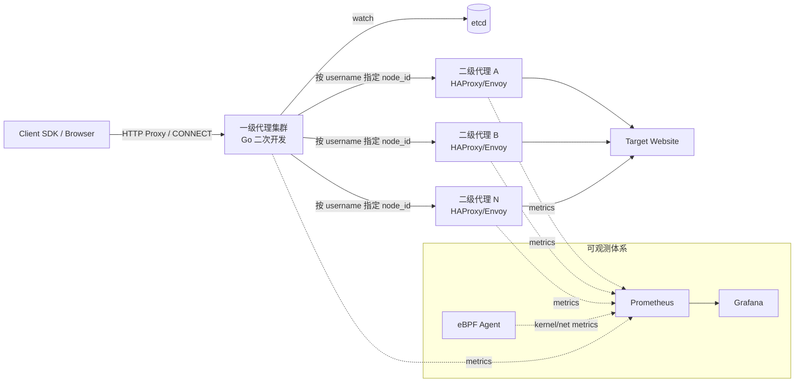
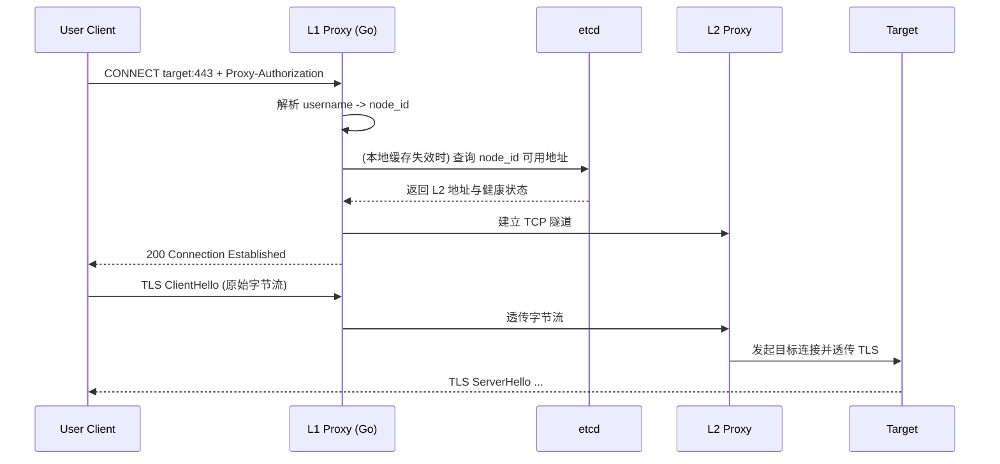
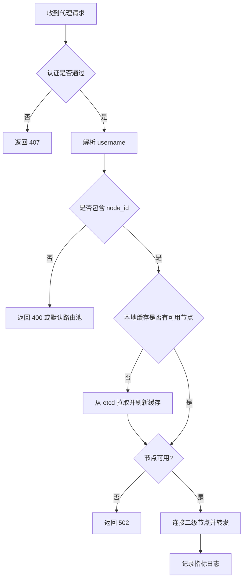

# OpenSpec 设计文档：多级高性能隧道代理（Pro 模式）

- **文档版本**：v0.1（预研阶段）
- **日期**：2026-05-12
- **状态**：Draft / 可进入 PoC
- **目标**：参考商业隧道代理 Pro 模式，设计“一级代理 + 二级代理”多级转发系统，支持通过 `username` 指定二级节点、TLS 指纹透传、eBPF 监控、etcd 自动服务发现。

---

## 1. 背景与目标

### 1.1 背景
当前需要构建一个可替代商业 Pro 隧道代理能力的内部系统，满足以下核心诉求：

1. 支持 HTTP/HTTPS 隧道代理（重点 CONNECT）。
2. 初版通过认证用户名参数指定二级代理节点 ID。
3. 一级代理将流量转发到指定二级代理，再由二级代理访问目标站点。
4. 对目标网站的 TLS 指纹信息透传（不在一级/二级进行 TLS 中间人解密）。
5. 使用 eBPF 做高性能、低侵入的网络与系统指标监控。
6. 二级节点采用开源高性能代理方案；一级节点基于开源方案二次开发。
7. 通过 etcd 实现二级节点自动注册、发现、健康感知。

### 1.2 非目标（初版）

- 不做 HTTPS MITM 解密与内容审计。
- 不做复杂计费系统（仅预留指标）。
- 不做跨地域智能调度（初版可基于静态策略 + etcd 健康状态）。

---

## 2. 需求分解

### 2.1 功能需求

- 认证：支持 `BasicAuth`/`Proxy-Authorization`。
- 路由：从 `username` 解析二级节点 ID（如：`user@node-az01-003`）。
- 转发：一级代理到二级代理建立上游连接，再转发原始流。
- 协议：支持 HTTP 请求代理 + HTTPS CONNECT 隧道。
- 透传：TLS 握手报文、ALPN、SNI、JA3/JA4 特征在链路上不被篡改（仅 TCP 层转发）。

### 2.2 非功能需求

- 高性能：单节点万级并发连接能力（视机器规格）。
- 高可用：一级无状态可水平扩展；二级可动态扩容缩容。
- 可观测：QPS、时延、成功率、连接生命周期、错误码分布。
- 可运维：etcd 自动发现，心跳 + TTL 下线。

---

## 3. 开源方案预研与对比

> 说明：以下为工程实践视角的预研建议，用于“一级二次开发 + 二级直接落地”的选型输入。

### 3.1 候选组件

1. **Envoy**
   - 优点：高性能、成熟 L4/L7、可观测生态强、动态配置强（xDS）。
   - 缺点：学习与运维复杂度高；按 username 精准路由到二级节点需要额外 filter/ext_authz 逻辑。

2. **HAProxy**
   - 优点：性能稳定、TCP/HTTP 代理成熟、生产验证广。
   - 缺点：对“认证用户名携带节点ID并路由”的原生表达能力一般，二次开发门槛较高（Lua/外部服务可补）。

3. **Nginx/OpenResty**
   - 优点：生态成熟，OpenResty 可用 Lua 快速做逻辑扩展。
   - 缺点：极致连接性能和长连接代理场景下，调优复杂；多协议细粒度可观测能力不如 Envoy 原生体系。

4. **gost / v2ray-core / sing-box（轻量代理内核类）**
   - 优点：协议支持丰富，二级出口节点快速部署。
   - 缺点：作为企业级可观测、可控、可审计网关内核时，需要补充大量工程化能力。

### 3.2 推荐组合（初版）

- **一级代理（需二开）**：Go 自研网关（借鉴/嵌入高性能开源网络库能力，例如 `gnet`/`fasthttp`/标准库 netpoll 方案）。
- **二级代理（开箱即用）**：HAProxy（TCP 模式）或 Envoy（L4 直通模式）。
- **服务发现**：etcd。
- **监控**：eBPF + Prometheus + Grafana。

### 3.3 选择理由

- 一级要实现“用户名 -> 二级节点ID -> 强定向转发”，逻辑定制性高，自研（基于 Go）效率最高。
- 二级节点职责清晰（稳定转发出口），使用成熟开源代理可降低风险。
- TLS 指纹透传本质要求是“仅隧道，不解密，不改写”，L4 代理即可满足。

---

## 4. 总体架构设计

## 4.1 架构图



### 4.2 关键模块

- **AuthParser**：解析 Proxy-Authorization、提取 username。
- **RouteResolver**：解析 `username` 中 node_id 并在本地路由表匹配。
- **EtcdWatcher**：维护 `node_id -> upstream_addr[]` 的本地缓存。
- **TunnelForwarder**：建立 L1->L2 TCP 连接并双向零拷贝转发。
- **Metrics/Trace**：暴露 Prometheus 指标，关联 eBPF 内核维度数据。

---

## 5. 关键流程设计

### 5.1 请求时序图（HTTPS CONNECT）



### 5.2 流程图（路由决策）



---

## 6. TLS 指纹透传设计

### 6.1 原则

- 不启用 MITM。
- CONNECT 后仅做 TCP 双向字节流中继。
- 禁止在一级/二级对 TLS 握手包进行重写或重发。

### 6.2 风险点与规避

- 风险：某些代理实现会重建上游 TLS（会改变 JA3）。
  - 规避：一级和二级都采用纯隧道模式（L4 透传）。
- 风险：透明代理/NAT 设备插入行为导致特征变化。
  - 规避：在出口链路做抓包校验，对比原始 ClientHello 哈希。

### 6.3 验证方法

- 使用 `tcpdump` + `ja3` 解析工具，比较客户端侧与目标侧 JA3。
- 构建回归测试：不同客户端（Chrome/curl/Go TLS）一致性验证。

---

## 7. eBPF 监控方案

### 7.1 采集范围

- 连接维度：建连速率、活跃连接数、连接时长分布。
- 网络维度：重传率、RTT 分布、丢包指标（内核侧统计）。
- 系统维度：CPU run queue、软中断、socket backlog。

### 7.2 技术实现

- 在一级与二级节点部署 eBPF Agent（如 Cilium/自研 bpf exporter）。
- 暴露 Prometheus 指标：
  - `proxy_conn_active`
  - `proxy_connect_latency_ms_bucket`
  - `proxy_upstream_fail_total`
  - `kernel_tcp_retrans_total`

### 7.3 告警建议

- 5 分钟连接失败率 > 2%。
- P95 CONNECT 建连时延 > 200ms。
- 二级节点心跳丢失 > 3 个周期自动摘除。

---

## 8. etcd 自动服务发现设计

### 8.1 注册模型

- Key：`/relay/l2/{node_id}/{instance_id}`
- Value：`{addr, az, weight, capability, version}`
- Lease：TTL 10s，心跳 3s 续租。

### 8.2 一级消费逻辑

- 启动时全量拉取。
- Watch 增量更新到本地内存路由表。
- 路由选择：
  1) 精确 node_id
  2) 多实例时按权重/最少连接
  3) 不可用则快速失败

---

## 9. 部署方案（初版）

### 9.1 环境拓扑

- K8s（推荐）或 VM。
- 一级代理：Deployment（无状态，多副本）。
- 二级代理：DaemonSet（按出口 IP 绑定）或 Deployment（按节点池部署）。
- etcd：独立 3~5 节点集群（建议与业务隔离）。
- 监控：Prometheus + Grafana + Loki（可选）。

### 9.2 发布策略

1. 先部署二级节点并注册 etcd。
2. 发布一级代理灰度（5% 流量）。
3. 对比关键 SLI（成功率/时延/错误码）。
4. 全量切换。

### 9.3 容灾策略

- 一级跨可用区部署 + LB 健康检查。
- 二级按地域/可用区分组；node_id 命名包含 AZ。
- etcd 多副本 + 定期快照备份。

---

## 10. Go 使用示例（一级代理核心逻辑）

```go
// username 格式示例: appuser@node-az01-003
func parseNodeID(username string) (user string, nodeID string, err error) {
    parts := strings.Split(username, "@")
    if len(parts) != 2 || parts[0] == "" || parts[1] == "" {
        return "", "", fmt.Errorf("invalid username format")
    }
    return parts[0], parts[1], nil
}

func handleConnect(clientConn net.Conn, username string, resolver Resolver) error {
    _, nodeID, err := parseNodeID(username)
    if err != nil {
        return err
    }

    upstreamAddr, err := resolver.Resolve(nodeID)
    if err != nil {
        return fmt.Errorf("resolve node %s failed: %w", nodeID, err)
    }

    upstreamConn, err := net.DialTimeout("tcp", upstreamAddr, 3*time.Second)
    if err != nil {
        return fmt.Errorf("connect upstream failed: %w", err)
    }
    defer upstreamConn.Close()

    // 关键点：不解密 TLS，只做双向字节透传
    go io.Copy(upstreamConn, clientConn)
    _, _ = io.Copy(clientConn, upstreamConn)
    return nil
}
```

---

## 11. 里程碑建议

- **M1（1~2 周）**：PoC 跑通（L1/L2/etcd，username 指定路由）。
- **M2（2~4 周）**：eBPF 指标 + Prometheus 看板 + 告警。
- **M3（4~6 周）**：压测调优、故障演练、灰度发布。

---

## 12. 风险与对策

1. **风险：二级节点不可用导致路由失败**
   - 对策：etcd TTL + 主动探活 + 快速摘除。
2. **风险：高并发下文件句柄与端口耗尽**
   - 对策：ulimit、net.ipv4/ip_local_port_range、连接复用与限流。
3. **风险：TLS 指纹透传被链路设备破坏**
   - 对策：分层抓包比对，变更流程加回归用例。

---

## 13. 结论（预研阶段）

该方案在“可落地性、性能、可观测、可扩展”四个维度具备较高可行性：

- 一级采用 Go 二开，可快速承载定制路由逻辑。
- 二级采用成熟开源代理，降低实现与稳定性风险。
- etcd + eBPF + Prometheus 组合满足生产级发现与观测需求。

建议进入 PoC 实施，优先验证三件事：
1. username 路由稳定性；
2. TLS 指纹透传一致性；
3. 高并发下连接成功率与时延目标。
