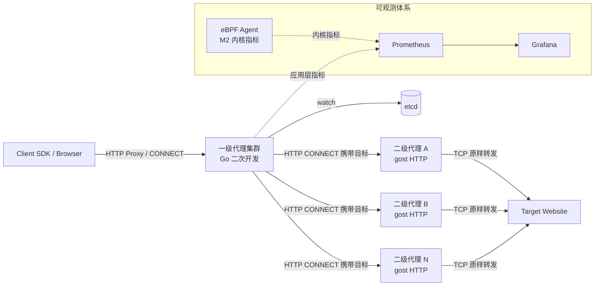
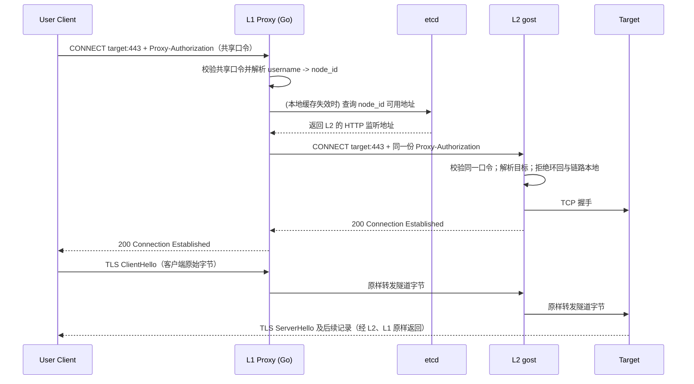
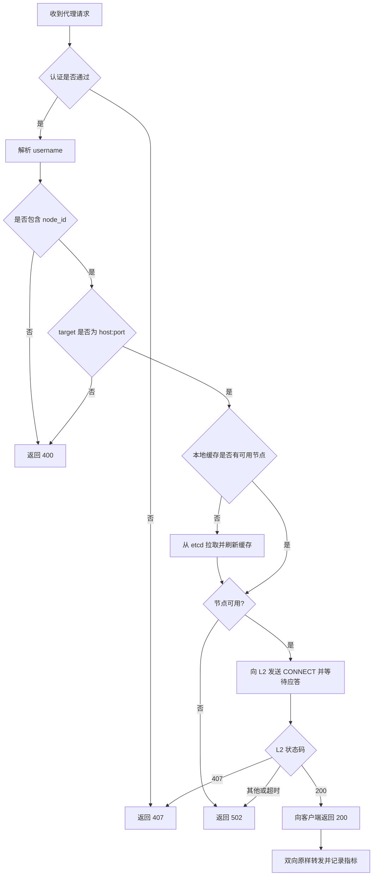
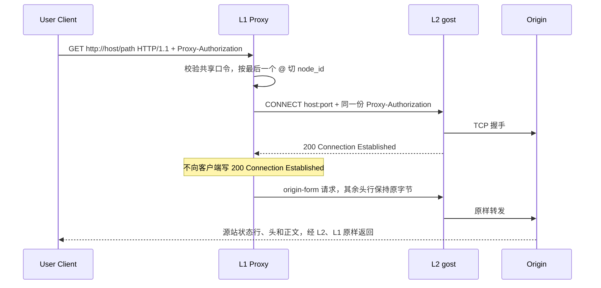

# OpenSpec 设计文档：多级高性能隧道代理（Pro 模式）

- **文档版本**：v0.10（请求头空等、解析失败分页）
- **日期**：2026-10-23
- **状态**：Draft / 可进入 PoC
- **目标**：参考商业隧道代理 Pro 模式，设计“一级代理 + 二级代理”多级转发系统，支持通过 `username` 指定二级节点、TLS 指纹透传、应用层与 eBPF 监控、etcd 自动服务发现。
- **v0.10 变更**：等请求头的第一个字节用 `tunnelIdle`（默认 5 分钟），keep-alive 空等不再被 10s 的 `header_deadline` 切断。读到第一个字节之后才武装 `header_deadline`，绝对截止，后续字节不顺延。v0.9 的 `ProxyUnknownUpstream` 要求这三种失败至少 100 次并且超过全部尝试的一半。那个「一半」就是分母闸，不到一半的 `resolver_error` 和 5 分钟里不足 100 次的全灭都不会翻页；v0.9 里「不要求健康分母」的说法是错的。v0.10 撤掉这条页，改成 `ProxyResolverUpstream`：两条协议上 `empty_addr` 与 `resolver_error` 在 5 分钟里至少 10 次就翻页，没有比例，也没有健康分母。`unknown_node` 只上看板。共享口令在 `Resolve` 之前校验，所以它是已认证客户端写出了路由表没有的 node，不是未认证扫描，也不是 etcd 故障。半关闭一开始就停掉 `tunnelIdle`，这段拆除不记 `idle_timeout`。`Fail502` 和 `FailHTTP` 把集合外的 reason 记成 `other`。JSON 对象后面的多余数据拒绝。`{node_id="unknown",reason="no_upstream"}` 不再增加。计量事件在写入通道前计入未确认数，消费者落盘后调用 `FinishMeter`，`WaitMeterIdle` 才返回；通道变空不等于这行已经记入日志。§8 未改。
- **v0.9 变更**：`Resolve` 的三种哨兵分开计数：`ErrUnknownNode` 是 `unknown_node`，地址为空是 `empty_addr`，其它解析错误是 `resolver_error`，`node_id` 都是 `unknown`。`ErrNoHealthyAddr` 仍保留原来的 `node_id` 和 `no_upstream`。失败率继续去掉 `unknown`。当时的 `ProxyUnknownUpstream` 要求 5 分钟里这三种失败至少 100 次，并且占全部尝试的一半以上。读请求头用单独的绝对截止 `header_deadline`（默认 10s）。CONNECT 隧道空闲到点记 `proxy_tunnel_abort_total{reason="idle_timeout"}`。`closeWrite` 失败两边都不当成隧道中断。配置拒绝未知字段，并限制时长上限，`half_close_idle` 不得大于 `tunnel_idle`。§8 未改。v0.10 修正了这条告警和请求头空等。
- **v0.8 变更**：空闲计时到点先记下原因再关连接，读到的 `net.ErrClosed` 记 `idle_timeout`，不再记成 `origin_reset` 或 `client_cancel`。双向拷贝用 `sync.Once` 保留第一个真实错误，忽略自己关掉对端造成的错误。半关闭之后的空闲超时不进 `proxy_http_body_abort_total`。请求头已经读到一部分才超时记 `header_timeout`，一个字节都没有仍不计数。失败率和按节点的页去掉 `node_id="unknown"`。Alertmanager 按 `alertname` 分组，全局页抑制对应的按节点页。`ECONNRESET` 在读和写上都是断管。`retry_put_delete` 来自 JSON 配置或 `-retry-put-delete`，按连接注入。`increase()` 不把序列第一次出现时已经有的值当成增量。gost 夹具按 `GOOS/GOARCH` 校验 v3.3.1 的 sha256，放进用户缓存目录；`GOST_REQUIRED=1` 时拿不到就失败。§8 未改。
- **v0.7 变更**：明文 HTTP 的计数纳入 SLI，单独成一套指标，不改 CONNECT 指标的名字和标签。请求时延是 `proxy_http_request_latency_ms{node_id,result}`，只上看板。告警用的 P95 是 `proxy_http_tunnel_setup_ms`，时钟与 CONNECT 相同：从拨号到 L2 返回 `200`，只统计新开的隧道。直方图序列数计入隐含的 `le="+Inf"`。复用隧道只有在 EOF / `ECONNRESET`（写出时还有 `EPIPE`、`ECONNABORTED`、`ErrClosedPipe`）、零个源站字节、且请求头没有写到一半时，才对 `GET` / `HEAD` / `OPTIONS` / `TRACE` 重试一次，记 `proxy_http_reused_conn_retry_total`，不把第一次算失败。读超时不重试。`PUT` / `DELETE` 默认不重试。失败率用 `or vector(0)`，5 分钟窗口里分母至少 100 才告警，`for` 为 5 分钟，并另有按节点的页。`proxy_conn_active` 只统计 CONNECT。计量事件 `v` 为 2，`protocol` 必填且没有 `omitempty`。`setup_ms` 只含这次实际使用的隧道建立，`request_ms` 是整条请求并含白写的重试。§8 未改。
- **v0.6 变更**：补上明文 HTTP（非 CONNECT）和 L1→L2 链路。明文 HTTP 由 L1 鉴权、按最后一个 `@` 切出 `node_id`，再向 gost 发一次 `CONNECT`，把 absolute-form 改成 origin-form 并删掉逐跳头，其余头行按原字节转发。不把 absolute-form 交给 gost 的 HTTP 转发：gost v3.3.1 会重排头、改大小写并注入 `User-Agent`。L1→L2 走内网，不加密、不做 mTLS；两端都不终结客户端 TLS。共享口令在内网明文传输写进 §12，作为已接受项，前提是内网隔离且 L2 只监听内网地址。§1.2、§2.1 与 §3 的 gost 示例与此对齐。§7、§8 未改。
- **v0.5 变更**：建连时延增加闭合的 `result` 标签，拨号之后的成功和失败都观察，§7.3 的 P95 与成功样本只取 `result="ok"`。补回隧道时长 `proxy_tunnel_duration_seconds`，并增加两个方向的字节计数 `proxy_tunnel_bytes_total`。等待 L2 状态行时客户端读泵先结束记 `proxy_client_abort_total{reason="client_gone"}`，不记 `l2_response`，不进上游失败率。用户名和目标域名走计量事件，不进 Prometheus 标签。商业统计对照见附录 B，开源管理面结论见附录 C。
- **v0.4 变更**：落地 L2 向 etcd 的注册（issue #5），并吸收 v0.3.1 的文档勘误，不另立版本号。节点是虚拟机，admin 是 Go，进程内调用 `registrar`；`nodeId` 来自环境变量 `RELAY_NODE_ID`。key 为 `/relay/l2/{nodeId}`，`value.addr` 是内网地址。每台虚拟机一个 lease（TTL 10s，每 3s 续租）。一次拨号加出口校验约 5s、失败率低于 1%；计划内重拨后出口 IP 必须变化，否则不注册。巡检每 1 分钟，外网或 CPU/内存异常都 Delete key。同一宿主机异常时一批 key 一起过期。详见 §8。勘误（原 v0.3.1）：§10 示例对空口令显式回 `407`；§10 与 §12 写明整条隧道空闲兜底（默认 5 分钟）会关掉长时间静默的 WebSocket、长轮询等长连接，应用需自带心跳，TCP keepalive 不算数据；§4.2 TunnelForwarder 补上 L2 `407` 透传和两级空闲计时；附录 A.5 写明缺端口回 `400`；§4.1 架构图删去 L2 到 Prometheus 的指标连线，gost 自带指标不在 M1；§7.3 注明等待 L2 应答时客户端先断开也计入 `l2_response`。v0.2.1 变更说明补全了当时引入的 400/407 规则。
- **v0.3 变更**：M1 PoC 的可观测改为 L1 应用层 Prometheus 指标。L1 用 `prometheus/client_golang` 暴露 `proxy_conn_active`、`proxy_connect_latency_ms`、`proxy_upstream_fail_total`，以及本地拒绝计数 `proxy_client_reject_total`。eBPF 只采集内核指标，移到 M2。两类来源和告警在 §7 分开。与 v0.2.1 的半关闭和 10s 应答等待合在同一份数据面上打点。`node_id` 失败关闭：只有 `Resolve` 返回 `ErrNoHealthyAddr` 时保留原来的 ID，其余解析错误记 `unknown`。
- **v0.2.1 变更**：修正 §10 的隧道拆除和 L2 应答等待。某一方向 `io.Copy` 返回错误（对端 RST 或写失败）时立刻完全关闭两端。干净 EOF 只 `CloseWrite`。反方向是空闲读超时而不是一次性截止：默认 30s（`halfCloseIdleTimeout`，可改），每次成功读到字节都重新计时，客户端先 FIN 和上游先 FIN 用同一套。整条隧道另有空闲兜底，默认 5 分钟（`tunnelIdleTimeout`，可改），任一方向有数据就重新计时；gost 的 `idleTimeout` 默认是 0，不靠它收尸。等待 L2 `200` 的默认上限是 10s，因为 gost 先拨通源站再应答。可观测性改版另记为 v0.3，本版不改 §7。L1 在本地校验共享口令（SHA-256 后常量时间比较），为空或不匹配直接回 `407`、不拨 L2；目标缺端口或用户名切不出 `node_id` 回 `400`，`node_id` 取最后一个 @ 之后；L2 返回的 `407` 连同 `Proxy-Authenticate` 交给客户端，其余失败仍为 `502`（§5.1、§5.2）。
- **v0.2 变更**：补上 v0.1 的链路缺口。L1 用第二次 HTTP `CONNECT` 把目标 `host:port` 交给 L2；L2 定为 gost v3 的 HTTP 正向代理，不再使用 HAProxy / Envoy 的纯 TCP 模式。对比与理由见附录 A。
- **已确认**：v1 的 L2 就是 gost v3，3proxy 与锁死配置的 Envoy 只作为同接口替换项。出口拒绝范围只有环回和链路本地，不含 RFC1918。L1→L2 使用客户端登录 L1 的那一份共享口令，不轮换。

---

## 1. 背景与目标

### 1.1 背景
当前需要构建一个可替代商业 Pro 隧道代理能力的内部系统，满足以下核心诉求：

1. 支持 HTTP/HTTPS 隧道代理（重点 CONNECT）。
2. 初版通过认证用户名参数指定二级代理节点 ID。
3. 一级代理将流量转发到指定二级代理，再由二级代理访问目标站点。目标 `host:port` 由 L1 在第二次 `CONNECT` 中显式交给 L2。
4. 对目标网站的 TLS 指纹信息透传（不在一级/二级进行 TLS 中间人解密，也不重新生成 ClientHello）。
5. 可观测分两层：M1 由 L1 暴露应用层 Prometheus 指标（建连时延、活跃隧道、上游失败、本地拒绝）；M2 用 eBPF 采集内核网络与系统指标。
6. 二级节点采用开源高性能代理方案；一级节点基于开源方案二次开发。
7. 通过 etcd 实现二级节点自动注册、发现、健康感知。

### 1.2 非目标（初版）

- 不做 HTTPS MITM 解密与内容审计。
- 不做复杂计费系统（仅预留指标）。
- 不做跨地域智能调度（初版可基于静态策略 + etcd 健康状态）。
- etcd 注册的实现形态已在 §8 定下来：admin 进程内嵌 `registrar`，不再使用独立的 HAProxy / Envoy 注册 sidecar。

本文件已经决定明文 HTTP（非 CONNECT）的处理方式：方案 B，见 §5.3–§5.6。L1↔L2 走内网明文，不加密、不做 mTLS，见 §6 和 §12 第 6 条。

---

## 2. 需求分解

### 2.1 功能需求

- 认证：支持 `BasicAuth`/`Proxy-Authorization`。全系统一份共享口令，不轮换。客户端用它登录 L1；L1 校验后把同一组用户名和密码写进发往 L2 的 `Proxy-Authorization`。用户名仍是 `user@node_id`，供 L1 选路。v1 接受由此带来的暴露面：任一 L2 都能看到这把钥匙，泄露后它对 L1 和全部 L2 继续有效，也不能按调用方吊销。
- 路由：从 `username` 解析二级节点 ID（如：`user@node-az01-003`），再从本地路由表得到该节点的 L2 监听地址。
- 转发：L1 向选中的 L2 发送 HTTP `CONNECT host:port`，L2 返回 `200` 后，双向原样转发隧道字节。
- 协议：支持 HTTP 请求代理 + HTTPS CONNECT 隧道。明文 HTTP（非 CONNECT）的处理方式已在本文件决定，采用方案 B：L1 鉴权并按最后一个 `@` 切出 `node_id` 后向 L2 发 `CONNECT`，把 absolute-form 改成 origin-form，其余头行按原字节转发，见 §5.3–§5.6。L1↔L2 走内网明文，不加密、不做 mTLS，见 §6 和 §12 第 6 条。
- 透传：TLS 握手报文、ALPN、SNI、JA3/JA4 特征在链路上不被篡改。`200` 之后只有 TCP 字节转发，没有 TLS 终结或重新握手。

### 2.2 非功能需求

- 高性能：单节点万级并发连接能力（视机器规格）。
- 高可用：一级无状态可水平扩展；二级可动态扩容缩容。
- 可观测：QPS、时延、成功率、连接生命周期、错误码分布。
- 可运维：etcd 自动发现，心跳 + TTL 下线。

---

## 3. 开源方案预研与对比

> 说明：以下为工程实践视角的预研建议，用于“一级二次开发 + 二级直接落地”的选型输入。完整对比表、TLS 结论与配置红线在附录 A。

### 3.1 候选组件

L1 与 L2 的职责不同，不能拿同一类软件硬套。

1. **一级（自研 Go）**
   - 要做终端用户认证，以及 `username -> node_id -> L2 地址` 的强制定向。
   - 要做的协议动作很小：向已选定的 L2 发一次 HTTP `CONNECT`，读到 `200` 后双向拷贝。
   - 这一跳的稳定接口是 HTTP `CONNECT`。L2 进程可以替换，L1 不用改。

2. **二级候选（动态正向代理，而不是固定后端的 L4 负载均衡）**
   - **gost v3**（v1 已确认）：HTTP handler 默认就是 `CONNECT` 之后双向转发。
   - **3proxy**：同一 CONNECT 接口下，C + Linux `splice`，连接密度更高。
   - **Envoy dynamic forward proxy**：能终止 `CONNECT` 并原始 TCP 转发，指标与热重启最好；安全配置与官方 HTTP 示例相反，容易配成重新发起 TLS。
   - **不采用 HAProxy / Nginx stream 的纯 TCP 模式**：它们只会把连接转到预先配置的后端，不能按 `CONNECT` 里的目标动态拨号；v0.1 那种裸 TCP 透传里也没有目标地址，L2 无法知道该连哪台源站。

### 3.2 推荐组合（初版）

- **一级代理（需二开）**：Go 自研网关（借鉴/嵌入高性能开源网络库能力，例如 `gnet`/`fasthttp`/标准库 netpoll 方案）。
- **L1→L2 目标传递**：第二次 HTTP `CONNECT`（代理链）。请求目标使用客户端原始 authority（`host:port`），DNS 在 L2 做。
- **二级代理（开箱即用）**：gost v3，`handler: http` + `listener: tcp`。关闭 sniffing、MITM 与压缩。这是 v1 的确定选择。
- **认证**：一份共享口令。L2 的 `auth.username` 写成客户端访问本节点时使用的用户名（含 `@node_id`），`auth.password` 与客户端登录 L1 的密码相同。L1 转发这同一组凭据。L2 只校验它，不从用户名里做选路。v1 每个 L2 节点只对应一个客户端用户名；若以后同一节点要接受多个用户名，需要把 `auth` 换成 gost 的多用户认证配置。
- **出口拒绝**：L2 在解析之后、拨号之前拒绝环回与链路本地。RFC1918 及其他私网地址本版放行，此范围以后可以再收紧。见附录 A.5。
- **服务发现**：etcd。L1 拨的地址是 `value.addr`（内网 IP:gost 端口），不随 ADSL 重拨变化。注册方式见 §8。
- **监控**：M1 由 L1 暴露应用层 Prometheus 指标；M2 用 eBPF 采集内核指标。两者都进 Prometheus + Grafana。见 §7。
- **同接口替换项**（不改变 L1 的 CONNECT）：要更高连接密度用 3proxy；要 Envoy 级指标或 L1↔L2 的 HTTP/2 多路复用时，用锁死配置的 Envoy DFP。二者都不是 v1 的 L2。红线见附录 A.5，替换条件见附录 A.6。

gost 的配置形态：

```yaml
services:
  - name: l2
    addr: "10.x.x.x:8080"
    bypass: egress-deny
    handler:
      type: http
      auth:
        username: appuser@node-az01-003
        password: <shared-secret>
      metadata:
        sniffing: false
    listener:
      type: tcp
bypasses:
  - name: egress-deny
    matchers:
      - 127.0.0.0/8
      - 169.254.0.0/16
      - ::1/128
      - fe80::/10
```

`addr` 里的 `10.x.x.x` 是内网地址占位，部署时换成该 L2 的内网地址。只绑定内网，不用 `:8080` 这种全接口监听，也不把 `0.0.0.0` 暴露在公网接口上。`listener` 保持 `tcp`。L1↔L2 走内网明文，不加密、不做 mTLS，见 §6 和 §12 第 6 条。`http+tls` / `https` 监听会终结这一跳的外层 TLS，不是客户端到源站的 TLS，本版不用。`mitm.certFile` / `mitm.keyFile` 不应出现。上面的 `bypass` 是黑名单，只比请求里的主机字符串；域名解析进这些网段时不会命中。拨号前还要对解析结果做一次同样的网段判断，见附录 A.5。

### 3.3 选择理由

- 一级要实现“用户名 -> 二级节点 ID -> 强定向转发”，逻辑定制性高，自研（基于 Go）效率最高。选路在拨号之前完成，L2 不解析 `node_id`。
- v0.1 把 L2 做成纯 TCP 透传时，链路上没有任何字段携带源站 `host:port`，二级无法拨号。HAProxy 也没有“按 CONNECT 目标动态拨号”的正向代理模式。
- 第二次 `CONNECT` 用一次往返把目标、端口和同一份共享口令放进同一条标准请求；L2 连上源站后再回 `200`。SOCKS5 能表达同样的目标，但握手往返更多，而且 Envoy 不能作为现成的 SOCKS 服务端接入。PROXY protocol 传递的是本跳的源/目的地址，不是正向代理的拨号目标。
- TLS 指纹要保持，靠的是 `200` 之后原样转发客户端已经写出的 TLS 记录，而不是“随便找一个 L4 代理”。gost 的默认数据面就是这条隧道；Envoy 必须额外写对 `connect_config`，并且不能配置上游 TLS。
- 单节点万级连接落在 gost 可运行的范围内。默认临时端口约 2.8 万（`32768–60999`），一条 L1 源地址到一个 L2 地址的 HTTP/1.1 隧道数量与此同一量级，覆盖本版“万级”目标。

---

## 4. 总体架构设计

## 4.1 架构图



### 4.2 关键模块

- **AuthParser**：解析客户端 `Proxy-Authorization`，用全系统共享口令完成认证，并保留用户名与密码供转发。
- **RouteResolver**：解析 `username` 中 node_id 并在本地路由表匹配。
- **EtcdWatcher**：Watch `/relay/l2/`，维护 `node_id -> addr`。`addr` 是 value 里的内网 `host:port`。key 存在即可路由，不读状态字段。见 §8.2。
- **TunnelForwarder**：向选定 L2 写 `CONNECT host:port`，`Proxy-Authorization` 使用客户端刚刚提交的同一组用户名和密码。确认 `200` 后与客户端双向原样转发。不在这条路径上 `tls.Dial`。L2 返回 `407` 时连同 `Proxy-Authenticate` 交给客户端。隧道阶段有半关闭空闲超时和整条隧道的空闲兜底，见 §10。
- **Metrics/Trace**：M1 在 L1 进程内暴露应用层 Prometheus 指标。M2 的 eBPF 内核指标另行采集，不在转发路径上计算。见 §7。

---

## 5. 关键流程设计

### 5.1 请求时序图（HTTPS CONNECT）



L1 必须先收到 L2 的 `200`（L2 已经与目标完成 TCP 握手），再向客户端回 `200`。在此之前客户端不应发出 ClientHello。客户端口令为空或不匹配时，L1 直接回 `407`，不拨 L2，计入 `proxy_client_reject_total{reason="auth"}`。目标不是 `host:port`（缺少端口）回 `400`，`reason="bad_target"`；用户名里没有 `node_id` 回 `400`，`reason="no_node"`。用户名或口令含 CR/LF 也是本地 `400`，`reason="bad_credential"`。这些本地 400/407 都不拨 L2。L2 返回 `407` 时，L1 把 `407` 和 `Proxy-Authenticate` 交给客户端，不改写成 `502`，计入 `proxy_upstream_fail_total{reason="l2_auth"}`。L2 的其他非 2xx、应答超时或拨号失败才转为 `502`，按 §7.1 的 `reason` 计入 `proxy_upstream_fail_total`。等待状态行时的读超时，且客户端读泵尚未结束，是 `reason="l2_response"`。客户端读泵先结束、状态行还没解析出来时记 `client_gone`，不记 `l2_response`。这些失败路径上都不会开始传输隧道字节。建连时延、连接时长和上下行字节的打点见 §7.1。L1→L2 这一跳按 §6 走内网，不加密。明文 HTTP 不向客户端回 `200 Connection Established`，见 §5.3。

### 5.2 流程图（路由决策）



图中的 `X`、`Y`、`Z`、`H`、`J`、`K` 与 §7.1 对应。`X`（本地 407）和 `Y`（本地 400）计入 `proxy_client_reject_total`，不拨 L2。进入 `Z` 的 `502` 计入 `proxy_upstream_fail_total`，`reason` 按路径分开。`J -- 407` 不进入 `Z`，单独记 `reason="l2_auth"`。`proxy_connect_latency_ms` 从 `H` 拨号起计时，拨号及之后的每个结束结果都观察，并带闭合的 `result` 标签；`result="ok"` 仍是 L2 返回 `200`。等待状态行时客户端读泵先结束且状态行未解析，不进入 `Z`，也不记 `l2_response`。`proxy_conn_active` 在 `K` 向客户端写出 `200` 之后随隧道增减；客户端断开后，这个 gauge 最长还会多停半关闭空闲（默认 30s）或隧道空闲（默认 5 分钟）。连接时长、上下行字节、`client_gone` 的判定，以及和 §10 每一处回写的对应，见 §7.1。这张图描述 CONNECT：L2 返回 200 之后向客户端写 `200`，再双向拷贝。明文 HTTP 在认证、选路和向 L2 发 CONNECT 之前与图相同；L2 返回 200 之后改为 §5.3，把源站响应原样交回，不写 L1 自己的 `200`。

---

### 5.3 明文 HTTP（非 CONNECT）

客户端把普通 HTTP 写成 absolute-form，例如 `GET http://host/path HTTP/1.1`。L1 先用与 CONNECT 相同的共享口令做鉴权，再按用户名最后一个 `@` 切出 `node_id`，向选中的 L2 发第二次 `CONNECT host:port`。L2 返回 `200` 之后，L1 把改写过的请求字节写进隧道。gost 在这条隧道里只转发字节，不再解析 HTTP。

另一条路是 L1 自己当 HTTP 代理，把 absolute-form 交给 gost，由 gost 向源站重新发请求。不采用。比较和实测见 §5.4。推荐 CONNECT 之后写字节，是为了保住业务层要的 HTTP/1.1 头顺序和大小写。



L1 在收到 L2 的 `200` 之前，不向源站写这份请求。成功时也不向客户端写 `200 Connection Established`：客户端等的是源站自己的状态行。本地失败和 L2 这条 CONNECT 的失败，仍用 §5.1 的 400 / 407 / 502，见 §5.6。

`Expect: 100-continue` 时，上面「写入请求」分成两段：先写头部，把源站的 `100` 原样交回，再写正文。`101 Switching Protocols` 之后，两侧改成和 CONNECT 一样的双向字节拷贝。

### 5.4 两种转发方式

方案 A：L1 把客户端的 absolute-form 请求转给 gost 的 HTTP handler，由 `http.Transport` 访问源站。

方案 B：L1 先对 L2 `CONNECT host:port`。隧道起来之后只写入改写过的原始字节。gost 不解析隧道里的 HTTP。

| | 方案 A：absolute-form 交给 gost | 方案 B：CONNECT 之后写字节 |
| --- | --- | --- |
| 头顺序和大小写 | gost v3.3.1 走 `net/http` 的 Transport。头名收成规范形式，写出时按名字排序。`x-custom` 变成 `X-Custom`，并和另一条 `X-Custom` 合成同一个名字 | L1 只重写请求行，并按行删掉逐跳头。留下的头行是客户端原来的字节 |
| Host | 客户端写的 Host 换成 absolute-URI 的 host:port。`hOsT: KeepMe.Example` 到不了源站 | 拨号目标取 absolute-URI 的 authority。Host 头原样保留，即使它和 URI 不一致 |
| 多出来的头 | 没有 User-Agent 时补 `User-Agent: Go-http-client/1.1`。`keepalive` 默认关闭，于是补 `Connection: close`。Content-Length 为 0 的 GET 会丢掉这一行 | 不补 User-Agent、Via、X-Forwarded-For、Forwarded、X-Real-IP |
| 逐跳头 | gost 会删 Proxy-Authorization 和 Proxy-Connection，但整份请求被重新序列化 | 控制面的 Proxy-Authorization 只放在 L1→L2 的 CONNECT 上。隧道里的那一份删掉，源站看不到 |
| 100-continue 和 Upgrade | Transport 自己处理 Expect；101 能做，请求和响应都经过重新序列化 | 先写头，把源站的 100 或最终响应原样交回，收到 100 才写正文。101 之后是字节隧道 |
| 超时 | 响应头默认最多等 15s（`readTimeout`），和本文的 10s、5 分钟不是同一套 | L2 的 CONNECT 用拨号 3s 和 `l2ResponseTimeout` 10s。隧道建立后用 `tunnelIdleTimeout` 5 分钟、`halfCloseIdleTimeout` 30s |
| 失败语义 | 和 CONNECT 的 400 / 407 / 502 混在 gost 自己的状态里 | CONNECT 控制面的失败与 §5.1 相同。成功之后源站状态码原样返回 |

gost v3.3.1 上方案 A 的一次实测：客户端发送 `hOsT: KeepMe.Example`、`X-Zz-Trace`、`x-custom`，没有 User-Agent。源站收到：

```
GET /PaTh?q=1 HTTP/1.1
Host: 127.0.0.1:port
User-Agent: Go-http-client/1.1
X-Custom: MiXeD
X-Zz-Trace: one
Connection: close
```

路径和 query 还在，也没有 Via 或 X-Forwarded-For。头的顺序、大小写和 Host 都变了，还多了 User-Agent。这不满足业务层对 HTTP/1.1 指纹的要求。

采用方案 B。L2 仍然是 gost 的 HTTP 正向代理。明文 HTTP 复用它已经在用的 CONNECT 字节隧道，不走它的 HTTP 重新序列化。

### 5.5 改写、逐跳头、复用和正文

请求行从 `METHOD SP absolute-URI SP HTTP/1.1` 改成 `METHOD SP origin-form SP HTTP/1.1`。方法、路径和 query 的字节保留，百分号不解码。没有路径时 origin-form 是 `/`。fragment 和 userinfo 丢掉，既不进入 CONNECT 目标，也不进入 origin-form。scheme 只接受 `http`（大小写不敏感）。`https://` 的明文请求回 400，应当改走 CONNECT。origin-form、`*` 以及没有 host 的请求也是 400。缺端口时 CONNECT 目标用 80。IPv6 保留方括号，例如 `[::1]:80`。

拨号用的 host:port 来自 absolute-URI，不来自 Host 头。Host 头有就原样保留，没有也不补。两者不一致时不改 Host。

按整行删除的逐跳头（名字大小写不敏感）：

- `Proxy-Authorization`、`Proxy-Connection`、`Keep-Alive`、`TE`、`Trailer`、`Proxy-Authenticate`
- `Connection` 里点名的头。`close`、`keep-alive`、`upgrade`、`transfer-encoding` 这四个是指令，不按头名删除

`Transfer-Encoding` 保留。正文按客户端的 chunked 帧原样拷贝，不解码再编码。同时带有 `Transfer-Encoding: chunked` 和 `Content-Length` 时删掉 `Content-Length`，避免请求走私。

`Connection` 是唯一可能改值的头：去掉那些指向已删除头的 token。token 集合没有变化时，这一行连空格都保持原样；变成空的就整行删除。Upgrade 时保留 `Upgrade` 和 `Connection`。

`Proxy-Connection` 只决定 L1 和客户端之间还要不要保持这条连接。它不转给源站，也不翻译成 `Connection`。

不添加 `Via`、`X-Forwarded-For`、`Forwarded`、`X-Real-IP`、`User-Agent`。客户端自己带了 `X-Forwarded-For` 就原样留下，不追加第二份。

同一条客户端连接上的请求串行处理。上一个响应写完才读下一个，不把管道请求并发打到源站。bufio 里已经读进来的下一个请求留到当前响应结束。

Keep-alive：

- 客户端一侧：HTTP/1.1 默认保持，除非 `Connection: close` 或 `Proxy-Connection: close`。HTTP/1.0 默认关闭，除非其中一个写了 `keep-alive`。
- 源站一侧：HTTP/1.1 默认保持，除非 `Connection: close`，或者响应既没有 Content-Length 也没有 chunked（只能读到对端关闭）。HTTP/1.0 只有 `Connection: keep-alive` 才保持。
- 一条客户端连接至多留一条 L2 隧道。下一条请求的 `node_id` 和 `host:port` 都相同，而且两边都还要保持，就把下一条请求写进同一条隧道，源站看到连接复用。主机或 node 变了，或者任一边要求关闭，就关掉隧道，下一条再发 CONNECT。
- 每条请求都重新校验口令并切 `node_id`。同一条连接上可以换 node。

正文按 `Content-Length` 或 chunked 原样转发。两个都没有，则正文为空，不把连接读到关闭。chunk 的 size 行、扩展和 trailer 原样拷贝；trailer 里不做逐跳头删除。HEAD 的响应不读正文。1xx、204、304 没有正文。

`Expect: 100-continue` 而且确实有正文时，L1 先只把头部写入隧道，不自己回 100。源站的 1xx（含 100）原样交给客户端。看到 100 之后才写正文，然后再读最终响应。源站直接给了最终响应（例如 417）就不写正文，并关掉这条客户端连接，避免还没消费的正文被当成下一个请求。已经向客户端写出过源站的任何字节（包括 100）之后，后续失败只关连接，不再补 502。

Upgrade（含 WebSocket）要同时满足：有非空的 `Upgrade`，并且 `Connection` 含 `upgrade`。这两个头都保留，`Proxy-Authorization` 仍然删除。响应是 101 时，之后双向拷贝原始字节，半关闭和空闲计时与 CONNECT 相同。101 结束这条客户端连接，不再当 HTTP 复用。不是 101 就按普通响应处理。

### 5.6 状态码、失败语义和超时

鉴权和选路的顺序与 CONNECT 相同，都在拨 L2 之前完成：

| 条件 | 客户端 | 是否拨 L2 | reason |
| --- | --- | --- | --- |
| 用户名或口令含 CR/LF | 400 | 否 | `bad_credential` |
| 口令为空、无法解析，或与共享口令不一致 | 407，带 `Proxy-Authenticate` | 否 | `auth` |
| 用户名切不出 `node_id` | 400 | 否 | `no_node` |
| 不是 `http` absolute-form，主机或端口非法，头部超过 64KiB，或头部语法不成立 | 400 | 否 | `bad_target` |
| 解析不到 L2 | 502 | 否 | `ErrNoHealthyAddr` 是 `no_upstream` 并保留 `node_id`。`ErrUnknownNode` 是 `unknown_node`，地址为空是 `empty_addr`，其它解析错误是 `resolver_error`。这三条的 `node_id` 都是 `unknown` |
| 拨号失败 | 502 | 已尝试 | `dial` |
| 写出 CONNECT 失败；或隧道建立后、客户端还没收到源站字节时，请求字节写失败，且不是下面的复用隧道断开 | 502 | 是 | `l2_write` |
| 设置或清除读截止时间失败 | 502 | 是 | `l2_deadline` |
| 读不到 L2 的 CONNECT 状态行；或隧道建立后、还没向客户端写出任何源站字节时，读不到源站状态行，且不是下面的复用隧道断开 | 502 | 是 | `l2_response` |
| L2 返回 407 | 407，原样带上 `Proxy-Authenticate` | 是 | `l2_auth` |
| L2 的其他非 200 | 502 | 是 | `l2_status` |
| 复用的隧道在任何源站字节写出之前被对端拆掉：读到 `EOF` 或 `ErrUnexpectedEOF`，或者读或写时是 `ECONNRESET`、`EPIPE`、`ECONNABORTED`、`io.ErrClosedPipe`。请求头没有写出一部分（失败时 `n==0`，或整段头已经写完之后才读失败）。方法默认是 `GET` / `HEAD` / `OPTIONS` / `TRACE`。正文还没从客户端读出（没有正文也算） | 客户端先看不见这次失败。关掉旧隧道，新开一条，把同一条请求再写一次 | 旧隧道已在，新的一次会再拨 | 不记失败，也不进请求时延。`proxy_http_reused_conn_retry_total` 加一。只重试一次，第二次按它自己的结果记。读超时不在这一行 |
| 同上这种断管，但不能自动重放：方法不是默认那四个，或者正文已经读出，或者请求头只写出了一部分。`PUT` / `DELETE` 只有打开 `retryPutDelete` 才按上面一行重试。本版不缓存正文 | 502 | 旧隧道已在，不再拨 | `stale_tunnel`。读超时不是这一行，记 `l2_response` |
| 已经向客户端写出过源站字节（含只写出 `100`）之后，读源站或再写请求失败 | 不再补 502，只关连接 | 是 | 读失败是 `l2_response`，写出失败是 `l2_write`。失败计数仍然加 |
| 还没有完整写出最终状态行，客户端断开或收不下这块头 | 多半写不进 502 | 视情况 | `client_gone`。不进失败率 |
| 最终状态行已经完整写出，之后正文或 101 隧道失败。正常 EOF、101 两侧都干净结束、以及半关闭之后的空闲超时，不算 | 不改已写出的状态，不补 502 | 是 | 结果保持 `ok`。`proxy_http_body_abort_total{reason}` 加一，不进失败率。`reason` 是 `client_cancel`、`origin_reset`、`idle_timeout`、`request_body`。整条隧道空闲到点（含计时器关掉连接后读到的 `net.ErrClosed`）是 `idle_timeout`。半关闭后的空闲不算 |
| 最终状态行完整写给客户端。含源站 4xx/5xx，以及 101 | 源站自己的状态 | 是 | `ok` |

上面这张表和 §7.1 的明文 HTTP 表是同一套结果。这里写客户端看见什么，§7.1 写进哪条计数。`stale_tunnel` 只出现在明文 HTTP。其余失败字符串与 CONNECT 相同。明文 HTTP 调用 `FailHTTP`、`RejectHTTP`、`AbortHTTP`、`ObserveHTTP`、`ObserveHTTPSetup` 和 `EnterHTTPTunnel`，不调用 `Fail502`、`ObserveConnect` 或 `EnterTunnel`。一条请求只 `ObserveHTTP` 一次。新开的隧道只 `ObserveHTTPSetup` 一次，在 L2 的 CONNECT 出结果时，不在源站状态行上再记。L2 返回 200 时请求还没结束，请求的 `ok` 记在源站最终状态行完整写给客户端的时刻。最终状态行是 code ≥ 200，或 101；`100` 和其他 1xx 不是。明文 HTTP 不向客户端写 L1 自己的 `200`。`proxy_http_tunnel_active` 是容量，不是 SLI：keep-alive 空等也算在里面，最长可到 `tunnelIdleTimeout`（默认 5 分钟）。

`PUT` 和 `DELETE` 不在默认重试里。RFC 9110 把它们标成幂等，但第一次请求可能已经到达源站，很多源站并不是真的幂等。要重试就在 JSON 配置里写 `"retry_put_delete": true`，或在命令行给 `-retry-put-delete=true`。`LimitsFromConfig` 读出一份 `proxyLimits`，传给 `serveProxyConnLimited`，不在请求路径上改包级变量。打开之后仍然只在零个源站字节、且请求头没有写出一部分时重试；读超时和写到一半的头都不重试。`POST` 和其他方法始终不重试。配置示例：`{"retry_put_delete":false,"tunnel_idle":"5m","half_close_idle":"30s","l2_response_timeout":"10s","header_deadline":"10s"}`。未知 JSON 字段拒绝。对象后面再跟另一个值也拒绝。`tunnel_idle` 最长 1 小时，`half_close_idle` 最长 1 小时并且不得大于 `tunnel_idle`，`l2_response_timeout` 最长 2 分钟，`header_deadline` 最长 1 分钟。零或负数拒绝。命令行的时长用同一组上限。

失败响应带 `Content-Length: 0` 和 `Connection: close`，随后关掉客户端连接。CONNECT 路径的失败响应格式不变。

超时不新造数字：

- 拨 L2：3s（`dialUpstream`）。
- 等 L2 的 CONNECT 状态行：`l2ResponseTimeout`，默认 10s。读完就清掉。
- 等请求头的第一个字节，包括第一条请求和 keep-alive 上下一条请求：`tunnelIdleTimeout`，默认 5 分钟。一个字节都没有不计数，不回 400。这段不用 `headerDeadline`。
- 第一个字节之后读完请求头：`headerDeadline`，默认 10s。设一次，后续字节不顺延。已经读到一部分才到点记 `header_timeout`。这段不再刷新 `tunnelIdle`。
- 等源站字节、拷贝正文：`tunnelIdleTimeout`，默认 5 分钟。读到字节就重新计时。
- 101 或半关闭之后，反方向空闲：`halfCloseIdleTimeout`，默认 30s。每次读到字节重新计时。

等 L2 的 200 时，不再像 CONNECT 那样另开一个读端把客户端字节泵进 pipe。明文请求的正文还要按帧切开，多一个读端会把正文读丢。客户端要是在这 10 秒里断开，要等到这次读或写失败才发现，结果记 `l2_response`，不记 `client_gone`。CONNECT 有读泵，同一时刻记的是 `client_gone`。两边故意不一样，见 §7.3。上限仍是拨号 3 秒加上 `l2ResponseTimeout`。

请求头超过 64KiB，或者头没有读完且不是超时，回 400，`reason="bad_target"`。请求行已经是 `CONNECT` 时进 `proxy_client_reject_total`。请求行还不是 `CONNECT`，包括请求行本身没读全、方法还看不出来，进 `proxy_http_client_reject_total{reason="bad_target"}`，不进 CONNECT 的拒绝计数。绝对的请求头截止到点、且已经读到一部分，记 `header_timeout`。一个字节都没有，包括请求头截止和隧道空闲，不计数。


## 6. TLS 指纹透传设计

### 6.1 原则

- 不启用 MITM，不在 L1 或 L2 上对客户端握手调用 TLS 栈。
- 客户端 `CONNECT` 与 L1→L2 的 `CONNECT` 都只是隧道建立前的 HTTP 控制面。两条 `200` 都写出之后，负载是客户端已经生成的 TLS 记录。
- L1 与 L2 对这段负载只做字节转发，不重写、不重分段重组后再编码、不插入 PROXY 协议头。
- L2 到目标是 L2 自己发起的 TCP 连接。目标看到的 TCP/IP 指纹属于 L2；目标看到的 TLS ClientHello 属于客户端。JA3/JA4 只覆盖后者。

v0.6 决定：L1 与 L2 之间走内网，不加密，也不做 mTLS。这一跳上的 CONNECT 和 `Proxy-Authorization` 是明文，Basic 只是 base64。前提和已接受的风险见 §12。

客户端到源站的 TLS 由业务层（客户端）生成，必须作为标准代理隧道里的原始字节，经 L1、L2 到达源站。L1 和 L2 都不终结这段 TLS，不做 MITM，也不为了看 ClientHello 去调用 TLS 栈。CONNECT 建立之后只转发原始字节：ClientHello 的字段、顺序、扩展和 ALPN 不改，TLS 记录层的分片也不改。

两种分片不是一回事：

- **TLS 记录分片**在字节流里面。一个 ClientHello 拆成多条 TLS record，或者一条 record 在记录层被拆开，都是载荷的一部分。字节拷贝保留这些边界。JA3/JA4 以外、会看记录边界的指纹因此也不变。
- **TCP 分段**不进 JA3/JA4。这两个指纹都是把 ClientHello 按 TLS 重组之后再哈希：JA3 看 legacy version、密码套件、扩展、曲线和点格式的线上顺序；JA4 另看 ALPN 和有没有 SNI，并把密码套件、扩展按自己的规则排序。它们不看 TCP 段长、TTL、窗口、选项或包间隔。L1 的 `io.Copy` 用 32KiB 缓冲，但 `Read` 一返回就 `Write`，不会为了填满缓冲而等，也不会把 TLS 重新编码。它不会把客户端原来的 TCP 段长原样送到下一跳：写到 L1→L2 的套接字上是一次新的发送。L2 再读再写。源站看到的段由 L2 出口内核决定（MSS、TSO/GSO）；L2 接收侧的 GRO 还可能先把 L1 送来的段拼起来。所以 TCP 分段会变，JA3/JA4 不变。源站看到的 TCP/IP 指纹属于 L2 的内核，不属于客户端。
- **时序**。转发路径不插入人为等待，不重排 TLS 记录，也不为了抹平间隔而囤数据。Go 的 TCP 连接默认 `TCP_NODELAY`，应用层不再用 Nagle 把小段合并。多一跳的传播延迟仍然存在。包与包之间的间隔不是透传保证，也不进入 JA3/JA4。

明文 HTTP 没有客户端 TLS。它要保住的是 HTTP/1.1 头的顺序和大小写，做法是 §5.3 的方案 B，不是在 L1 或 L2 上终结 TLS。

### 6.2 风险点与规避

- 风险：代理对源站重新发起 TLS（会换成该代理自己的 ClientHello，JA3/JA4 都变）。
  - 规避：L2 只做 `CONNECT` 终止 + 原始 TCP 转发。gost 不配置 `mitm.*`；不把 Envoy 集群配成 `transport_socket: tls`；3proxy 不启用 `ssl_mitm` / `ssl_cli`。L1 也不对目标 `tls.Dial`，不用 `http.Transport` 在隧道里继续握手。
- 风险：L2 把还没剥掉的 PROXY 协议头、HTTP 头或压缩后的字节写给源站。源站会直接握手失败，而不只是指纹变化。
  - 规避：不使用 PROXY protocol 传递目标；`200` 之后的第一个字节就是客户端写出的第一个字节。
- 风险：为了“看一眼 SNI”而解析并重新序列化 ClientHello（扩展顺序、GREASE、padding 都会变，JA3 必变）。
  - 规避：目标已经在 `CONNECT` 的 authority 里，L2 不需要读 ClientHello。`sniffing` 保持关闭。`sniffing: true` 会窥视隧道开头，HTTP 会被送进重新序列化的处理；再配上 mitm 证书就会终结 TLS。`sniffing.websocket` 同样不开。
- 风险：recorder 或重写插件碰到隧道字节。录制要把正文拷出去，重写会改头或改体。
  - 规避：不配置 `recorders`，不挂 rewriter。`compression` 保持关闭，避免 Transport 加上 `Accept-Encoding` 或解开压缩。
- 风险：把 L1→L2 做成 TLS 监听，结果终结的是这一跳，或者被人理解成要解密客户端握手。
  - 规避：gost 的 `listener.type` 保持 `tcp`，不用 `tls`、`mtls`、`http2`、`http3`。本版明确不加密这一跳，见 §12。
- 风险：透明代理或 NAT 设备插入行为导致特征变化。
  - 规避：在源站侧做 §6.3 的比对，而不是只在 L1 出口抓包。

CONNECT 的 `200` 里 gost 会带 `Proxy-Agent`。这行写给 L1，不写进源站连接，不改变 ClientHello。不要为了去掉它去打开 sniffing。

### 6.3 验证方法

可以自动化，不依赖公网：

1. 准备一份固定的 ClientHello 字节。同一个客户端打两次不能直接比整段载荷，随机数每次不同。固定字节才能比整段。
2. 源站侧用会抓原始 ClientHello 的服务，也就是 `tls.peet.ws` 的自建等价物：接受 TCP，按 TLS record 头读出完整握手记录。不要用会自己再握手的反向代理当采集点。
3. 直连：把这份 ClientHello 写给源站。
4. 经 L1→L2：同一份字节走 CONNECT。L1 只在 `200` 之后拷贝。写入可以故意拆成小块并拉开几毫秒间隔，用来确认 TCP 分段重组不改变载荷。
5. 两边用同一套实现计算 JA3 和 JA4。与 tls.peet.ws / FoxIO 一样忽略 GREASE（`id & 0x0f0f == 0x0a0a`）。JA3 是 ClientHello 的 legacy version、密码套件、扩展、支持的组和点格式按线上顺序拼出来的 MD5。JA4 取 `supported_versions` 里最高的非 GREASE 版本；密码套件和扩展（去掉 SNI 与 ALPN 之后）按十六进制排序再取 SHA-256 的前 12 个十六进制字符；签名算法保持原序。直连和经 L1→L2 的 JA3 必须相同，JA4 必须相同。固定字节时，整段 ClientHello 也必须相同。
6. 反例：打开 `mitm.*` 或 `sniffing: true` 之后再比，指纹必须对不上。发布配置时跑第 5 步。

夹具（不进仓库）按第 3 到第 5 步，用 gost v3.3.1 跑过：同一份 ClientHello 拆成小块、间隔几毫秒写进 L1→L2，源站收到的字节与直连一致，JA3 与 JA4 一致。不同客户端（Chrome、curl、Go TLS）的回归仍建议在发布前再跑一轮，比对的是各自的 ClientHello，不是要求这三者彼此相同。`tcpdump` 可以辅助看记录边界，结论以源站侧的字节和 JA3/JA4 为准。


## 7. 可观测性

指标有两个来源，都进 Prometheus，采集位置不同。用户名、目标域名、客户端地址不进 Prometheus，走 §7.1 的计量事件。

- **应用层（M1）**：L1 进程用 `prometheus/client_golang` 暴露下面这些指标。CONNECT 与明文 HTTP 各有一组时延、在途隧道和上游失败，在各自的路径上更新。路由表规模在刷新本地缓存时更新。两组都进入 §7.3 的 SLI；时延只把 `result="ok"` 当作成功样本。
- **内核（M2）**：eBPF Agent 采集 `kernel_tcp_retrans_total`、RTT、run queue latency 等内核网络与系统指标。

### 7.1 应用层指标（M1）

L1 在独立的管理监听地址上提供 `/metrics`。管理端口与代理端口分开，不接受 `CONNECT`，也不检查 `Proxy-Authorization`。每个 L1 副本暴露自己的值，集群总量由 Prometheus 聚合。默认 registry 同时导出 client_golang 自带的 Go 运行时和进程指标。

CONNECT 的 SLI 是 `proxy_connect_latency_ms` 和 `proxy_upstream_fail_total`。`proxy_conn_active` 是容量，不是这两条告警的输入：客户端断开后它还会多停半关闭空闲或隧道空闲。明文 HTTP 的 SLI 是 `proxy_http_tunnel_setup_ms` 和 `proxy_http_upstream_fail_total`。`proxy_http_request_latency_ms` 只上看板，不设页：它含客户端上传、源站处理和长轮询，也把新隧道和复用隧道混在一起。`proxy_http_tunnel_active` 同样不是 SLI，keep-alive 空等最长 5 分钟也算在里面。两边的本地拒绝和 `client_gone` 都不进 §7.3 的失败率。时长、字节、重试、正文中断、节点池和计量丢弃用于容量和排障，不单独设 2% / 200ms 告警。

L2 不负责这些指标。gost 自带的 metrics/observer 不在 M1 范围内，见附录 C。CONNECT 与明文 HTTP 分属两套指标名，不在 CONNECT 指标上加 `protocol` 标签。

标签取值有上界：

- `node_id`：本地路由表中已有的二级节点 ID，包含在表里但当前没有健康地址的节点。用户名里写出、但路由表从未收录的 ID 不进入标签，固定为 `unknown`。`ErrNoHealthyAddr` 保留原来的 ID，reason 是 `no_upstream`。`ErrUnknownNode` 记 `unknown_node`，地址为空记 `empty_addr`，其它解析错误记 `resolver_error`。这三条的 `node_id` 都是 `unknown`，避免把用户名里的任意 ID 写进标签。计量事件里的 `node_id` 是另一条规则，见下文，可以保留请求里的原值。
- `result`（`proxy_connect_latency_ms`）：`ok`、`dial`、`l2_write`、`l2_deadline`、`l2_response`、`l2_status`、`l2_auth`、`client_gone`。失败值与 `proxy_upstream_fail_total` 的 reason 常量是同一组字符串，另加 `ok` 和 `client_gone`。没有 `no_upstream`，也没有本地拒绝的 reason。`ObserveConnect` 收到集合外的字符串时直接返回，不创建序列。
- `reason`（`proxy_upstream_fail_total`）：`no_upstream`、`dial`、`l2_write`、`l2_deadline`、`l2_response`、`l2_status`、`l2_auth`，以及只出现在 `node_id="unknown"` 上的 `unknown_node`、`empty_addr`、`resolver_error`。常量导出，§10 在另一个包里按 `l1metrics.ReasonDial` 这种名字使用。`client_gone` 不在这个集合里。写错的字符串记 `reason="other"`，按调用方传入的 `node_id` 计数，不丢掉。
- `reason`（`proxy_client_reject_total`）：`auth`、`no_node`、`bad_target`、`bad_credential`、`header_timeout`。这个计数没有 `node_id`。`header_timeout` 是请求行已经是 `CONNECT`、并且已经读到一部分头才超时。
- `reason`（`proxy_client_abort_total`）：只有 `client_gone`。其它字符串被 `ClientAbort` 丢掉。
- `direction`（`proxy_tunnel_bytes_total`）：`up`（客户端 → L2）、`down`（L2 → 客户端）。其它字符串不累加。
- `state`（`proxy_l2_nodes`）：`ready`、`not_ready`。

不使用目标主机、URL、用户名、源地址或错误原文做 Prometheus 标签。

`result` 把建连直方图的序列数乘了 8。Prometheus 直方图除了列出的桶，还有一条隐含的 `le="+Inf"`。建连是 10 个显式桶 + `le="+Inf"` + `_sum` + `_count`，一个 `(node_id, result)` 是 13 条序列。上限是「路由表 node_id 数 × 8 × 13」。4000 个节点时 `proxy_connect_latency_ms` 是 41.6 万条。原先写成 38.4 万，少算了 `+Inf` 这 4000×8 条。时长直方图是 8 个显式桶 + `le="+Inf"` + `_sum` + `_count`，即 11 条；4000 个节点是 4.4 万条。字节计数是「节点数 × 2」。这是修正后的 CONNECT 建连直方图。v0.7 不在这组指标上再加标签。序列只在该标签组合真实出现后才创建。启动时不预建：预建会在进程一起来就把整张上限变成实际序列。明文 HTTP 是平行的另一套名字，预算见下文。

CONNECT 这条协议自己的序列上限。`other` 按 4000 个表内节点各一条。三种解析哨兵另加 3 条，不再另有 `{node_id="unknown",reason="no_upstream"}`。`proxy_l2_nodes`、`proxy_l2_healthy_addrs`、`proxy_meter_drop_total` 是两条协议共用的，不进这张表，也不进明文 HTTP 的合计。

| 指标 | 怎么乘 | 序列上限 |
| --- | --- | --- |
| `proxy_connect_latency_ms` | 4000 × 8 个 result × 13 | 416000 |
| `proxy_tunnel_duration_seconds` | 4000 × 11 | 44000 |
| `proxy_tunnel_bytes_total` | 4000 × 2 个 direction | 8000 |
| `proxy_conn_active` | 4000 个 node_id | 4000 |
| `proxy_upstream_fail_total` | 4000 × 8 个 reason（七个上游失败再加 `other`），再加 3 条 `node_id="unknown"`：`unknown_node`、`empty_addr`、`resolver_error` | 32003 |
| `proxy_tunnel_abort_total` | 4000 × 1 个 reason | 4000 |
| `proxy_client_reject_total` | 5 个 reason，没有 node_id | 5 |
| `proxy_client_abort_total` | 4000 × 1 个 reason | 4000 |
| 合计 | | 512008 |

#### 建连时延的 result

计时起点是 §10 拨号 L2 之前，对应 §5.2 的节点 `H`。拨号函数是 `dialUpstream`，默认就是 `net.DialTimeout("tcp", addr, 3*time.Second)`。`node_id` 在拨号及之后来自路由表命中项。样本在结果确定时写入，不含随后的隧道存活时间。向客户端写 `200` 失败不再写第二次样本，`ok` 已经记下。

会观察的路径：

| `result` | 路径 |
| --- | --- |
| `dial` | `dialUpstream` 失败 |
| `l2_write` | 向 L2 写出 `CONNECT` 失败 |
| `l2_deadline` | `SetReadDeadline` 失败，包括设上 `l2ResponseTimeout` 和读完后清掉。客户端读泵是否已经结束，都记这个结果 |
| `l2_response` | 状态行没读成，且这次 `select` 没有先取到客户端读泵结束。包括读超时、L2 提前 RST、状态行不合法、头部过长 |
| `client_gone` | 见下一小节 |
| `l2_auth` | 状态行已解析，码是 407 |
| `l2_status` | 状态行已解析，码不是 200 也不是 407 |
| `ok` | 状态行已解析，码是 200。写在给客户端写 `200` 之前 |

不观察的路径：用户名或口令含 CR/LF、口令为空或不匹配、没有 `node_id`、`target` 不是 `host:port`、`Resolve` 失败或地址为空。这些发生在拨号之前。

桶上界（毫秒）不变：`5, 10, 25, 50, 100, 200, 500, 1000, 3000, 10000`。`200` 与 §7.3 的成功建连 P95 阈值对齐，`3000` 与 `DialTimeout`（3s）对齐。成功样本还要等 L2 的状态行，默认 `l2ResponseTimeout` 为 10s，gost 先拨通源站才回 `200`。3s 到 10s 的成功建连落入 `10000` 桶。拨号时间加上这 10s 仍可能超过 10000ms，那些观察落在 `+Inf` 桶。失败和 `client_gone` 使用同一组桶，告警时用 `result="ok"` 滤掉。

#### client_gone

等待 L2 状态行时，客户端到 L1 的读先结束，并且状态行没有解析出来。这次不叫 `l2_response`，不调用 `Fail502`，不进入 §7.3 失败率的分子，也不进入分母。

判定按 §10 的两个 goroutine：

1. 客户端读泵执行 `io.Copy(clientPumpW, clientR)`。它返回时关闭 `clientGone`。返回原因是读结束：对端 FIN（干净 EOF）或读错误（含 RST）。`io.Copy` 把干净 EOF 当成成功，返回的错误值是 nil，通道照样关闭。TCP 上完全关闭和只关写端，读这一侧都表现为 EOF，这里不分。
2. 状态 goroutine 设置读截止时间并解析状态行，结果送进容量为 1 的 `statusc`。
3. `select` 先取到 `statusc`：`clientLeft` 为 false。读失败记 `l2_response`（`deadline` 标志除外），即使客户端几乎同时断开。
4. `select` 先取到 `clientGone`：`clientLeft` 为 true。立刻 `upstreamConn.Close()`，再等待状态 goroutine 退出。关闭上游是为了不必坐满 10s。
5. 两个分支都就绪时，`select` 伪随机选择。选中 `statusc` 就按第 3 步。选中 `clientGone` 就按第 4 步，再用下面的优先级。
6. 优先级：`st.deadline == true`（`SetReadDeadline` 本身失败）仍是 `l2_deadline`。否则 `st.err == nil`（状态行已经完整解析）按状态码记 `ok` / `l2_auth` / `l2_status`，不改记 `client_gone`。否则记 `client_gone`。此时的读错误是关掉上游的结果，或是客户端离开之后才返回的读失败。

`client_gone` 仍调用 `badGateway`，尝试向客户端写 `502`。客户端多半已经不可写，写错误被忽略，不因此再记一次失败。

已经解析出的 407 或其它状态码仍算上游结果。客户端读泵先结束，但状态行已经在手里时，不把真实的 `l2_auth` / `l2_status` 藏进 `client_gone`。

#### 连接时长和两个方向的字节

v0.2 的采集范围写过连接时长分布，v0.3 的指标表里没有这项。v0.5 补回，并且只统计已经向客户端写出 `200` 的隧道。

- `proxy_tunnel_duration_seconds`：Histogram，标签只有 `node_id`。起点是客户端 `200` 写成功的时刻，也是 `EnterTunnel` 加一的时刻。终点是 `handleConnect` 返回，两个方向的拷贝都已结束。半关闭空闲（默认 30s）和隧道空闲（默认 5 分钟）算在时长里，因为这段时间隧道仍占着 gauge。没建成的尝试不进这个直方图。
- 桶上界（秒）：`1, 5, 15, 30, 60, 300, 900, 3600`。`30` 对齐半关闭空闲，`300` 对齐隧道空闲。更长的隧道落在 `3600` 或 `+Inf`。
- `proxy_tunnel_bytes_total`：Counter，标签 `node_id`、`direction`。`up` 是 `io.Copy` 从客户端管道写到 L2 的字节，`down` 是从 L2 的状态读缓冲写到客户端的字节。计数用 `io.Copy` 的写入长度，包含写到一半才出错的那一部分。`n <= 0` 不记。不含发往 L2 的 `CONNECT` 请求，也不含写给客户端的 `200` 行。`200` 之后粘在缓冲里的源站字节算 `down`。

商业统计里的「响应时间」常常是一次 HTTP 的耗时或 p90。本系统不做 MITM，没有源站 HTTP 响应时间。这里能看的是建连时延（拨号到 L2 的 `200`）和隧道时长（连接占住多久）。

#### 请求数、并发和节点池

不另设一个「总请求数」计数器，避免和直方图 `_count`、失败计数各记一遍。一次 CONNECT 尝试落在下面三项里的一项：

- 拨号及之后：`proxy_connect_latency_ms_count`，按 `result` 分开。这里包含 `ok`、各类拨号后失败和 `client_gone`。
- 还没拨号的上游失败：`proxy_upstream_fail_total{reason="no_upstream"}`。
- 本地拒绝：`proxy_client_reject_total`。

并发用已有的 `proxy_conn_active`。`sum(proxy_conn_active)` 是集群当前隧道数。客户端断开后，这个 gauge 最长还会多停半关闭空闲（默认 30s）或隧道空闲（默认 5 分钟）。

节点池不按 node_id 展开成标签。`EtcdWatcher` 每次刷新本地路由表时调用 `SetL2Inventory`。§10 的示例不含 etcd，所以不调用它。

- `proxy_l2_nodes{state="ready"}`：至少有一个健康地址的 node_id 个数。
- `proxy_l2_nodes{state="not_ready"}`：在表里但当前没有健康地址的 node_id 个数。
- `proxy_l2_healthy_addrs`：健康地址条数，无标签。地址字符串不进标签。一个 node_id 可以对应多个地址，所以它不等于 ready 节点数。v1 若一节点一个出口地址，两者相等，这个数就是在用的出口地址数。它不是去重后的公网 IP，也不是供应商那种按国家拆开的池大小。出口国家或 AZ 用 node_id 去对注册信息，不在 L1 上猜。

#### 明文 HTTP

v0.7 把明文 HTTP 算进 SLI，并且单独成指标。不在 `proxy_connect_latency_ms` 上加 `protocol` 标签：那会改掉已经在用的 CONNECT 序列，也会把两种时钟混进同一个分位。CONNECT 的样本在 L2 返回 `200` 时结束。明文 HTTP 里和它对齐的是 `proxy_http_tunnel_setup_ms`，只在新开隧道时从拨号记到 L2 的 CONNECT 出结果。`proxy_http_request_latency_ms` 是另一支：一条请求一个样本，含上传、源站处理和长轮询，复用隧道时不含拨号，不拿它做 P95 页。

名字跟 CONNECT 对齐的办法是在 `proxy_` 后面插入 `http_`，对象相同就保留原来的词。`proxy_tunnel_bytes_total` 对应 `proxy_http_tunnel_bytes_total`，`proxy_upstream_fail_total` 对应 `proxy_http_upstream_fail_total`。在途隧道不叫 `proxy_http_conn_active`，免得被读成「已经向客户端写出 200」。建隧道时延不叫 `proxy_http_connect_latency_ms`，叫 `proxy_http_tunnel_setup_ms`，避免和 CONNECT 那条建连直方图的抓取名拼在一起。

一条 absolute-form 请求一个请求样本，不是一条 L2 隧道一个。同一条客户端连接上的下一条请求再记一次。新开的隧道另外有一个 setup 样本，复用时没有。

| `result` | 什么时候 | 失败计数 |
| --- | --- | --- |
| `dial` | 这条请求新开隧道，`dialUpstream` 失败 | `proxy_http_upstream_fail_total` |
| `l2_write` | 向 L2 写出 `CONNECT` 失败，或把请求头、正文写进隧道失败。客户端已经看到源站字节时不再补 502，计数仍然加 | 同上 |
| `l2_deadline` | 等 L2 的 CONNECT 状态行时 `SetReadDeadline` 失败 | 同上 |
| `l2_response` | 读不到 L2 的 CONNECT 状态行；或隧道起来之后、还没向客户端写出任何源站字节时，读不到合法的源站头，并且这次不是可重试的复用断开。等 L2 的 10 秒里客户端已经离开、但没有并行读泵，读超时仍是这个结果，不是 `client_gone`，见 §5.6 和 §7.3 | 同上。已经向客户端写过源站字节（含 `100`）就不再补 502，计数仍然加 |
| `l2_auth` | L2 的 CONNECT 响应是 407。源站自己的 HTTP 状态不算 | 同上，客户端收到 407 |
| `l2_status` | L2 的 CONNECT 响应不是 200 也不是 407。源站的 4xx/5xx 不是这个结果 | 同上，客户端收到 502 |
| `stale_tunnel` | 复用的隧道在任何源站字节写出之前被对端拆掉（读或写时的 `EOF`、`ECONNRESET`，以及 `EPIPE` / `ECONNABORTED` / `ErrClosedPipe`），而且这次请求不能安全重放：方法不是默认的 `GET` / `HEAD` / `OPTIONS` / `TRACE`（`PUT` / `DELETE` 要打开 `retry_put_delete`），或者正文已经从客户端读出，或者请求头只写出了一部分。读超时不是这个结果。本版不把正文收进内存。不进 setup 直方图 | `proxy_http_upstream_fail_total{reason="stale_tunnel"}`，客户端收到 502 |
| `client_gone` | 还没有完整写出最终状态行，客户端把正文断开，或客户端收不下这块头。最终状态行是 code ≥ 200，或 101。明文 HTTP 没有 CONNECT 那条 `clientGone` 泵，所以等 L2 的 200 时用不上这个结果 | 只进 `proxy_http_client_abort_total`，不进失败率 |
| `ok` | 源站最终状态行完整写给客户端。最终状态行是 code ≥ 200，或 101。源站的 4xx/5xx 也算。`100` 和其他 1xx 不算。101 小于 200，但切换协议之后没有另一条最终状态，所以它单独算 | 不加失败 |

自动重试不进这张表：第一次写到已经死掉的复用隧道，错误是上面的断管而不是读超时，零个源站字节，请求头没有写到一半，方法是 `GET` / `HEAD` / `OPTIONS` / `TRACE`（或已打开 `retryPutDelete` 的 `PUT` / `DELETE`），正文还在客户端那边。这次不 `ObserveHTTP`，不 `FailHTTP`。关掉隧道，`proxy_http_reused_conn_retry_total` 加一，新开一条隧道再写一次。第二次才是这条请求的结果。只重试一次。读超时仍是 `l2_response`。

不进请求直方图的路径：口令错误、口令或用户名含 CR/LF、没有 `node_id`、目标不合法、`Resolve` 失败。前四项进 `proxy_http_client_reject_total`。`ErrNoHealthyAddr` 进失败计数，reason 是 `no_upstream`。`ErrUnknownNode`、空地址和其它解析错误也只进失败计数，reason 分别是 `unknown_node`、`empty_addr`、`resolver_error`，`node_id` 是 `unknown`。第一条请求的头没读完：一个字节都没有，包括等第一个字节时的 `tunnelIdle`，不计数。已经读到一部分才到 `header_deadline`，记 `header_timeout`（slowloris）；已经读到一部分但不是超时，记 `bad_target`。请求行已经是 `CONNECT` 时这两项进 `proxy_client_reject_total`，否则进 `proxy_http_client_reject_total`。`header_deadline` 默认 10s，从读到这一个请求头的第一个字节起算，后续字节不顺延。等这个字节本身用 `tunnelIdle`。

请求时延：新开隧道时从 `dialUpstream` 之前起算，含拨号、L2 的 CONNECT 和源站状态行。复用时从把这条请求写进隧道起算，不含拨号。`ok` 停在最终状态行写完，不含后面的正文，也不含 101 之后的字节隧道。setup 时延只覆盖新隧道，从同一次拨号前起算，停在 L2 的 CONNECT 出结果（`200` 或上表里属于拨号阶段的失败）。复用、`stale_tunnel`、源站状态行和 `client_gone` 都不进 setup。

只写出了 `100`、最终状态行还没写成：

- 接着读源站失败：`l2_response`。客户端已经看到 `100`，不再补 502，失败计数仍然加。
- 客户端不再给正文，或不再收：`client_gone`。不补 502，不进失败率。

这和「还没写出任何源站字节就读失败，回 502」不冲突：`100` 已经是源站字节。§5.6 的 502 行只覆盖还没写出源站字节的情况。

最终状态行已经完整写出之后，正文或 101 隧道里的错误不改 `ok`，也不加失败计数。另外 `proxy_http_body_abort_total{reason}` 加一，否则这段中断在失败率里是看不见的。`reason` 只有四个：客户端断开或收不下是 `client_cancel`；源站把 `Content-Length` 截断、或 101 的下行被源站拆掉，是 `origin_reset`；整条隧道空闲到点是 `idle_timeout`，包括计时器先关掉连接、读端因此看到 `net.ErrClosed` 的情况；101 里把请求字节写进隧道失败是 `request_body`。正常的 `EOF`（`io.Copy` 返回 nil）和 101 两侧都干净结束不计数。一侧已经干净 `CloseWrite` 之后，反方向等到 `halfCloseIdle` 的空闲超时也不计数，避免正常的 WebSocket 收尾变成 `body_abort`。双向拷贝用 `sync.Once` 记下第一个真实错误，再关两端；另一方向因为这次关闭得到的 `net.ErrClosed` 不能覆盖原因。`closeWrite` 失败不当成隧道中断，也不去关另一端。`Expect: 100-continue` 的 `417` 只要把 `417` 写给了客户端，就是 `ok`。101 的请求延迟停在状态行写完；之后的双向拷贝进字节、隧道时长，失败时按上面的 `reason` 进 `proxy_http_body_abort_total`。

`proxy_http_tunnel_active` 在 L2 的 CONNECT 返回 200 时加一，这条隧道关闭时减一。每条 `EnterHTTPTunnel` 都有一次减一，时长也是这一次；没拿到 L2 `200` 的不加、也不记时长。明文 HTTP 不向客户端写 `200 Connection Established`，所以不用 `proxy_conn_active`。一条客户端连接至多握住一条 L2 隧道；keep-alive 复用期间 gauge 保持 1，不按请求加减。空等下一条请求的时间也算在 gauge 和 `proxy_http_tunnel_duration_seconds` 里，上限是 `tunnelIdleTimeout`（默认 5 分钟）。所以这个 gauge 不是「正在传输的请求数」，也不进 §7.3。

`proxy_http_tunnel_bytes_total` 的 `up` 是 L2 `200` 之后写进隧道的请求字节，不含发往 L2 的那条 CONNECT。`down` 是写给客户端的源站字节，含 1xx、最终响应，以及 101 之后从隧道写到客户端的原始字节。101 之后客户端写进隧道的字节算 `up`。重试时写进死隧道的那一部分也算 `up`，因为那些字节已经交出去了。

`ObserveHTTP` 接受八个 CONNECT 结果再加 `stale_tunnel`。`ObserveHTTPSetup` 只接受七个：`ok`、`dial`、`l2_write`、`l2_deadline`、`l2_response`、`l2_status`、`l2_auth`。不接受 `client_gone`，也不接受 `stale_tunnel`。等 L2 时没有读泵，客户端离开记的是 `l2_response`，所以 setup 上不会出现 `client_gone`。`FailHTTP` 接受七个上游失败再加 `stale_tunnel`，以及只记在 `unknown` 上的 `unknown_node`、`empty_addr`、`resolver_error`，不接受 `client_gone`。集合外的字符串改记 `other`。`AbortHTTP` 只接受 `client_gone`，`RejectHTTP` 只接受五个本地拒绝（含 `header_timeout`）。`AddHTTPBodyAbort` 只接受四个 `reason`。这三处写错的字符串不创建序列。

4000 个节点、每个闭合组合都出现过时的上限。直方图的一条序列组合是「显式桶 + `le="+Inf"` + `_sum` + `_count`」：

| 指标 | 怎么乘 | 序列上限 |
| --- | --- | --- |
| `proxy_http_request_latency_ms` | 4000 × 9 个 result × 13 | 468000 |
| `proxy_http_tunnel_setup_ms` | 4000 × 7 个 result × 13 | 364000 |
| `proxy_http_tunnel_duration_seconds` | 4000 × 11 | 44000 |
| `proxy_http_tunnel_bytes_total` | 4000 × 2 个 direction | 8000 |
| `proxy_http_upstream_fail_total` | 4000 × 9 个 reason（八个再加 `other`），再加 3 条 `node_id="unknown"`：`unknown_node`、`empty_addr`、`resolver_error` | 36003 |
| `proxy_http_client_abort_total` | 4000 × 1 个 reason | 4000 |
| `proxy_http_tunnel_active` | 4000 个 node_id | 4000 |
| `proxy_http_client_reject_total` | 5 个 reason，没有 node_id | 5 |
| `proxy_http_reused_conn_retry_total` | 4000 个 node_id | 4000 |
| `proxy_http_body_abort_total` | 4000 × 4 个 reason | 16000 |
| 合计 | | 948008 |

用户名、目标域名、客户端地址不在这些标签里。CONNECT 建连直方图只因补上 `+Inf` 而从 38.4 万改为 41.6 万，v0.7 不给它加标签。整条 CONNECT 协议的合计是上文的 512008。启动时不预建这些序列。

setup 的七个 result 没有 `client_gone`。`node_id="unknown"` 只多在失败计数上加 3 条：`unknown_node`、`empty_addr`、`resolver_error`。`ErrNoHealthyAddr` 用原来的 `node_id` 和 `no_upstream`，已经算在 4000 × 9 里。这三条路径不调用 `ObserveHTTP` 或 `ObserveHTTPSetup`，所以直方图里没有 `unknown`。用户自己把节点命名成 `unknown` 会和这个哨兵撞车，上限不再另加一档。不要把每一条指标都按 4001 个节点去乘。CONNECT 的 `proxy_upstream_fail_total` 是 4000 × 8（七个上游失败再加 `other`）再加这 3 条，合计 32003，不再另加一条 `unknown`/`no_upstream`。已经建成的 CONNECT 隧道空闲到点另有 `proxy_tunnel_abort_total{node_id,reason="idle_timeout"}`，4000 条。这两项都进上面的 CONNECT 合计 512008，不进这张明文 HTTP 合计，也不进失败率。半关闭后的空闲不进 `proxy_tunnel_abort_total`。

#### 从 `{node_id="unknown",reason="no_upstream"}` 迁出

v0.9 之前，路由表没收录、地址为空、以及解析器返回的其它错误，都记在 `{node_id="unknown",reason="no_upstream"}`。这条序列不再增加。`reason="no_upstream"` 只还表示 `ErrNoHealthyAddr`，并且带着原来的 `node_id`。

看板和告警把选择器从 `reason="no_upstream"` 且 `node_id="unknown"` 拆开：

- `unknown_node`：表里从未收录。只上看板，不翻页。
- `empty_addr`：`Resolve` 成功但地址是空的。进 `ProxyResolverUpstream`。
- `resolver_error`：etcd 超时、watch 中断，以及其它不是上面两个哨兵的解析错误。进同一条页。

`MeterEvent.result` 在这三条路径上是 `unknown_node`、`empty_addr`、`resolver_error`，不再是 `no_upstream`。消费方如果只认 `no_upstream`，会把这三类尝试漏掉。事件里的 `node_id` 仍是用户名里请求的那一段。口令不匹配不发事件，这三条只出现在共享口令已经通过之后。

#### 计量事件

Prometheus 回答「这个节点现在健不健康」。按用户、按目标域名的流量和请求数会把标签做成无界集合，不放进 Prometheus。认证通过之后，每次尝试结束发一条 `MeterEvent`。口令错误、口令为空、用户名或口令含 CR/LF，都不发事件，也不记录对方提交的用户名。

| 字段 | 含义 |
| --- | --- |
| `v` | 固定为 2。v0.5 写出的是 1，没有 `protocol`；读到 1 时把协议当成 `connect` |
| `protocol` | `connect` 或 `http`。必填，JSON 不省略。只出现在事件里，不是 Prometheus 标签。其它值 `TryEmit` 直接丢掉 |
| `result` | 认证通过之后的结果。CONNECT 是 `no_node`、`bad_target`、`no_upstream`、`unknown_node`、`empty_addr`、`resolver_error`，或建连直方图那八个值。明文 HTTP 在这之外还可以是 `stale_tunnel`。v0.9 起解析失败不再写 `no_upstream` |
| `user` | 最后一个 `@` 之前的那一段。v1 没有独立子账号对象，以后按子账号汇总就用这个字段 |
| `node_id` | 用户名里请求的那一段，路由表没有也原样保留。Prometheus 的 `node_id` 标签仍然失败关闭 |
| `target_host` / `target_port` | CONNECT 是 `CONNECT` 的 authority。明文 HTTP 是 absolute-form 里解析出的源站 `host` 和 `port`（缺省端口补成 80），没有路径，没有 scheme，不是 L2 的地址 |
| `client_ip` | `clientConn.RemoteAddr()`。没有地址就省略 |
| `setup_ms` | 只统计这次事件实际使用的那条隧道的建立，从这次 `dialUpstream` 之前到 L2 的 CONNECT 出结果。CONNECT 就是 `ObserveConnect` 的毫秒数。明文 HTTP 是 `ObserveHTTPSetup` 的毫秒数，复用时没有新隧道，字段省略（0）。重试成功时，事件里只留下第二次隧道的 `setup_ms`；第一次死隧道的 setup 已经在它建成时进过直方图，不写进这一条请求事件。拨号之前的结果没有这个字段。`setup_ms` 不含源站时间，也不含被丢掉的那次尝试 |
| `request_ms` | 只在明文 HTTP 上有。等于 `ObserveHTTP` 的毫秒数：新隧道从第一次拨号前起算，复用从写出这条请求起算。`ok` 停在源站最终状态行写完。重试不重置 `started`，所以白写的那一次算在同一次 `request_ms` 里，不含在 `setup_ms` 里。CONNECT 不写这个字段 |
| `tunnel_sec` | 只在 CONNECT 建成隧道时有，与 `proxy_tunnel_duration_seconds` 是同一次测量。明文 HTTP 的隧道可能比这一条请求活得长，事件里留空，时长只看 `proxy_http_tunnel_duration_seconds` |
| `bytes_up` / `bytes_down` | CONNECT 是整条隧道的 `io.Copy` 写入量。明文 HTTP 只含这一条请求：`bytes_up` 是 L2 `200` 之后写进隧道的请求字节，含 101 之后客户端写进隧道的字节，也含重试时写进死隧道的字节，不含发往 L2 的 CONNECT。`bytes_down` 是写给客户端的源站字节，含 1xx、最终响应，以及 101 之后从隧道写到客户端的原始字节 |

#### v=1 消费方切换

v=1 没有 `protocol`，时延字段是 `handshake_ms`。v=2 的 `protocol` 必填，JSON 不省略；CONNECT 写 `setup_ms`，不写 `request_ms`；明文 HTTP 写 `request_ms`，只有这次请求新开了隧道才写 `setup_ms`。v=2 不再写 `handshake_ms`。

按这个顺序切，不能反过来：

1. 先发能读两种行的消费方。Loki 管道、ClickHouse 表和报表必须同时接受 v=1 和 v=2。读到没有 `protocol` 的 v=1 时，协议按 `connect` 计，`handshake_ms` 仍是那条 CONNECT 的建立耗时。读到 v=2 时 `protocol` 必须在，不允许再按「没有协议就是 CONNECT」去猜。L1 还没升级时，线上只有 v=1。
2. 消费方已经能收下 v=2 之后，再升级 L1。L1 先升级时，旧消费者会把带 `protocol` 的新行丢掉、把没有协议字段的新行当成 CONNECT，或者把隧道次数和请求次数加在一起。
3. 每一台 L1 都只发 v=2 之后，才可以停掉对 v=1 的读取。还有一台旧 L1 时，表和管道都要留着 v=1 的入口。
4. 报表按 `protocol` 拆开。CONNECT 是认证通过后一条隧道尝试一条事件，一条事件对应一条 CONNECT，不是隧道里的每一个字节。明文 HTTP 是认证通过后一条请求一条事件；keep-alive 上的下一条请求是另一条事件，不是同一条隧道再补一笔。两边的 `result="ok"` 不能直接相加：一边是建成的隧道数，一边是完成的请求数。
5. 同一条明文请求事件里，`request_ms` 含白写的那一次重试，`setup_ms` 不含死隧道、也不含源站时间。不要把 `request_ms` 拿去和 CONNECT 的 `setup_ms` 做同一个分位。

下面代码块里的 `TryEmit` 就是夹具编译的那一份：`protocol` 的 JSON 标签没有 `omitempty`，值不是 `connect` 或 `http` 就增加 `proxy_meter_drop_total` 并返回。`internal/docfixture/l1metrics/metrics.go` 与这个代码块逐字节相同，测试会核对，不另放一份只在夹具里的校验。

`TryEmit` 把 `v` 写成 2。`protocol` 不是 `connect` 或 `http` 就丢掉，并增加 `proxy_meter_drop_total`，不写入通道。通道容量 1024，满了同样丢并增加这个计数。转发路径不因计量阻塞。一个进程只有一个消费者，不要 close 这条通道。`ServeMeter` 把事件写成 JSON 行，接到独立日志，不和调试日志混在一起。明文 HTTP 在认证通过后按请求发事件，`protocol` 为 `http`。CONNECT 的 `protocol` 为 `connect`。

`TryEmit` 在写入通道之前把这条事件计入未确认。唯一的消费者在把事件记入日志之后调用 `FinishMeter`；队列满而丢弃时由 `TryEmit` 自己确认。`WaitMeterIdle` 等到未确认数归零。通道已经空还不够：事件可能刚被取走，日志还没写上。转发路径不调用 `WaitMeterIdle`。测试直接读 `MeterEvents` 时同样在追加日志之后 `FinishMeter`，不能再开第二个消费者。

| 路径 | 适合放什么 | 代价 |
| --- | --- | --- |
| Prometheus | 闭合标签上的 SLI、告警、节点并发、节点字节、节点池 | 每加一枚无界标签，序列数随用户或域名涨。4000 节点再乘域名会到百万级，抓取和查询都会坏 |
| JSON 行，由采集端送进 Loki | 排障、按请求追查。§9.1 已把 Loki 列为可选项，M1 不必先部署新数据库 | 按用户做跨月加总又贵又慢，不拿它当账本 |
| 同一份 JSON 再进 ClickHouse | 按用户、域名、节点算流量、请求数、成功率、分位时延 | 多一个存储。M1 不部署，只把 schema 定成 `v=2`。读到没有 `protocol` 的 `v=1` 时，协议按 `connect` 计 |

M1 先打 JSON 行。仓库查询要按用户或域名出报表时再把同一份事件导入 ClickHouse。事件里可以做的报表：某用户的上下行字节和尝试数、某域名的 `ok` 占比、某节点被哪些域名使用。出口国家或 AZ 用 `node_id` 连接注册信息，不在事件里写一个 L1 推断出来的国家。

| 指标 | 类型 | 标签 | 含义 |
| --- | --- | --- | --- |
| `proxy_conn_active` | Gauge | `node_id` | 只统计 CONNECT。已经向客户端写出 `200 Connection Established`、`handleConnect` 尚未返回的隧道数。明文 HTTP 不加这个 gauge。客户端断开后 gauge 仍可能多计这条隧道：半关闭后反方向空闲最长再等 `halfCloseIdleTimeout`（默认 30s）；两边都没有字节时由 `tunnelIdleTimeout`（默认 5 分钟）收尸 |
| `proxy_connect_latency_ms` | Histogram | `node_id`, `result` | 从开始拨号 L2 到该次尝试结束的毫秒数。抓取文本里的桶列为 `proxy_connect_latency_ms_bucket`，同族还有 `_sum` 与 `_count`。未过滤的 `_count` 含全部 8 个 result |
| `proxy_tunnel_duration_seconds` | Histogram | `node_id` | 已建成隧道的存活秒数。桶列为 `proxy_tunnel_duration_seconds_bucket` |
| `proxy_tunnel_bytes_total` | Counter | `node_id`, `direction` | 隧道载荷字节，`up` 或 `down` |
| `proxy_upstream_fail_total` | Counter | `node_id`, `reason` | 没有建成隧道的上游结果。除 `l2_auth` 外，客户端收到的都是 `502`。`l2_auth` 是 L2 返回的 `407`。不含 `client_gone`。`unknown_node`、`empty_addr`、`resolver_error` 只出现在 `node_id="unknown"`。集合外的 reason 记 `other` |
| `proxy_tunnel_abort_total` | Counter | `node_id`, `reason` | 已经向客户端写出 `200` 的 CONNECT 隧道因空闲到点结束。`reason` 只有 `idle_timeout`。半关闭后的空闲不记。不进失败率 |
| `proxy_client_reject_total` | Counter | `reason` | L1 在拨 L2 之前返回的本地 `400` / `407` |
| `proxy_client_abort_total` | Counter | `node_id`, `reason` | `client_gone`。不进入上游失败计数 |
| `proxy_l2_nodes` | Gauge | `state` | 路由表里的 node_id 数，`ready` 或 `not_ready` |
| `proxy_l2_healthy_addrs` | Gauge | 无 | 健康 L2 地址条数 |
| `proxy_meter_drop_total` | Counter | 无 | 计量队列满而丢弃的事件数 |
| `proxy_http_tunnel_setup_ms` | Histogram | `node_id`, `result` | 新开的明文隧道，从拨号前到 L2 的 CONNECT 出结果。桶与 `proxy_connect_latency_ms` 相同。result 七个：`ok`、`dial`、`l2_write`、`l2_deadline`、`l2_response`、`l2_status`、`l2_auth`。没有 `client_gone`。复用不观察。P95 页看 `result="ok"` |
| `proxy_http_request_latency_ms` | Histogram | `node_id`, `result` | 一条明文请求从拨号前（复用则从写出请求起）到结果确定的毫秒数。桶与 CONNECT 相同。`result="ok"` 停在源站最终状态行写完。多一个 `stale_tunnel`。只上看板，不设页 |
| `proxy_http_tunnel_active` | Gauge | `node_id` | 明文 HTTP 握住的 L2 隧道数。L2 的 CONNECT 返回 200 时加一，隧道关闭时减一。含 keep-alive 空等，最长 5 分钟。不是 SLI |
| `proxy_http_tunnel_duration_seconds` | Histogram | `node_id` | 上一条 gauge 对应的存活秒数，含两条请求之间的空等。桶与 CONNECT 的隧道时长相同 |
| `proxy_http_tunnel_bytes_total` | Counter | `node_id`, `direction` | 与 `proxy_tunnel_bytes_total` 对齐的明文载荷。`up` 不含发往 L2 的 CONNECT，含 101 之后的上行。`down` 含 1xx、最终响应和 101 之后的下行 |
| `proxy_http_upstream_fail_total` | Counter | `node_id`, `reason` | 明文请求没完成。reason 比 CONNECT 多 `stale_tunnel`，不含 `client_gone`。三种解析哨兵只出现在 `node_id="unknown"`。集合外的 reason 记 `other`。已经写出源站字节时不再补 502，计数仍然加 |
| `proxy_http_client_reject_total` | Counter | `reason` | 明文请求在拨 L2 之前的本地 400 / 407。没有 `node_id`。头没读完且请求行不是 `CONNECT` 时，不完整是 `bad_target`，已经读到一部分才超时是 `header_timeout`。零字节不记 |
| `proxy_http_client_abort_total` | Counter | `node_id`, `reason` | 明文请求的 `client_gone`。不进失败率 |
| `proxy_http_reused_conn_retry_total` | Counter | `node_id` | 复用隧道被对端拆掉后，默认可重放的请求重开隧道的次数。不含读超时，不含写到一半的请求头。不进失败率 |
| `proxy_http_body_abort_total` | Counter | `node_id`, `reason` | 最终状态行已经写出之后，正文或 101 隧道失败的次数。`reason` 是 `client_cancel`、`origin_reset`、`idle_timeout`、`request_body`。正常关闭和半关闭后的空闲不记。结果仍是 `ok`。不进失败率 |

CONNECT 的 `502` 与 L2 的 `407`（`l2_auth`）进入 `proxy_upstream_fail_total`。明文 HTTP 的对应结果进入 `proxy_http_upstream_fail_total`，不进 CONNECT 那条计数。两边的本地 `400` / `407` 只进入各自的 `proxy_client_reject_total` 或 `proxy_http_client_reject_total`。`client_gone` 只进入对应的 abort 计数和该协议直方图的 `result="client_gone"`。

下面是注册与打点函数。CONNECT 的打点落在 §10 `handleConnect` 的这些位置，明文 HTTP 落在 §10.1，调用另一组函数。常量都是导出的，另一个包可以引用：

1. 用户名或口令含 CR/LF，以及口令为空或不匹配：`RejectClient`，再 `reply`。不 `TryEmit`。
2. 认证通过后打开发事件。没有 `node_id`：`finish(ReasonRejectNoNode)` 和 `RejectClient`。`target` 不合法：`finish(ReasonRejectBadTarget)` 和 `RejectClient`。这两处还没拨号，`finish` 不调用 `ObserveConnect`。
3. `Resolve` 失败，或返回的地址为空：`classifyResolve` 区分原因。`ErrNoHealthyAddr` 调用 `Fail502(原来的 node_id, ReasonNoUpstream)`。`ErrUnknownNode`、空地址和其它错误分别是 `ReasonUnknownNode`、`ReasonEmptyAddr`、`ReasonResolverError`，标签 `node_id` 为 `unknown`。然后 `finish` 用同一个 reason。事件里的 `node_id` 仍是请求值。这四条都不 `ObserveConnect`。
4. 拨号前 `handshakeStart = time.Now()`。此后的 `finish` 会 `ObserveConnect`。`dialUpstream` 失败：`Fail502(nodeID, ReasonDial)` 和 `finish(ReasonDial)`。
5. `upstreamConn.Write` 失败：`Fail502` + `finish(ReasonL2Write)`。
6. `select` 之后，`st.deadline`：`Fail502` + `finish(ReasonL2Deadline)`。
7. `clientLeft` 且状态行未解析、又不是 deadline：`ClientAbort(nodeID, ReasonClientGone)` + `finish(ReasonClientGone)`。不调用 `Fail502`。
8. 其它读失败：`Fail502` + `finish(ReasonL2Response)`。
9. 状态码 407：`Fail502` + `finish(ReasonL2Auth)`，再把 `407` 和 `Proxy-Authenticate` 交给客户端。
10. 状态码不是 200 也不是 407：`Fail502` + `finish(ReasonL2Status)`。
11. 状态码 200：`finish(ResultOK)`，再写客户端 `200`。写成功后 `defer EnterTunnel(nodeID)()`，记下 `tunnelStart`，两侧拷贝里 `AddTunnelBytes`。返回时的 defer 调用 `ObserveTunnel` 并 `TryEmit`。

| 位置 | `proxy_upstream_fail_total` | `proxy_connect_latency_ms` | `proxy_conn_active` | `proxy_client_reject_total` | `proxy_client_abort_total` | 时长 / 字节 |
| --- | --- | --- | --- | --- | --- | --- |
| 用户名或口令含 CR/LF，本地 `400` | 不增加 | 不观察 | 不变 | `reason="bad_credential"` | 不增加 | 不记。不发事件 |
| 口令为空或不匹配，本地 `407`，不拨 L2 | 不增加 | 不观察 | 不变 | `reason="auth"` | 不增加 | 不记。不发事件 |
| 用户名没有 `node_id`，本地 `400` | 不增加 | 不观察 | 不变 | `reason="no_node"` | 不增加 | 不记。事件 `result="no_node"` |
| `target` 不是 `host:port`，本地 `400` | 不增加 | 不观察 | 不变 | `reason="bad_target"` | 不增加 | 不记。事件 `result="bad_target"` |
| `Resolve` 失败或空地址并写 `502`。只有 `ErrNoHealthyAddr` 的 Prometheus 标签保留该 ID，reason 是 `no_upstream`。`ErrUnknownNode` 是 `unknown_node`，空地址是 `empty_addr`，其它错误是 `resolver_error`，这三条的 `node_id` 是 `unknown` | 见左 | 不观察 | 不变 | 不增加 | 不增加 | 不记。事件保留请求的 node_id，`result` 与 reason 相同 |
| `dialUpstream` 失败并写 `502` | `reason="dial"` | `result="dial"` | 不变 | 不增加 | 不增加 | 不记 |
| `upstreamConn.Write` 失败并写 `502` | `reason="l2_write"` | `result="l2_write"` | 不变 | 不增加 | 不增加 | 不记 |
| `SetReadDeadline` 失败并写 `502` | `reason="l2_deadline"` | `result="l2_deadline"` | 不变 | 不增加 | 不增加 | 不记 |
| 读取 L2 状态行失败并写 `502`，客户端读泵尚未结束。包括读超时 | `reason="l2_response"` | `result="l2_response"` | 不变 | 不增加 | 不增加 | 不记 |
| `select` 先收到 `clientGone`，状态行未解析，且不是 deadline | 不增加 | `result="client_gone"` | 不变 | 不增加 | `reason="client_gone"` | 不记 |
| L2 返回 `407`，状态行已解析。客户端即便也离开了，只要解析成功就走这里 | `reason="l2_auth"` | `result="l2_auth"` | 不变 | 不增加 | 不增加 | 不记 |
| 状态码不是 200 也不是 407，并写 `502` | `reason="l2_status"` | `result="l2_status"` | 不变 | 不增加 | 不增加 | 不记 |
| L2 返回 200，随后向客户端写 `200` 失败 | 不增加 | `result="ok"`，写在客户端 `200` 之前 | 不变 | 不增加 | 不增加 | 不记时长和字节 |
| 向客户端写出 `200` 成功，随后两侧拷贝 | 不增加 | 不再观察 | 写出成功后 `Inc`；返回时 `Dec` | 不增加 | 不增加 | 返回时观察时长；拷贝中按方向累加字节 |

```go
package l1metrics

import (
	"encoding/json"
	"io"
	"net/http"
	"sync"
	"time"

	"github.com/prometheus/client_golang/prometheus"
	"github.com/prometheus/client_golang/prometheus/promhttp"
)

const (
	// NodeUnknown 是路由表从未收录的 node_id 在标签里的固定值。
	NodeUnknown = "unknown"

	ReasonNoUpstream = "no_upstream"
	ReasonDial       = "dial"
	ReasonL2Write    = "l2_write"
	ReasonL2Deadline = "l2_deadline"
	ReasonL2Response = "l2_response"
	ReasonL2Status   = "l2_status"
	ReasonL2Auth     = "l2_auth"

	// 路由表哨兵上的三种解析失败。node_id 固定为 unknown，不进按节点的失败率。
	// ErrUnknownNode 是 unknown_node，成功但地址为空是 empty_addr，其它错误是 resolver_error。
	// ErrNoHealthyAddr 仍用原来的 node_id 和 no_upstream。
	ReasonUnknownNode   = "unknown_node"
	ReasonEmptyAddr     = "empty_addr"
	ReasonResolverError = "resolver_error"

	// ReasonOther 是 Fail502 / FailHTTP 收到闭合集合以外的 reason 时的回退。
	// 仍然计数，不静默丢掉。node_id 用调用方传入的值。
	ReasonOther = "other"

	// ReasonClientGone 只用于 proxy_client_abort_total，以及建连时延的 result。
	// 不要传给 Fail502。它不进入上游失败率的分子。
	ReasonClientGone = "client_gone"

	// ReasonStaleTunnel 只用于明文 HTTP：复用的隧道在源站字节之前断开，且请求不能重放。
	// 不传给 Fail502，也不进 proxy_http_tunnel_setup_ms。
	ReasonStaleTunnel = "stale_tunnel"

	// 正文中断的 reason。正常 EOF 和 101 的干净拆除不记。
	// client_cancel 是客户端断开或收不下。origin_reset 是源站把响应截断或拆连接。
	// idle_timeout 是空闲读超时。request_body 是最终状态行写出之后，请求字节写进隧道失败。
	ReasonAbortClientCancel = "client_cancel"
	ReasonAbortOriginReset  = "origin_reset"
	ReasonAbortIdleTimeout  = "idle_timeout"
	ReasonAbortRequestBody  = "request_body"

	// ResultOK 是 L2 已返回 200。失败结果复用上面的 reason 常量，不含 no_upstream。
	ResultOK = "ok"

	ReasonRejectAuth          = "auth"
	ReasonRejectNoNode        = "no_node"
	ReasonRejectBadTarget     = "bad_target"
	ReasonRejectBadCredential = "bad_credential"
	// ReasonRejectHeaderTimeout 是已经读到一部分请求头之后的读超时。零字节空闲不记。
	ReasonRejectHeaderTimeout = "header_timeout"

	// DirUp 是客户端到 L2 的隧道字节。DirDown 是 L2 到客户端。
	DirUp   = "up"
	DirDown = "down"

	// ProtocolConnect 与 ProtocolHTTP 只写进计量事件，不是 Prometheus 标签。
	ProtocolConnect = "connect"
	ProtocolHTTP    = "http"

	StateReady    = "ready"
	StateNotReady = "not_ready"

	// MeterQueue 是计量事件的缓冲。满了就丢，转发路径不阻塞。
	MeterQueue = 1024
)

var (
	proxyConnActive = prometheus.NewGaugeVec(prometheus.GaugeOpts{
		Name: "proxy_conn_active",
		Help: "只统计 CONNECT。已经向客户端写出 200 Connection Established、handleConnect 尚未返回的隧道数。明文 HTTP 不写 L1 自己的 200，不进这个 gauge。客户端断开后最多滞后 30s（半关闭空闲）或 5 分钟（隧道空闲）。",
	}, []string{"node_id"})

	proxyConnectLatency = prometheus.NewHistogramVec(prometheus.HistogramOpts{
		Name:    "proxy_connect_latency_ms",
		Help:    "从开始拨号 L2 到本次尝试结束的毫秒数。result 只取 ok、dial、l2_write、l2_deadline、l2_response、l2_status、l2_auth、client_gone。",
		Buckets: []float64{5, 10, 25, 50, 100, 200, 500, 1000, 3000, 10000},
	}, []string{"node_id", "result"})

	proxyTunnelDuration = prometheus.NewHistogramVec(prometheus.HistogramOpts{
		Name:    "proxy_tunnel_duration_seconds",
		Help:    "已向客户端写出 200 的隧道，从写出成功到 handleConnect 返回的秒数。",
		Buckets: []float64{1, 5, 15, 30, 60, 300, 900, 3600},
	}, []string{"node_id"})

	proxyTunnelBytes = prometheus.NewCounterVec(prometheus.CounterOpts{
		Name: "proxy_tunnel_bytes_total",
		Help: "隧道载荷字节。up 是客户端到 L2，down 是 L2 到客户端。不含 CONNECT 请求和 200 响应。",
	}, []string{"node_id", "direction"})

	proxyUpstreamFail = prometheus.NewCounterVec(prometheus.CounterOpts{
		Name: "proxy_upstream_fail_total",
		Help: "没有建成隧道的上游结果。l2_auth 对应交给客户端的 L2 407，其余 reason 对应 502。不含 client_gone。unknown_node、empty_addr、resolver_error 只出现在 node_id=unknown。集合外的 reason 记 other。",
	}, []string{"node_id", "reason"})

	proxyClientReject = prometheus.NewCounterVec(prometheus.CounterOpts{
		Name: "proxy_client_reject_total",
		Help: "拨号 L2 之前，L1 本地返回 400 或 407 的次数。",
	}, []string{"reason"})

	proxyClientAbort = prometheus.NewCounterVec(prometheus.CounterOpts{
		Name: "proxy_client_abort_total",
		Help: "等待 L2 状态行时客户端读泵先结束，且状态行未能解析。reason 只有 client_gone。",
	}, []string{"node_id", "reason"})

	proxyL2Nodes = prometheus.NewGaugeVec(prometheus.GaugeOpts{
		Name: "proxy_l2_nodes",
		Help: "本地路由表中的 node_id 个数。ready 至少有一个健康地址，not_ready 没有。",
	}, []string{"state"})

	proxyL2HealthyAddrs = prometheus.NewGauge(prometheus.GaugeOpts{
		Name: "proxy_l2_healthy_addrs",
		Help: "本地路由表里的健康 L2 地址条数。地址本身不是标签。",
	})

	proxyMeterDrop = prometheus.NewCounter(prometheus.CounterOpts{
		Name: "proxy_meter_drop_total",
		Help: "计量事件被丢弃的条数。队列满，或 protocol 不是 connect / http。",
	})

	proxyHTTPTunnelSetup = prometheus.NewHistogramVec(prometheus.HistogramOpts{
		Name:    "proxy_http_tunnel_setup_ms",
		Help:    "新开的明文 HTTP 隧道，从拨号前到 L2 的 CONNECT 出结果的毫秒数。result 是 ok、dial、l2_write、l2_deadline、l2_response、l2_status、l2_auth。不含 client_gone，不含 stale_tunnel。复用不观察。P95 页看 result=ok。",
		Buckets: []float64{5, 10, 25, 50, 100, 200, 500, 1000, 3000, 10000},
	}, []string{"node_id", "result"})

	proxyHTTPRequestLatency = prometheus.NewHistogramVec(prometheus.HistogramOpts{
		Name:    "proxy_http_request_latency_ms",
		Help:    "一条明文 HTTP 请求从拨号前（复用隧道则从写出请求起）到结果确定的毫秒数。result 比建连多 stale_tunnel。ok 停在源站最终状态行写完。只上看板，不设页。",
		Buckets: []float64{5, 10, 25, 50, 100, 200, 500, 1000, 3000, 10000},
	}, []string{"node_id", "result"})

	proxyHTTPTunnelActive = prometheus.NewGaugeVec(prometheus.GaugeOpts{
		Name: "proxy_http_tunnel_active",
		Help: "明文 HTTP 握住的 L2 隧道数，含 keep-alive 空等，最长 5 分钟。L2 的 CONNECT 返回 200 时加一，隧道关闭时减一。不是 SLI。明文 HTTP 不向客户端写 L1 自己的 200。",
	}, []string{"node_id"})

	proxyHTTPTunnelDuration = prometheus.NewHistogramVec(prometheus.HistogramOpts{
		Name:    "proxy_http_tunnel_duration_seconds",
		Help:    "明文 HTTP 的 L2 隧道从 L2 返回 200 到关闭的秒数，含两条请求之间的空等。",
		Buckets: []float64{1, 5, 15, 30, 60, 300, 900, 3600},
	}, []string{"node_id"})

	proxyHTTPTunnelBytes = prometheus.NewCounterVec(prometheus.CounterOpts{
		Name: "proxy_http_tunnel_bytes_total",
		Help: "明文 HTTP 载荷，与 proxy_tunnel_bytes_total 对齐。up 是 L2 返回 200 之后写进隧道的字节，不含发往 L2 的 CONNECT，含 101 之后的上行。down 含 1xx、最终响应和 101 之后的下行。",
	}, []string{"node_id", "direction"})

	proxyHTTPUpstreamFail = prometheus.NewCounterVec(prometheus.CounterOpts{
		Name: "proxy_http_upstream_fail_total",
		Help: "明文请求没有完成。reason 比 proxy_upstream_fail_total 多 stale_tunnel，不含 client_gone。已经写出源站字节时不再补 502，计数仍然加。unknown_node、empty_addr、resolver_error 只出现在 node_id=unknown。集合外的 reason 记 other。",
	}, []string{"node_id", "reason"})

	proxyHTTPClientReject = prometheus.NewCounterVec(prometheus.CounterOpts{
		Name: "proxy_http_client_reject_total",
		Help: "明文请求在拨 L2 之前，L1 本地返回 400 或 407 的次数。没有 node_id。header_timeout 是读到一部分请求头后的超时。",
	}, []string{"reason"})

	proxyHTTPClientAbort = prometheus.NewCounterVec(prometheus.CounterOpts{
		Name: "proxy_http_client_abort_total",
		Help: "明文请求在最终状态行完整写出之前客户端离开。reason 只有 client_gone。不进失败率。",
	}, []string{"node_id", "reason"})

	proxyHTTPReusedRetry = prometheus.NewCounterVec(prometheus.CounterOpts{
		Name: "proxy_http_reused_conn_retry_total",
		Help: "复用隧道被对端拆掉后重开的次数。只含 GET/HEAD/OPTIONS/TRACE，以及打开 retryPutDelete 时的 PUT/DELETE。不含读超时，不含写到一半的请求头。不进失败率。",
	}, []string{"node_id"})

	proxyHTTPBodyAbort = prometheus.NewCounterVec(prometheus.CounterOpts{
		Name: "proxy_http_body_abort_total",
		Help: "最终状态行已经写出之后的正文或 101 隧道失败。reason 是 client_cancel、origin_reset、idle_timeout、request_body。正常 EOF、干净的 101 拆除，以及半关闭之后的空闲超时不记。结果仍是 ok。不进失败率。",
	}, []string{"node_id", "reason"})

	proxyTunnelAbort = prometheus.NewCounterVec(prometheus.CounterOpts{
		Name: "proxy_tunnel_abort_total",
		Help: "已经向客户端写出 200 的 CONNECT 隧道，因空闲到点结束。reason 只有 idle_timeout。半关闭后的空闲不记。不进失败率。",
	}, []string{"node_id", "reason"})

	meterEvents = make(chan MeterEvent, MeterQueue)
)

func init() {
	prometheus.MustRegister(
		proxyConnActive,
		proxyConnectLatency,
		proxyTunnelDuration,
		proxyTunnelBytes,
		proxyUpstreamFail,
		proxyClientReject,
		proxyClientAbort,
		proxyL2Nodes,
		proxyL2HealthyAddrs,
		proxyMeterDrop,
		proxyHTTPTunnelSetup,
		proxyHTTPRequestLatency,
		proxyHTTPTunnelActive,
		proxyHTTPTunnelDuration,
		proxyHTTPTunnelBytes,
		proxyHTTPUpstreamFail,
		proxyHTTPClientReject,
		proxyHTTPClientAbort,
		proxyHTTPReusedRetry,
		proxyHTTPBodyAbort,
		proxyTunnelAbort,
	)
}

// Mount 在管理 mux 上暴露 /metrics。该 mux 使用独立监听地址，不挂在代理端口上。
func Mount(mux *http.ServeMux) {
	mux.Handle("/metrics", promhttp.Handler())
}

// NodeLabel 只接受路由表里已有的 node_id。未收录或空字符串折叠为 unknown。
func NodeLabel(inTable bool, nodeID string) string {
	if !inTable || nodeID == "" {
		return NodeUnknown
	}
	return nodeID
}

func knownUpstreamFail(reason string) bool {
	switch reason {
	case ReasonNoUpstream, ReasonDial, ReasonL2Write, ReasonL2Deadline, ReasonL2Response, ReasonL2Status, ReasonL2Auth,
		ReasonUnknownNode, ReasonEmptyAddr, ReasonResolverError:
		return true
	default:
		return false
	}
}

// sentinelNode 把三种解析哨兵固定到 unknown，避免用户名里的任意 ID 变成标签。
func sentinelNode(nodeID, reason string) string {
	switch reason {
	case ReasonUnknownNode, ReasonEmptyAddr, ReasonResolverError:
		return NodeUnknown
	default:
		return nodeID
	}
}

// Fail502 增加 proxy_upstream_fail_total。
// ReasonNoUpstream、ReasonDial、ReasonL2Write、ReasonL2Deadline、ReasonL2Response、ReasonL2Status
// 由调用方接着对客户端写 502。ReasonL2Auth 时调用方把 L2 的 407 原样交还，不改写成 502。
// ReasonUnknownNode、ReasonEmptyAddr、ReasonResolverError 也写 502，标签 node_id 固定为 unknown。
// ReasonClientGone 不是这里的 reason。集合外的字符串改记 ReasonOther，不丢掉。
func Fail502(nodeID, reason string) {
	if !knownUpstreamFail(reason) {
		reason = ReasonOther
	}
	proxyUpstreamFail.WithLabelValues(sentinelNode(nodeID, reason), reason).Inc()
}

// RejectClient 记录一次拨号 L2 之前的本地 400 或 407。
// reason 取 ReasonRejectAuth、ReasonRejectNoNode、ReasonRejectBadTarget、ReasonRejectBadCredential。
func RejectClient(reason string) {
	proxyClientReject.WithLabelValues(reason).Inc()
}

// ClientAbort 记录一次 client_gone。其它 reason 直接丢掉，避免新标签。
func ClientAbort(nodeID, reason string) {
	if reason != ReasonClientGone {
		return
	}
	proxyClientAbort.WithLabelValues(nodeID, reason).Inc()
}

func knownConnectResult(result string) bool {
	switch result {
	case ResultOK, ReasonDial, ReasonL2Write, ReasonL2Deadline, ReasonL2Response, ReasonL2Status, ReasonL2Auth, ReasonClientGone:
		return true
	default:
		return false
	}
}

// ObserveConnect 记录从 started 到本次尝试结束的毫秒数。
// 拨号之前的本地拒绝和 no_upstream 不调用。result 不在闭合集合里时不观察。
func ObserveConnect(nodeID, result string, started time.Time) {
	if !knownConnectResult(result) {
		return
	}
	elapsed := float64(time.Since(started)) / float64(time.Millisecond)
	proxyConnectLatency.WithLabelValues(nodeID, result).Observe(elapsed)
}

// ObserveTunnel 记录一条已建立隧道的存活秒数。started 是向客户端写出 200 成功的时刻。
func ObserveTunnel(nodeID string, started time.Time) {
	if started.IsZero() {
		return
	}
	proxyTunnelDuration.WithLabelValues(nodeID).Observe(time.Since(started).Seconds())
}

// AddTunnelBytes 累加一个方向的隧道载荷。n <= 0 或 direction 不是 up/down 时不记。
func AddTunnelBytes(nodeID, direction string, n int64) {
	if n <= 0 || (direction != DirUp && direction != DirDown) {
		return
	}
	proxyTunnelBytes.WithLabelValues(nodeID, direction).Add(float64(n))
}

// EnterTunnel 在向客户端写出 200 成功之后调用。返回值在 handleConnect 返回时把 gauge 减一。
// 客户端断开后，减一仍可能再等半关闭空闲（默认 30s）或隧道空闲（默认 5 分钟）。
// 明文 HTTP 不调用它：那条路径不写 L1 自己的 200。
func EnterTunnel(nodeID string) (leave func()) {
	gauge := proxyConnActive.WithLabelValues(nodeID)
	gauge.Inc()
	return gauge.Dec
}

func knownHTTPFail(reason string) bool {
	switch reason {
	case ReasonNoUpstream, ReasonDial, ReasonL2Write, ReasonL2Deadline, ReasonL2Response, ReasonL2Status, ReasonL2Auth, ReasonStaleTunnel,
		ReasonUnknownNode, ReasonEmptyAddr, ReasonResolverError:
		return true
	default:
		return false
	}
}

func knownHTTPResult(result string) bool {
	switch result {
	case ResultOK, ReasonDial, ReasonL2Write, ReasonL2Deadline, ReasonL2Response, ReasonL2Status, ReasonL2Auth, ReasonClientGone, ReasonStaleTunnel:
		return true
	default:
		return false
	}
}

func knownHTTPReject(reason string) bool {
	switch reason {
	case ReasonRejectAuth, ReasonRejectNoNode, ReasonRejectBadTarget, ReasonRejectBadCredential, ReasonRejectHeaderTimeout:
		return true
	default:
		return false
	}
}

// FailHTTP 增加 proxy_http_upstream_fail_total。
// reason 是七个上游失败值再加 stale_tunnel，以及三种只出现在 unknown 上的解析失败，不含 client_gone。
// 其它字符串改记 ReasonOther，不丢掉。已经向客户端写出过源站字节时，调用方不再补 502，这个计数仍然加。
func FailHTTP(nodeID, reason string) {
	if !knownHTTPFail(reason) {
		reason = ReasonOther
	}
	proxyHTTPUpstreamFail.WithLabelValues(sentinelNode(nodeID, reason), reason).Inc()
}

// RejectHTTP 记录明文请求在拨 L2 之前的本地 400 或 407。
// reason 只取五个本地拒绝：auth、no_node、bad_target、bad_credential、header_timeout。没有 node_id 标签。
func RejectHTTP(reason string) {
	if !knownHTTPReject(reason) {
		return
	}
	proxyHTTPClientReject.WithLabelValues(reason).Inc()
}

// AbortHTTP 记录明文请求的 client_gone。其它 reason 直接丢掉。
func AbortHTTP(nodeID, reason string) {
	if reason != ReasonClientGone {
		return
	}
	proxyHTTPClientAbort.WithLabelValues(nodeID, reason).Inc()
}

// ObserveHTTP 记录一条明文请求从 started 到结果确定的毫秒数。
// result 是建连那八个再加 stale_tunnel。写错或 started 为零都不观察。一条请求只调用一次。
func ObserveHTTP(nodeID, result string, started time.Time) {
	if started.IsZero() || !knownHTTPResult(result) {
		return
	}
	elapsed := float64(time.Since(started)) / float64(time.Millisecond)
	proxyHTTPRequestLatency.WithLabelValues(nodeID, result).Observe(elapsed)
}

func knownHTTPSetupResult(result string) bool {
	switch result {
	case ResultOK, ReasonDial, ReasonL2Write, ReasonL2Deadline, ReasonL2Response, ReasonL2Status, ReasonL2Auth:
		return true
	default:
		return false
	}
}

// ObserveHTTPSetup 记录新隧道从拨号前到 L2 的 CONNECT 出结果的毫秒数。
// result 是 ok、dial、l2_write、l2_deadline、l2_response、l2_status、l2_auth。
// client_gone 和 stale_tunnel 不观察。复用隧道不调用。一条隧道只调用一次。
func ObserveHTTPSetup(nodeID, result string, started time.Time) {
	if started.IsZero() || !knownHTTPSetupResult(result) {
		return
	}
	elapsed := float64(time.Since(started)) / float64(time.Millisecond)
	proxyHTTPTunnelSetup.WithLabelValues(nodeID, result).Observe(elapsed)
}

// ObserveHTTPTunnel 记录一条明文 HTTP 的 L2 隧道从 L2 返回 200 到关闭的秒数。
// 中间空等下一条请求的时间算在里面。started 为零不观察。
func ObserveHTTPTunnel(nodeID string, started time.Time) {
	if started.IsZero() {
		return
	}
	proxyHTTPTunnelDuration.WithLabelValues(nodeID).Observe(time.Since(started).Seconds())
}

// AddHTTPBytes 累加明文请求的载荷。up 不含发往 L2 的 CONNECT。
// n <= 0 或 direction 不是 up/down 时不记。
func AddHTTPBytes(nodeID, direction string, n int64) {
	if n <= 0 || (direction != DirUp && direction != DirDown) {
		return
	}
	proxyHTTPTunnelBytes.WithLabelValues(nodeID, direction).Add(float64(n))
}

// AddHTTPReusedRetry 记录一次可重放请求因复用隧道被对端拆掉而重开。不进失败率。
func AddHTTPReusedRetry(nodeID string) {
	proxyHTTPReusedRetry.WithLabelValues(nodeID).Inc()
}

func knownBodyAbort(reason string) bool {
	switch reason {
	case ReasonAbortClientCancel, ReasonAbortOriginReset, ReasonAbortIdleTimeout, ReasonAbortRequestBody:
		return true
	default:
		return false
	}
}

// AddHTTPBodyAbort 记录最终状态行写出之后的正文或 101 隧道失败。不改 ok，不进失败率。
// reason 不在闭合集合里时直接丢掉，不创建序列。正常关闭不要调用。
func AddHTTPBodyAbort(nodeID, reason string) {
	if !knownBodyAbort(reason) {
		return
	}
	proxyHTTPBodyAbort.WithLabelValues(nodeID, reason).Inc()
}

// AddTunnelAbort 记录已经建成的 CONNECT 隧道因空闲到点结束。
// reason 只有 idle_timeout。半关闭后的空闲不要调用。不进失败率。
func AddTunnelAbort(nodeID, reason string) {
	if reason != ReasonAbortIdleTimeout {
		return
	}
	proxyTunnelAbort.WithLabelValues(nodeID, reason).Inc()
}

// EnterHTTPTunnel 在 L2 的 CONNECT 返回 200 时调用。明文 HTTP 不向客户端写 L1 自己的 200。
// 返回值在这条 L2 隧道关闭时把 gauge 减一。keep-alive 复用期间不反复加减。
func EnterHTTPTunnel(nodeID string) (leave func()) {
	gauge := proxyHTTPTunnelActive.WithLabelValues(nodeID)
	gauge.Inc()
	return gauge.Dec
}

// SetL2Inventory 由路由表刷新时调用，不在单次 CONNECT 上调用。
// readyNodes 是至少有一个健康地址的 node_id 数，notReadyNodes 是表里没有健康地址的 node_id 数。
// healthyAddrs 是健康地址条数，不是去重后的公网 IP。
func SetL2Inventory(readyNodes, notReadyNodes, healthyAddrs int) {
	proxyL2Nodes.WithLabelValues(StateReady).Set(float64(readyNodes))
	proxyL2Nodes.WithLabelValues(StateNotReady).Set(float64(notReadyNodes))
	proxyL2HealthyAddrs.Set(float64(healthyAddrs))
}

// MeterEvent 是一条尝试的计量事件。认证失败不产生事件。
// Protocol 是 connect 或 http，只出现在事件里。用户名、目标主机、客户端地址同样不进 Prometheus 标签。
// NodeID 是用户名里请求的那一段，可以是路由表没有的值；Prometheus 的 node_id 仍然失败关闭。
type MeterEvent struct {
	V          int     `json:"v"`
	Protocol   string  `json:"protocol"`
	Result     string  `json:"result"`
	User       string  `json:"user,omitempty"`
	NodeID     string  `json:"node_id,omitempty"`
	TargetHost string  `json:"target_host,omitempty"`
	TargetPort string  `json:"target_port,omitempty"`
	ClientIP   string  `json:"client_ip,omitempty"`
	SetupMs    float64 `json:"setup_ms,omitempty"`
	RequestMs  float64 `json:"request_ms,omitempty"`
	TunnelSec  float64 `json:"tunnel_sec,omitempty"`
	BytesUp    int64   `json:"bytes_up,omitempty"`
	BytesDown  int64   `json:"bytes_down,omitempty"`
}

// 已写入通道、消费者尚未确认的事件数。
// 确认发生在记入日志之后，所以通道变空不等于这行已经落盘。
var (
	meterMu       sync.Mutex
	meterIdle     = sync.NewCond(&meterMu)
	meterInflight int
)

func beginMeter() {
	meterMu.Lock()
	meterInflight++
	meterMu.Unlock()
}

func endMeter() {
	meterMu.Lock()
	if meterInflight == 0 {
		meterMu.Unlock()
		panic("meter inflight underflow")
	}
	meterInflight--
	if meterInflight == 0 {
		meterIdle.Broadcast()
	}
	meterMu.Unlock()
}

// TryEmit 非阻塞写入。队列满则丢弃并增加 proxy_meter_drop_total。
// v 固定写成 2。protocol 不是 connect 或 http 时丢掉，同样增加 proxy_meter_drop_total。
// Protocol 的 JSON 标签没有 omitempty，空字符串也会出现在行里；那种行在写入前就被丢掉。
// 没有 protocol 的 v=1 事件是旧日志，读的时候按 connect 处理；新事件不再写出那种行。
// 写入通道之前先计入未确认。队列满则当场确认并丢弃。转发路径不等待消费者。
func TryEmit(ev MeterEvent) {
	if ev.Protocol != ProtocolConnect && ev.Protocol != ProtocolHTTP {
		proxyMeterDrop.Inc()
		return
	}
	ev.V = 2
	beginMeter()
	select {
	case meterEvents <- ev:
	default:
		endMeter()
		proxyMeterDrop.Inc()
	}
}

// MeterEvents 返回唯一的事件队列。一个进程只能有一个消费者，不要 close。
func MeterEvents() <-chan MeterEvent {
	return meterEvents
}

// FinishMeter 由那一个消费者在把事件记入日志之后调用。
func FinishMeter() {
	endMeter()
}

// WaitMeterIdle 等到已接受的事件都被确认。转发路径不调用。
// 通道已空仍可能要等：事件可能刚被取出，日志还没写上。
func WaitMeterIdle() {
	meterMu.Lock()
	for meterInflight > 0 {
		meterIdle.Wait()
	}
	meterMu.Unlock()
}

// ServeMeter 把事件写成 JSON 行。生产环境把它接到独立日志。
// 写出一行之后 FinishMeter。测试若直接读 MeterEvents，也要在记入日志之后 FinishMeter。
// 不能两个消费者同时读。
func ServeMeter(w io.Writer) {
	enc := json.NewEncoder(w)
	for ev := range meterEvents {
		_ = enc.Encode(ev)
		FinishMeter()
	}
}
```

### 7.2 内核指标（M2，eBPF）

M2 在一级与二级节点部署 eBPF Agent（如 Cilium，或自研 exporter），采集内核看到的网络与系统指标。连接数、CONNECT 时延、明文 HTTP 请求时延、隧道时长、上下行字节和上游失败以 §7.1 为准。告警表达式在 §7.3，两条协议分开。

- `kernel_tcp_retrans_total`：内核统计的 TCP 重传次数（Counter）。
- RTT：TCP RTT 分布。
- run queue latency：CPU 运行队列延迟。
- 同层还包括丢包、软中断和 socket backlog。

应用层建连时延包含 L2 拨号、出口 DNS 和源站 TCP 握手。内核 RTT 是本机 TCP 栈看到的往返时间。两个数分开告警。

### 7.3 告警建议

应用层（M1）。CONNECT 和明文 HTTP 都算进 SLI。失败率按协议分开，再另给一条两侧加总。P95 也按协议分开，不合成一个。明文 HTTP 的 P95 用 `proxy_http_tunnel_setup_ms`，不用请求时延：请求时延把上传、源站处理、长轮询、新隧道和复用隧道混在一个数里，200ms 解释不了 L1 和 L2 慢不慢。setup 的 `ok` 与 CONNECT 一样停在 L2 返回 `200`。

失败率只报协议、不报加总时，两边各 1.5% 都不会越过 2% 的页，合在一起已经越线。只报加总、不报协议时，故障集中在一边会被另一边的成功样本稀释。两条协议的失败率都要告警，加总也要告警。

`client_gone`、本地拒绝和 `proxy_http_reused_conn_retry_total` 都不进分子，也不进分母。`stale_tunnel` 进分子：客户端收到了 502。不要用未过滤的直方图 `_count` 做分母：拨号之后的失败已经在分子里，再加进分母会算两次，`client_gone` 还会被算进分母。

等 L2 的 CONNECT 状态行时客户端先离开，两边记的结果不一样，这是故意的。CONNECT 有一条并行读泵，读泵先结束记 `client_gone`，不进失败率。明文 HTTP 不能再开一个读端，否则会把还没按帧切开的正文读丢。这段等待里的读超时仍记 `l2_response`，进失败率。客户端在最终状态行之前断开正文，明文 HTTP 才记 `client_gone`。

序列还没出现时，`sum()` 和 `increase()` 是空向量。空向量做加法或除法仍然是空，告警不会响。L1 重启后还没有 `result="ok"` 时，100% 失败就这样漏掉；明文 HTTP 还从没失败过时，加总表达式整条是空的。全局表达式里每段 `sum(...)` 都接 `or vector(0)`。按节点时不能用 `or vector(0)`：它会把整组向量换成一个没有 `node_id` 的 0。一边用 `sum by (node_id)(increase(失败[5m])) or (sum by (node_id)(increase(成功[5m])) * 0)`，另一边对称，缺的那一侧变成带 `node_id` 的 0。`失败 + 成功` 也不会再丢掉只出现在一边的节点。

`increase()` 不把一条序列第一次被抓到时已经有的值算进增量。进程启动前或第一次抓取之前已经累加的失败看不见；序列一出现就是 100、之后不再增加，5 分钟增量为 0，告警保持沉默。之后的每一步增量照常计算：从 100 再每分钟加 30，和从 0 起每分钟加 30，在同一个 5 分钟窗口里都是 150。这是 `increase` 的行为，不改成用当前值减 0，否则一个长期不动的计数器会在每次重启后翻页。

分母至少 100，并且大于 0。5 分钟里 1 次失败加 9 次成功是 10%，但只有 10 个请求，不该翻页。样本已经不少于 100、比值也越过 2%，只要这段条件连续保持不满 5 分钟，`for: 5m` 仍然只让告警停在 pending，不会翻页。`for` 是 5 分钟，单次评估越过阈值只进入 pending。不在启动时预建序列，那会把 §7.1 的上限一次变成实际序列。P95 在没有 `result="ok"` 桶时保持空向量，不另造一个 0 去翻页；这种时候失败率已经会响。P95 同样要这 5 分钟里至少 100 个 `result="ok"` 样本，一个慢请求不翻页。

`node_id="unknown"` 不进失败率的分子，也不进分母，也不进按节点的页，P95 的选择器同样丢掉它。它是路由表没收录时的哨兵，不是一台可以单独处理的节点。用户把自己的节点也命名成 `unknown` 会和这个哨兵撞在一起，这条节点不会单独翻页，这和 §7.1 的上限说明是同一件事。共享口令在 `Resolve` 之前校验。口令不匹配回 `407`，不调用 `Resolve`，也不发计量事件。`unknown_node` 因此只来自已经认证的客户端，用户名里的 node 不在表里。这是客户端配错，只上看板，不翻页。etcd 超时和 watch 中断必须返回 `resolver_error`，地址为空返回 `empty_addr`。把清表实现成对每个 id 都回 `ErrUnknownNode`，看板上会涨，但这条页不会响。

`ProxyResolverUpstream` 只加 `empty_addr` 和 `resolver_error`，CONNECT 与明文 HTTP 两条计数加在一起。5 分钟里至少 10 次就翻页。没有「占全部尝试的一半」，也没有「健康分母 >= 100」。v0.9 的 `ProxyUnknownUpstream` 两条都有：100 次的量，再加上超过一半这个比例。比例用全部尝试做分母，本身就是闸。不到一半的解析错误、以及 5 分钟里到不了 100 次的小站全灭，都不会翻页。那条页撤掉。新页只有全局，没有按节点的页。`group_by: [alertname]` 把它收成一条。

4000 个节点同时越过阈值时，按节点的页会一次发出几千条。Alertmanager 按 `alertname` 分组，并且在全局页已经响起时抑制对应的按节点页。只有个别节点变坏、全局还在 2% 以下时，按节点的页仍然会响。

```yaml
route:
  group_by: ['alertname']
  group_wait: 30s
  group_interval: 5m
  repeat_interval: 4h
inhibit_rules:
  - source_matchers: ['alertname = ProxyConnectFailureRate', 'severity = page']
    target_matchers: ['alertname = ProxyConnectFailureRateByNode']
    equal: []
  - source_matchers: ['alertname = ProxyHTTPFailureRate', 'severity = page']
    target_matchers: ['alertname = ProxyHTTPFailureRateByNode']
    equal: []
  - source_matchers: ['alertname = ProxyConnectLatencyP95', 'severity = page']
    target_matchers: ['alertname = ProxyConnectLatencyP95ByNode']
    equal: []
  - source_matchers: ['alertname = ProxyHTTPTunnelSetupP95', 'severity = page']
    target_matchers: ['alertname = ProxyHTTPTunnelSetupP95ByNode']
    equal: []
```

下面每条全局失败率都是「比值 > 0.02，并且分母 >= 100」。`S(x)` 是 `sum(increase(x{node_id!="unknown"}[5m])) or vector(0)`。按节点的 `S` 用上面的 `or (另一侧 * 0)`，不用 `vector(0)`，选择器同样去掉 `unknown`。

- CONNECT。分子 `S(proxy_upstream_fail_total)`，含 `no_upstream`、`dial`、`l2_write`、`l2_deadline`、`l2_response`、`l2_status`、`l2_auth`。分母是该分子加上 `S(proxy_connect_latency_ms_count{result="ok"})`。另有一条 `sum by (node_id)` 的页，阈值相同。
- 明文 HTTP。分子 `S(proxy_http_upstream_fail_total)`，比 CONNECT 多 `stale_tunnel`。分母加上 `S(proxy_http_request_latency_ms_count{result="ok"})`。成功样本用请求时延的 `ok`，不用 setup 的 `ok`：隧道建成不等于这条请求完成。阈值同样是 2%，也有按节点的页。
- 两侧加总。分子是两个失败 `S` 相加，分母是该分子加上两个 `result="ok"` 的 `S`。加总只做全局，不按节点再翻一页。
- CONNECT 成功建连的 P95 > 200ms，并且这 5 分钟的 `ok` 样本至少 100：`histogram_quantile(0.95, sum by (le) (rate(proxy_connect_latency_ms_bucket{result="ok"}[5m])))`。按节点时 `sum by (le, node_id)`，样本数也按 `node_id` 算。
- 明文 HTTP 新隧道 setup 的 P95 > 200ms，样本数同样至少 100：`histogram_quantile(0.95, sum by (le) (rate(proxy_http_tunnel_setup_ms_bucket{result="ok"}[5m])))`。时钟与 CONNECT 相同，阈值用同一个 200ms。请求时延不设这条页。按节点的页用 `sum by (le, node_id)`。
- 解析器故障。`ProxyResolverUpstream`。分子是两条协议上 `node_id="unknown"` 且 reason 为 `empty_addr` 或 `resolver_error` 的 `increase` 之和。至少 10。没有比例，没有健康分母。`unknown_node` 不在分子里。`for` 仍是 5 分钟。

每条页的 `for` 都是 5 分钟。可执行的规则在 `internal/docfixture/prom/sli_rules.yml`。`promtool test rules` 覆盖空序列、只有失败没有 `ok`、一侧从未失败时加总仍有数、1 次失败加 9 次成功不翻页、P95 低于 200ms 不翻页，以及样本够多时 CONNECT 和 setup 的 P95 真的翻页（含按节点的那一条）。另外覆盖：序列第一次出现时已经不是 0、评估窗口就从这次出现开始，之后不再增加，告警保持沉默；同一条序列从非 0 开始再增加，窗口同样从出现开始，`increase` 只算后来的增量；样本已经不少于 100 但条件保持不满 5 分钟，告警停在 pending；失败率在 `for` 还没走完时是 pending、走完才翻页；`node_id="unknown"` 不进分子、分母和按节点的页。大量 `unknown_node` 不翻页。大约 20% 的 `resolver_error`（其余是健康 `ok`）让 `ProxyResolverUpstream` 翻页，健康失败率不翻页。低流量、只有 CONNECT 侧 `empty_addr`、5 分钟里 15 次、没有 `ok` 样本，这条页也翻页。两条协议各 5 次加在一起刚好 10，翻页；单独一条协议的 5 次不翻页。少量 `resolver_error`（5 分钟里 5 次）不翻页。

内核（M2，eBPF）：

- `kernel_tcp_retrans_total` 的 5 分钟增量相对该节点基线明显升高。
- RTT 分布相对该节点基线明显升高。
- run queue latency 持续高于该节点基线。这是调度延迟，与上面两条协议的 P95 分开看。

发现与摘除走 etcd lease（§8），单独执行，不读 §7.1 或 §7.2 的时间序列：

- 进程还在时，重拨、出口校验失败（含重拨后出口 IP 没变）、gost 探测失败、外网或 CPU/内存巡检失败、ppp 地址变化都是 Delete key，不等 TTL。
- 进程消失才等 lease 到期。节点是虚拟机，计划外掉线只在宿主机异常时发生，同一宿主机上的一批 key 会一起过期，L1 要承受这批 DELETE（§8.3）。TTL 10s，每 3s 续租；大约 3 次续租没到就会摘除。etcd 切主会把未到期的 lease 续满，这种情况下最长大约 16s。

---

## 8. etcd 自动服务发现设计

### 8.1 注册模型（已实现）

节点是虚拟机。注册跑在这台虚拟机已有的 admin 里，不另起 sidecar。admin 是 Go 程序，主路径是进程内调用本仓库的 Go 包 `registrar`，入口是 `Start`、`Drain`、`Ready`、`Report`、`Stop`。gost v3 仍是独立的 systemd 服务，只做 §3.2 / 附录 A.5 的 HTTP `CONNECT`。admin 原有的重拨 API 和定期上报保留；重拨是进程内先 `Drain`，再挂断拨号，出口校验通过后才 `Ready`。`example/admin` 是这段调用的参考。`cmd/registrard` 把同一组调用暴露在 `127.0.0.1`，只在暂时不能改 admin 时使用。

- Key：`/relay/l2/{nodeId}`，例如 `/relay/l2/626220`。一台虚拟机一个 gost，不再使用 `{instance_id}`。`nodeId` 来自环境变量 `RELAY_NODE_ID`（`registrar.NodeIDEnv`），由运维保证唯一。事务里的冲突检测保留，只作为兜底。
- Lease：每台主机一个，TTL 10s，每 3s `KeepAliveOnce`。重拨不 `Revoke`，同一次在线期间 lease ID 不变。
- 客户端：`Config.Endpoints` 原样传给 etcd，`AutoSyncInterval = 0`，避免成员列表被自动改写。生产环境必须列出全部成员，否则切主时连在已死成员上的 lease 会过期。

Value：

```json
{
  "addr": "10.0.8.26:8080",
  "egress_ip": "100.64.12.34",
  "proxy_port": 8080,
  "control_port": 17001,
  "node_id": "626220",
  "instance_id": "9f1c0e2a4b6d8f01a3c5e7b9d1f30426",
  "az": "az01",
  "weight": 100,
  "capability": "http-connect",
  "version": "gost-3.3.1",
  "registered_at": 1792655781744
}
```

`addr` 是 L1 拨的内网地址，重拨前后不变。`egress_ip` 只作信息。`weight` 会写进 value；v1 每个 nodeId 只有一个 key，L1 按 node_id 精确选路，不看 weight，所以资源异常不靠把 weight 写小来躲流量。

写入用事务：key 不存在、lease 属于本进程、lease 是本机状态文件里的上一任且 value 的 `instance_id` 也是本实例，或该 lease 已经失效，才允许 Put / Delete。否则视为 nodeId 冲突，不覆盖，并调用 `OnAlert`。活着的别人的 lease 用 `kind = node_id_conflict`。`instance_id` 对不上时用 `kind = foreign_instance`，并且不 Revoke 那条 lease。

`instance_id` 是第一次启动时生成的随机数，和当时的 `/etc/machine-id` 一起写进状态文件，也写进 value。状态文件被拷到另一台机器（`machine-id` 不同）时，新进程不认里面的 lease，也不会把原机的 key 撤掉。`machine-id` 或 `instance_id` 有一边是空的，同样不认、不撤。即便 `machine-id` 也被一起拷走，撤销之前会先读当前 key：`value.addr` 不是本机 `IntranetAddr`，或 `instance_id` 对不上，或这两个字段有一个是空的，都不 Revoke，也不覆盖。只有地址和实例都对得上，才把状态文件里的 lease 当成自己的。没有状态文件时，仅 `machine-id` 和内网地址相同不够拿回 key，必须等重拨标记过期。同一台机器丢掉状态文件再启动也一样：新进程的 `instance_id` 是新的，标记还在就不能注册，必须等到 EpochTTL（默认 30s）结束。克隆体如果连 `machine-id`、`instance_id`、内网地址全部相同，registrar 仍然分不出来，这是残留风险：克隆虚拟机时要重新生成 machine-id，不要把状态文件当成镜像的一部分。

状态文件（例如 `/var/lib/relay-registrar/{nodeId}.json`）记录 instance、lease、`drained`、当前出口，以及计划内重拨前的出口（`prev_egress`）。写文件时先把临时文件 fsync，再 rename，然后 fsync 目录。没有 `machine_id` 或 `instance_id` 的旧状态文件视为身份不明：启动后保持 `drained`，不撤旧 lease，也不自动注册，要等 admin 调用 `Ready`。`example/admin` 在 `Start` 之后会调用 `Ready`。`cmd/registrard` 只是 HTTP 适配，启动时不调用 `Ready`，等原来的 admin `POST /v1/ready`。

`Drain` 先把 `drained` 和“必须换出口”落盘。只有本进程登记过这个 key（写成功过，或状态文件认下了自己的身份）才会动 `/relay/l2-epoch/{nodeId}`。别人拿着同一个 nodeId 来 `Drain`，删不掉当前 key，也写不上标记；它自己的 lease 丢失同样不会写标记。持有者摘 key 时，标记和删除在同一次事务里：先确认业务 key 还是刚刚读到的那一版，再写上自己的标记并删除 key。别人提前留下的标记挡不住这次删除。客户端记着的 epoch lease 如果已经在服务端被撤销，这次事务会整笔失败；registrar 丢掉这个 lease id，重新 Grant，再提交一次。仍然失败才退回只删 key。刚 Grant 出来、事务又没写上标记的 lease 会马上 Revoke，不会留着空转续租。key 已经不在时，持有者只会在标记不存在或本来就是自己的时候补写，不会盖掉别人的标记。刷新标记之后会撤销被换掉的那条 epoch lease。

标记不在 `/relay/l2/` 前缀下，L1 的 Watch 看不到。它挂在自己的 epoch lease 上（默认 max(30s, 3×业务 TTL)，业务 TTL 为 10s 时就是 30s；进程还活着就按 EpochRenewInterval 续租，默认 10s），正文是 `instance_id`、`node_id`、`addr`、`machine_id`。所以业务 lease 在 drained 期间丢失时，标记还在。创建业务 key，以及靠“lease 已死”这条路径覆盖残留 key，都要求标记不存在，或属于本实例：`instance_id` 相同，并且标记里的 `addr` 为空（旧格式）或等于本机 `IntranetAddr`。只凭相同的 `addr` 和 `machine_id` 不能注册。注册成功后只删除本实例的这些标记。

重拨中崩溃并且状态文件也丢了时，新进程的 `instance_id` 是新的。标记上的内网地址和 `machine_id` 如果仍是这台机器，就不报 `foreign_instance`，但在标记过期之前仍然拒绝注册：`Ready` 即使带了不同的 `prevEgress` 也返回 `ErrNodeConflict`，也不会删掉持有者的标记。同一台机器必须等到 EpochTTL（默认 30s）之后才能重新注册。拷走状态文件、因此 `instance_id` 相同、但 `IntranetAddr` 已经不同的机器不算持有者，按 `foreign_instance` 拒绝。地址或 machine-id 对不上的标记同样是 `foreign_instance`。持有者一直停在 drained、不再调用 `Ready` 时，标记最多再续 `MaxDrained`（默认 10×EpochTTL；EpochTTL 为 30s 时是 5 分钟），然后停止续租并 `OnAlert`（`kind = epoch_hold_expired`），标记在剩余的一个 EpochTTL 内自己过期。续租循环到点时如果别的操作还占着锁，随后进来的 `Drain` 不会把标记再挂回这条已经停止续租的 epoch lease，也不会把这次新的窗口报成 `epoch_hold_expired`。它重新计算 `MaxDrained`，并 Grant 一条新的 epoch lease。进程退出后 epoch lease 不再续租。这是残留风险。

上次在线且本机 ppp 地址未变、状态文件也属于本机时，新进程 Grant 新 lease，用事务盖住原 key，再撤销旧 lease，Watch 不会看到 DELETE。这是进程重启，不是重拨，不要求出口变化。客户端如果误以为自己的 lease 已经丢失（例如切主后本地截止时间到了，服务端租约其实还在），旧 lease 会留在本实例的上一任列表里，重新 Put 时认领，而不是报成和自己冲突。

### 8.2 生命周期

| 调用 | 行为 |
| --- | --- |
| `Start` | 连接配置里的全部成员并 Grant。业务 lease 和 epoch lease 在独立 goroutine 里续租（默认每 3s / 10s），不跟 Drain、Ready、探测共用 `r.mu`。`r.mu` 也不跨过 etcd 调用和状态文件 fsync。探测每 1s，ppp 地址每 500ms。探测未通过不 Put |
| `Drain` | 同步 Delete 本 key。注册成功时就 Grant 一条还没有标记的 epoch lease 并继续续租，所以持有者的删除是一次事务：业务 lease 仍是自己的，才写上标记并删除 key。不再先 Get、再 Grant、再提交。单次尝试默认 2s；续租已经量到更大的 RTT 时，这一次拉到 1.5×RTT，但不超过剩余预算。失败后按指数退避加抖动再试（大约从 100ms 起到 500ms），总预算 6s，etcd 确认后才返回。不要用 700ms 的紧重试，延迟一高就会打成重试风暴。业务 lease 继续由独立循环续租，Drain 持有状态机锁时也续得上。记下重拨前的出口。还没注册过就 `Drain` 时没有出口可记，也不写 epoch 标记，之后的 `Ready` 必须由调用方传入一个不同的 `prevEgress`。别人的标记不会让这次删除失败。epoch lease 已在服务端撤销时，重新 Grant 并再试一次合并事务，然后才退回只删 key。事务在客户端超时但标记已经写成这次的 lease 时，不 Revoke 这条刚写上的标记。没写上标记的新 lease 会撤销。停在 drained 超过 `MaxDrained` 后不再续租标记；下一次 `Drain` 另 Grant，不复用那条已经停续的 lease |
| `Ready(egressIP, prevEgress)` | 本机 ppp 地址必须等于 `egressIP`，且 gost 探测已通过，才 Put。创建 key 的事务会同时看 epoch 标记；lease 已死的覆盖也看。能穿过标记的只有本实例：`instance_id` 相同，且 `addr` 为空或等于本机内网地址。重拨中：状态文件里的上一任出口和调用方传入的 `prevEgress` 都用来比对，相同则 `ErrEgressUnchanged`。状态文件损坏、`node_id` 对不上，或文件整个缺失时，都先按 `drained` 处理，`Report` 不能注册。损坏或 `node_id` 不符时，不传 `prevEgress` 得到 `ErrEgressUnconfirmed`。文件缺失且没有标记时，和第一次启动无法区分：`Ready` 不传 `prevEgress` 会注册。文件缺失但标记上的地址和 machine-id 是本机时，不报 `foreign_instance`，标记过期前 `Ready` 返回 `ErrNodeConflict`，不同的 `prevEgress` 也不能接管。`instance_id` 相同但 `addr` 不同，按 `foreign_instance` 拒绝 |
| `Report` | 每分钟一次。零值表示健康。`NetFault` 表示访问外部失败，`CPUFault` / `MemFault` 表示 CPU 或内存异常。任一故障则 Delete，恢复后（再传零值或没有故障位）Put。`drained` 期间，以及还没有一次通过出口校验的 `Ready`（或本机接管）时，忽略，不会把出口写进 etcd。上报正文不写 etcd |
| `Stop` | `Revoke` lease。进程被杀或宿主机异常时没有这一步，key 等 TTL |

后台探测向本机 gost 发带口令的 `CONNECT 127.0.0.1:1`，期望 `403`。这和 gost v3 的 HTTP 行为一致：认证通过之后，bypass 命中的 `CONNECT` 回 `403`，不是 `407`（go-gost 的 `TestHTTPConnect/bypass-403`）。连续 3 次失败就 Delete，连续 2 次成功再 Put，单次超时 800ms。ppp 守卫发现已注册出口和本机地址不一致，或链路断开（`LocalIP` 返回空），立刻 Delete 并进入 `drained`，直到下一次 `Ready`。这条路径不是计划内重拨，不额外要求出口必须变化。

一次拨号加一次出口校验合计约 5s（规划上按 4s 拨号、1s 校验，失败率低于 1%）。这段时间里 lease 继续每 3s 续租，所以 TTL 仍是 10s，`Drain` 的 6s 预算也不用拉长：`Drain` 在挂断之前就返回。registrar 不替 admin 睡眠，这两个时长只放在 `AssumedDial` 和 `AssumedEgressCheck` 里。

计划内、按时刻对齐的批量重拨必须先调用 `JitterBeforeDrain`。默认 `RedialJitter` 是 60s，每台机器在 `Drain` 之前随机等待 `[0, 60s)`。这是硬要求：同一时刻一起 `Drain` 会把 etcd 打满，业务 lease 的 10s TTL 保不住。`example/admin` 的演示可以用 `-redial-jitter 0` 跳过等待，生产配置不能设 0。`cmd/registrard` 没写 `redial_jitter_ms` 时也是这 60s。配置里把该字段写成 0 会拒绝启动，只有测试或演示加上 `-allow-zero-jitter` 才接受。`POST /v1/drain` 接受请求后立刻返回 202，抖动和 `Drain` 使用独立于 HTTP 请求的 context。客户端超时短于 60s、连接断开，也不会取消这次 `Drain`，key 不会因此留在 etcd。调用方用 `GET /v1/status` 看 `drained`。

下线用 Delete，不用 `status=draining`。key 在即可路由，不依赖每个 L1 都正确过滤状态。业务 key 仍是一次重拨删一次、写一次。持有者的 `Drain` 在同一次事务里写 epoch 标记，成功注册后再按条件删掉，所以重拨路径上的 etcd 写大约翻倍（4000 台同时重拨时，这部分大约从 2.2 次/s 抬到 4.4 次/s）。在线节点的 3s 续租不写这个标记。没登记过的实例不产生这些写。

### 8.3 L1 消费

- 启动时按前缀 `/relay/l2/` 全量拉取，之后 Watch 同一前缀。断线后从最后看到的 revision 续上。
- key 存在即可路由，拨 `value.addr`。不要拨 `egress_ip`。
- 拨号超时默认跟 §10 的 `dialUpstream` 一样，是 3s。§7.1 直方图里 `3000` 这个桶按的就是这 3s。进程消失后 key 还会留到 TTL：本仓库内嵌 etcd 上，约 10.3s 后 key 消失；消失 3s 后再切主，约 14.5s（验收上限 16s，etcd 会在选主时把 lease 续满）。如果部署要把拨号超时收到 1–2s，少坐这段空窗，要同时改 §7.1 里对齐 3s 的桶，不能只改拨号。
- 节点都是虚拟机。计划外掉线只在宿主机异常时发生，而且很少。同一宿主机上的一批节点会同时停止续租，key 在同一个 TTL 窗口里成批 DELETE。L1 的 Watch 和路由更新要扛住这一批事件：不能因为事件数量把发现循环卡住，也不能把同批里尚未过期的其他节点误删。
- 路由就是精确的 `node_id`。没有健康地址则快速失败。v1 不做多实例权重选择。

### 8.4 已确认的运行参数

拨号和巡检的时钟在 admin，registrar 不替它睡眠。下面这些都可以改，列出的是现在用的默认值。

| 事项 | 决定 | 哪里改 |
| --- | --- | --- |
| 一次拨号加一次出口校验 | 合计约 5s，失败率低于 1%。规划上按拨号 4s、校验 1s。计划内重拨后外部出口必须变化，否则不注册。状态文件缺失或损坏时按 drained 处理：`Report` 不能注册，必须先 `Ready`。文件缺失时，`Ready` 不传 `prevEgress` 仍会注册；调用方如果还知道旧出口，传进来才能挡住 | `AssumedDial`、`AssumedEgressCheck`、`AssumedRedialFailureRate`。`Ready` 的第二个参数 |
| 巡检 | 每 1 分钟。检查访问外部是否正常，以及 CPU、内存是否正常。默认两类失败都摘掉 key，恢复后再写回。`Report` 的零值是健康 | `InspectionInterval`。故障用 `NetFault`、`CPUFault`、`MemFault`。外网巡检不可靠时设 `IgnoreAdminNetCheck`。资源异常不想摘除时把 `ResourceFaultAction` 设为 `ignore` |
| 定期上报发往哪里 | 不外发，上报正文不写 etcd。L1 只读注册 value | `OnReport` 交给 admin 原有上报通道 |
| 计划外掉线 | 节点是虚拟机，只有宿主机异常时才发生，而且很少。同一宿主机上的一批节点会一起过期。不因此改 TTL | `TTL` 10s，`RenewInterval` 3s。L1 要承受批量 DELETE，见 §8.3 |
| nodeId | 环境变量 `RELAY_NODE_ID`，运维保证唯一。变量存在但只有空白是配置错误，不会改去读文件。事务冲突检测保留作兜底 | `NodeID` 可直接传入；为空且环境变量未设置时才读 `NodeIDFile`。告警走 `OnAlert` |
| admin 语言 | Go。主路径是进程内调用 `registrar`。`cmd/registrard` 只是备选，启动时不调用 `Ready` | `example/admin` 在 `Start` 之后调用 `Ready` |
| 计划内重拨的时间拉开 | 必须。调用 `JitterBeforeDrain`，默认在 Drain 之前随机等待 0–60s。同一时刻一起 Drain 会丢 lease。`example/admin` 的演示可以设 0。`registrard` 生产配置写成 0 会拒绝启动，只有 `-allow-zero-jitter` 才接受；`POST /v1/drain` 返回 202，不跟请求 context 一起取消 | `RedialJitter`，默认 `DefaultRedialJitter` |
| 同一台机器丢掉状态文件再启动 | 新 `instance_id` 对不上还活着的重拨标记。不报 `foreign_instance`，但标记过期前不能注册。最多等一个 EpochTTL，默认 30s | `EpochTTL` |
| 旧状态文件 | 没有 `machine_id` 或 `instance_id` 时保持 `drained`，不撤旧 lease，直到 `Ready`。旧 epoch 标记如果只有 `instance_id` 和 `node_id`、没有 `addr`，仍然算本实例；带了 `addr` 就必须和本机内网地址一致。文件整个丢失见上一行 | 无自动升级开关 |
| drained 期间的标记 | 持有者停在 drained 时继续续租标记，默认最多 10×EpochTTL（30s 时为 5 分钟）。到期停止续租，`OnAlert` 的 kind 为 `epoch_hold_expired`，标记再在一个 EpochTTL 内过期 | `MaxDrained` |

### 8.5 本仓库里怎么验证

`go test ./registrar/` 用内嵌 etcd 覆盖验收里的计划内重拨、重拨后出口 IP 没变时不注册、校验失败与崩溃恢复、未 `Drain` 的地址变化、gost 挂死与外网/资源巡检失败、切主时在线节点不删 key 且 `Drain` 在 3s 内完成、进程消失后的 TTL / 切主上限、nodeId 冲突，以及 etcd 单次操作延迟 1.5s 时续租间隔仍低于 TTL。另有：默认 `DrainAttempt` / `DrainBudget` 下，1.5s 的 etcd 延迟时持有者 `Drain` 只有一次事务，实测约 1.5s，低于 3s。leader 进程被杀掉（连接重置）时，验收 5 的 3s 仍然成立。leader 的客户端口和 peer 口被 iptables 丢包时，第一次尝试会坐满 `DrainAttempt` 再换成员；一次实测是 2.08s，仍低于 3s，但第二次如果也慢就会超过 3s。这条测试断言的是 6s 预算内删掉 key、业务 lease 不丢，不把 3s 当成丢包时的上限。压测入口是 `cmd/loadgen` 和 `scripts/loadtest.sh`。

启动错开是 `(staggerBase+i) % 8000ms`。单进程 `staggerBase` 为 0，公式就是 `i % 8000ms`。`hosts=4000` 时下标最大是 3999，所以实际错开是 0–3999ms，不是 8s。多进程时父进程把已经分出去的主机数当作 `staggerBase`，4000 台仍然铺在这 4s 里，而不是每个进程各自从 0 再铺一遍。loadgen 把公式和 `start_sleep_max_ms` 写进 summary。`-redial-inflight 0` 表示不限制同时进行的 `Drain`+`Ready`。

续租和 `Drain` 不再共用一把锁。锁拆开之前，单进程、内嵌 etcd、4000 路不限并发、同一时刻 `Drain`：`docs/acceptance/acceptance7-unbounded-before.log` 由 loadgen 在干净工作区上自己写入（commit `7c4cd62`），`drain_err` 4000，`lease_lost` 4000，`keepalive_ok` 1918，`keepalive_err` 247。同一形状在锁拆开之后（`acceptance7-unbounded-after.log`，commit `8d2b963`）：`lease_lost` 0，`keepalive_err` 0，`keepalive_ok` 26574（每台 min/p50/max 6/7/7），`drain_ok` 3968，`drain_err` 32。这 32 次当时没有分开记：`drain_err` 把 `Drain` 失败和 `Drain` 成功之后的 `Ready` 失败加在了一起，无法再拆。租约没有丢。loadgen 现在分开写 `drain_fail` 和 `redial_ready_fail`，`drain_err` 仍是两者之和。同形状、拆开计数的运行是 `docs/acceptance/acceptance7-unbounded-split.log`（loadgen 在 commit `82650a7` 的干净工作区上自己写入）：`drain_ok` 4000，`drain_fail` 0，`redial_ready_fail` 0，`drain_err` 0，`lease_lost` 0，`keepalive_err` 0，`keepalive_ok` 25809（每台 min/p50/max 6/6/7），`watch_del` 4000，`watch_put` 8000。同一次提交上还有一次当时没入库的运行，loadgen 自己写入的原文在 `docs/acceptance/acceptance7-unbounded-split-pre-fix.log`（头里的 commit 是 `82650a7`）：`drain_ok` 4000，`drain_fail` 0，`redial_ready_fail` 0，`drain_err` 0，`lease_lost` 824，`keepalive_err` 1970，样本 `rpc error: code = Unknown desc = not a primary lessor`，`keepalive_ok` 30235（min/p50/max 5/8/9），`watch_del` 4768，`watch_put` 8824。多出来的 768 次 DELETE 是注册真的从 etcd 消失了（计划内 Drain 只有 4000 次）。`lease_lost` 824 比这 768 多，是因为有的租约已经在本地被放弃、测试结束时 etcd 还没把它删完。

`not a primary lessor` 是 etcd `lease.ErrNotPrimary`。客户端能看到它，是因为 `EtcdServer.LeaseRenew` 在 `isLeader()` 为真但 `ensureLeadership()` 失败时直接把这个错误返回。`ensureLeadership` 在成员超过 3 个 tick 没有处理心跳时做一次线性读：读失败，或者读完 raft lead 已经不是自己，就失败。服务端注释写的是把错误交给客户端，让客户端改连其他成员再续。lessor 在自己不是 primary、或者一条已经过期的租约正要撤销时被 demote 打断，也会返回同一个错误；`LeaseRenew` 对 lessor 的这份错误会转发给当前 leader，不会原样回到 gRPC。所以这次样本是「这个成员没能确认自己仍是 primary lessor」，包含领导权刚交出去或线性读失败，不是已经知道自己是 follower 却还在本地续租。这条错误不在 `toGRPCErrorMap` 里，gRPC 状态码是 `Unknown`。`clientv3.KeepAliveOnce` 只对 `Unavailable` 和 `Internal` 在调用内部重试，`Unknown` 立刻返回。`leader changed` 映射成 `Unavailable`，会在单次超时里被客户端自己重试；这次日志里的样本不是它。

错误本身不是 `lease not found`，租约当时还在。旧续租循环在本地记下的 TTL 截止时间（上次成功加 10s）之前把这次失败记成 `ka_err`，200ms 后再试。4000 路以这个间隔打在 `ensureLeadership` 已经失败的成员上，会让领导权检查更难成功。截止时间一过，任何错误（包括这一条）都走 `loseLeaseLocked`：清掉业务 lease，停止 KeepAlive。停止之后 etcd 才按剩余 TTL 把 key 删掉，所以上面多出来的 DELETE 是这个循环造成的过期，不是 etcd 先把租约删了再回报这个错误。

修复在续租循环里：`not a primary lessor` 和 `leader changed` 在本地截止时间之前按 0.5–1.5s 抖动退避，只记 `ka_err`，不判丢失。过了截止时间先 `TimeToLive`。TTL 仍大于 0 就按剩余时间拨回本地截止时间并继续续。`lease not found` 或 TTL≤0 才 `lease_lost`。核对请求自己也是 not-primary 或超时，则不判丢失，退避后再试。`TestNotPrimaryPastDeadlineKeepsLiveLease`、`TestNotPrimaryPastDeadlineLosesRevokedLease`、`TestNotPrimaryProbeFailureDoesNotLoseLease` 覆盖这三条。修复提交 `f1e0753` 上同一形状再跑了三次，loadgen 在干净工作区自己写入，三次都入库：`acceptance7-unbounded-split-1.log`、`acceptance7-unbounded-split-2.log`、`acceptance7-unbounded-split-3.log`。三次都是 `lease_lost` 0，`drain_fail` 0，`redial_ready_fail` 0，`drain_ok` 4000，`watch_del` 4000。第 2 次 `keepalive_err` 100，样本是 `context deadline exceeded`；`keepalive_ok` 62577（min/p50/max 15/16/17），`watch_del` 仍是 4000。这 100 次超时没有变成 `lease_lost`，也没有多出 DELETE。第 1 次 `keepalive_err` 0，`keepalive_ok` 25754（6/6/7）。第 3 次 `keepalive_err` 0，`keepalive_ok` 23909（5/6/7）。

验收 7（`acceptance7.log`，commit `0695611`）是 8 个 OS 进程、每个 500 个 registrar，对 **127.0.0.1 上的 3 个 etcd 进程**（同一台机器，不是分在不同主机上的集群），`-redial-inflight 0`，重拨时刻对齐。合计 `registered` 4000，`ready_err` 0，`drain_ok` 4000，`drain_err` 0，`lease_lost` 0，`keepalive_err` 0，`keepalive_ok` 36522，`watch_del` 4000，`watch_put` 8000。日志里的 `kill_leader` 写在全部 `redial` 事件之后：leader 是在所有 `Drain` 已经结束之后才停的，不是重拨进行中。`leader_killed` true 只表示这次运行后来停过 leader。每个进程都 Watch 整个 `/relay/l2/` 前缀，汇总时取最大的那一份，不把次数乘上进程数。日志头里的 commit、`git status`、Go 版本、开始和结束时间都是运行时写的，不要手改。

Watch DELETE 次数等于这次 `Drain` 的次数；多出来的 DELETE 才是 lease 过期。续租次数来自 registrar 自己的续租循环，不会正好是主机数乘一个固定次数。loadgen 默认同时只进行 64 路 `Drain`+`Ready`，那只是可选的压测调度，不是 registrar 的限制。最近一次验收 5、验收 7 的输出在 `docs/acceptance/`。

---

## 9. 部署方案（初版）

### 9.1 环境拓扑

- K8s（推荐）或 VM。
- 一级代理：Deployment（无状态，多副本）。
- 二级代理：2000–4000 台虚拟机，分布在若干宿主机上。每台虚拟机一个 gost v3 systemd 服务，监听内网地址。admin 是 Go 进程，在进程内调用 §8 的 registrar，保留原有重拨 API 和每分钟巡检。同一宿主机异常时，上面这批节点的 key 会一起过期。
- etcd：3 节点，走内网，与拨号出口分开。registrar 和 L1 的客户端都配置全部成员。
- 监控：Prometheus 抓取 L1 管理地址上的 `/metrics`（M1 应用层指标）。M2 另外部署 eBPF Agent。Grafana + Loki（可选）。

### 9.2 发布策略

1. 先部署二级节点并注册 etcd。
2. 发布一级代理灰度（5% 流量）。
3. 对比关键 SLI（成功率/时延/错误码，取自 M1 应用层指标），并做一次 ClientHello 字节比对。
4. 全量切换。

### 9.3 容灾策略

- 一级跨可用区部署 + LB 健康检查。
- 二级按地域/可用区分组；node_id 命名包含 AZ。
- etcd 多副本 + 定期快照备份。
- 宿主机故障会让其上的 L2 虚拟机成批失去续租。L1 按 §8.3 承受这一批 DELETE，不把发现循环停在事件洪峰上。

---

## 10. Go 使用示例（一级代理核心逻辑）

下面是 L1 处理 CONNECT 的数据面，共享口令校验就在这个函数里完成。口令先做 SHA-256，再用 `subtle.ConstantTimeCompare` 与全系统共享口令比较；为空或不匹配时直接回 `407`，不拨 L2，也不调用 `Resolve`。用户名以最后一个 `@` 切分，`node_id` 是它后面的那一段，因此用户名本身可以含 `@`。目标不是 `host:port`，或切不出 `node_id`，回 `400`。通过后再向 L2 发第二次 `CONNECT`，`Proxy-Authorization` 使用客户端提交的同一组用户名和密码。读取 L2 应答的默认上限是 10 秒（`l2ResponseTimeout`，部署时可改）。gost 要先拨通源站才回 `200`，2 秒会把 2.5 秒才拨通的源站误判成 `502`。读完无论成败都清掉这个截止时间，隧道阶段不再受它限制。客户端若在等待期间读泵先结束，L1 关掉这条上游连接，读立刻返回，不必坐满 10 秒。读泵结束包括对端 FIN 和读错误；`io.Copy` 把干净 EOF 当成 nil，通道仍会关闭。TCP 上完全关闭和只关写端，读这一侧都是 EOF。状态行尚未解析时记 `client_gone`，不记 `l2_response`，判定见 §7.1。L2 返回 `407` 时，连同 `Proxy-Authenticate` 交给客户端；解析节点、拨号、向 L2 写出 `CONNECT`、设置或清除读截止时间、读应答失败，以及除 `200`/`407` 以外的状态，先写 `502` 再返回错误（见 §5.1）。确认 `200` 后才应答客户端。之后两个方向各自拷贝：`io.Copy` 返回非 nil 错误时立刻完全关闭两端，另一方向不会继续堵着；干净 EOF 只对对端 `CloseWrite`。`CloseWrite` 自己失败不当成隧道中断，也不去关另一端：对端经常已经先关了，这时再把两端都 `Close`，另一方向会读到 `net.ErrClosed`，把一次正常的半关闭记成中断。明文 HTTP 的 `pipeUpgrade` 用同一条规则。半关闭之后的空闲仍由 `halfCloseIdle` 收掉。半关闭一开始就停掉整条隧道的空闲计时。这段时间里 `tunnelIdle` 就算先关掉连接，也不记 `proxy_tunnel_abort_total`。还没半关闭时，整条隧道空闲到点先置位再关两端，读到的错误记 `proxy_tunnel_abort_total{reason="idle_timeout"}`，不进失败率。反方向接着用空闲读超时（`halfCloseIdleTimeout`，默认 30s，可改）：每次成功读到字节都把截止时间重新拨到「现在 + 30s」，不是从 `CloseWrite` 那一刻起只拨一次。间隔只要短于这个值，响应可以很慢，也可以一直分片；连续这段时间没有字节才放弃。客户端先 FIN 和上游先 FIN 走同一套。整条隧道另有兜底（`tunnelIdleTimeout`，默认 5 分钟，可改）：任一方向读到字节都重新计时，两边都安静这么久才关闭。gost 的 `idleTimeout` 默认是 0，这条兜底不能省。两个方向连续 5 分钟都没有字节的连接会被关掉，例如长时间静默的 WebSocket，或挂起超过 5 分钟才返回的长轮询；这类应用要自己发心跳（WebSocket ping/pong 或应用层 keepalive），间隔短于 `tunnelIdleTimeout`，TCP keepalive 不带载荷，不会重置这个计时。两个方向都结束后再由 defer 完全关闭。出口网段拒绝在 L2 解析之后做，不在本函数里。示例不包含 etcd。打点使用 §7.1 导出的函数，按包名 `l1metrics` 调用。口令错误和含 CR/LF 的凭据只走 `RejectClient`，不发计量事件。认证通过之后的每条返回路径发一条 `MeterEvent`，`protocol` 为 `connect`。对客户端的 `502`，以及原样交还的 L2 `407`，走 `Fail502`。拨号及之后的结束结果调用 `ObserveConnect`，`result` 用闭合集合里的值；`client_gone` 走 `ClientAbort`，不走 `Fail502`。L2 返回 `200` 后先 `ObserveConnect`（`result="ok"`），向客户端写出 `200` 成功后再 `EnterTunnel`。两个方向的 `io.Copy` 用 `AddTunnelBytes` 累加载荷字节。函数返回时如果隧道建立过，再 `ObserveTunnel`。`upstreamConn.Write` 失败和 `SetReadDeadline` 失败都回 `502`，`reason` 分别是 `l2_write`、`l2_deadline`。涉及 `bufio`、`crypto/sha256`、`crypto/subtle`、`encoding/base64`、`errors`、`fmt`、`io`、`net`、`net/http`、`strconv`、`strings`、`sync`、`sync/atomic`、`time`。

```go
// ErrUnknownNode 表示本地路由表从未收录该 node_id。
var ErrUnknownNode = errors.New("unknown node")

// ErrNoHealthyAddr 表示该 node_id 已在路由表里，但当前没有健康地址。
// 只有这个错误保留原来的 node_id 标签，reason 仍是 no_upstream。
var ErrNoHealthyAddr = errors.New("no healthy address")

// Resolver 按 node_id 给出一个健康的 L2 地址。
// 成功必须返回非空地址。返回 ("", nil) 按解析失败处理：502，node_id="unknown"，reason 为 empty_addr。
// 从未收录返回 ErrUnknownNode，reason 为 unknown_node。
// 已收录但没有健康地址返回 ErrNoHealthyAddr，保留原来的 node_id，reason 为 no_upstream。
// 其它错误（etcd 超时、watch 中断）是 resolver_error，node_id 为 unknown。
// 三种哨兵都不把用户名里的 ID 写进 Prometheus 标签。
// 经 errors.Join 同时带上 ErrNoHealthyAddr 的错误会留下原来的 ID，
// 例如 errors.Join(ErrUnknownNode, ErrNoHealthyAddr)。Resolver 不得把这两个哨兵 Join 在一起。
type Resolver interface {
	Resolve(nodeID string) (addr string, err error)
}

// classifyResolve 把 Resolve 的结果分成标签和 reason。
// 成功且地址非空时 reason 为空。否则返回要写入失败计数的 node_id 和 reason。
func classifyResolve(nodeID, addr string, err error) (label, reason string, ret error) {
	if err == nil && addr != "" {
		return nodeID, "", nil
	}
	if errors.Is(err, ErrNoHealthyAddr) {
		return l1metrics.NodeLabel(true, nodeID), l1metrics.ReasonNoUpstream, err
	}
	if errors.Is(err, ErrUnknownNode) {
		return l1metrics.NodeUnknown, l1metrics.ReasonUnknownNode, err
	}
	if err == nil {
		return l1metrics.NodeUnknown, l1metrics.ReasonEmptyAddr, errors.New("empty address")
	}
	return l1metrics.NodeUnknown, l1metrics.ReasonResolverError, err
}

// sharedSecret 是全系统那一份共享口令，与客户端登录 L1 以及 L2 的 auth.password 相同。
// 生产环境从配置注入；示例写成常量。
var sharedSecret = "s3cret"

// l2ResponseTimeout 是等待 L2 CONNECT 状态行的上限，部署时可改这个变量。
// gost 在拨通源站之后才回 200。2s 会把 2.5s 才拨通的源站写成 502。
// 默认 10s，覆盖一次较慢的源站拨号。读完应答后必须清掉，隧道拷贝不再受它限制。
var l2ResponseTimeout = 10 * time.Second

// halfCloseIdleTimeout 是半关闭之后，反方向连续没有读到字节的上限，部署时可改。
// 每次成功 Read 之前都把截止时间重新拨到现在 + 该值，所以是空闲超时，不是从 CloseWrite 起的一次性截止。
// 客户端先 FIN 与上游先 FIN 用的是同一套。默认 30s。
var halfCloseIdleTimeout = 30 * time.Second

// tunnelIdleTimeout 是整条隧道的空闲兜底，部署时可改。任一方向读到字节都重新计时。
// gost 的 idleTimeout 默认是 0（不限制），L1 不能靠它把两边都安静的隧道收掉。默认 5 分钟。
var tunnelIdleTimeout = 5 * time.Minute

// headerDeadline 是读请求头的绝对上限。等第一个字节用 tunnelIdle，不占用这段截止。
// 读到第一个字节之后设一次，之后的读不顺延。默认 10s。用来切断 slowloris。
// 一个字节都没有仍不记拒绝；已经读到一部分才到点记 header_timeout。
var headerDeadline = 10 * time.Second

// 配置里的时长上限。超过就拒绝这份配置，避免把空闲或请求头等待设成几天。
const (
	maxTunnelIdle     = time.Hour
	maxHalfCloseIdle  = time.Hour
	maxL2Response     = 2 * time.Minute
	maxHeaderDeadline = time.Minute
)

// dialUpstream 拨向选定 L2 的 HTTP 监听地址。默认 TCP，超时 3s。
var dialUpstream = func(addr string) (net.Conn, error) {
	return net.DialTimeout("tcp", addr, 3*time.Second)
}

// errIdleExpired 是整条隧道的空闲计时到点、并且已经关掉两端之后的读错误。
// fire 在 Close 之前先置位。读到 net.ErrClosed 时改成这个错误，调用方记 idle_timeout，
// 不再把这次关闭记成 origin_reset 或 client_cancel。
var errIdleExpired = errors.New("tunnel idle timeout")

// errHalfCloseIdle 是半关闭之后反方向的空闲读超时。
// 一侧已经干净结束，这段等待是拆除，不是正文被截断，不进 proxy_http_body_abort_total。
var errHalfCloseIdle = errors.New("idle after half-close")

// proxyLimits 是一条连接使用的超时、重试开关和拨号函数。
// 包级变量只作为进程默认值。LimitsFromConfig 从 JSON 配置文件和命令行得到一份，
// 调用方把它传给 serveProxyConnLimited 或 handleConnect。请求路径不改包级变量。
// 配置文件示例：
// {"retry_put_delete":false,"tunnel_idle":"5m","half_close_idle":"30s","l2_response_timeout":"10s","header_deadline":"10s"}
// 命令行：-proxy-config、-retry-put-delete、-tunnel-idle、-half-close-idle、-l2-response-timeout、-header-deadline。
// half_close_idle 不得大于 tunnel_idle。未知 JSON 字段拒绝。
type proxyLimits struct {
	tunnelIdle     time.Duration
	halfCloseIdle  time.Duration
	l2Response     time.Duration
	headerDeadline time.Duration
	retryPutDelete bool
	dial           func(string) (net.Conn, error)
}

func defaultLimits() proxyLimits {
	return proxyLimits{
		tunnelIdle:     tunnelIdleTimeout,
		halfCloseIdle:  halfCloseIdleTimeout,
		l2Response:     l2ResponseTimeout,
		headerDeadline: headerDeadline,
		retryPutDelete: retryPutDelete,
		dial:           dialUpstream,
	}
}

// fillLimits 把没填的时长和拨号补成进程默认。retryPutDelete 以传入的值为准。
func fillLimits(l proxyLimits) proxyLimits {
	d := defaultLimits()
	if l.tunnelIdle <= 0 {
		l.tunnelIdle = d.tunnelIdle
	}
	if l.halfCloseIdle <= 0 {
		l.halfCloseIdle = d.halfCloseIdle
	}
	if l.l2Response <= 0 {
		l.l2Response = d.l2Response
	}
	if l.headerDeadline <= 0 {
		l.headerDeadline = d.headerDeadline
	}
	if l.dial == nil {
		l.dial = d.dial
	}
	return l
}

// LimitsFromConfig 先读 JSON 文件，再用命令行覆盖，返回一份 proxyLimits。
// 不写包级变量。path 非空、且 args 里没有 -proxy-config 时，用 path。
// -retry-put-delete 接受 true 或 false；命令行没写这项时，保留文件或默认值。
func LimitsFromConfig(path string, args []string) (proxyLimits, error) {
	lim := defaultLimits()
	fs := flag.NewFlagSet("proxy", flag.ContinueOnError)
	fs.SetOutput(io.Discard)
	cfgPath := fs.String("proxy-config", "", "JSON 配置文件")
	retryStr := fs.String("retry-put-delete", "", "true 则允许重试 PUT 和 DELETE")
	tunnelStr := fs.String("tunnel-idle", "", "整条隧道空闲兜底，例如 5m")
	halfStr := fs.String("half-close-idle", "", "半关闭后的空闲上限，例如 30s")
	l2Str := fs.String("l2-response-timeout", "", "等待 L2 CONNECT 状态行的上限，例如 10s")
	headStr := fs.String("header-deadline", "", "读请求头的绝对上限，例如 10s")
	if err := fs.Parse(args); err != nil {
		return proxyLimits{}, err
	}
	file := path
	if *cfgPath != "" {
		file = *cfgPath
	}
	if file != "" {
		b, err := os.ReadFile(file)
		if err != nil {
			return proxyLimits{}, err
		}
		dec := json.NewDecoder(strings.NewReader(string(b)))
		dec.DisallowUnknownFields()
		var cfg proxyFile
		if err := dec.Decode(&cfg); err != nil {
			return proxyLimits{}, err
		}
		if dec.More() {
			return proxyLimits{}, fmt.Errorf("trailing data after JSON object")
		}
		if err := cfg.apply(&lim); err != nil {
			return proxyLimits{}, err
		}
	}
	if *retryStr != "" {
		v, err := strconv.ParseBool(*retryStr)
		if err != nil {
			return proxyLimits{}, fmt.Errorf("retry-put-delete: %w", err)
		}
		lim.retryPutDelete = v
	}
	if err := applyDuration(&lim.tunnelIdle, *tunnelStr, "tunnel-idle", maxTunnelIdle); err != nil {
		return proxyLimits{}, err
	}
	if err := applyDuration(&lim.halfCloseIdle, *halfStr, "half-close-idle", maxHalfCloseIdle); err != nil {
		return proxyLimits{}, err
	}
	if err := applyDuration(&lim.l2Response, *l2Str, "l2-response-timeout", maxL2Response); err != nil {
		return proxyLimits{}, err
	}
	if err := applyDuration(&lim.headerDeadline, *headStr, "header-deadline", maxHeaderDeadline); err != nil {
		return proxyLimits{}, err
	}
	if lim.halfCloseIdle > lim.tunnelIdle {
		return proxyLimits{}, fmt.Errorf("half-close-idle %s must be <= tunnel-idle %s", lim.halfCloseIdle, lim.tunnelIdle)
	}
	return lim, nil
}

type proxyFile struct {
	RetryPutDelete *bool  `json:"retry_put_delete"`
	TunnelIdle     string `json:"tunnel_idle"`
	HalfCloseIdle  string `json:"half_close_idle"`
	L2Response     string `json:"l2_response_timeout"`
	HeaderDeadline string `json:"header_deadline"`
}

func (c proxyFile) apply(l *proxyLimits) error {
	if c.RetryPutDelete != nil {
		l.retryPutDelete = *c.RetryPutDelete
	}
	if err := applyDuration(&l.tunnelIdle, c.TunnelIdle, "tunnel_idle", maxTunnelIdle); err != nil {
		return err
	}
	if err := applyDuration(&l.halfCloseIdle, c.HalfCloseIdle, "half_close_idle", maxHalfCloseIdle); err != nil {
		return err
	}
	if err := applyDuration(&l.l2Response, c.L2Response, "l2_response_timeout", maxL2Response); err != nil {
		return err
	}
	return applyDuration(&l.headerDeadline, c.HeaderDeadline, "header_deadline", maxHeaderDeadline)
}

func applyDuration(dst *time.Duration, raw, name string, max time.Duration) error {
	if raw == "" {
		return nil
	}
	d, err := time.ParseDuration(raw)
	if err != nil {
		return fmt.Errorf("%s: %w", name, err)
	}
	if d <= 0 {
		return fmt.Errorf("%s must be > 0", name)
	}
	if d > max {
		return fmt.Errorf("%s must be <= %s", name, max)
	}
	*dst = d
	return nil
}

// username 格式示例: appuser@node-az01-003。
// node_id 取最后一个 '@' 之后的部分，用户名本身可以含 '@'（例如 user@corp@node1 → node1）。
func parseNodeID(username string) (user string, nodeID string, err error) {
	i := strings.LastIndex(username, "@")
	if i <= 0 || i == len(username)-1 {
		return "", "", fmt.Errorf("invalid username format")
	}
	user, nodeID = username[:i], username[i+1:]
	if strings.ContainsAny(nodeID, " \r\n/") {
		return "", "", fmt.Errorf("invalid username format")
	}
	return user, nodeID, nil
}

// sharedPasswordOK 先哈希再比较，避免口令长度不同时 ConstantTimeCompare 直接返回。
func sharedPasswordOK(password string) bool {
	got := sha256.Sum256([]byte(password))
	want := sha256.Sum256([]byte(sharedSecret))
	return subtle.ConstantTimeCompare(got[:], want[:]) == 1
}

// target 为客户端 CONNECT 的 authority，形如 host:port；IPv6 字面量保留方括号。
// password 与客户端登录 L1 的密码是同一份共享口令，不轮换。
func handleConnect(clientConn net.Conn, username, password, target string, resolver Resolver, lim proxyLimits) error {
	lim = fillLimits(lim)
	defer clientConn.Close()

	// 认证通过之后才发计量事件。握手耗时在结果确定时写入，不含后面的隧道时间。
	meter := l1metrics.MeterEvent{Protocol: l1metrics.ProtocolConnect}
	if ra := clientConn.RemoteAddr(); ra != nil {
		meter.ClientIP = ra.String()
	}
	var (
		meterOn        bool
		nodeID         string
		handshakeStart time.Time
		tunnelStart    time.Time
		bytesUp        atomic.Int64
		bytesDown      atomic.Int64
	)
	finish := func(result string) {
		meter.Result = result
		if handshakeStart.IsZero() {
			return
		}
		meter.SetupMs = float64(time.Since(handshakeStart)) / float64(time.Millisecond)
		l1metrics.ObserveConnect(nodeID, result, handshakeStart)
	}
	defer func() {
		if !meterOn {
			return
		}
		if !tunnelStart.IsZero() {
			meter.TunnelSec = time.Since(tunnelStart).Seconds()
			l1metrics.ObserveTunnel(nodeID, tunnelStart)
		}
		meter.BytesUp = bytesUp.Load()
		meter.BytesDown = bytesDown.Load()
		l1metrics.TryEmit(meter)
	}()

	// 隧道字节还没开始。400 / 407 / 502 都在这里写回客户端（见 §5.1、§5.2）。
	reply := func(status int, reason, header string, err error) error {
		msg := fmt.Sprintf("HTTP/1.1 %d %s\r\n", status, reason)
		if header != "" {
			msg += header + "\r\n"
		}
		msg += "\r\n"
		_, _ = io.WriteString(clientConn, msg)
		return err
	}
	badGateway := func(err error) error {
		return reply(http.StatusBadGateway, "Bad Gateway", "", err)
	}

	if strings.ContainsAny(username, "\r\n") || strings.ContainsAny(password, "\r\n") {
		l1metrics.RejectClient(l1metrics.ReasonRejectBadCredential)
		return reply(http.StatusBadRequest, "Bad Request", "", fmt.Errorf("invalid credential"))
	}
	if password == "" || !sharedPasswordOK(password) {
		l1metrics.RejectClient(l1metrics.ReasonRejectAuth)
		return reply(http.StatusProxyAuthRequired, "Proxy Authentication Required",
			`Proxy-Authenticate: Basic realm="relay"`, fmt.Errorf("invalid credential"))
	}
	meterOn = true

	var user string
	var err error
	user, nodeID, err = parseNodeID(username)
	if err != nil {
		finish(l1metrics.ReasonRejectNoNode)
		l1metrics.RejectClient(l1metrics.ReasonRejectNoNode)
		return reply(http.StatusBadRequest, "Bad Request", "", err)
	}
	meter.User = user
	// 事件保留请求的 node_id。Prometheus 只在 ErrNoHealthyAddr 时保留它。
	meter.NodeID = nodeID

	host, port, err := net.SplitHostPort(target)
	if err != nil || host == "" || strings.ContainsAny(host, " \r\n/") {
		finish(l1metrics.ReasonRejectBadTarget)
		l1metrics.RejectClient(l1metrics.ReasonRejectBadTarget)
		return reply(http.StatusBadRequest, "Bad Request", "", fmt.Errorf("invalid connect target"))
	}
	if _, err := strconv.Atoi(port); err != nil {
		finish(l1metrics.ReasonRejectBadTarget)
		l1metrics.RejectClient(l1metrics.ReasonRejectBadTarget)
		return reply(http.StatusBadRequest, "Bad Request", "", fmt.Errorf("invalid connect target"))
	}
	meter.TargetHost = host
	meter.TargetPort = port

	upstreamAddr, err := resolver.Resolve(nodeID)
	if label, reason, rerr := classifyResolve(nodeID, upstreamAddr, err); reason != "" {
		l1metrics.Fail502(label, reason)
		finish(reason)
		return badGateway(fmt.Errorf("resolve node %s failed: %w", nodeID, rerr))
	}

	handshakeStart = time.Now()
	upstreamConn, err := lim.dial(upstreamAddr)
	if err != nil {
		l1metrics.Fail502(nodeID, l1metrics.ReasonDial)
		finish(l1metrics.ReasonDial)
		return badGateway(fmt.Errorf("connect l2 failed: %w", err))
	}
	defer upstreamConn.Close()

	token := base64.StdEncoding.EncodeToString([]byte(username + ":" + password))
	req := "CONNECT " + target + " HTTP/1.1\r\n" +
		"Host: " + target + "\r\n" +
		"Proxy-Authorization: Basic " + token + "\r\n\r\n"
	if _, err := upstreamConn.Write([]byte(req)); err != nil {
		l1metrics.Fail502(nodeID, l1metrics.ReasonL2Write)
		finish(l1metrics.ReasonL2Write)
		return badGateway(err)
	}

	// 此后只有 clientPump 经 clientR 读 clientConn，隧道从 clientPipe 读，避免两个读端抢数据。
	// 等待 L2 时客户端读结束（EOF 或读错误），则关掉 upstream，让状态行读取立刻返回。
	// io.Copy 遇到干净 EOF 时返回的 err 是 nil，clientGone 仍然关闭。
	// 半关闭之后 idleConn 每次 Read 都重新拨空闲截止时间；读到字节则拨回整条隧道的兜底计时。
	idle := &tunnelIdle{client: clientConn, upstream: upstreamConn, timeout: lim.tunnelIdle}
	defer idle.stop()
	clientR := &idleConn{Conn: clientConn, onBytes: idle.touch, expired: &idle.expired, halfIdle: lim.halfCloseIdle}
	upstreamR := &idleConn{Conn: upstreamConn, onBytes: idle.touch, expired: &idle.expired, halfIdle: lim.halfCloseIdle}
	clientPipe, clientPumpW := io.Pipe()
	defer clientPipe.Close()
	clientGone := make(chan struct{})
	go func() {
		_, copyErr := io.Copy(clientPumpW, clientR)
		_ = clientPumpW.CloseWithError(copyErr)
		close(clientGone)
	}()

	type l2Status struct {
		code              int
		proxyAuthenticate string
		br                *bufio.Reader
		err               error
		deadline          bool
	}
	statusc := make(chan l2Status, 1)
	go func() {
		var st l2Status
		if st.err = upstreamConn.SetReadDeadline(time.Now().Add(lim.l2Response)); st.err != nil {
			st.deadline = true
			statusc <- st
			return
		}
		st.br = bufio.NewReader(upstreamR)
		st.code, st.proxyAuthenticate, st.err = readConnectStatus(st.br)
		if clearErr := upstreamConn.SetReadDeadline(time.Time{}); clearErr != nil && st.err == nil {
			st.err = clearErr
			st.deadline = true
		}
		statusc <- st
	}()
	var st l2Status
	var clientLeft bool
	select {
	case st = <-statusc:
	case <-clientGone:
		clientLeft = true
		upstreamConn.Close()
		st = <-statusc
	}
	// deadline 优先：SetReadDeadline 本身失败。其次状态行已解析则按状态码。
	// 只有先走到 clientGone，且状态行没解析出来，才是 client_gone。
	if st.err != nil {
		if st.deadline {
			l1metrics.Fail502(nodeID, l1metrics.ReasonL2Deadline)
			finish(l1metrics.ReasonL2Deadline)
			return badGateway(st.err)
		}
		if clientLeft {
			l1metrics.ClientAbort(nodeID, l1metrics.ReasonClientGone)
			finish(l1metrics.ReasonClientGone)
			return badGateway(st.err)
		}
		l1metrics.Fail502(nodeID, l1metrics.ReasonL2Response)
		finish(l1metrics.ReasonL2Response)
		return badGateway(st.err)
	}
	code, proxyAuthenticate, br := st.code, st.proxyAuthenticate, st.br
	if code == http.StatusProxyAuthRequired {
		challenge := proxyAuthenticate
		if challenge == "" || strings.ContainsAny(challenge, "\r\n") {
			challenge = `Basic realm="relay"`
		}
		l1metrics.Fail502(nodeID, l1metrics.ReasonL2Auth)
		finish(l1metrics.ReasonL2Auth)
		return reply(http.StatusProxyAuthRequired, "Proxy Authentication Required",
			"Proxy-Authenticate: "+challenge, fmt.Errorf("l2 connect status 407"))
	}
	if code != http.StatusOK {
		l1metrics.Fail502(nodeID, l1metrics.ReasonL2Status)
		finish(l1metrics.ReasonL2Status)
		return badGateway(fmt.Errorf("l2 connect status %d", code))
	}

	finish(l1metrics.ResultOK)
	if _, err := io.WriteString(clientConn, "HTTP/1.1 200 Connection Established\r\n\r\n"); err != nil {
		return err
	}
	defer l1metrics.EnterTunnel(nodeID)()
	tunnelStart = time.Now()

	// br 可能已经缓冲了与 200 粘在一起的后续字节，转发必须从 br 读，不能另起一次 net.Conn 读。
	// 从这里开始不再解析 HTTP，也不建立 TLS。io.Copy 会保持字节内容；是否换成 splice 不影响 JA3/JA4。
	// 读或写出错：先记下第一个真实错误，再完全关闭两端。另一方向因此读到 net.ErrClosed，
	// 那个错误是我们自己关出来的，不再覆盖已经记下的原因。
	// 干净 EOF：只 CloseWrite。反方向若已经堵在 Read 里，先拨一次空闲截止时间把它唤醒；
	// 之后每次 Read 再拨（见 idleConn）。连续 halfCloseIdle 没有字节才算超时。
	// n 是 io.Copy 已经写到对端的字节，含写到一半才出错的那一部分。不含 CONNECT 头和 200 行。
	idle.start()
	var (
		once    sync.Once
		kept    error
		closing atomic.Bool
	)
	done := make(chan struct{}, 2)
	record := func(err error) {
		if err == nil {
			return
		}
		if closing.Load() && errors.Is(err, net.ErrClosed) {
			return
		}
		once.Do(func() { kept = err })
		closing.Store(true)
		clientConn.Close()
		upstreamConn.Close()
	}
	relay := func(dst net.Conn, src io.Reader, reverse *idleConn, direction string, sink *atomic.Int64) {
		defer func() { done <- struct{}{} }()
		n, copyErr := io.Copy(dst, src)
		if n > 0 {
			sink.Add(n)
			l1metrics.AddTunnelBytes(nodeID, direction, n)
		}
		if copyErr != nil {
			record(copyErr)
			return
		}
		// closeWrite 失败不当成隧道中断，也不关另一端。对端经常已经先关了，
		// 这时再把两端都 Close，另一方向会读到 net.ErrClosed，把正常半关闭记成中断。
		// 明文 HTTP 的 pipeUpgrade 同样忽略这个错误。之后的空闲仍由 halfCloseIdle 收掉。
		// 半关闭一旦开始就停掉整条隧道的计时：tunnelIdle 先到点不再记 idle_timeout。
		_ = closeWrite(dst)
		reverse.armHalf(lim.halfCloseIdle)
		idle.stop()
	}
	// 客户端先 FIN：反方向是 upstreamR。上游先 FIN：反方向是 clientR。同一套空闲计时。
	go func() { relay(upstreamConn, clientPipe, upstreamR, l1metrics.DirUp, &bytesUp) }()
	go func() { relay(clientConn, br, clientR, l1metrics.DirDown, &bytesDown) }()
	<-done
	<-done
	// 任一侧已经半关闭时，空闲到点是拆除，不是隧道中断。
	if errors.Is(kept, errIdleExpired) && !clientR.halfClosed.Load() && !upstreamR.halfClosed.Load() {
		l1metrics.AddTunnelAbort(nodeID, l1metrics.ReasonAbortIdleTimeout)
	}
	return kept
}

// idleConn 在半关闭之后把读变成空闲超时：每次 Read 都先把截止时间拨到现在 + halfIdle。
// 读到字节时触碰整条隧道的兜底计时。半关闭之前不改截止时间，握手阶段的读超时仍然有效。
// expired 在 tunnelIdle.fire 关掉连接之前置位。这时的读错误是空闲到点，不是对端 RST。
type idleConn struct {
	net.Conn
	mu         sync.Mutex
	halfClosed atomic.Bool
	onBytes    func()
	expired    *atomic.Bool
	halfIdle   time.Duration
}

func (c *idleConn) armHalf(d time.Duration) {
	c.mu.Lock()
	c.halfClosed.Store(true)
	if d <= 0 {
		d = halfCloseIdleTimeout
	}
	_ = c.Conn.SetReadDeadline(time.Now().Add(d))
	c.mu.Unlock()
}

func (c *idleConn) Read(p []byte) (int, error) {
	c.mu.Lock()
	if c.halfClosed.Load() {
		d := c.halfIdle
		if d <= 0 {
			d = halfCloseIdleTimeout
		}
		_ = c.Conn.SetReadDeadline(time.Now().Add(d))
	}
	c.mu.Unlock()
	n, err := c.Conn.Read(p)
	if n > 0 && c.onBytes != nil {
		c.onBytes()
	}
	if err == nil {
		return n, nil
	}
	// 半关闭优先于整条隧道的空闲：计时器先关掉连接时也不记 idle_timeout。
	if c.halfClosed.Load() && (isTimeout(err) || (c.expired != nil && c.expired.Load())) {
		return n, errHalfCloseIdle
	}
	if c.expired != nil && c.expired.Load() {
		return n, errIdleExpired
	}
	return n, err
}

// tunnelIdle 在任一方向读到字节时把关闭时刻推后 timeout。
// 到点仍没有新字节，先记下 expired，再同时关掉客户端和上游。
type tunnelIdle struct {
	client, upstream net.Conn
	mu               sync.Mutex
	timer            *time.Timer
	stopped          bool
	expired          atomic.Bool
	timeout          time.Duration
}

func (t *tunnelIdle) start() {
	t.mu.Lock()
	defer t.mu.Unlock()
	if t.stopped {
		return
	}
	d := t.timeout
	if d <= 0 {
		d = tunnelIdleTimeout
	}
	t.timer = time.AfterFunc(d, t.fire)
}

func (t *tunnelIdle) touch() {
	t.mu.Lock()
	defer t.mu.Unlock()
	if t.timer == nil || t.stopped {
		return
	}
	d := t.timeout
	if d <= 0 {
		d = tunnelIdleTimeout
	}
	t.timer.Reset(d)
}

func (t *tunnelIdle) fire() {
	t.mu.Lock()
	if t.stopped {
		t.mu.Unlock()
		return
	}
	t.stopped = true
	t.expired.Store(true)
	t.mu.Unlock()
	t.client.Close()
	t.upstream.Close()
}

func (t *tunnelIdle) stop() {
	t.mu.Lock()
	defer t.mu.Unlock()
	t.stopped = true
	if t.timer != nil {
		t.timer.Stop()
	}
}

// closeWrite 关闭写端，使对端读到 EOF，同时保留本端读端。不是 TCP 连接时退化为完全关闭。
func closeWrite(conn net.Conn) error {
	if cw, ok := conn.(interface{ CloseWrite() error }); ok {
		return cw.CloseWrite()
	}
	return conn.Close()
}

func readConnectStatus(r *bufio.Reader) (int, string, error) {
	line, err := r.ReadString('\n')
	if err != nil {
		return 0, "", err
	}
	parts := strings.SplitN(strings.TrimSpace(line), " ", 3)
	if len(parts) < 2 {
		return 0, "", fmt.Errorf("bad status line")
	}
	code, err := strconv.Atoi(parts[1])
	if err != nil {
		return 0, "", err
	}
	var proxyAuthenticate string
	for i := 0; i < 64; i++ {
		line, err = r.ReadString('\n')
		if err != nil {
			return 0, "", err
		}
		if line == "\r\n" || line == "\n" {
			return code, proxyAuthenticate, nil
		}
		key, val, ok := strings.Cut(strings.TrimRight(line, "\r\n"), ":")
		if ok && proxyAuthenticate == "" && strings.EqualFold(strings.TrimSpace(key), "Proxy-Authenticate") {
			proxyAuthenticate = strings.TrimSpace(val)
		}
	}
	return 0, "", fmt.Errorf("l2 response headers too long")
}
```

不要用会自行完成 TLS 的客户端来实现这一跳，例如对目标调用 `tls.Dial`，或让 `http.Transport` 在 `CONNECT` 之后继续做 TLS 握手。那会丢掉客户端的 ClientHello。`http.ReadResponse` 对没有 `Content-Length` 的 `200` 会把连接余下的字节当成响应体，因此这里用手写的状态行读取，把隧道字节留给后面的 `io.Copy`。

### 10.1 明文 HTTP

下面是 §5.4 方案 B 的参考实现，和上面的 `handleConnect`、`parseNodeID`、`sharedPasswordOK`、`dialUpstream`、`readConnectStatus` 放在同一个包。`serveProxyConn` 是入口：第一条请求的方法是 `CONNECT` 时交给 `handleConnect`，否则按 absolute-form 处理。除了 §10 开头列出的包，还用到 `bytes` 和 `syscall`。计数使用 §7.1 的明文 HTTP 函数：`RejectHTTP`、`FailHTTP`、`AbortHTTP`、`ObserveHTTP`、`ObserveHTTPSetup`、`EnterHTTPTunnel`、`ObserveHTTPTunnel`、`AddHTTPBytes`、`AddHTTPReusedRetry`、`AddHTTPBodyAbort`。不调用 `Fail502`、`ObserveConnect` 或 `EnterTunnel`。认证通过后每条请求发一条 `MeterEvent`，`protocol` 为 `http`。

```go
// maxHTTPHead 是单条请求或响应头部的上限。超过则本地 400，reason 为 bad_target。
// 正文不设这个上限，按 Content-Length 或 chunked 原样转发。
const maxHTTPHead = 64 << 10

// serveProxyConn 是客户端连接的入口。第一条请求的方法是 CONNECT 时交给 handleConnect；
// 否则按明文 HTTP 处理，并在这条连接上串行读取后续请求。
// 不支持把后续请求并发转发。bufio 里已经读到的下一个请求，要等当前响应写完再处理。
func serveProxyConn(conn net.Conn, resolver Resolver) error {
	return serveProxyConnLimited(conn, resolver, defaultLimits())
}

// serveProxyConnLimited 与 serveProxyConn 相同，超时和重试开关来自这一次的 lim。
// 测试和 LimitsFromConfig 的结果走这里，不改包级变量。
func serveProxyConnLimited(conn net.Conn, resolver Resolver, lim proxyLimits) error {
	lim = fillLimits(lim)
	defer conn.Close()
	session := newHTTPSession(conn, lim)
	defer session.stop()
	mc := &modeConn{Conn: conn, session: session}
	br := bufio.NewReaderSize(mc, maxHTTPHead)
	head, err := readRequestHead(mc, br)
	if err != nil {
		// 一个字节都没有：不计数。等第一个字节的空闲是 tunnelIdle，不记拒绝。
		// 已经读到一部分才超时：slowloris，记 header_timeout。
		// 已经读到一部分但不是超时：头不完整，记 bad_target。
		// 请求行已经是 CONNECT 时，这两项走 CONNECT 的拒绝计数。
		if len(head) == 0 {
			return err
		}
		notePartialHead(head, err)
		writeHTTPError(conn, http.StatusBadRequest, "Bad Request", "")
		return err
	}
	if requestMethod(head) == "CONNECT" {
		// CONNECT 隧道由 handleConnect 自己计时空闲。这里停掉明文 HTTP 的计时，
		// 并停止 modeConn 在每次 Read 时覆盖截止时间。
		session.stop()
		mc.disabled.Store(true)
		_ = conn.SetReadDeadline(time.Time{})
		return finishConnect(mc, br, head, resolver)
	}
	return serveAbsolute(conn, session, mc, br, head, resolver)
}

// finishConnect 把头里已经消费的 CONNECT 控制面交给 handleConnect。
// bufio 若多读了隧道字节，用 prefixConn 放回去，避免 ClientHello 被吃掉。
func finishConnect(mc *modeConn, br *bufio.Reader, head []byte, resolver Resolver) error {
	start, headers, err := splitHead(head)
	if err != nil {
		l1metrics.RejectClient(l1metrics.ReasonRejectBadTarget)
		writeHTTPError(mc, http.StatusBadRequest, "Bad Request", "")
		return err
	}
	parts := strings.Split(start, " ")
	if len(parts) != 3 || parts[0] != "CONNECT" || parts[1] == "" {
		l1metrics.RejectClient(l1metrics.ReasonRejectBadTarget)
		writeHTTPError(mc, http.StatusBadRequest, "Bad Request", "")
		return fmt.Errorf("bad connect request")
	}
	user, pass := basicFrom(headers)
	prefix := takeBuffered(br)
	pc := &prefixConn{Conn: mc, r: io.MultiReader(bytes.NewReader(prefix), mc)}
	return handleConnect(pc, user, pass, parts[1], resolver, mc.session.lim)
}

// httpTry 是一条明文 HTTP 请求的计数，不是一条 L2 隧道。
// keep-alive 上的下一条请求是新的 httpTry。认证失败不发计量事件。
type httpTry struct {
	meter          l1metrics.MeterEvent
	meterOn        bool
	nodeID         string
	started        time.Time
	up, down       atomic.Int64
	observed       bool
	emitted        bool
	retried        bool
	retryPutDelete bool
}

func newHTTPTry(client net.Conn, lim proxyLimits) *httpTry {
	t := &httpTry{retryPutDelete: lim.retryPutDelete}
	t.meter.Protocol = l1metrics.ProtocolHTTP
	if ra := client.RemoteAddr(); ra != nil {
		t.meter.ClientIP = ra.String()
	}
	return t
}

func (t *httpTry) addUp(n int) {
	if t == nil || n <= 0 {
		return
	}
	t.up.Add(int64(n))
	l1metrics.AddHTTPBytes(t.nodeID, l1metrics.DirUp, int64(n))
}

func (t *httpTry) addDown(n int) {
	if t == nil || n <= 0 {
		return
	}
	t.down.Add(int64(n))
	l1metrics.AddHTTPBytes(t.nodeID, l1metrics.DirDown, int64(n))
}

// observe 在结果确定时调用一次。started 为零说明还没拨号、也还没开始写复用隧道，只记结果，不进直方图。
// request_ms 从 started 起算。重试不重置 started，所以白写的那一次算在同一次 request_ms 里。
func (t *httpTry) observe(result string) {
	if t == nil || t.observed {
		return
	}
	t.observed = true
	t.meter.Result = result
	if t.started.IsZero() {
		return
	}
	t.meter.RequestMs = float64(time.Since(t.started)) / float64(time.Millisecond)
	l1metrics.ObserveHTTP(t.nodeID, result, t.started)
}

func (t *httpTry) failUpstream(promNode, reason string) {
	if t == nil || t.observed {
		return
	}
	l1metrics.FailHTTP(promNode, reason)
	t.observe(reason)
}

// failOpen 记录新隧道这次 CONNECT 的失败。请求记一次，setup 用这一次拨号前的时刻再记一次。
// 重试时不改请求自己的 started。no_upstream 发生在拨号前，不走这里。
// 事件里的 setup_ms 只覆盖这一次隧道，和 ObserveHTTPSetup 同一段钟。
func (t *httpTry) failOpen(promNode, reason string, setupStart time.Time) {
	if t == nil {
		return
	}
	t.noteSetup(setupStart)
	t.failUpstream(promNode, reason)
	if !setupStart.IsZero() {
		l1metrics.ObserveHTTPSetup(t.nodeID, reason, setupStart)
	}
}

// noteSetup 把这一次新隧道的建立耗时写进事件。重试时覆盖，只留下实际送出这条请求的隧道。
// 死掉的复用隧道不在这里：它的 setup 在它自己建成时已经 ObserveHTTPSetup。
// setup_ms 不含源站时间，也不含被丢掉的那次尝试。request_ms 才含白写的时间。
func (t *httpTry) noteSetup(setupStart time.Time) {
	if t == nil || setupStart.IsZero() {
		return
	}
	t.meter.SetupMs = float64(time.Since(setupStart)) / float64(time.Millisecond)
}

func (t *httpTry) clientGone() {
	if t == nil || t.observed {
		return
	}
	l1metrics.AbortHTTP(t.nodeID, l1metrics.ReasonClientGone)
	t.observe(l1metrics.ReasonClientGone)
}

func (t *httpTry) emit() {
	if t == nil || t.emitted || !t.meterOn || t.meter.Result == "" {
		return
	}
	t.emitted = true
	t.meter.BytesUp = t.up.Load()
	t.meter.BytesDown = t.down.Load()
	l1metrics.TryEmit(t.meter)
}

// serveAbsolute 处理 absolute-form 明文 HTTP。同一条客户端连接上：
// 同一 node_id 且同一 host:port、双方都还想 keep-alive 时，复用已经建立的 L2 隧道；
// 主机或 node 变了，就关掉隧道再向新的 L2 发 CONNECT。
// 每条请求一个 httpTry。复用隧道不再拨号，延迟从写出请求起算。
// 复用的隧道若在源站字节之前被对端拆掉，且方法默认可重放、头没有写到一半，就重开一次；否则在断管时记 stale_tunnel。读超时不重开。
func serveAbsolute(client net.Conn, session *httpSession, mc *modeConn, br *bufio.Reader, head []byte, resolver Resolver) error {
	var held *upstream
	defer func() {
		if held != nil {
			held.close(session)
		}
	}()
	var try *httpTry
	defer func() { try.emit() }()
	for {
		try.emit()
		try = nil
		if head == nil {
			var err error
			head, err = readRequestHead(mc, br)
			if err != nil {
				if len(head) == 0 {
					return err
				}
				notePartialHead(head, err)
				writeHTTPError(client, http.StatusBadRequest, "Bad Request", "")
				return err
			}
		}
		if requestMethod(head) == "CONNECT" {
			l1metrics.RejectHTTP(l1metrics.ReasonRejectBadTarget)
			writeHTTPError(client, http.StatusBadRequest, "Bad Request", "")
			return fmt.Errorf("connect on http connection")
		}
		req, rej := parseAbsolute(head)
		head = nil
		if rej != nil {
			l1metrics.RejectHTTP(rej.metric)
			writeHTTPError(client, rej.status, rej.reason, rej.header)
			return rej.err
		}
		try = newHTTPTry(client, session.lim)
		if strings.ContainsAny(req.username, "\r\n") || strings.ContainsAny(req.password, "\r\n") {
			l1metrics.RejectHTTP(l1metrics.ReasonRejectBadCredential)
			writeHTTPError(client, http.StatusBadRequest, "Bad Request", "")
			return fmt.Errorf("invalid credential")
		}
		if !sharedPasswordOK(req.password) {
			l1metrics.RejectHTTP(l1metrics.ReasonRejectAuth)
			writeHTTPError(client, http.StatusProxyAuthRequired, "Proxy Authentication Required",
				`Proxy-Authenticate: Basic realm="relay"`)
			return fmt.Errorf("invalid credential")
		}
		try.meterOn = true
		user, nodeID, err := parseNodeID(req.username)
		try.meter.User = user
		try.meter.NodeID = nodeID
		try.nodeID = nodeID
		if err != nil {
			l1metrics.RejectHTTP(l1metrics.ReasonRejectNoNode)
			try.observe(l1metrics.ReasonRejectNoNode)
			writeHTTPError(client, http.StatusBadRequest, "Bad Request", "")
			return err
		}
		if req.targetErr != nil {
			l1metrics.RejectHTTP(l1metrics.ReasonRejectBadTarget)
			try.observe(l1metrics.ReasonRejectBadTarget)
			writeHTTPError(client, http.StatusBadRequest, "Bad Request", "")
			return req.targetErr
		}
		if host, port, serr := net.SplitHostPort(req.originTarget); serr == nil {
			try.meter.TargetHost = host
			try.meter.TargetPort = port
		}
		if held != nil && (held.nodeID != nodeID || held.target != req.originTarget) {
			held.close(session)
			held = nil
		}
		reused := held != nil
		if held == nil {
			held, err = openUpstream(session, req.username, req.password, nodeID, req.originTarget, resolver, client, try)
			if err != nil {
				held = nil
				return err
			}
		}
		outcome, err := held.relay(client, mc, br, req, try, reused)
		if outcome.stale {
			// 第一次不记失败，也不 ObserveHTTP。关掉旧隧道（时长和 gauge 各结清一次）后重开。
			// 请求的 started 保持不变，握手时间含这次白走的尝试。
			held.close(session)
			held = nil
			l1metrics.AddHTTPReusedRetry(nodeID)
			try.retried = true
			held, err = openUpstream(session, req.username, req.password, nodeID, req.originTarget, resolver, client, try)
			if err != nil {
				held = nil
				return err
			}
			outcome, err = held.relay(client, mc, br, req, try, false)
		}
		if err != nil {
			held.close(session)
			held = nil
			return err
		}
		if !outcome.reuse {
			held.close(session)
			held = nil
		}
		if outcome.endClient {
			return nil
		}
	}
}

// absReq 是已经决定要转发的明文请求。wireHead 是写给源站的头部字节。
type absReq struct {
	method         string
	username       string
	password       string
	originTarget   string
	wireHead       []byte
	chunked        bool
	contentLength  int64
	expectContinue bool
	upgrade        bool
	closeClient    bool
	targetErr      error
}

type httpReject struct {
	status int
	reason string
	header string
	metric string
	err    error
}

type relayOutcome struct {
	reuse     bool
	endClient bool
	stale     bool
}

// parseAbsolute 只接受 http 的 absolute-form。https 的明文请求、origin-form 都记为坏目标。
// 口令是否正确不在这里判断，调用方按与 CONNECT 相同的顺序处理。
func parseAbsolute(head []byte) (*absReq, *httpReject) {
	start, headers, err := splitHead(head)
	if err != nil {
		return nil, &httpReject{
			status: http.StatusBadRequest, reason: "Bad Request",
			metric: l1metrics.ReasonRejectBadTarget, err: err,
		}
	}
	parts := strings.Split(start, " ")
	if len(parts) != 3 || parts[0] == "" || parts[1] == "" || (parts[2] != "HTTP/1.0" && parts[2] != "HTTP/1.1") {
		return nil, &httpReject{
			status: http.StatusBadRequest, reason: "Bad Request",
			metric: l1metrics.ReasonRejectBadTarget, err: fmt.Errorf("bad request line"),
		}
	}
	method, rawTarget, version := parts[0], parts[1], parts[2]
	user, pass := basicFrom(headers)

	req := &absReq{
		method: method, username: user, password: pass, contentLength: -1,
	}
	originForm, hostport, terr := parseHTTPAbsolute(rawTarget)
	if terr != nil {
		req.targetErr = terr
		return req, nil
	}
	req.originTarget = hostport

	connToks, proxyToks, chunked, clValues, expect, hasUpgrade, syntaxErr := scanHeaders(headers)
	if syntaxErr != nil {
		return nil, &httpReject{
			status: http.StatusBadRequest, reason: "Bad Request",
			metric: l1metrics.ReasonRejectBadTarget, err: syntaxErr,
		}
	}
	if len(clValues) > 0 {
		n, perr := strconv.ParseInt(clValues[0], 10, 64)
		if perr != nil || n < 0 {
			req.targetErr = fmt.Errorf("bad content-length")
			return req, nil
		}
		for _, v := range clValues[1:] {
			if v != clValues[0] {
				req.targetErr = fmt.Errorf("conflicting content-length")
				return req, nil
			}
		}
		req.contentLength = n
	}
	req.chunked = chunked
	req.expectContinue = expect && (chunked || req.contentLength > 0)
	req.upgrade = hasUpgrade && hasToken(connToks, "upgrade")
	req.closeClient = wantsClose(version, connToks, proxyToks)
	req.wireHead = rewriteHead(method, originForm, version, headers, chunked, req.upgrade, connToks)
	return req, nil
}

func scanHeaders(headers [][]byte) (connToks, proxyToks []string, chunked bool, clValues []string, expect, hasUpgrade bool, err error) {
	for _, ln := range headers {
		name, _, ok := headerName(ln)
		if !ok {
			return nil, nil, false, nil, false, false, fmt.Errorf("bad header")
		}
		val := headerValue(ln)
		switch strings.ToLower(string(name)) {
		case "connection":
			connToks = append(connToks, splitTokens(val)...)
		case "proxy-connection":
			proxyToks = append(proxyToks, splitTokens(val)...)
		case "transfer-encoding":
			if hasToken(splitTokens(val), "chunked") {
				chunked = true
			}
		case "content-length":
			clValues = append(clValues, strings.TrimSpace(val))
		case "expect":
			if hasToken(splitTokens(val), "100-continue") {
				expect = true
			}
		case "upgrade":
			if strings.TrimSpace(val) != "" {
				hasUpgrade = true
			}
		}
	}
	return connToks, proxyToks, chunked, clValues, expect, hasUpgrade, nil
}

// rewriteHead 把请求行改成 origin-form，删掉逐跳头，其余头行按原字节顺序和大小写保留。
// 不添加 Via、X-Forwarded-For、Forwarded、User-Agent。
// Connection 是唯一可能改值的头：只删掉那些指向已被删除头的 token。token 集合没变时整行不动。
func rewriteHead(method, originForm, version string, headers [][]byte, chunked, upgrade bool, connToks []string) []byte {
	drop := map[string]bool{
		"proxy-authorization": true,
		"proxy-connection":    true,
		"keep-alive":          true,
		"te":                  true,
		"trailer":             true,
		"proxy-authenticate":  true,
	}
	if chunked {
		// 同时带 Content-Length 和 chunked 时删掉 Content-Length，避免请求走私。
		drop["content-length"] = true
	}
	for _, t := range connToks {
		lt := strings.ToLower(t)
		switch lt {
		case "close", "keep-alive", "upgrade", "transfer-encoding":
			continue
		default:
			drop[lt] = true
		}
	}
	delete(drop, "transfer-encoding")
	if upgrade {
		delete(drop, "upgrade")
	}

	var b bytes.Buffer
	fmt.Fprintf(&b, "%s %s %s\r\n", method, originForm, version)
	for _, ln := range headers {
		name, _, ok := headerName(ln)
		if !ok {
			continue
		}
		lname := strings.ToLower(string(name))
		if drop[lname] {
			continue
		}
		if lname == "connection" {
			kept := filterConnTokens(headerValue(ln), drop)
			if len(kept) == 0 {
				continue
			}
			if sameTokens(headerValue(ln), kept) {
				b.Write(ln)
			} else {
				b.Write(name)
				b.WriteString(": ")
				b.WriteString(strings.Join(kept, ", "))
				b.WriteString("\r\n")
			}
			continue
		}
		b.Write(ln)
	}
	b.WriteString("\r\n")
	return b.Bytes()
}

func filterConnTokens(val string, drop map[string]bool) []string {
	var kept []string
	for _, t := range splitTokens(val) {
		lt := strings.ToLower(t)
		switch lt {
		case "close", "keep-alive", "upgrade", "transfer-encoding":
			kept = append(kept, t)
			continue
		}
		if drop[lt] {
			continue
		}
		kept = append(kept, t)
	}
	return kept
}

func sameTokens(val string, kept []string) bool {
	orig := splitTokens(val)
	if len(orig) != len(kept) {
		return false
	}
	for i := range orig {
		if orig[i] != kept[i] {
			return false
		}
	}
	return true
}

func wantsClose(version string, connToks, proxyToks []string) bool {
	if hasToken(connToks, "close") || hasToken(proxyToks, "close") {
		return true
	}
	if version == "HTTP/1.0" {
		return !(hasToken(connToks, "keep-alive") || hasToken(proxyToks, "keep-alive"))
	}
	return false
}

// parseHTTPAbsolute 手工切 absolute-form，不经过 net/url，避免百分号解码和主机名大小写变化。
// 缺端口时用 80。userinfo 和 fragment 不进入 CONNECT 目标，也不进入 origin-form。
func parseHTTPAbsolute(raw string) (originForm, hostport string, err error) {
	i := strings.Index(raw, "://")
	if i <= 0 || !strings.EqualFold(raw[:i], "http") {
		return "", "", fmt.Errorf("not http absolute-form")
	}
	rest := raw[i+3:]
	if hash := strings.IndexByte(rest, '#'); hash >= 0 {
		rest = rest[:hash]
	}
	var authority, pathq string
	if s := strings.IndexAny(rest, "/?"); s >= 0 {
		authority = rest[:s]
		pathq = rest[s:]
		if pathq[0] == '?' {
			pathq = "/" + pathq
		}
	} else {
		authority = rest
		pathq = "/"
	}
	if authority == "" {
		return "", "", fmt.Errorf("missing host")
	}
	if at := strings.LastIndex(authority, "@"); at >= 0 {
		authority = authority[at+1:]
	}
	hostport, err = splitHostPortDefault(authority, "80")
	if err != nil {
		return "", "", err
	}
	return pathq, hostport, nil
}

func splitHostPortDefault(authority, defPort string) (string, error) {
	var host, port string
	if strings.HasPrefix(authority, "[") {
		end := strings.IndexByte(authority, ']')
		if end <= 1 {
			return "", fmt.Errorf("bad ipv6 host")
		}
		host = authority[:end+1]
		rest := authority[end+1:]
		switch {
		case rest == "":
			port = defPort
		case strings.HasPrefix(rest, ":"):
			port = rest[1:]
		default:
			return "", fmt.Errorf("bad ipv6 host")
		}
	} else {
		h, p, e := net.SplitHostPort(authority)
		if e != nil {
			if strings.Contains(authority, ":") {
				return "", fmt.Errorf("bad host")
			}
			host = authority
			port = defPort
		} else {
			host = h
			port = p
		}
	}
	if host == "" || host == "[]" || strings.ContainsAny(host, " \r\n/") {
		return "", fmt.Errorf("bad host")
	}
	pn, err := strconv.Atoi(port)
	if err != nil || pn < 1 || pn > 65535 {
		return "", fmt.Errorf("bad port")
	}
	if strings.HasPrefix(host, "[") {
		return host + ":" + port, nil
	}
	return net.JoinHostPort(host, port), nil
}

// upstream 是一条已经拿到 L2 CONNECT 200 的隧道，后面只搬运 HTTP 字节。
// opened 是 L2 返回 200 的时刻。明文 HTTP 不向客户端写 200，gauge 从这里加一。
type upstream struct {
	nodeID string
	target string
	conn   net.Conn
	br     *bufio.Reader
	mode   *modeConn
	leave  func()
	opened time.Time
}

func (u *upstream) close(session *httpSession) {
	if u == nil {
		return
	}
	if u.leave != nil {
		u.leave()
		u.leave = nil
	}
	if !u.opened.IsZero() {
		l1metrics.ObserveHTTPTunnel(u.nodeID, u.opened)
		u.opened = time.Time{}
	}
	u.conn.Close()
	if session != nil {
		session.clearUpstream(u.conn)
	}
}

// openUpstream 向选定 L2 发与 CONNECT 数据面相同的第二次 CONNECT。
// 失败时的状态码与 §5.6 相同，计数走明文 HTTP 的指标，不调用 Fail502、ObserveConnect 或 EnterTunnel。
// 请求的延迟从第一次拨号前开始；重试不覆盖 started。setup 用这一次自己的 setupStart，
// 在 CONNECT 出结果时记一次：失败走 failOpen，成功在返回隧道之前记 ok。L2 返回 200 时请求还没结束，不在这里记请求的 ok。
func openUpstream(session *httpSession, username, password, nodeID, target string, resolver Resolver, client net.Conn, try *httpTry) (*upstream, error) {
	addr, err := resolver.Resolve(nodeID)
	if label, reason, rerr := classifyResolve(nodeID, addr, err); reason != "" {
		try.failUpstream(label, reason)
		writeHTTPError(client, http.StatusBadGateway, "Bad Gateway", "")
		return nil, fmt.Errorf("resolve node %s failed: %w", nodeID, rerr)
	}
	if try.started.IsZero() {
		try.started = time.Now()
	}
	setupStart := time.Now()
	raw, err := session.lim.dial(addr)
	if err != nil {
		try.failOpen(nodeID, l1metrics.ReasonDial, setupStart)
		writeHTTPError(client, http.StatusBadGateway, "Bad Gateway", "")
		return nil, err
	}
	session.setUpstream(raw)
	ok := false
	defer func() {
		if !ok {
			raw.Close()
			session.clearUpstream(raw)
		}
	}()

	token := base64.StdEncoding.EncodeToString([]byte(username + ":" + password))
	creq := "CONNECT " + target + " HTTP/1.1\r\n" +
		"Host: " + target + "\r\n" +
		"Proxy-Authorization: Basic " + token + "\r\n\r\n"
	nw, err := raw.Write([]byte(creq))
	if err != nil || nw != len(creq) {
		if err == nil {
			err = io.ErrShortWrite
		}
		try.failOpen(nodeID, l1metrics.ReasonL2Write, setupStart)
		writeHTTPError(client, http.StatusBadGateway, "Bad Gateway", "")
		return nil, err
	}
	if err := raw.SetReadDeadline(time.Now().Add(session.lim.l2Response)); err != nil {
		try.failOpen(nodeID, l1metrics.ReasonL2Deadline, setupStart)
		writeHTTPError(client, http.StatusBadGateway, "Bad Gateway", "")
		return nil, err
	}
	br := bufio.NewReader(raw)
	code, pa, err := readConnectStatus(br)
	if clearErr := raw.SetReadDeadline(time.Time{}); clearErr != nil && err == nil {
		try.failOpen(nodeID, l1metrics.ReasonL2Deadline, setupStart)
		writeHTTPError(client, http.StatusBadGateway, "Bad Gateway", "")
		return nil, clearErr
	}
	if err != nil {
		try.failOpen(nodeID, l1metrics.ReasonL2Response, setupStart)
		writeHTTPError(client, http.StatusBadGateway, "Bad Gateway", "")
		return nil, err
	}
	if code == http.StatusProxyAuthRequired {
		challenge := pa
		if challenge == "" || strings.ContainsAny(challenge, "\r\n") {
			challenge = `Basic realm="relay"`
		}
		try.failOpen(nodeID, l1metrics.ReasonL2Auth, setupStart)
		writeHTTPError(client, http.StatusProxyAuthRequired, "Proxy Authentication Required",
			"Proxy-Authenticate: "+challenge)
		return nil, fmt.Errorf("l2 connect status 407")
	}
	if code != http.StatusOK {
		try.failOpen(nodeID, l1metrics.ReasonL2Status, setupStart)
		writeHTTPError(client, http.StatusBadGateway, "Bad Gateway", "")
		return nil, fmt.Errorf("l2 connect status %d", code)
	}

	var prefix []byte
	if n := br.Buffered(); n > 0 {
		prefix = make([]byte, n)
		if _, err := io.ReadFull(br, prefix); err != nil {
			try.failOpen(nodeID, l1metrics.ReasonL2Response, setupStart)
			writeHTTPError(client, http.StatusBadGateway, "Bad Gateway", "")
			return nil, err
		}
	}
	try.noteSetup(setupStart)
	l1metrics.ObserveHTTPSetup(nodeID, l1metrics.ResultOK, setupStart)
	mc := &modeConn{Conn: raw, session: session}
	ubr := bufio.NewReaderSize(io.MultiReader(bytes.NewReader(prefix), mc), maxHTTPHead)
	ok = true
	opened := time.Now()
	return &upstream{
		nodeID: nodeID,
		target: target,
		conn:   raw,
		br:     ubr,
		mode:   mc,
		leave:  l1metrics.EnterHTTPTunnel(nodeID),
		opened: opened,
	}, nil
}

// retryPutDelete 是进程默认值，默认关闭。一条连接用的是 proxyLimits.retryPutDelete，
// 来自 LimitsFromConfig（JSON 的 retry_put_delete，或命令行 -retry-put-delete）。
// RFC 9110 把 PUT 和 DELETE 标成幂等，但第一次请求可能已经到达源站，很多源站并不是真的幂等。
// 打开之后也只在零个源站字节、且请求头没有写出一部分时重试。
var retryPutDelete = false

func retryableMethod(method string, putDelete bool) bool {
	switch method {
	case "GET", "HEAD", "OPTIONS", "TRACE":
		return true
	case "PUT", "DELETE":
		return putDelete
	default:
		return false
	}
}

func brokenPipeOrEOF(err error) bool {
	if err == nil {
		return false
	}
	if errors.Is(err, io.EOF) || errors.Is(err, io.ErrUnexpectedEOF) || errors.Is(err, io.ErrClosedPipe) {
		return true
	}
	return errors.Is(err, syscall.ECONNRESET) || errors.Is(err, syscall.EPIPE) || errors.Is(err, syscall.ECONNABORTED)
}

// classifyStale 只在复用隧道、这条请求还没有结果、并且调用方确认零个源站字节时使用。
// 自动重试只接受对端把连接拆掉：EOF、UnexpectedEOF，以及读或写时的 ECONNRESET、EPIPE、ECONNABORTED、ErrClosedPipe。
// ECONNRESET 在读响应和写请求时都算断管。读超时不是死隧道，返回 false, false，由调用方记原来的原因。
// partialWrite 表示请求头已经写出一部分，那些字节可能已经到了源站，不重试。
// 整段头写完之后的读失败不是 partialWrite，Node 空闲关掉连接时仍要重试。
// 正文已经从客户端读出同样不重试。本版不缓存正文。
// 方法默认只有 GET、HEAD、OPTIONS、TRACE。PUT 和 DELETE 要这条连接的 retryPutDelete 为真。
// 错误确实是断管、但不能重试时记 stale_tunnel。其它错误返回 false, false。
func (t *httpTry) classifyStale(reused, bodyTouched, partialWrite bool, method string, err error) (retry, stale bool) {
	if t == nil || err == nil || !reused || t.observed || t.retried {
		return false, false
	}
	if isTimeout(err) || !brokenPipeOrEOF(err) {
		return false, false
	}
	if partialWrite || bodyTouched || !retryableMethod(method, t.retryPutDelete) {
		return false, true
	}
	return true, false
}

// relay 把改写后的请求写入隧道，再把源站响应原样写回客户端。
// Expect: 100-continue 时先只写头，等源站的 100 之后才写正文；源站直接给最终响应则不写正文。
// 已经向客户端写出过源站字节之后，后续失败只关连接，不再补 502。
// ok 记在最终状态行完整写给客户端的时刻。最终状态行是 code >= 200，或 101。
// 100 和其他 1xx 不是 ok。101 小于 200，但它是这条请求的最终状态。
// 源站自己的 4xx/5xx 只要完整写出，对这条代理来说仍是 ok。
// reused 为真表示这条请求写在已经用过的隧道上。源站一个字节都还没到、且请求还能重放时，
// 返回 stale，由调用方重开；不能重放则记 stale_tunnel。一条请求只在最终那次尝试上出结果。
func (u *upstream) relay(client net.Conn, clientMode *modeConn, clientBR *bufio.Reader, req *absReq, try *httpTry, reused bool) (relayOutcome, error) {
	if try.started.IsZero() {
		try.started = time.Now()
	}
	bodyTouched := false
	n, err := u.conn.Write(req.wireHead)
	try.addUp(n)
	if err != nil || n != len(req.wireHead) {
		if err == nil {
			err = io.ErrShortWrite
		}
		if retry, stale := try.classifyStale(reused, false, n > 0, req.method, err); retry {
			return relayOutcome{stale: true}, nil
		} else if stale {
			try.failUpstream(u.nodeID, l1metrics.ReasonStaleTunnel)
			writeHTTPError(client, http.StatusBadGateway, "Bad Gateway", "")
			return relayOutcome{}, err
		}
		try.failUpstream(u.nodeID, l1metrics.ReasonL2Write)
		writeHTTPError(client, http.StatusBadGateway, "Bad Gateway", "")
		return relayOutcome{}, err
	}
	upW := countWriter{w: u.conn, try: try, up: true}
	if !req.expectContinue {
		readFailed, werr := writeBody(upW, clientBR, req)
		if werr != nil {
			return u.finishBodyWrite(client, req, try, reused, false, readFailed, werr)
		}
		bodyTouched = req.chunked || req.contentLength > 0
	}
	sent := false
	wroteBody := !req.expectContinue
	downW := countWriter{w: client, try: try, up: false}
	for {
		head, err := readHTTPHead(u.br)
		if err != nil {
			if !try.observed && len(head) == 0 && !sent {
				if retry, stale := try.classifyStale(reused, bodyTouched, false, req.method, err); retry {
					return relayOutcome{stale: true}, nil
				} else if stale {
					try.failUpstream(u.nodeID, l1metrics.ReasonStaleTunnel)
					writeHTTPError(client, http.StatusBadGateway, "Bad Gateway", "")
					return relayOutcome{}, err
				}
			}
			if !try.observed {
				try.failUpstream(u.nodeID, l1metrics.ReasonL2Response)
				if !sent {
					writeHTTPError(client, http.StatusBadGateway, "Bad Gateway", "")
				}
			}
			return relayOutcome{endClient: sent}, err
		}
		meta, err := inspectResponse(head, req)
		if err != nil {
			if !try.observed {
				try.failUpstream(u.nodeID, l1metrics.ReasonL2Response)
				if !sent {
					writeHTTPError(client, http.StatusBadGateway, "Bad Gateway", "")
				}
			}
			return relayOutcome{endClient: sent}, err
		}
		nw, werr := downW.Write(head)
		if werr != nil || nw != len(head) {
			if !try.observed {
				try.clientGone()
			}
			if werr == nil {
				werr = io.ErrShortWrite
			}
			return relayOutcome{endClient: true}, werr
		}
		sent = true
		if meta.code >= 200 || meta.code == http.StatusSwitchingProtocols {
			try.observe(l1metrics.ResultOK)
		}
		if meta.code == http.StatusSwitchingProtocols {
			if req.upgrade {
				reason, err := pipeUpgrade(client, clientBR, u.conn, u.br, clientMode, u.mode, try)
				if err != nil && reason != "" {
					l1metrics.AddHTTPBodyAbort(u.nodeID, reason)
				}
				return relayOutcome{endClient: true}, err
			}
			return relayOutcome{endClient: true}, nil
		}
		if meta.code < 200 {
			if meta.code == http.StatusContinue && req.expectContinue && !wroteBody {
				readFailed, werr := writeBody(upW, clientBR, req)
				if werr != nil {
					return u.finishBodyWrite(client, req, try, reused, true, readFailed, werr)
				}
				wroteBody = true
				bodyTouched = req.chunked || req.contentLength > 0
			}
			continue
		}
		readFailed, err := relayResponseBody(downW, u.br, meta)
		if err != nil {
			if reason := bodyAbortReason(readFailed, err); reason != "" {
				l1metrics.AddHTTPBodyAbort(u.nodeID, reason)
			}
			return relayOutcome{endClient: true}, err
		}
		// 最终响应已经发出、但 Expect 的正文还没消费：不能在这条客户端连接上接着读下一个请求。
		abandonedBody := req.expectContinue && !wroteBody
		reuse := meta.keep && !req.closeClient && !meta.untilEOF && !abandonedBody
		end := req.closeClient || meta.untilEOF || abandonedBody
		return relayOutcome{reuse: reuse, endClient: end}, nil
	}
}

// finishBodyWrite 处理请求正文没写完。读侧失败是 client_gone。
// 写侧失败发生在请求头已经完整写出之后，头可能已经到达源站，所以 partialWrite 为真，不重试。
// 已经向客户端写过源站字节时记 l2_write，不再补 502。读超时也记 l2_write，不记 stale_tunnel。
// 还没写过源站字节、且错误是断管时，复用隧道记 stale_tunnel。
func (u *upstream) finishBodyWrite(client net.Conn, req *absReq, try *httpTry, reused, afterOrigin, readFailed bool, err error) (relayOutcome, error) {
	if readFailed {
		try.clientGone()
		if !afterOrigin {
			writeHTTPError(client, http.StatusBadGateway, "Bad Gateway", "")
		}
		return relayOutcome{endClient: afterOrigin}, err
	}
	touched := req.chunked || req.contentLength > 0
	if !afterOrigin {
		if retry, stale := try.classifyStale(reused, touched, true, req.method, err); retry {
			return relayOutcome{stale: true}, nil
		} else if stale {
			try.failUpstream(u.nodeID, l1metrics.ReasonStaleTunnel)
			writeHTTPError(client, http.StatusBadGateway, "Bad Gateway", "")
			return relayOutcome{}, err
		}
	}
	try.failUpstream(u.nodeID, l1metrics.ReasonL2Write)
	if !afterOrigin {
		writeHTTPError(client, http.StatusBadGateway, "Bad Gateway", "")
	}
	return relayOutcome{endClient: afterOrigin}, err
}

// writeBody 把请求正文写入隧道，不记指标。readFailed 为真表示客户端这一侧没有把正文给完。
func writeBody(dst io.Writer, src *bufio.Reader, req *absReq) (bool, error) {
	return writeRequestBody(dst, src, req)
}

type respMeta struct {
	code          int
	keep          bool
	chunked       bool
	contentLength int64
	noBody        bool
	untilEOF      bool
}

func inspectResponse(head []byte, req *absReq) (respMeta, error) {
	start, headers, err := splitHead(head)
	if err != nil {
		return respMeta{}, err
	}
	fields := strings.Split(start, " ")
	if len(fields) < 2 {
		return respMeta{}, fmt.Errorf("bad status line")
	}
	code, err := strconv.Atoi(fields[1])
	if err != nil {
		return respMeta{}, err
	}
	version := fields[0]
	var connToks []string
	chunked := false
	cl := int64(-1)
	sawCL := false
	for _, ln := range headers {
		name, _, ok := headerName(ln)
		if !ok {
			return respMeta{}, fmt.Errorf("bad response header")
		}
		val := headerValue(ln)
		switch strings.ToLower(string(name)) {
		case "connection":
			connToks = append(connToks, splitTokens(val)...)
		case "transfer-encoding":
			if hasToken(splitTokens(val), "chunked") {
				chunked = true
			}
		case "content-length":
			n, perr := strconv.ParseInt(strings.TrimSpace(val), 10, 64)
			if perr != nil || n < 0 {
				return respMeta{}, fmt.Errorf("bad content-length")
			}
			if sawCL && n != cl {
				return respMeta{}, fmt.Errorf("conflicting content-length")
			}
			sawCL = true
			cl = n
		}
	}
	meta := respMeta{code: code, contentLength: cl, chunked: chunked}
	if chunked {
		meta.contentLength = -1
	}
	meta.noBody = code < 200 || code == http.StatusNoContent || code == http.StatusNotModified || strings.EqualFold(req.method, "HEAD") || code == http.StatusSwitchingProtocols
	if !meta.noBody && !chunked && !sawCL {
		meta.untilEOF = true
	}
	if version == "HTTP/1.0" {
		meta.keep = hasToken(connToks, "keep-alive") && !meta.untilEOF
	} else {
		meta.keep = !hasToken(connToks, "close") && !meta.untilEOF
	}
	if code == http.StatusSwitchingProtocols {
		meta.keep = false
	}
	return meta, nil
}

func writeRequestBody(dst io.Writer, src *bufio.Reader, req *absReq) (bool, error) {
	if req.chunked {
		return copyChunked(dst, src)
	}
	if req.contentLength > 0 {
		return copyNRead(dst, src, req.contentLength)
	}
	return false, nil
}

type countWriter struct {
	w   io.Writer
	try *httpTry
	up  bool
}

func (c countWriter) Write(p []byte) (int, error) {
	n, err := c.w.Write(p)
	if c.up {
		c.try.addUp(n)
	} else {
		c.try.addDown(n)
	}
	return n, err
}

type errWriter struct {
	w      io.Writer
	failed bool
}

func (e *errWriter) Write(p []byte) (int, error) {
	n, err := e.w.Write(p)
	if err != nil || (len(p) > 0 && n < len(p)) {
		e.failed = true
	}
	return n, err
}

type errReader struct {
	r      io.Reader
	failed bool
}

func (e *errReader) Read(p []byte) (int, error) {
	n, err := e.r.Read(p)
	if err != nil && !errors.Is(err, io.EOF) {
		e.failed = true
	}
	return n, err
}

// copyNRead 报告失败发生在读侧还是写侧。提前 EOF 算读侧：请求正文没给完是客户端，响应正文没给完是源站。
func copyNRead(dst io.Writer, src io.Reader, n int64) (bool, error) {
	mr := &errReader{r: src}
	_, err := io.CopyN(dst, mr, n)
	if err == nil {
		return false, nil
	}
	if mr.failed || errors.Is(err, io.EOF) || errors.Is(err, io.ErrUnexpectedEOF) {
		return true, err
	}
	return false, err
}

// relayResponseBody 把最终状态行之后的响应正文写给客户端。
// 返回的 bool 表示失败在读源站这一侧。Content-Length 没给够是读侧，记 origin_reset。
// 直到连接关闭的正文在 EOF 上成功返回，不记 body abort。
func relayResponseBody(dst io.Writer, src *bufio.Reader, meta respMeta) (bool, error) {
	if meta.noBody {
		return false, nil
	}
	if meta.chunked {
		return copyChunked(dst, src)
	}
	if meta.contentLength >= 0 {
		return copyNRead(dst, src, meta.contentLength)
	}
	return copyUntilClose(dst, src)
}

func copyUntilClose(dst io.Writer, src io.Reader) (bool, error) {
	mr := &errReader{r: src}
	_, err := io.Copy(dst, mr)
	if err == nil || errors.Is(err, io.EOF) {
		return false, nil
	}
	if mr.failed || isTimeout(err) {
		return true, err
	}
	return false, err
}

func bodyAbortReason(readFailed bool, err error) string {
	if errors.Is(err, errHalfCloseIdle) {
		return ""
	}
	if errors.Is(err, errIdleExpired) || isTimeout(err) {
		return l1metrics.ReasonAbortIdleTimeout
	}
	if readFailed {
		return l1metrics.ReasonAbortOriginReset
	}
	return l1metrics.ReasonAbortClientCancel
}

// copyChunked 按 chunk 帧拷贝，不解码、不重编码。size 行、扩展、正文和 trailer 都原样写出。
func copyChunked(dst io.Writer, src *bufio.Reader) (bool, error) {
	for {
		line, err := src.ReadBytes('\n')
		if err != nil {
			return true, err
		}
		if _, err := dst.Write(line); err != nil {
			return false, err
		}
		size, err := parseChunkSize(line)
		if err != nil {
			return true, err
		}
		if size == 0 {
			for {
				trailer, err := src.ReadBytes('\n')
				if err != nil {
					return true, err
				}
				if _, err := dst.Write(trailer); err != nil {
					return false, err
				}
				if isBlankLine(trailer) {
					return false, nil
				}
			}
		}
		readFailed, err := copyNRead(dst, src, size)
		if err != nil {
			return readFailed, err
		}
		crlf := make([]byte, 2)
		if _, err := io.ReadFull(src, crlf); err != nil {
			return true, err
		}
		if _, err := dst.Write(crlf); err != nil {
			return false, err
		}
	}
}

func parseChunkSize(line []byte) (int64, error) {
	line = bytes.TrimRight(line, "\r\n")
	if i := bytes.IndexAny(line, "; \t"); i >= 0 {
		line = line[:i]
	}
	if len(line) == 0 {
		return 0, fmt.Errorf("empty chunk size")
	}
	return strconv.ParseInt(string(line), 16, 64)
}

// pipeUpgrade 在 101 之后进入与 CONNECT 相同的双向字节转发。
// 半关闭后的空闲上限是这条连接的 halfCloseIdle。半关闭一开始就停掉会话空闲计时，
// 整条隧道的 tunnelIdle 不再把这次拆除记成 idle_timeout。
// io.Copy 在 EOF 上返回 nil。随后的 closeWrite 失败不当成隧道中断，也不去关另一端，
// 否则另一方向会读到 use of closed network connection，把正常的 101 结束记成 abort。
// 某一方向先失败时，用 sync.Once 记下第一个真实错误，再关两端。
// 另一方向因这次 Close 得到的 net.ErrClosed 不再覆盖原因。
// 半关闭后的空闲超时返回空 reason，调用方不计数。正常拆除的 error 为 nil。
func pipeUpgrade(client net.Conn, clientR io.Reader, up net.Conn, upR io.Reader, clientMode, upMode *modeConn, try *httpTry) (string, error) {
	type copyResult struct {
		reason string
		err    error
	}
	var (
		once    sync.Once
		kept    copyResult
		closing atomic.Bool
	)
	done := make(chan struct{}, 2)
	halfIdle := halfCloseIdleTimeout
	if clientMode != nil && clientMode.session != nil && clientMode.session.lim.halfCloseIdle > 0 {
		halfIdle = clientMode.session.lim.halfCloseIdle
	}
	record := func(reason string, err error) {
		if err == nil {
			return
		}
		if closing.Load() && errors.Is(err, net.ErrClosed) {
			return
		}
		// 半关闭空闲的 reason 是空的。仍然先记下，避免另一方向的关闭错误后来居上。
		// 调用方看到空 reason 不进 body abort。
		once.Do(func() { kept = copyResult{reason: reason, err: err} })
		closing.Store(true)
		client.Close()
		up.Close()
	}
	relay := func(dst net.Conn, src io.Reader, reverse *modeConn, upload bool) {
		defer func() { done <- struct{}{} }()
		ew := &errWriter{w: countWriter{w: dst, try: try, up: upload}}
		er := &errReader{r: src}
		_, copyErr := io.Copy(ew, er)
		if copyErr != nil {
			record(upgradeAbortReason(upload, ew.failed, copyErr), copyErr)
			return
		}
		_ = closeWrite(dst)
		if reverse != nil {
			reverse.noteHalf(halfIdle)
		}
	}
	go func() { relay(up, clientR, upMode, true) }()
	go func() { relay(client, upR, clientMode, false) }()
	<-done
	<-done
	if kept.reason == l1metrics.ReasonAbortIdleTimeout &&
		((clientMode != nil && clientMode.half.Load()) || (upMode != nil && upMode.half.Load())) {
		return "", kept.err
	}
	return kept.reason, kept.err
}

func upgradeAbortReason(upload, writeFailed bool, err error) string {
	if errors.Is(err, errHalfCloseIdle) {
		return ""
	}
	if errors.Is(err, errIdleExpired) || isTimeout(err) {
		return l1metrics.ReasonAbortIdleTimeout
	}
	if upload && writeFailed {
		return l1metrics.ReasonAbortRequestBody
	}
	if writeFailed || !upload {
		// 写给客户端失败是 client_cancel。从客户端读失败也是 client_cancel。
		// 从源站读失败（下行、且不是写失败）是 origin_reset。
		if !upload && !writeFailed {
			return l1metrics.ReasonAbortOriginReset
		}
		return l1metrics.ReasonAbortClientCancel
	}
	return l1metrics.ReasonAbortClientCancel
}

func writeHTTPError(w io.Writer, status int, reason, header string) {
	var b strings.Builder
	fmt.Fprintf(&b, "HTTP/1.1 %d %s\r\n", status, reason)
	if header != "" {
		b.WriteString(header)
		if !strings.HasSuffix(header, "\r\n") {
			b.WriteString("\r\n")
		}
	}
	b.WriteString("Content-Length: 0\r\nConnection: close\r\n\r\n")
	_, _ = io.WriteString(w, b.String())
}

// readRequestHead 先等请求头的第一个字节，这段用 tunnelIdle，keep-alive 空等可以到 5 分钟。
// 第一个字节进缓冲之后才武装 headerDeadline：绝对截止，读到后续字节不顺延。
// 读完或失败后清掉，后面的正文和空闲仍用 tunnelIdle。一个字节都没有不记 header_timeout。
func readRequestHead(mc *modeConn, br *bufio.Reader) ([]byte, error) {
	if br.Buffered() == 0 {
		if _, err := br.Peek(1); err != nil {
			return nil, err
		}
	}
	if mc != nil {
		d := headerDeadline
		if mc.session != nil && mc.session.lim.headerDeadline > 0 {
			d = mc.session.lim.headerDeadline
		}
		mc.beginHeader(time.Now().Add(d))
		defer mc.endHeader()
	}
	return readHTTPHead(br)
}

func readHTTPHead(r *bufio.Reader) ([]byte, error) {
	var buf bytes.Buffer
	for {
		line, err := r.ReadSlice('\n')
		if len(line) > 0 {
			if buf.Len()+len(line) > maxHTTPHead {
				return buf.Bytes(), fmt.Errorf("head too large")
			}
			buf.Write(line)
		}
		if err == bufio.ErrBufferFull {
			return buf.Bytes(), fmt.Errorf("head too large")
		}
		if err != nil {
			return buf.Bytes(), err
		}
		if isBlankLine(line) {
			if buf.Len() == len(line) {
				return buf.Bytes(), fmt.Errorf("empty message")
			}
			return buf.Bytes(), nil
		}
	}
}

func splitHead(head []byte) (string, [][]byte, error) {
	parts := bytes.SplitAfter(head, []byte("\n"))
	var lines [][]byte
	for _, ln := range parts {
		if len(ln) == 0 {
			continue
		}
		lines = append(lines, ln)
	}
	if len(lines) == 0 {
		return "", nil, fmt.Errorf("empty message")
	}
	start := string(bytes.TrimRight(lines[0], "\r\n"))
	var headers [][]byte
	for _, ln := range lines[1:] {
		if isBlankLine(ln) {
			continue
		}
		headers = append(headers, ln)
	}
	return start, headers, nil
}

func headerName(line []byte) (name, rest []byte, ok bool) {
	if len(line) == 0 || line[0] == ' ' || line[0] == '\t' {
		return nil, nil, false
	}
	i := bytes.IndexByte(line, ':')
	if i <= 0 {
		return nil, nil, false
	}
	return line[:i], line[i+1:], true
}

func headerValue(line []byte) string {
	_, rest, ok := headerName(line)
	if !ok {
		return ""
	}
	return strings.TrimSpace(string(bytes.TrimRight(rest, "\r\n")))
}

func isBlankLine(line []byte) bool {
	return bytes.Equal(line, []byte("\n")) || bytes.Equal(line, []byte("\r\n"))
}

func requestMethod(head []byte) string {
	line, _, _ := bytes.Cut(head, []byte("\n"))
	line = bytes.TrimRight(line, "\r")
	method, _, _ := bytes.Cut(line, []byte(" "))
	return string(method)
}

func basicFrom(headers [][]byte) (user, pass string) {
	for _, ln := range headers {
		name, _, ok := headerName(ln)
		if !ok || !strings.EqualFold(string(name), "Proxy-Authorization") {
			continue
		}
		u, p, good := parseBasic(headerValue(ln))
		if good {
			return u, p
		}
	}
	return "", ""
}

func parseBasic(v string) (user, pass string, ok bool) {
	if len(v) < 6 || !strings.EqualFold(v[:6], "basic ") {
		return "", "", false
	}
	raw, err := base64.StdEncoding.DecodeString(strings.TrimSpace(v[6:]))
	if err != nil {
		return "", "", false
	}
	s := string(raw)
	i := strings.IndexByte(s, ':')
	if i < 0 {
		return "", "", false
	}
	return s[:i], s[i+1:], true
}

func splitTokens(v string) []string {
	parts := strings.Split(v, ",")
	out := make([]string, 0, len(parts))
	for _, p := range parts {
		p = strings.TrimSpace(p)
		if p != "" {
			out = append(out, p)
		}
	}
	return out
}

func hasToken(toks []string, want string) bool {
	for _, t := range toks {
		if strings.EqualFold(t, want) {
			return true
		}
	}
	return false
}

func takeBuffered(br *bufio.Reader) []byte {
	n := br.Buffered()
	if n == 0 {
		return nil
	}
	b := make([]byte, n)
	_, _ = io.ReadFull(br, b)
	return b
}

func isTimeout(err error) bool {
	var ne net.Error
	return errors.As(err, &ne) && ne.Timeout()
}

// modeConn 在每次 Read 前刷新空闲截止时间。半关闭后改用这条连接的 halfCloseIdle。
// disabled 时不再改截止时间，留给 handleConnect 自己的 idleConn。
// headerUntil 非零时是已经读到请求头第一个字节之后的绝对截止，不因后续字节而刷新，也不去拨会话空闲计时。
// 会话空闲计时到点会先置位再 Close。这时的读错误记成 errIdleExpired，而不是 net.ErrClosed。
type modeConn struct {
	net.Conn
	session     *httpSession
	mu          sync.Mutex
	half        atomic.Bool
	disabled    atomic.Bool
	headerUntil atomic.Int64
}

func (m *modeConn) beginHeader(deadline time.Time) {
	m.headerUntil.Store(deadline.UnixNano())
	_ = m.SetReadDeadline(deadline)
}

func (m *modeConn) endHeader() {
	m.headerUntil.Store(0)
	if !m.disabled.Load() {
		_ = m.SetReadDeadline(time.Time{})
	}
}

// noteHalf 和 Read 共用 mu，避免 Read 在看到半关闭之前把截止时间又拨回整条隧道的空闲。
// 同时停掉会话空闲计时，半关闭期间 tunnelIdle 不再先到点。
func (m *modeConn) noteHalf(d time.Duration) {
	m.mu.Lock()
	m.half.Store(true)
	if d <= 0 {
		d = halfCloseIdleTimeout
	}
	_ = m.Conn.SetReadDeadline(time.Now().Add(d))
	m.mu.Unlock()
	if m.session != nil {
		m.session.stop()
	}
}

func (m *modeConn) Read(p []byte) (int, error) {
	lim := defaultLimits()
	if m.session != nil {
		lim = m.session.lim
	}
	m.mu.Lock()
	inHeader := m.headerUntil.Load() != 0
	if !m.disabled.Load() && !inHeader {
		d := lim.tunnelIdle
		if m.half.Load() {
			d = lim.halfCloseIdle
		}
		_ = m.Conn.SetReadDeadline(time.Now().Add(d))
	}
	m.mu.Unlock()
	n, err := m.Conn.Read(p)
	if n > 0 && m.session != nil && m.headerUntil.Load() == 0 {
		m.session.touch()
	}
	if err == nil || m.session == nil {
		return n, err
	}
	// 半关闭优先：会话计时器先关掉连接时也不把这次读记成整条隧道的 idle_timeout。
	if m.half.Load() && (isTimeout(err) || m.session.idleExpired.Load()) {
		return n, errHalfCloseIdle
	}
	if m.session.idleExpired.Load() {
		return n, errIdleExpired
	}
	return n, err
}

func (m *modeConn) CloseWrite() error {
	if cw, ok := m.Conn.(interface{ CloseWrite() error }); ok {
		return cw.CloseWrite()
	}
	return m.Conn.Close()
}

// prefixConn 先读完已经从 bufio 取出的字节，再读底层连接。
type prefixConn struct {
	net.Conn
	r io.Reader
}

func (p *prefixConn) Read(b []byte) (int, error) { return p.r.Read(b) }

func (p *prefixConn) CloseWrite() error {
	if cw, ok := p.Conn.(interface{ CloseWrite() error }); ok {
		return cw.CloseWrite()
	}
	return p.Conn.Close()
}

// httpSession 是明文 HTTP 连接上的空闲兜底，时长用 lim.tunnelIdle。
// 任一方向读到字节就重新计时。到点先记下 idleExpired，再关掉客户端和当前上游。
type httpSession struct {
	client      net.Conn
	lim         proxyLimits
	mu          sync.Mutex
	upstream    net.Conn
	timer       *time.Timer
	stopped     bool
	idleExpired atomic.Bool
}

func newHTTPSession(client net.Conn, lim proxyLimits) *httpSession {
	lim = fillLimits(lim)
	s := &httpSession{client: client, lim: lim}
	s.timer = time.AfterFunc(s.lim.tunnelIdle, s.fire)
	return s
}

func (s *httpSession) touch() {
	s.mu.Lock()
	defer s.mu.Unlock()
	if s.stopped || s.timer == nil {
		return
	}
	s.timer.Reset(s.lim.tunnelIdle)
}

func (s *httpSession) setUpstream(c net.Conn) {
	s.mu.Lock()
	s.upstream = c
	stopped := s.stopped
	s.mu.Unlock()
	if stopped && c != nil {
		c.Close()
	}
}

func (s *httpSession) clearUpstream(c net.Conn) {
	s.mu.Lock()
	if s.upstream == c {
		s.upstream = nil
	}
	s.mu.Unlock()
}

func (s *httpSession) fire() {
	s.mu.Lock()
	if s.stopped {
		s.mu.Unlock()
		return
	}
	s.stopped = true
	s.idleExpired.Store(true)
	up := s.upstream
	s.mu.Unlock()
	s.client.Close()
	if up != nil {
		up.Close()
	}
}

// notePartialHead 给已经读到一部分的请求头记拒绝。
// 超时是 header_timeout，其它不完整是 bad_target。零字节不调用。
// 请求行已经是 CONNECT 时走 CONNECT 的计数，避免把 CONNECT 算进明文 HTTP。
func notePartialHead(head []byte, err error) {
	if len(head) == 0 || err == nil {
		return
	}
	reason := l1metrics.ReasonRejectBadTarget
	// 读截止时间，或空闲计时先关掉连接，都是 header_timeout。零字节不走到这里。
	if isTimeout(err) || errors.Is(err, errIdleExpired) {
		reason = l1metrics.ReasonRejectHeaderTimeout
	}
	if requestMethod(head) == "CONNECT" {
		l1metrics.RejectClient(reason)
		return
	}
	l1metrics.RejectHTTP(reason)
}

func (s *httpSession) stop() {
	s.mu.Lock()
	defer s.mu.Unlock()
	s.stopped = true
	if s.timer != nil {
		s.timer.Stop()
	}
}
```

`internal/docfixture` 在构建标签 `docfixture` 下把 §7.1 的 `package l1metrics`、上面的 CONNECT 片段和这一段逐字节抽出来编译。`l1metrics` 用的是 `prometheus/client_golang`，不是另一份 mock。测试核对抽出的文件和文档代码块逐字节相同，并检查直方图有隐含的 `le="+Inf"`、一个标签组合是 13 条序列（10 个显式桶、`+Inf`、`_sum`、`_count`）。`go test -tags docfixture -race` 覆盖这组文件；默认 `go test ./...` 不编译它们。gost 用环境变量 `GOST_BIN`，并要求 `gost -V` 的输出里有单独的字段 `v3.3.1`（`v3.3.10` 不算）。否则按 `GOOS/GOARCH` 下载 linux/darwin 的 amd64 和 arm64 包，校验发行包和二进制的 sha256，写入用户缓存目录（先写临时文件、fsync、再改名）；缓存里的二进制对不上校验和就丢掉重下。不支持的系统写明原因。`GOST_REQUIRED=1` 时拿不到二进制是失败，不是跳过。不依赖写死的 `/tmp/gost`。源站是原始 TCP，用来核对字节而不是用 `net/http` 再解析一遍。覆盖了头顺序和大小写、逐跳头删除、不注入 Via / X-Forwarded-For / User-Agent、chunked 请求和响应、Content-Length、`Expect: 100-continue`（只在最终状态行记一次 `ok`，`100` 不计）、417 时不把正文写入隧道且记 `ok`、WebSocket 的 101（`ok` 停在状态行，之后的字节进 `proxy_http_tunnel_bytes_total`；干净结束不记 `proxy_http_body_abort_total`，截断的响应正文记 `reason="origin_reset"`）、同一条连接上换主机和换 node（三次建隧道）、同一主机的 keep-alive（四条请求 gauge 保持 1，四次请求 `ok`、一次 setup `ok`）、用户名最后一个 `@`、400 / 407 / 502、以及方案 A 会改写头。客户端一个字节都没写，按 `tunnelIdle` 关掉，不记拒绝、不观察、不记失败、不发事件，不按 `header_deadline`。keep-alive 上空等超过 `header_deadline`、短于 `tunnelIdle` 时连接还在，下一条请求仍能完成。下一条请求的头在第一个字节之后往里滴，到 `header_deadline` 切断，记 `header_timeout`。第一条请求同样：已经读到一部分、并且还在往里滴字节，到 `header_deadline` 就切断。正文传输中的空闲到点记 `reason="idle_timeout"`。CONNECT 隧道空闲到点记 `proxy_tunnel_abort_total{reason="idle_timeout"}`。半关闭已经开始时，更短的 `tunnelIdle` 不把这次拆除记成 `idle_timeout`，连接等到 `halfCloseIdle`。`ErrUnknownNode`、空地址和其它解析错误分别记 `unknown_node`、`empty_addr`、`resolver_error`。集合外的失败 reason 记 `other`。半关闭后的空闲不记 body abort。源站在 101 之后 RST，记 `origin_reset`，不记 `client_cancel`。读侧的 `ECONNRESET` 上，GET 重试，PUT 回 502 `stale_tunnel`。每条请求只 `ObserveHTTP` 一次，结果是八个 CONNECT 结果再加 `stale_tunnel`。新隧道另 `ObserveHTTPSetup` 一次，结果是七个 setup 值，没有 `client_gone`。`no_upstream` 不观察。第一条请求的头没读完时：请求行已经是 CONNECT 才记 `proxy_client_reject_total{reason="bad_target"}`，否则记 `proxy_http_client_reject_total{reason="bad_target"}`；一个字节都没有不计数。源站按 Node 的习惯空闲 5 秒关掉连接后，下一条 GET 重开一次并记 `proxy_http_reused_conn_retry_total`，两次请求都是 `ok`。不能重放的 POST，以及默认关闭重试的 PUT，记 `stale_tunnel` 和 502，不重试。请求头只写出一部分就遇到 `EPIPE` 时也不重试。复用隧道上的读超时记 `l2_response`，不重试。这些请求不调用 `Fail502`、`ObserveConnect` 或 `EnterTunnel`。每条隧道关闭时 gauge 和时长各结清一次。CONNECT 隧道另用一份固定 ClientHello，拆成小块写入；源站收到的字节与直连相同，JA3 与 JA4 相同。`internal/docfixture/prom` 的 `promtool test rules` 覆盖失败率在空序列、只有失败、一侧从未失败、样本不足 100，以及 P95 真的越过 200ms 时的表达式。另覆盖：大约 20% 的 `resolver_error` 让 `ProxyResolverUpstream` 翻页；低流量且只有 CONNECT 侧 `empty_addr` 也翻页；两条协议各 5 次加在一起翻页；大量 `unknown_node` 不翻页；5 分钟里 5 次 `resolver_error` 不翻页。夹具里的 gost 没有挂 §3 的环回黑名单，否则连不到本机源站；生产配置仍按附录 A.5 拒绝环回和链路本地。


---

## 11. 里程碑建议

- **M1（1~2 周）**：PoC 跑通（L1 向 gost 发 `CONNECT`、etcd、username 指定路由、ClientHello 字节比对），并用 `prometheus/client_golang` 暴露 §7.1 的应用层指标。CONNECT 与明文 HTTP 各有时延、在途隧道和上游失败，本地拒绝另计。应用层告警见 §7.3。
- **M2（2~4 周）**：部署 eBPF Agent，采集 `kernel_tcp_retrans_total`、RTT、run queue latency 等内核指标，接入 Prometheus 看板与 §7.3 的内核告警。
- **M3（4~6 周）**：压测调优、故障演练、灰度发布。

---

## 12. 风险与对策

1. **风险：二级节点不可用导致路由失败**
   - 对策：重拨、探测失败、外网或 CPU/内存巡检失败时 Delete key；重拨后出口 IP 没变则不注册。进程消失时靠 lease TTL 摘除。同一宿主机上的一批虚拟机会一起过期。见 §8。
2. **风险：高并发下文件句柄与端口耗尽**
   - 对策：ulimit、`net.ipv4.ip_local_port_range`、按出口拆分 L2。单源地址到单 L2 的 HTTP/1.1 并发大约受临时端口数量限制；超出后再评估 Envoy 的 HTTP/2 `CONNECT` 多路复用。
3. **风险：TLS 指纹透传被链路设备或错误的 L2 配置破坏**
   - 对策：分层抓包比对；发布配置时拒绝 MITM、上游 TLS 与 sniffing。变更流程加回归用例。
4. **风险：L2 作为正向代理访问本机或云元数据地址**
   - 对策：L2 在拨号前拒绝 `127.0.0.0/8`、`::1`、`169.254.0.0/16`（含 `169.254.169.254`）和 `fe80::/10`。RFC1918 等私网本版放行，以后可以再收紧。比对的是解析后的地址，见附录 A.5。
5. **风险：共享口令从任一 L2 泄露后，可以用来登录 L1 和全部 L2**
   - 已接受：v1 就用这一份口令，不轮换，也不另设跳级口令。更换口令会同时更换客户端、L1 和全部 L2。
6. **风险：L1→L2 不加密，共享口令在内网上以 Basic（只是 base64）出现**
   - 已接受（v0.6）：这一跳不做 mTLS，也不做 TLS。决定人是仓库负责人 h。
   - 前提：L1 与 L2 在隔离内网（独立 VPC 或 VLAN），不可信网络没有到 L2 监听地址的路由。L2 只绑定内网地址，不监听公网地址，也不用 `0.0.0.0` 暴露在公网接口上。安全组只放行 L1 所在网段访问 L2 端口。
   - 能在这条内网上抓包的人可以得到共享口令，并看到 CONNECT 里的目标域名。口令泄露之后的影响与第 5 条相同：它对 L1 和全部 L2 继续有效，也不能按调用方吊销。
   - 这一跳不加密，是为了避免把外层 TLS 做成对客户端握手的终结。客户端到源站的 TLS 记录仍按 §6 原样转发。以后如果要保护 L1↔L2，只能加密这一跳的外层，隧道里的字节不能变。本版明确不做。
7. **风险：长时间静默的长连接会被 L1 的隧道空闲兜底关闭**
   - 对策：`tunnelIdleTimeout` 默认 5 分钟，可按部署调大。接入方对 WebSocket、长轮询等长连接做应用层心跳，间隔短于该值；TCP keepalive 不算数据，不能代替。见 §10。

---

## 13. 结论（预研阶段）

该方案在“可落地性、性能、可观测、可扩展”四个维度具备较高可行性：

- 一级采用 Go 二开，可快速承载定制路由逻辑，并以 HTTP `CONNECT` 把目标交给已选中的 L2。
- 二级采用 gost v3 的 HTTP 正向代理。默认路径就是隧道字节转发，能保住客户端 TLS 指纹；3proxy 与锁死配置的 Envoy DFP 是同一接口上的替换项。
- etcd 负责二级节点发现。观测分两层：M1 用 L1 应用层 Prometheus 指标覆盖建连、活跃隧道、上游失败和本地拒绝，M2 用 eBPF 补内核网络与系统指标。

建议进入 PoC 实施，优先验证三件事：
1. username 路由稳定性，以及 L2 `200` 之后才向客户端应答；
2. 客户端与目标侧 ClientHello / JA3 / JA4 一致；
3. 高并发下连接成功率与时延目标，用 §7.1 的 SLI 核对。CONNECT 与明文 HTTP 分开看，两侧失败率再加总，见 §7.3。

---

## 附录 A. L1→L2 目标传递与 L2 选型

v0.1 让 L1 与 L2 之间只建立一条裸 TCP，然后把客户端字节拷进去。L2 若是 HAProxy 或 Envoy 的 TCP 模式，它只能连到配置里写好的后端，看不到客户端 `CONNECT` 行里的 `target:port`。HAProxy 也不是动态正向代理：Lua `core.tcp()` 可以临时拨号，但那就变成了自研代理，不再是开箱的 L4 转发。

本附录比较三种目标传递方式，以及能真正按目标拨号的 L2。评价顺序是：能不能把客户端 TLS ClientHello 原样送到源站，然后才是正确性、性能、运维，以及和 `username` 选路的配合。

### A.1 TLS 指纹结论

JA3 是 ClientHello 里版本、密码套件、扩展、曲线和点格式按**线上顺序**拼出来的哈希。JA4 对同一份 ClientHello 做另一种规范化（密码套件和扩展会排序，并单独记下 ALPN 与是否有 SNI）。两边都只看握手内容，不看 TCP 窗口、TTL 或分段。

因此只要客户端在 `200` 之后写出的字节流，原样出现在 L2 到源站的 TCP 载荷里，JA3 和 JA4 就与客户端直接访问时一致。推荐路径满足这一点：L1 和 L2 都不终止、也不重新发起客户端这次 TLS。gost 默认的 `CONNECT` 转发、3proxy 默认的 `mapsocket`/`splice`、以及按 A.5 锁死的 Envoy，都是字节转发。

下面这些会换掉 ClientHello，指纹不再是客户端的：

- Envoy 集群配置 `envoy.transport_sockets.tls`。官方 DFP 示例就是这样连上游的，它会用 Envoy 自己的握手。拷贝该示例再拿来做隧道，会直接破坏指纹。
- 漏配 `connect_config`。此时 Envoy 把 `CONNECT` 请求本身代理到上游，而不是把后续载荷当原始 TCP。
- Envoy 的 compressor、buffer 等过滤器作用在隧道 body 上。
- gost 配置 `mitm.certFile` 与 `mitm.keyFile`（中间人，必然重新握手）。`sniffing: true` 会去看隧道开头的 TLS，本设计直接关闭，避免解析后再编码。
- 3proxy 的 `ssl_mitm` 或 `ssl_cli`。
- Squid 的 `ssl_bump` 动作 `bump`（`splice` 才是不解密的 TCP 隧道）。
- sing-box 的 uTLS、reality、vision 等主动构造 ClientHello 的出站。

两件容易和“端到端透传”混在一起的事：

- 源站看到的 TCP 握手是 L2 发起的。客户端的 TCP 指纹不会出现在源站。这不影响 JA3/JA4。
- QUIC / HTTP/3 不在 TCP `CONNECT` 里。本版不承诺 UDP 上的 JA4。

v0.6 决定 L1↔L2 不加密、不做 mTLS，走隔离内网（§6、§12）。外层加密会改变这一跳的报文；只要隧道里的字节不变，源站的 JA3/JA4 仍然是客户端的。本版不用外层加密。以后如果加上，也只能包住这一跳，不能改隧道内的 TLS 记录。

### A.2 目标传递协议

| 方案 | 能否表达源站 host:port | 正确性 | 性能 | 运维与排障 | username 选路 | ClientHello |
| --- | --- | --- | --- | --- | --- | --- |
| 第二次 HTTP `CONNECT` | 能。请求目标就是 authority，`Host` 与之一致 | L2 在出口侧 DNS，TCP 成功后回 `200`；失败有状态码。L1 在此之后才应答客户端 | L1↔L2 一次往返，Basic 认证在同一组头部里。之后是字节转发 | `curl -x`、访问日志里的目标主机、标准 502/504 | 选路在 L1 拨号前完成。发往 L2 的是客户端刚刚提交的同一组用户名和密码；L2 只校验这份口令，不解析 `node_id` | `200` 之后不解析。是否保持指纹取决于 L2 是否原样转发 |
| SOCKS5 `CONNECT`（ATYP=0x03） | 能。域名最长 255 字节，另带端口，由 L2 解析 | 与 `CONNECT` 一样是远程解析的 TCP 隧道 | 无认证 2 次往返；RFC 1929 用户名密码再加 1 次。跨地域出口上这是可见的额外时延 | 要用 SOCKS 客户端才能复现这一跳 | 选路仍在 L1。跳级认证能做，但塞不进“先选节点”这个动作 | 成功应答后同样是字节转发 |
| PROXY protocol v1 | 不能 | 文本头只有双方 IP 和端口。目的地址是本跳接入地址，没有域名，也没有“请拨到该主机”的语义 | 不适用 | 头一旦被写进源站连接，TLS 直接失败 | 无认证，不参与选路 | 只有定制接收方先剥头再拨号才有可能保持 |
| PROXY protocol v2，含 TLV | 不能按规范表达拨号目标 | `PP2_TYPE_AUTHORITY`（0x02）是客户端在**这条连接**上给出的主机名（定义上常为 SNI），不含端口。L1 上的客户端连接是 HTTP，不是 TLS，此时还没有 SNI。自定义 TLV（0xE0–0xEF）可以私自塞 `host:port`，但接收方必须自己实现拨号 | 头部本身很短 | HAProxy `accept-proxy` 与 Envoy 的 proxy protocol listener filter 只恢复源地址、做 ACL/日志，不会向任意 authority 新开连接 | 无标准认证 | 剥头不完整时，头字节会成为源站看到的“ClientHello” |

选用第二次 HTTP `CONNECT`。它和客户端已经在用的语义相同，一次往返同时完成目标、端口和口令校验，gost、3proxy、Envoy、Squid 都能接。SOCKS5 是正确的备选，但往返更多，而且把 Envoy 排除在现成实现之外。PROXY protocol 解决的是反向代理丢失客户端源地址，不是正向代理的目的地址。

### A.3 L2 组件

共同前提：L1 已经选定实例。L2 校验同一份共享口令、按 `CONNECT` 拨号、原样转发。用户名里的 `node_id` 会随这份凭据到达 L2，L2 不用它选路。

| 组件 | 动态拨号 | 性能与连接规模 | 运维 | 共享口令 | TLS 字节 |
| --- | --- | --- | --- | --- | --- |
| **gost v3 HTTP**（v1 已确认） | 原生 `CONNECT`，出口侧 DNS | Go 运行时。万级连接在放宽 fd 之后可达到；每连接内存和 GC 高于 C。M1 为 HTTP/1.1，每条隧道一条 L1↔L2 TCP | 单二进制、短 YAML、自带 Basic 认证。有 metrics/observer。功能面很宽，配置要钉死 | 原生 username/password，配成客户端的同一组 | 默认就是隧道拷贝。MITM 与 sniffing 是显式开关，本版关闭 |
| **3proxy** `proxy` | 原生 `CONNECT`，`mapsocket` 双向转发 | C，Linux 上可用 `splice`。相同机器上连接密度和 CPU 通常更好，适合作为性能替换项 | 配置方言老、无内建 Prometheus，要靠日志或节点级 eBPF。行为稳定 | `auth strong` + `users` / `allow` | 默认不碰 TLS。`ssl_mitm` 与 `ssl_cli` 必须保持关闭 |
| **Envoy DFP** | 可以。路由匹配 `connect_matcher`，`upgrade_configs` 使用 `CONNECT` 且带 `connect_config: {}`，集群类型为 dynamic forward proxy，DNS 缓存两边一致 | 上限最高，热重启和统计最全。二进制和配置都更重 | 官方 DFP 页面的示例带上游 TLS，那是 Envoy 自己去握手。过滤器链也容易改写隧道 body。校验同一份 Basic 口令需要额外 filter 或 ext_authz | 能做，配置比 gost/3proxy 长 | 只有 A.5 的锁死配置才是字节转发。2020 年 #11197 起，终止 `CONNECT` 时在上游 TCP 建立后就回 `200`，不等源站先发数据，因此不会和“客户端等 200 再发 ClientHello”死锁。升级概述里“等上游第一个字节再合成 200”描述的是更早的行为 |
| **Squid** | 原生 `CONNECT`，默认把隧道当 TCP 铲数据 | 进程模型更重，不是本版的性能选项目标 | 文档成熟，配置体积大 | ACL 成熟 | 端口未开 `ssl-bump`，或动作为 `splice` 时字节保持。`bump` 会解密并重新握手 |
| **sing-box** `http` 入站 + `direct` 出站 | 能接 `CONNECT` 并直连 | Go，与 gost 同一量级 | 发布节奏快，但产品方向包含主动改指纹的传输 | `users` 列表 | 纯 `direct` 且关闭 sniff 时应当原样转发。uTLS / reality 一类出站会故意换 ClientHello，和本目标相反。社区也报告过 sniff 打开时直连 TLS 失败的案例 |
| **HAProxy TCP、Nginx stream** | 不能按请求动态拨号 | L4 性能很好，用错了地方 | 适合做 L1 前面的负载均衡，不适合做 L2 | 不承载这层选路 | 到固定后端时字节可以不变，但后端不是客户端指定的源站 |
| **microsocks / Dante** | 仅 SOCKS | 很小或足够 | 只在选择 SOCKS5 时有意义 | SOCKS 认证 | 默认是字节转发 |

gost 的取舍：正确的隧道是默认路径，HTTP `CONNECT` 又是 L1 的稳定接口。v1 已确定用 gost。3proxy 和锁死配置的 Envoy 留作以后替换：3proxy 更省资源，Envoy 的上限和可观测性更好，但要靠一份与官方 TLS 示例相反的配置才能保住指纹。

### A.4 与 username 路由的配合

1. 客户端对 L1：`CONNECT example.com:443`，`Proxy-Authorization` 的用户名是 `appuser@node-az01-003`，密码是全系统那一份共享口令。
2. L1 校验这份口令，取出 `node-az01-003`，从 etcd 缓存得到 `l2-az01-003.internal:8080`。
3. L1 对这个地址发 `CONNECT example.com:443`，`Proxy-Authorization` 仍是 `appuser@node-az01-003` 和同一份密码。
4. L2 校验同一组用户名和密码，解析 `example.com`。解析结果落在环回或链路本地时拒绝拨号；否则 TCP 连接成功后回 `200`。
5. L1 向客户端回 `200`，双向拷贝。客户端的 SNI 在 ClientHello 内部，L1 不读、不改。`CONNECT` 里的主机名按客户端原样交给 L2，L1 不先解析成 IP。

v1 接受这个认证取舍：L2 持有客户端登录 L1 的口令，全系统只有这一份，而且不轮换。任一出口泄露后，这把钥匙对 L1 和其他 L2 仍然有效，也不能按调用方单独吊销。更换时要同时改客户端、L1 和全部 L2。

出口侧 DNS 让源站看到的地址属于出口地域。L1 若先解析再把 IP 写进第二次 `CONNECT`，虚拟主机仍可能靠 SNI 工作，但会丢掉出口侧 DNS，也会让 L1 变成 DNS 出口。

### A.5 配置红线

gost（v1）：

- `listener.type` 为 `tcp`，`handler.type` 为 `http`。
- `auth.username` 等于客户端访问该节点的用户名，`auth.password` 等于那份共享口令。v1 每个节点只有这一个用户名（见 §3.2）。监听保持认证开启。
- `sniffing` 为 false；不设置 `mitm.certFile`、`mitm.keyFile`、`compression`，也不开 `sniffing.websocket`。
- `addr` 是内网地址。不监听公网地址，不用 `0.0.0.0` 暴露在公网接口上。`listener.type` 保持 `tcp`，不用 `tls`、`mtls`、`http2`、`http3`。
- 不配置 `recorders`，不挂 rewriter。`idleTimeout` 保持默认 0，由 L1 的 `tunnelIdleTimeout` 收尸。`metadata.header` 不往隧道里加头。

3proxy（替换项，口令与上面相同）：

```
auth strong
users appuser@node-az01-003:CL:<shared-secret>
allow appuser@node-az01-003
proxy -p8080
```

不写 `ssl_mitm`、`ssl_cli`。需要数据过滤插件时也不要挂会改写字节的 filter；`splice` 只在没有这类 filter 时启用。

Envoy DFP（替换项）必须同时满足：

- HTTP 连接管理器允许 `CONNECT`，路由使用 `connect_matcher`。
- `upgrade_configs` 为 `upgrade_type: CONNECT` 且存在 `connect_config: {}`，用于在本地终止 `CONNECT`，把载荷当原始 TCP 送出。
- 集群为 `envoy.clusters.dynamic_forward_proxy`，与 HTTP 过滤器共用同一份 DNS cache；不配置 `transport_socket`。
- 升级过滤器链里只有路由器，不放 compressor / buffer。
- 用与客户端相同的 Basic 口令限制调用方。从这台机器能路由到的地址，调用方就可能尝试去连，因此下面的出口拒绝同样适用。

出口拒绝（当前决定，以后可以再收紧）：

- 拒绝：`127.0.0.0/8`、`::1`、`169.254.0.0/16`（含云元数据 `169.254.169.254`）、`fe80::/10`。
- 放行：RFC1918（`10.0.0.0/8`、`172.16.0.0/12`、`192.168.0.0/16`）以及其他私网地址。
- 判断发生在 L2 解析之后、TCP 拨号之前，对象是即将连接的 IP。IPv4-mapped IPv6（`::ffff:a.b.c.d`）先还原成 IPv4 再比。
- gost 服务级 `bypass` 黑名单能拒绝请求行里直接写出的这些 IP。它的 CIDR 规则不解析域名：`example.com` 解析到 `169.254.169.254` 时不会命中。v1 还要在解析结果上做同一次判断（例如 `gost-geo-plugin` 黑名单，或 L2 侧等价检查）。只贴上面的 `bypass` 名单不够。

客户端 `CONNECT` 缺少端口时直接拒绝（回 `400`，见 §5.1），L1 不替它补端口。

### A.6 什么时候换掉 gost

- 单机内存或 GC 先于带宽打满：换成 3proxy，L1 仍发 HTTP `CONNECT`。
- 单条 L1 源地址到单个 L2 的并发超过临时端口，或需要 Envoy 的热重启与内建指标：换成 A.5 的 Envoy 配置。HTTP/2 `CONNECT` 可以在一条连接上复用多条隧道，从而避开源端口上限。
- 两种替换都要先重跑 A.1 的 ClientHello 字节比对，再灰度。替换不改变共享口令，也不放宽 A.5 的出口拒绝范围。

### A.7 明文 HTTP 与 L1→L2 不加密

明文 HTTP 用 §5.4 的方案 B：L1 鉴权并切出 `node_id` 之后，向 gost 再发一次 `CONNECT`，然后写入 origin-form 请求。不把 absolute-form 交给 gost 的 HTTP handler。gost v3.3.1 那条路径会用 `http.Transport` 重排头、改大小写、替换 Host，并在缺少 User-Agent 时补上 `Go-http-client/1.1`。

L1→L2 按 §6 走内网明文。gost 这一侧同时满足：

- `addr` 是内网 IP 和端口，不是公网地址，也不是绑在公网接口上的 `0.0.0.0`。
- `listener.type` 为 `tcp`。不用 `tls`、`mtls`、`http2`、`http3`。
- `sniffing` 为 false，不设 `sniffing.websocket`、`mitm.certFile`、`mitm.keyFile`、`compression`。
- 不配置 `recorders`，不挂 rewriter。
- `idleTimeout` 保持默认 0。隧道由 L1 的 `tunnelIdleTimeout` 收掉，不靠 gost 的空闲计时。
- `metadata.header` 不用来往隧道里加头。CONNECT 响应上的 `Proxy-Agent` 只回到 L1，不要为了去掉它打开 sniffing。

替换成 3proxy 或 Envoy 时，监听地址同样只在内网，并且先重跑 §6.3 的 JA3/JA4 比对。明文 HTTP 的字节语义也要重跑：头的顺序和大小写要原样到达源站。

## 附录 B. 商业代理服务的统计对照

统计时点 2026-10-22。只记录当时公开页面里写明的内容。页面没写的项记「查不到」，不把控制台截图或销售口径补成接口字段。刮削 API、浏览器会话和代理网络不是同一套统计，单独注明。

本系统要借的是用法，不是把对方的产品指标原样做成 Prometheus 标签。适合放进 §7.1 的部分已经落在节点级直方图、计数器和计量事件上。出口国家在商业产品里多半是请求参数；本系统 v1 的地域是节点归属，用 `node_id` 去对注册信息。

### B.1 对照

| 统计项 | Bright Data | Oxylabs | Decodo（原 Smartproxy） | IPRoyal | 快代理 | 青果网络 | 小象代理 |
| --- | --- | --- | --- | --- | --- | --- | --- |
| 按用户 / 子账号的流量和请求 | 按 zone 看带宽和请求。独立子账号用量：查不到 | 住宅 Public API 有子用户流量；`client-stats` 示例只有 `traffic` | 可按 Proxy User 分；子用户接口有 `traffic` / `traffic_rx` / `traffic_tx` | 住宅报表可按子用户 `hash`；子用户资源有 `traffic_used` | 查不到 | 查不到 | 查不到 |
| 按节点 / 出口 | 静态机房 / ISP 可按国家数 IP。单 IP 用量曲线：查不到 | 查不到 | 查不到 | 机房 / ISP 报表有 IP 列。住宅报表没有 IP 列 | 隧道可查当前 IP。按出口的用量曲线：查不到 | 有 IP 提取和使用记录。按出口的用量字段：查不到 | 查不到 |
| 按目标域名 | 控制台可按目标域名过滤；事件日志有 URL；shield 接口按域名给 `req` 和 `bw` | 住宅有 target-stats；控制台 Usage 可按 target 过滤；Dashboard API 可 `group_by=TARGET` | Top targets；流量接口可 `groupBy=target` | 住宅和机房 / ISP 报表都有 hostname | 隧道 Pro 页面写了访问目标统计。统计接口的域名字段：查不到 | 查不到 | 查不到 |
| 按国家 / 地区 | shield 可用 `cn`、`peer_cn` 过滤。静态 IP 有 `ip_per_country`。按国家的流量表：查不到 | 控制台 Usage 可按国家过滤。Public API 和 Dashboard API 的响应字段里没有国家 | Top countries；`groupBy=country`。城市、州、ASN、邮编：页面写明住宅统计没有 | 查不到 | 查不到。国家编码接口是提取参数，不是用量 | 查不到 | 查不到 |
| 成功率 | 事件日志有 Success/Fail（最多 200 条）。Proxy Manager `recent_stats` 有 `total` 和 `success`。代理网络的成功率 API：查不到 | 控制台 Usage 写了成功和失败请求数。住宅 Public API 示例没有成功率 | 流量接口的 `metadata.totals` 示例含 `unsuccessful_requests` 和 `success_rate`。示例值是 0，页面没写定义 | 代理报表：查不到 | 有错误统计分析。名为成功率的数值接口：查不到 | 有错误分析。成功率数值：查不到 | 有请求错误统计。成功率数值：查不到 |
| 响应时间 | 代理网络：查不到。Web Unlocker 另有 `time_p90`，不是这条产品线 | 住宅代理：查不到。Web Unblocker 的 stats 另有 `average_response_time` | 同上示例含 `response_time`，单位没写 | 代理报表：查不到。Web Scraper API 另有 `latency` 毫秒 | 查不到 | 查不到。产品介绍里的「响应时间 < 1 秒」是宣传，不是用户统计 | 查不到 |
| 并发 | 代理网络的并发曲线：查不到 | 查不到。Dashboard API 的 429 是接口限流文案 | 查不到 | 代理报表：查不到。Web Scraper API 另有 `concurrency_limit` | 并发是购买规格（隧道默认 1 秒 5 次），统计页写的是请求频率。并发连接数曲线：查不到 | 请求频率走势有。隧道 QPS 是购买限制。并发连接数曲线：查不到 | 并发是购买限速（按分钟折算），超限返回 429。用量报表里的并发数：查不到 |
| IP 使用数和池大小 | 静态 zone 有各国 IP 数。住宅池大小的用户接口：查不到 | 查不到 | 查不到 | 查不到 | 营销页有每日活跃 IP。用户可查的池大小接口：查不到。私密代理有提取数量和明细 | 有提取和使用记录。池大小接口：查不到 | 查不到 |
| 带宽 | 控制台有带宽和请求。带宽按请求头、请求体、响应头、响应体加总。`/zone/bw`、`/customer/bw` | 住宅 API 的流量字段；Dashboard API 有 `traffic_bytes` | 流量、下载、上传；接口有 `rx_bytes`、`tx_bytes` | 报表的 Data 列，单位 B/KB/MB/GB | 隧道有平均和峰值带宽。海外代理接口列表有 `getfpsflow`，响应字段本次没打开到 | 产品页写了带宽监控 / 流量监控 | 查不到。公开接口总览没有流量查询 |

### B.2 来源

Bright Data

- 控制台按产品看带宽和请求数，用量图可按 zone、产品、目标域名过滤，并可看平均每请求带宽：[Proxy products FAQ](https://docs.brightdata.com/proxy-networks/faqs) 中 “How to review usage stats for proxy products in the control panel”。
- 事件日志最多 200 条，字段有时间、zone、源 IP、URL、Success/Fail：同一页 “How to view the proxy event log?”。
- 带宽口径和 `GET /zone/bw`、`GET /customer/bw`、`GET /zone/cost`：[Bandwidth](https://docs.brightdata.com/general/usage-monitoring/bandwidth)。账号接口页把 zone 带宽写成 `GET /zone/bw`：[Bandwidth stats for a zone](https://docs.brightdata.com/api-reference/account-management-api/Get_the_bandwidth_stats_for_a_Zone)。两页路径写法不完全相同，响应 JSON 字段列表页面没给全，这里不补。
- `GET /shield/domains_by_class` 返回 `domain`、`req`、`bw`，可用 `cn`、`peer_cn` 过滤：[Domains by classification](https://docs.brightdata.com/api-reference/scraping-shield-api/domains-by-classification-data)。`GET /shield/zones_by_class` 按 zone 返回 `req` 和 `bw`：[zones-by-classification-data](https://docs.brightdata.com/api-reference/scraping-shield-api/zones-by-classification-data)。
- 静态数据中心 / ISP zone 的 `ip_per_country`：[Get Zone Static Datacenter ISP IPs](https://docs.brightdata.com/api-reference/account-management-api/Get_Zone_Static_Datacenter_ISP_IPs)。
- 本机 Proxy Manager `GET /api/recent_stats` 的示例有 `total`、`success`、`status_code`、`hostname`、`protocol`：[Get recent status](https://docs.brightdata.com/api-reference/proxy-manager/get_recent_stats)。
- 不是代理网络用量：Web Unlocker 的 `GET /unblocker/success_rate/{domain}` 返回成功率和 `time_p90`（[文档](https://docs.brightdata.com/api-reference/rest-api/unlocker/get-success-rate)）；Browser API 能列出 `running` 会话（[文档](https://docs.brightdata.com/api-reference/browser-api/get-sessions)）。

Oxylabs

- 住宅子用户、子用户流量、按目标域名的 target-stats（近 30 天）、当月 `client-stats`。给出的 `client-stats` 示例只有 `traffic`、`date_from`、`date_to`：[Residential Public API](https://developers.oxylabs.io/products/proxies/residential-proxies/public-api)。
- 控制台 Usage：时间范围内的流量、按日拆分、成功和失败请求数，可按 target 或国家过滤：[Residential Proxies Quick Start](https://oxylabs.io/blog/residential-proxies-quick-start-guide) 的 “Usage statistics”。Statistics 页的存在另见 [Proxies 101](https://developers.oxylabs.io/help-center/dashboard/proxies-101-navigating-the-dashboard)，该页没有列出维度。
- Dashboard API：`GET /stats/v1/usage` 的响应字段是 `requests` 和 `traffic_bytes`，`group_by` 取 `DAY`、`TARGET`、`INSTANCE`。同一页写 “currently supports Datacenter Proxies (DC) and Agent Browser (HB)”，下一句又写也能查住宅、移动、Web Unblocker 和 Web Scraper API。示例是 Agent Browser。响应字段里没有成功率、响应时间、国家：[Dashboard API](https://developers.oxylabs.io/dashboard/dashboard-api)。
- 不是住宅代理用量：Web Unblocker `GET https://data.oxylabs.io/v1/stats` 的示例有 `average_response_time`、`request_traffic`、`response_traffic`（[Usage Statistics](https://developers.oxylabs.io/products/web-unblocker/usage-statistics)）。

Decodo

- 住宅用量页：流量和请求曲线，可按 Location、Proxy User、Target、Protocol 分，可按小时到月聚合，保留 180 天。表有日期、流量、下载、上传、请求数、花费。另有 Top targets、Top countries、Top users。页面写明城市、美国州、ASN、邮编的住宅统计没有：[Usage Statistics](https://help.decodo.com/docs/residential-proxy-statistics)。
- 同页的 `POST https://api.decodo.com/api/v2/statistics/traffic` 示例里，`metadata.totals` 含 `unsuccessful_requests`、`response_time`、`success_rate`（示例数值为 0），按天的行只有 `rx_bytes`、`tx_bytes`、`requests`。OpenAPI 没逐项解释这些总计字段：[Get traffic](https://help.decodo.com/api-reference/traffic/get-traffic)。`groupBy` 含 `day`、`target`、`country`、`protocol`、`proxy_user`、`hour`、`week`、`month`。
- 流量口径：上传含请求头、cookie、POST；下载含响应头和 cookie；目标站的 403/404/503 计入；代理自己的 502 和连接错误不计入：[Proxy Traffic](https://help.decodo.com/docs/proxy-traffic)。
- 子用户流量 `traffic`、`traffic_rx`、`traffic_tx`：[Get sub user traffic](https://help.decodo.com/api-reference/sub-users/get-sub-user-traffic)。

IPRoyal

- 住宅 CSV：`date,hostname,port,data,measurement unit,requests count`，可按子用户 `hash` 取：[Reports](https://docs.iproyal.com/proxies/residential/api/reports)。控制台说明：[How to generate my data usage report](https://help.iproyal.com/en/articles/14998870-how-to-generate-my-data-usage-report-and-understand-it)。
- 机房和 ISP 的 Data Usage 可按 IP 或 hostname 过滤。FAQ 列出的列有 Date、IP、Hostname、Data、单位。请求数列写在住宅报表上，不把机房报表说成也有：[同一 FAQ](https://help.iproyal.com/en/articles/14998870-how-to-generate-my-data-usage-report-and-understand-it)，机房入口另见 [Datacenter quick start](https://iproyal.com/quick-start-guides/datacenter-proxies/)。
- 子用户 `traffic_available`、`traffic_used`：[Sub-Users](https://docs.iproyal.com/proxies/residential/api/sub-users)。
- 不是代理报表：Web Scraper API 的 `GET /v1/usage` 有 `successful`、`failed`、`latency`，`GET /v1/user` 有 `concurrency_limit`（[Usage](https://docs.iproyal.com/scraping-tools/web-scraper-api-beta/api/usage)、[concurrency FAQ](https://help.iproyal.com/en/articles/17597319-is-there-a-concurrency-limit)）。

快代理

- 隧道 Pro 页面列出带宽监控、请求监控、错误统计、API 调用监控、访问目标统计：[隧道代理 Pro](https://www.kuaidaili.com/tps_pro/)。
- 开发手册：请求量和请求错误、平均带宽和峰值带宽；并发是下单规格，默认 1 秒 5 次，超限可能返回 `441`：[隧道代理开发手册](https://www.kuaidaili.com/doc/dev/tps/)。
- 私密代理页面写了请求量、频率、错误率、IP 提取监控和提取明细：[私密代理](https://www.kuaidaili.com/dps)。
- 订单 `quota_items` 有 `used` / `remaining`。`GET /v1/orders/{order_id}/stats` 是最近 24 小时的 `error_breakdown` 和 `risk_breakdown`，页面写明不提供任意历史区间、请求总量时间序列、客户端 IP 或访问域名：[Agent Gateway](https://www.kuaidaili.com/doc/using/cli_api_guide/)。
- 接口总览里海外动态代理有「获取海外代理使用流量 (getfpsflow)」。本次没有打开到该接口的响应字段，不编字段：[API 接口概览](https://www.kuaidaili.com/doc/api/)。

青果网络

- 产品页写了请求数据、IP 提取和使用、带宽 / 流量监控、错误分析：[代理 IP](https://www.qg.net/product/proxyip.html)、[全球 HTTP](https://www.qg.net/product/global_proxy.html)。
- 全球 HTTP 短效：请求频率、请求错误分析、IP 提取和使用监控。单 IP 最大连接数 100、带宽 2Mbps 是限制，不是统计接口：[短效代理（全球 HTTP）](https://www.qg.net/doc/2135.html)。
- 隧道：可视化的请求频率；默认每秒 5 个并发起，是产品限制：[隧道代理](https://www.qg.net/doc/1443.html)。错误分类（含 `request exceed`、`conn num exceed`、连接超时）见 [QPS 说明](https://www.qg.net/doc/2068.html)。按用户、域名、国家的用量拆分：查不到。

小象代理

- 隧道短效、隧道动态转发、短效代理的帮助页都写了请求量和请求错误的可视化统计：[短效隧道](https://www.xiaoxiangdaili.com/help/4392)、[动态转发](https://www.xiaoxiangdaili.com/help/product/tunnel-dynamic)、[短效代理](https://www.xiaoxiangdaili.com/help/product/short)。
- 动态转发把购买的「5 并发/秒」按 300 次/分钟限速，超过返回 429。这是限速，不是对外的并发报表：[接入指南](https://www.xiaoxiangdaili.com/help/dev/guide_tun_dyn)。
- 业务接口总览没有流量查询：[产品接口总览](https://www.xiaoxiangdaili.com/help/api/index)。按子账号、目标域名、国家、成功率数值、响应时间、带宽、池大小：查不到。

---

## 附录 C. 开源代理管理面能不能直接用

结论：不能直接拿来替换本系统的 L1 和 etcd 注册。gost v3 继续做 v1 的 L2 进程。它自带的 Prometheus 和 Web API 管的是这一个进程，标签也不是这里的 `node_id` 和 `result`。社区 Web UI 连的是一个 API 地址。3proxy 和 Squid 仍是附录 A 里的同接口或对照项，不是 2000–4000 个出口的控制面。下面的代理池项目采集的是网上的免费代理，仓库里没有「自有出口 + `/relay/l2/` 的 etcd lease + L1 按 `username` 选路」这条集成。

活跃度用 GitHub API 的 `pushed_at` 和 `stargazers_count`，查询时间 2026-10-22。星数不是质量评分。

| 项目 | 许可证 | 活跃度 | 2000–4000 节点 | 和 etcd 注册、L1 的关系 | 直接用？ |
| --- | --- | --- | --- | --- | --- |
| gost v3 指标 | MIT | 仓库 [go-gost/gost](https://github.com/go-gost/gost)，7683 星，`pushed_at` 2026-10-21。发布 [v3.3.1](https://github.com/go-gost/gost/releases/tag/v3.3.1) 于 2026-10-21 | 指标是单个进程的。文档示例标签是 `host`、`service`，链错误另有 `chain`，记录器另有 `recorder`。没有用户名和目标域名 | 不能产出 §7.1 的 `result="ok"`、`client_gone`，也不读 etcd。M1 仍不抓这组指标 | 不能替换 L1。L2 进程要不要另抓，不在 M1 |
| gost v3 Web API | 同上 | 同上 | API 配置的是当前这个进程里的 service | 启动方式是 `-api` 或配置里的 `api.addr`。没有舰队视图，没有 etcd | 不能当注册中心 |
| go-gost/gost-ui | 仓库根目录没有 LICENSE，GitHub `license` 为 null，查不到 SPDX 许可证 | [go-gost/gost-ui](https://github.com/go-gost/gost-ui)，263 星，`pushed_at` 2026-06-09 | README 的用法是填一个 API 地址再连接。管不了 4000 个进程 | 不消费 `/relay/l2/`，也不做 `username` 选路 | 不能当本系统的控制台 |
| 3proxy | [copying](https://github.com/3proxy/3proxy/blob/master/copying) 是 3proxy 0.9 Public License：BSD 风格条款，也可改用 Apache-2.0、GPL-2.0-or-later 或 LGPL-2.1-or-later。GitHub SPDX 为 `NOASSERTION` | [3proxy/3proxy](https://github.com/3proxy/3proxy)，5542 星，`pushed_at` 2026-10-22 | 单机代理。流量靠 `counter` / `countin` / `countout` / `countall`，按用户、来源、目标端口记限额和报表（[man](https://github.com/3proxy/3proxy/blob/master/man/3proxy.cfg.5)、[样例](https://github.com/3proxy/3proxy/blob/master/cfg/counters.sample)）。没有内建 Prometheus（[issue #649](https://github.com/3proxy/3proxy/issues/649) 仍是提案） | 可以继续当附录 A 的 L2 替换项。计数文件是本机的，不注册 etcd，也不实现 L1 | 不能替换 L1 或注册组件 |
| Squid | GitHub 标明 GPL-2.0：[squid-cache/squid](https://github.com/squid-cache/squid) | 3125 星，`pushed_at` 2026-10-22 | Cache Manager 是单个实例的计数和 5 分钟利用率，含 `client_http.requests`、出入字节和中位服务时间（[Utilization](https://wiki.squid-cache.org/Features/CacheManager/Utilization)）。社区 exporter 是外挂，不是上游组件 | 不注册 etcd。`ssl_bump` 的红线仍在附录 A | 不能替换 L1 或注册组件 |
| jhao104/proxy_pool | MIT | [jhao104/proxy_pool](https://github.com/jhao104/proxy_pool)，23764 星，`pushed_at` 2026-06-15 | README 写的是定时采集网上免费代理、验证后放进 Redis，再提供 API。没有 2000–4000 个自有出口的控制面 | 不写 `/relay/l2/`，没有 L1 的 CONNECT 选路 | 不能 |
| Python3WebSpider/ProxyPool | MIT | [Python3WebSpider/ProxyPool](https://github.com/Python3WebSpider/ProxyPool)，6259 星，`pushed_at` 2026-07-04 | 同样是 Getter / Tester / Server 的免费代理池 | 同上 | 不能 |
| henson/proxypool | Apache-2.0 | [henson/proxypool](https://github.com/henson/proxypool)，1700 星，`pushed_at` 2023-09-04 | Go 实现的 IP 代理池。最近一次推送停在 2023 | 同上 | 不能 |
| SpiderClub/haipproxy | MIT | [SpiderClub/haipproxy](https://github.com/SpiderClub/haipproxy)，5523 星，`pushed_at` 2022-12-26 | README 写采集互联网上的 IP，用 Redis。并写明 master 不保证能跑，要用 release 列表 | 客户端可以接到一个 squid 二级代理，那不是本设计的 etcd 注册 | 不能 |
| qiyeboy/IPProxyPool | 仓库未声明许可证，GitHub `license` 为 null | [qiyeboy/IPProxyPool](https://github.com/qiyeboy/IPProxyPool)，4288 星，`pushed_at` 2018-07-13 | 免费代理池，2018 年后没有推送 | 同上 | 不能 |
| constverum/ProxyBroker | Apache-2.0 | [constverum/ProxyBroker](https://github.com/constverum/ProxyBroker)，4170 星，`pushed_at` 2024-03-18 | 查找、检测公开的 HTTP(S) / SOCKS 代理，并可临时充当服务端 | 同上 | 不能 |

gost 指标文档里的序列包括 `gost_services`、`gost_service_requests_total`、`gost_service_requests_in_flight`、`gost_service_request_duration_seconds`、`gost_service_transfer_input_bytes_total`、`gost_service_transfer_output_bytes_total`、`gost_service_handler_errors_total`、`gost_chain_errors_total`，3.2.0 起另有 `gost_recorder_records_total`。官方说明：[Prometheus Metrics](https://v3.gost.run/en/tutorials/metrics/)。API 说明：[Web API](https://v3.gost.run/en/tutorials/api/overview/)。这些数和 §7.1 的上下行字节、并发、时长同类，但标签和失败分类对不上，也不能区分 `client_gone`。4000 个 L2 进程意味着 4000 个抓取目标，那是部署问题，不是一个管理面。

---
